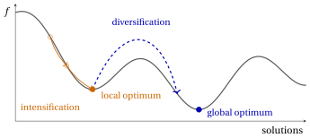

# Heuristic algorithms: definitions

**Part 4 · Heuristic algorithms · Chapter 23** · [:material-file-pdf-box: Lecture notes, volume 4 (PDF)](../pdf/lecture-notes-4-heuristic-algorithms.pdf) · [:material-pencil: Exercises: Definitions](../exercises/heuristics.md)

!!! nota "Prerequisites"

    - From this module, the chapters «Knapsack problems», «Bin packing problems», «Travelling salesman problems» and «Parallel machine scheduling»: instances, feasible solutions and optimal values of the four problems used as examples.

    - From the module <em>Integer linear programming</em>, [Chapter 2 «LP relaxation»](https://fabiofurini.github.io/integer-linear-programming/models-and-bounds/lp-relaxation/): the LP relaxation as a source of dual bounds. A short recap is given here for the knapsack problem.

!!! chiave "Objectives"

    At the end of this chapter you will be able to:

    - define a heuristic algorithm, and compute its gap with respect to a dual bound;

    - tell primal bounds from dual bounds on the four reference instances;

    - classify heuristic algorithms, and describe the solution representation and the search space;

    - define neighbourhoods and local optima, and explain intensification and diversification;

    - evaluate a heuristic algorithm by quality, running time and repeated runs.

## 23.1 Heuristic algorithms

!!! definizione "Definition 23.1: Heuristic algorithm"

    Given an <strong>optimization problem</strong> $\mathscr{P}$, let $z(I)$ be the <strong>optimal value</strong> of $\mathscr{P}$ on an <strong>instance</strong> $I$. A <strong>heuristic algorithm</strong> for $\mathscr{P}$ is an algorithm that, for every instance $I$ of $\mathscr{P}$, computes a feasible solution of $I$, without guaranteeing that it is optimal. We denote by $\mathscr{A}(I)$ the value of the solution computed by the heuristic algorithm $\mathscr{A}$ on the instance $I$.

- Since the solution computed by $\mathscr{A}$ is feasible, for every instance $I$

    $$
    \begin{cases}
    \mathscr{A}(I) \ge z(I) & \text{if } \mathscr{P} \text{ is a minimization problem,}\\[1ex]
    \mathscr{A}(I) \le z(I) & \text{if } \mathscr{P} \text{ is a maximization problem.}
    \end{cases}
    $$

- The four problems used as examples — the knapsack problem, the bin packing problem, the travelling salesman problem and the scheduling problem $P\,||\,C_{\max}$ — are all <strong>NP-hard</strong>: an exact algorithm may require a running time that grows exponentially with the size of the instance.

- <strong>Approximation algorithms</strong> (chapter «Approximation algorithms: definitions») are heuristic algorithms with a <em>proved</em> worst-case guarantee on the ratio between $\mathscr{A}(I)$ and $z(I)$. Most of the heuristic algorithms used in practice have no such guarantee: their quality is assessed on the instances at hand, as described in Section [23.8](#sez-sec-evaluation).

!!! chiave ""

    A heuristic algorithm trades the <strong>quality</strong> of the solution for the <strong>running time</strong>: the point of a heuristic is to compute, in a short time, a solution whose value is close to $z(I)$.

## 23.2 The problems and the assumptions { #sez-sec-problems }

- The heuristic algorithms of these notes are illustrated on four classical combinatorial optimization problems. Their definitions and assumptions are given in the notes on combinatorial optimization problems; we recall them briefly.

<table>
<tr>
<th>problem</th>
<th>data</th>
<th>solution</th>
<th>objective</th>
</tr>
<tr>
<td>KP</td>
<td>items \(\mathscr{I}\), profits \(p_i\), weights \(w_i\), capacity \(c\)</td>
<td>subset of items</td>
<td>max total profit</td>
</tr>
<tr>
<td>BPP</td>
<td>items \(\mathscr{I}\), weights \(w_i\), capacity \(c\)</td>
<td>packing patterns</td>
<td>min number of bins</td>
</tr>
<tr>
<td>TSP</td>
<td>cities \(\mathscr{V}\), distances \(d_{ij}\)</td>
<td>tour \(\sigma\)</td>
<td>min length \(L(\sigma)\)</td>
</tr>
<tr>
<td>\(P\,||\,C_{\max}\)</td>
<td>jobs \(\mathscr{J}\), times \(t_j\), machines \(m\)</td>
<td>sets \(J_1,\dots,J_m\)</td>
<td>min makespan</td>
</tr>
</table>

- We assume that every instance satisfies the assumptions of its problem: $w_i\le c$ for all items and $\sum_i w_i > c$ for the KP and the BPP; $n\ge 3$ and symmetric distances for the TSP; $n>m$ for $P\,||\,C_{\max}$.

- The following four instances, which are also the instances of the MIP modelling course, are used throughout the notes on heuristic algorithms. Their optimal values are known, so the quality of every heuristic solution can be measured exactly.

!!! esempio "Example 23.1: KP reference instance"

    A knapsack of capacity $c=9$ and $4$ items with profits and weights

    $$
    \begin{array}{l|cccc}
    \hline  & {i=1} & {i=2} & {i=3} & {i=4} \\[1ex]
    \hline {p_i} & {10} & {7} & {6} & {4} \\
    {w_i} & {5} & {4} & {3} & {3} \\
    \hline
    \end{array}
    $$

    The optimal solution is $S^*=\{1,2\}$, of weight $9$ and profit $z(I)=17$.

!!! esempio "Example 23.2: BPP reference instance"

    Bins of capacity $c=7$ and $6$ items with weights

    $$
    \begin{array}{l|cccccc}
    \hline  & {i=1} & {i=2} & {i=3} & {i=4} & {i=5} & {i=6} \\[1ex]
    \hline {w_i} & {4} & {4} & {5} & {3} & {2} & {3} \\
    \hline
    \end{array}
    $$

    The total weight is $21=3c$, so at least $3$ bins are needed, and the packing patterns $\{1,4\}$, $\{2,6\}$, $\{3,5\}$ use exactly $3$ bins, all of them full: $z(I)=3$.

!!! esempio "Example 23.3: TSP reference instance"

    $5$ cities with the symmetric distances

    $$
    \begin{array}{c|ccccc}
    \hline {d_{ij}} & {1} & {2} & {3} & {4} & {5} \\
    \hline {1} & --- & {5} & {2} & {2} & {9} \\
    {2} & {5} & --- & {4} & {3} & {4} \\
    {3} & {2} & {4} & --- & {4} & {7} \\
    {4} & {2} & {3} & {4} & --- & {7} \\
    {5} & {9} & {4} & {7} & {7} & --- \\
    \hline
    \end{array}
    $$

    The instance is metric. Among its $12$ distinct tours, the unique optimal one is $\sigma=(1,3,5,2,4)$, of length $z(I)=18$.

!!! esempio "Example 23.4: $P\,||\,C_{\max}$ reference instance"

    $m=3$ identical machines and $7$ jobs with processing times

    $$
    \begin{array}{l|ccccccc}
    \hline  & {j=1} & {j=2} & {j=3} & {j=4} & {j=5} & {j=6} & {j=7} \\[1ex]
    \hline {t_j} & {5} & {5} & {4} & {4} & {3} & {3} & {3} \\
    \hline
    \end{array}
    $$

    The total processing time is $27$, so the makespan is at least $\lceil 27/3\rceil=9$, and the sets $J_1=\{1,3\}$, $J_2=\{2,4\}$, $J_3=\{5,6,7\}$ attain it: $z(I)=9$.

## 23.3 Primal and dual bounds

- The value of <em>any</em> feasible solution bounds the optimal value from one side, and is called a <strong>primal bound</strong>. A heuristic algorithm is a method for computing primal bounds.

- A bound on the optimal value from the <em>other</em> side, obtained without computing a feasible solution, is called a <strong>dual bound</strong>. Dual bounds come from relaxations of the problem, such as the LP relaxation, or from simple properties of the problem.

- For a minimization problem a primal bound is an <strong>upper bound</strong> $\UB$ and a dual bound is a <strong>lower bound</strong> $\LB$; for a maximization problem the roles are exchanged. In both cases the optimal value is sandwiched between the two bounds:

!!! chiave ""

    $$
    \begin{cases}
    \mathrm{LB}(I) \;\le\; z(I) \;\le\; \mathscr{A}(I) & \text{if } \mathscr{P} \text{ is a minimization problem,}\\[1.5ex]
    \mathscr{A}(I) \;\le\; z(I) \;\le\; \mathrm{UB}(I) & \text{if } \mathscr{P} \text{ is a maximization problem.}
    \end{cases}
    $$

- The <strong>gap</strong> of a heuristic value $\mathscr{A}(I)$ is the relative gap $\frac{\UB-\LB}{\LB}$ defined in the chapter «Combinatorial optimization problems»: the difference of the two bounds divided by the <strong>lower</strong> one. With the heuristic value in place of the primal bound it reads

    $$
    gap(I) =
    \begin{cases}
    \dfrac{\mathscr{A}(I) - \mathrm{LB}(I)}{\mathrm{LB}(I)} & \text{if } \mathscr{P} \text{ is a minimization problem,}\\[3ex]
    \dfrac{\mathrm{UB}(I) - \mathscr{A}(I)}{\mathscr{A}(I)} & \text{if } \mathscr{P} \text{ is a maximization problem.}
    \end{cases}
    $$

- The <strong>relative error</strong> of $\mathscr{A}$ on $I$, defined in the notes on approximation algorithms, is $\frac{\mathscr{A}(I)-z(I)}{z(I)}$ for a minimization problem and $\frac{z(I)-\mathscr{A}(I)}{z(I)}$ for a maximization problem. It cannot be computed when $z(I)$ is unknown, which is the typical situation; the gap, instead, uses only computed quantities.

!!! teorema "Proposition 23.2"

    For every instance $I$, the relative error of $\mathscr{A}$ on $I$ is at most $gap(I)$.

??? dimostrazione "Proof"

    For a minimization problem, $\mathrm{LB}(I)\le z(I)$, hence $\frac{\mathscr{A}(I)}{z(I)} \le \frac{\mathscr{A}(I)}{\mathrm{LB}(I)}$ and

    $$
    \frac{\mathscr{A}(I)-z(I)}{z(I)} = \frac{\mathscr{A}(I)}{z(I)} - 1 \;\le\; \frac{\mathscr{A}(I)}{\mathrm{LB}(I)} - 1 = gap(I).
    $$

    For a maximization problem, $\mathscr{A}(I)\le z(I)\le \mathrm{UB}(I)$, hence

    $$
    \frac{z(I)-\mathscr{A}(I)}{z(I)} \;\le\; \frac{z(I)-\mathscr{A}(I)}{\mathscr{A}(I)} \;\le\; \frac{\mathrm{UB}(I)-\mathscr{A}(I)}{\mathscr{A}(I)} = gap(I).
    $$

    
□

- The gap is therefore a <strong>certificate</strong>: if $gap(I)\le 5\%$, the solution is within $5\%$ of the optimum, even if the optimum is unknown. If $gap(I)=0$, the solution is optimal.

!!! esempio "Example 23.5: Bounds and gaps on the reference instances"

    <strong>KP.</strong> The solution $\{1,3\}$ has weight $8\le 9$ and profit $\mathscr{A}(I)=16$. The LP relaxation, with the items sorted by non-increasing efficiency $(1,3,2,4)$, packs items $1$ and $3$ and a fraction $\frac{1}{4}$ of item $2$, so $z(I)\le 10+6+7\cdot\frac{1}{4}=17.75$ and, the profits being integer, $\mathrm{UB}(I)=17$. Hence $gap(I)=\frac{17-16}{16}=6.25\%$, while the relative error is $\frac{17-16}{17}\approx 5.9\%$.

    <strong>BPP.</strong> The packing patterns $\{1\}$, $\{2\}$, $\{3\}$, $\{4,5\}$, $\{6\}$ are feasible and use $\mathscr{A}(I)=5$ bins, while $\mathrm{LB}(I)=\left\lceil \frac{21}{7}\right\rceil=3$. Hence $gap(I)=\frac{5-3}{3}\approx 66.7\%$.

    <strong>TSP.</strong> The tour $(1,3,2,4,5)$ has length $\mathscr{A}(I)=2+4+3+7+9=25$. A dual bound is given by [Proposition 23.3](#box-8-prop-twoedges) below: $\mathrm{LB}(I)=17$. Hence $gap(I)=\frac{25-17}{17}\approx 47.1\%$, while the relative error is $\frac{25-18}{18}\approx 38.9\%$.

    <strong>$P\,||\,C_{\max}$.</strong> The solution with $J_1=\{1,5,7\}$, $J_2=\{2,6\}$, $J_3=\{3,4\}$ has makespan $\mathscr{A}(I)=11$, while $\mathrm{LB}(I)=\max\{5,\lceil 27/3\rceil\}=9$. Hence $gap(I)=\frac{11-9}{9}\approx 22.2\%$.

    On the BPP and $P\,||\,C_{\max}$ the dual bound equals $z(I)$, so the gap equals the relative error. On the KP the dual bound also equals $z(I)$, but the gap divides by the smaller value $\mathscr{A}(I)$ and is slightly larger. On the TSP the dual bound is weaker, and the gap overestimates the relative error.

!!! teorema "Proposition 23.3"

    For every TSP instance $I$, let $a_i$ and $b_i$ be the two smallest distances from city $i$ to the other cities. Then

    $$
    z(I) \;\ge\; \left\lceil \frac{1}{2} \sum_{i\in\mathscr{V}} (a_i+b_i) \right\rceil .
    $$

??? dimostrazione "Proof"

    In every tour each city is the endpoint of exactly two edges, of length at least $a_i$ and $b_i$. Summing the lengths of the two edges incident to each city counts every edge of the tour twice, hence

    $$
    2\,L(\sigma) \;=\; \sum_{i\in\mathscr{V}} \big(\text{lengths of the two edges incident to } i\big) \;\ge\; \sum_{i\in\mathscr{V}} (a_i+b_i)
    $$

    for every tour $\sigma$, and in particular for an optimal one. The distances being integer, $z(I)$ is an integer, and the bound can be rounded up. □

- On the reference instance the two smallest distances are $(2,2)$ for city $1$, $(3,4)$ for city $2$, $(2,4)$ for city $3$, $(2,3)$ for city $4$ and $(4,7)$ for city $5$, so $\mathrm{LB}(I)=\left\lceil\frac{4+7+6+5+11}{2}\right\rceil=\lceil 16.5\rceil=17$.

!!! chiave ""

    A heuristic algorithm gives only one side of the gap. Without a dual bound on the other side, nothing can be said about the quality of the solution, however good it may look.

## 23.4 Classification of heuristic algorithms

- Heuristic algorithms are classified according to how they produce and use solutions. The four classes below are the subject of the following notes on heuristic algorithms.

<table>
<tr>
<th>class</th>
<th>idea</th>
</tr>
<tr>
<td><strong>constructive heuristics</strong></td>
<td>build one solution step by step, extending a partial solution with one element at a time; a choice, once made, is never revised</td>
</tr>
<tr>
<td><strong>local search</strong></td>
<td>start from a feasible solution and repeatedly replace it by a better solution obtained by a small modification, until no small modification improves it</td>
</tr>
<tr>
<td><strong>metaheuristics</strong></td>
<td>general strategies that guide a local search beyond the point where it stops, exploring other regions of the solutions</td>
</tr>
<tr>
<td><strong>MIP-based heuristics</strong></td>
<td>use a mixed-integer programming formulation, its relaxation and a MIP solver to guide the search or to explore large sets of solutions</td>
</tr>
</table>

- The classes are not alternatives: a local search needs a starting solution, typically computed by a constructive heuristic; a metaheuristic contains one or more local searches; a MIP-based heuristic may start from, and improve, the solution of any of the others.

## 23.5 Solution representation and search space

- A heuristic algorithm manipulates solutions, which must be stored in a data structure: the <strong>representation</strong> of the solutions. The set of all the objects that the representation can describe is the <strong>search space</strong>.

- The representation is a design choice, and it determines which modifications of a solution are easy to perform. For the four problems we use the following representations.

<table>
<tr>
<th>problem</th>
<th>representation</th>
<th>size of the search space</th>
<th>feasible?</th>
</tr>
<tr>
<td>KP</td>
<td>binary vector \(x\in\{0,1\}^n\)</td>
<td>\(2^n\)</td>
<td>not always: the capacity can be exceeded</td>
</tr>
<tr>
<td>BPP</td>
<td>vector \(bin\), with \(bin_i\) the bin of item \(i\)</td>
<td>at most \(n^n\)</td>
<td>not always: a bin can be overfull</td>
</tr>
<tr>
<td>TSP</td>
<td>permutation \(\sigma\) of the cities</td>
<td>\(\frac{(n-1)!}{2}\) distinct tours</td>
<td>always</td>
</tr>
<tr>
<td>\(P\,||\,C_{\max}\)</td>
<td>vector \(mach\), with \(mach_j\) the machine of job \(j\)</td>
<td>\(m^n\)</td>
<td>always</td>
</tr>
</table>

- When the representation can describe infeasible objects, a heuristic must either restrict itself to feasible ones or accept infeasible ones and penalize them. This is the first of the design choices discussed in the notes on local search.

- The search spaces grow very quickly: a TSP with $n=20$ cities has $\frac{19!}{2}\approx 6\cdot 10^{16}$ distinct tours. A heuristic explores only a tiny part of the search space, and the question is <em>which</em> part.

## 23.6 Neighbourhoods and local optima

- Let $\mathscr{F}(I)$ be the set of the feasible solutions of the instance $I$, and let $f(S)$ be the value of the solution $S\in\mathscr{F}(I)$, so that $z(I)$ is the minimum (or maximum) of $f$ over $\mathscr{F}(I)$.

!!! definizione "Definition 23.4: Neighbourhood"

    A <strong>neighbourhood</strong> is a function $N$ that associates with every feasible solution $S\in\mathscr{F}(I)$ a set $N(S)\subseteq\mathscr{F}(I)$ of feasible solutions, the <strong>neighbours</strong> of $S$. A <strong>move</strong> is the transformation of $S$ into one of its neighbours.

- A neighbourhood is usually defined by a family of small modifications of the representation: change one component of the vector $x$, move one job to another machine, replace two edges of a tour.

!!! definizione "Definition 23.5: Local optimum"

    A feasible solution $S\in\mathscr{F}(I)$ is a <strong>local optimum</strong> with respect to the neighbourhood $N$ if no neighbour of $S$ is better than $S$:

    $$
    \begin{cases}
    f(S) \le f(S') \quad \text{for all } S'\in N(S) & \text{if } \mathscr{P} \text{ is a minimization problem,}\\[1ex]
    f(S) \ge f(S') \quad \text{for all } S'\in N(S) & \text{if } \mathscr{P} \text{ is a maximization problem.}
    \end{cases}
    $$

    An optimal solution is also called a <strong>global optimum</strong>.

- A global optimum is a local optimum for every neighbourhood, but a local optimum need not be a global optimum. Moreover, <strong>being a local optimum depends on the neighbourhood</strong>: the same solution can be a local optimum for one neighbourhood and not for another.

!!! esempio "Example 23.6: Two neighbourhoods for the KP"

    On the KP reference instance ($c=9$), consider the solution $x=(1,0,1,0)$, i.e., the items $\{1,3\}$, of weight $8$ and profit $16$.

    The <strong>flip</strong> neighbourhood changes one component of $x$, i.e., adds or removes one item:

    
<table>
    <tr>
    <th>neighbour</th>
    <th>weight</th>
    <th>profit</th>
    <th>feasible</th>
    </tr>
    <tr>
    <td>\((0,0,1,0)\)</td>
    <td>\(3\)</td>
    <td>\(6\)</td>
    <td>yes</td>
    </tr>
    <tr>
    <td>\((1,1,1,0)\)</td>
    <td>\(12\)</td>
    <td>—</td>
    <td>no</td>
    </tr>
    <tr>
    <td>\((1,0,0,0)\)</td>
    <td>\(5\)</td>
    <td>\(10\)</td>
    <td>yes</td>
    </tr>
    <tr>
    <td>\((1,0,1,1)\)</td>
    <td>\(11\)</td>
    <td>—</td>
    <td>no</td>
    </tr>
    </table>

    The feasible neighbours have profit $6$ and $10$, smaller than $16$: $x$ is a <strong>local optimum</strong> with respect to the flip neighbourhood.

    The <strong>swap</strong> neighbourhood removes one selected item and adds one unselected item:

    
<table>
    <tr>
    <th>neighbour</th>
    <th>weight</th>
    <th>profit</th>
    <th>feasible</th>
    </tr>
    <tr>
    <td>\((0,1,1,0)\): out \(1\), in \(2\)</td>
    <td>\(7\)</td>
    <td>\(13\)</td>
    <td>yes</td>
    </tr>
    <tr>
    <td>\((0,0,1,1)\): out \(1\), in \(4\)</td>
    <td>\(6\)</td>
    <td>\(10\)</td>
    <td>yes</td>
    </tr>
    <tr>
    <td>\((1,1,0,0)\): out \(3\), in \(2\)</td>
    <td>\(9\)</td>
    <td>\(17\)</td>
    <td>yes</td>
    </tr>
    <tr>
    <td>\((1,0,0,1)\): out \(3\), in \(4\)</td>
    <td>\(8\)</td>
    <td>\(14\)</td>
    <td>yes</td>
    </tr>
    </table>

    The neighbour $(1,1,0,0)$ has profit $17>16$: $x$ is <strong>not</strong> a local optimum with respect to the swap neighbourhood, and the move leads to the global optimum.

!!! definizione "Definition 23.6: Exact neighbourhood"

    A neighbourhood $N$ is <strong>exact</strong> if every local optimum with respect to $N$ is a global optimum.

- Exact neighbourhoods are rare, and they exist for problems that can be solved in polynomial time: the neighbourhood of the simplex method, which moves between adjacent vertices of the polyhedron, is exact for linear programming; the neighbourhood that exchanges one edge in and one edge out is exact for the minimum spanning tree problem.

- For NP-hard problems, small neighbourhoods are not exact, and the neighbourhoods that are exact, such as the one containing all the feasible solutions, are too large to be explored. The design of a neighbourhood is a compromise between its <strong>size</strong>, which determines the time needed to explore it, and the <strong>quality</strong> of its local optima.

## 23.7 Intensification and diversification

- The values of the solutions, seen as a function on the search space, form the <strong>landscape</strong> explored by a heuristic. For a minimization problem the local optima are the bottoms of the valleys, and the global optimum is the bottom of the deepest valley.

{ .fig loading=lazy  }

- <strong>Intensification</strong> is the search for better solutions in the region where good solutions have already been found: moving downhill, toward the bottom of the current valley. Local search is pure intensification, and stops at the first local optimum it reaches.

- <strong>Diversification</strong> is the move toward regions of the search space that have not been explored yet: leaving the current valley, possibly through worse solutions, to reach another one.

- Too much intensification traps the search in the first valley; too much diversification makes it wander without ever exploring a valley to its bottom. Every metaheuristic is a way of balancing the two.

## 23.8 How to evaluate a heuristic algorithm { #sez-sec-evaluation }

- A heuristic algorithm is evaluated by the <strong>quality</strong> of its solutions and by its <strong>running time</strong>, which are conflicting goals.

- <strong>Quality</strong> is measured by the gap with respect to the best available dual bound, or by the relative error when the optimal value is known, as on the reference instances of these notes.

- <strong>Worst-case analysis</strong>, as for approximation algorithms, gives guarantees valid for all the instances, but they are often far from the typical behaviour. <strong>Experimental analysis</strong> measures the gaps and the running times on a set of benchmark instances, which must be large and varied enough to avoid conclusions that hold only for a few instances.

- A single instance proves nothing: on the TSP reference instance the same rule, applied from different starting cities, gives tours of length between $18$ and $25$. Comparisons between heuristics must use the same instances and report the distribution of the results, not only the best one.

- For heuristics that use random choices, the results depend on the random numbers: each instance must be solved several times, with different <strong>seeds</strong> of the random number generator, reporting the average and the spread of the results.

!!! chiave ""

    A heuristic algorithm is good if, on the instances it is meant for, it finds solutions with a small gap in the time available, consistently.

## 23.9 Typical mistakes

!!! attenzione "Warning"

    - <strong>Judging a heuristic from one run or one instance.</strong> The same rule, from different starting cities, gives tours of length between $18$ and $25$ on the TSP reference instance.

    - <strong>Confusing the gap with the relative error.</strong> The gap is measured against a dual bound, so it is never smaller than the relative error; in a minimization problem they coincide only when the dual bound equals $z(I)$.

    - <strong>Using the wrong denominator.</strong> The gap always divides by the lower bound: for a maximization problem it is $\frac{\mathrm{UB}(I)-\mathscr{A}(I)}{\mathscr{A}(I)}$, for a minimization problem $\frac{\mathscr{A}(I)-\mathrm{LB}(I)}{\mathrm{LB}(I)}$.

    - <strong>Forgetting to round the dual bound.</strong> With integer data the bound $17.75$ of the KP is rounded down to $17$, and the bound $16.5$ of the TSP is rounded up to $17$.

    - <strong>Trusting a good-looking solution.</strong> Without a dual bound on the other side, nothing can be said about the quality of a solution.

## 23.10 In summary

!!! chiave "In summary"

    - A heuristic algorithm returns a feasible solution without guaranteeing its optimality: its value is a <em>primal</em> bound.

    - The gap compares the heuristic value with the best dual bound, and it is an upper bound on the relative error.

    - Heuristic algorithms are constructive, improvement (local search) or metaheuristic; a neighbourhood defines the local optima, and the search balances intensification and diversification.

    - Quality is assessed on many instances and, for random methods, on many seeds.

    <strong>Dashboard of the reference instances.</strong> Heuristic solutions of this chapter and their dual bounds:

    
<table>
    <tr>
    <th>problem</th>
    <th>primal bound</th>
    <th>dual bound</th>
    <th>gap</th>
    <th>\(z(I)\)</th>
    </tr>
    <tr>
    <td>KP (max)</td>
    <td>\(16\)</td>
    <td>\(\mathrm{UB}(I)=17\)</td>
    <td>\(6.25\%\)</td>
    <td>\(17\)</td>
    </tr>
    <tr>
    <td>BPP (min)</td>
    <td>\(5\)</td>
    <td>\(\mathrm{LB}(I)=3\)</td>
    <td>\(66.7\%\)</td>
    <td>\(3\)</td>
    </tr>
    <tr>
    <td>TSP (min)</td>
    <td>\(25\)</td>
    <td>\(\mathrm{LB}(I)=17\)</td>
    <td>\(47.1\%\)</td>
    <td>\(18\)</td>
    </tr>
    <tr>
    <td>\(P\,||\,C_{\max}\) (min)</td>
    <td>\(11\)</td>
    <td>\(\mathrm{LB}(I)=9\)</td>
    <td>\(22.2\%\)</td>
    <td>\(9\)</td>
    </tr>
    </table>

---

**Exercises on this chapter:** [:material-pencil: Definitions](../exercises/heuristics.md)
