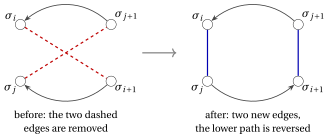
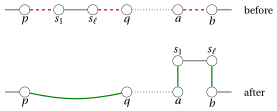
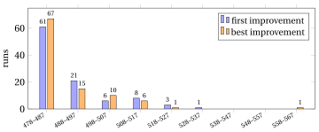

# Local search

<div class="info-capitolo" markdown>

**Part 4 · Heuristic algorithms · Chapter 22** · [:material-file-pdf-box: Lecture notes, volume 4 (PDF)](../pdf/lecture-notes-4-heuristic-algorithms.pdf) · [:material-pencil: Exercises: Local search](../exercises/local-search.md) · [:material-gesture-tap: App: TSP: nearest neighbour and 2-opt](../lab/tsp-nn-2opt.md)

</div>

!!! nota "Prerequisites"

    - From this module, the chapter «Heuristic algorithms»: neighbourhoods, local optima, intensification and diversification.

    - From this module, the chapter «Constructive heuristics»: the starting solutions used here.

!!! chiave "Objectives"

    At the end of this chapter you will be able to:

    - define the neighbourhoods of the KP, the BPP, the TSP and $P\,||\,C_{\max}$;

    - execute a local search with the first improvement and the best improvement rules;

    - evaluate a move incrementally, in $O(1)$ for the 2-opt move;

    - escape a plateau with an auxiliary objective, and handle infeasible solutions with a penalty;

    - combine neighbourhoods (variable neighbourhood descent) and restarts (multi-start).

## 22.1 Local search { #sez-sec-ls }

<a id="box-1-def-ls"></a>

!!! definizione "Definition 22.1: Local search"

    Given a neighbourhood $N$, a <strong>local search</strong> (denoted by $LS$) is an improvement heuristic. It starts from a feasible solution and, at every iteration, looks in the neighbourhood of the current solution for a <em>better</em> solution. If it finds one, it moves to it and repeats; if no neighbour is better, the current solution is a local optimum with respect to $N$, and the search stops.

- The <strong>neighbourhood</strong> $N(S)$ of a feasible solution $S$, the <strong>move</strong> from $S$ to a neighbour and the <strong>local optimum</strong> with respect to $N$ are defined in the chapter «Heuristic algorithms: definitions».

!!! chiave ""

    A local search improves a feasible solution by moving from a solution to a better neighbour, and it stops in a local optimum with respect to $N$.

## 22.2 The problems, the assumptions and the starting solutions { #sez-sec-problems }

- The algorithms are illustrated on the four problems of the notes on heuristic algorithms, defined in the notes on combinatorial optimization problems, with the same notation and assumptions:

<div class="tabella" markdown="0"><table>
<tr>
<th>problem</th>
<th>data</th>
<th>representation of a solution</th>
<th>objective</th>
</tr>
<tr>
<td>KP</td>
<td><span class="arithmatex">\(p_i\)</span>, <span class="arithmatex">\(w_i\)</span> (<span class="arithmatex">\(i\in\mathscr{I}\)</span>), capacity <span class="arithmatex">\(c\)</span></td>
<td>binary vector <span class="arithmatex">\(x\)</span></td>
<td>max profit</td>
</tr>
<tr>
<td>BPP</td>
<td><span class="arithmatex">\(w_i\)</span> (<span class="arithmatex">\(i\in\mathscr{I}\)</span>), capacity <span class="arithmatex">\(c\)</span></td>
<td>vector <span class="arithmatex">\(bin\)</span>, packing patterns <span class="arithmatex">\(P_b\)</span></td>
<td>min number of bins <span class="arithmatex">\(nb\)</span></td>
</tr>
<tr>
<td>TSP</td>
<td><span class="arithmatex">\(d_{ij}\)</span> (<span class="arithmatex">\(i,j\in\mathscr{V}\)</span>)</td>
<td>tour <span class="arithmatex">\(\sigma\)</span></td>
<td>min length <span class="arithmatex">\(L(\sigma)\)</span></td>
</tr>
<tr>
<td><span class="arithmatex">\(P\,||\,C_{\max}\)</span></td>
<td><span class="arithmatex">\(t_j\)</span> (<span class="arithmatex">\(j\in\mathscr{J}\)</span>), <span class="arithmatex">\(m\)</span> machines</td>
<td>vector <span class="arithmatex">\(mach\)</span>, sets <span class="arithmatex">\(J_h\)</span></td>
<td>min makespan <span class="arithmatex">\(C_{\max}\)</span></td>
</tr>
</table></div>

- For $P\,||\,C_{\max}$, $L_h=\sum_{j\in J_h} t_j$ is the <strong>load</strong> of machine $h$ and $C_{\max}=\max_h L_h$. For the BPP, $L_b=\sum_{i\in P_b} w_i$ is the <strong>load</strong> of bin $b$. A machine (or a bin) whose load equals the objective value is called <strong>critical</strong>.

- The <strong>reference instances</strong> are those of the notes on definitions: the KP with $p=(10,7,6,4)$, $w=(5,4,3,3)$, $c=9$; the BPP with $w=(4,4,5,3,2,3)$, $c=7$; the TSP with $5$ cities; $P\,||\,C_{\max}$ with $t=(5,5,4,4,3,3,3)$ and $m=3$. Their optimal values are $17$, $3$, $18$ and $9$.

### 22.2.1 Starting solutions

- A local search needs a feasible <strong>starting solution</strong>. We use the solutions computed in the notes on constructive heuristics and in the notes on approximation algorithms, recalled below.

<div class="tabella" markdown="0"><table>
<tr>
<th>problem</th>
<th>algorithm</th>
<th>starting solution</th>
<th>value</th>
<th><span class="arithmatex">\(z(I)\)</span></th>
</tr>
<tr>
<td>KP</td>
<td><span class="arithmatex">\(GR\)</span> (greedy by efficiency)</td>
<td><span class="arithmatex">\(x=(1,0,1,0)\)</span>, items <span class="arithmatex">\(\{1,3\}\)</span></td>
<td><span class="arithmatex">\(16\)</span></td>
<td><span class="arithmatex">\(17\)</span></td>
</tr>
<tr>
<td>KP</td>
<td>greedy by weight <span class="arithmatex">\(GR_w\)</span></td>
<td><span class="arithmatex">\(x=(0,0,1,1)\)</span>, items <span class="arithmatex">\(\{3,4\}\)</span></td>
<td><span class="arithmatex">\(10\)</span></td>
<td><span class="arithmatex">\(17\)</span></td>
</tr>
<tr>
<td>BPP</td>
<td><span class="arithmatex">\(NF\)</span></td>
<td><span class="arithmatex">\(\{1\},\{2\},\{3\},\{4,5\},\{6\}\)</span></td>
<td><span class="arithmatex">\(5\)</span></td>
<td><span class="arithmatex">\(3\)</span></td>
</tr>
<tr>
<td>BPP</td>
<td><span class="arithmatex">\(FF\)</span></td>
<td><span class="arithmatex">\(\{1,4\},\{2,5\},\{3\},\{6\}\)</span></td>
<td><span class="arithmatex">\(4\)</span></td>
<td><span class="arithmatex">\(3\)</span></td>
</tr>
<tr>
<td>BPP</td>
<td><span class="arithmatex">\(FFD\)</span></td>
<td><span class="arithmatex">\(\{3,5\},\{1,4\},\{2,6\}\)</span></td>
<td><span class="arithmatex">\(3\)</span></td>
<td><span class="arithmatex">\(3\)</span></td>
</tr>
<tr>
<td>TSP</td>
<td><span class="arithmatex">\(NN\)</span> from city <span class="arithmatex">\(1\)</span></td>
<td><span class="arithmatex">\(\sigma=(1,3,2,4,5)\)</span></td>
<td><span class="arithmatex">\(25\)</span></td>
<td><span class="arithmatex">\(18\)</span></td>
</tr>
<tr>
<td><span class="arithmatex">\(P\,||\,C_{\max}\)</span></td>
<td><span class="arithmatex">\(LPT\)</span></td>
<td><span class="arithmatex">\(J_1=\{1,5,7\}\)</span>, <span class="arithmatex">\(J_2=\{2,6\}\)</span>, <span class="arithmatex">\(J_3=\{3,4\}\)</span></td>
<td><span class="arithmatex">\(11\)</span></td>
<td><span class="arithmatex">\(9\)</span></td>
</tr>
</table></div>

- The solution of $FFD$ is already optimal, so no local search can improve it: for the BPP we start from the solutions of $NF$ and $FF$.

- To study the behaviour of a local search on many starting solutions we also use <strong>random starting solutions</strong>. They are generated with the Park–Miller minimal standard generator: given an integer <strong>seed</strong> $s_0\in\{1,\dots,2^{31}-2\}$, the $k$-th pseudo-random number is

!!! chiave ""

    $$
    s_k = 16807\cdot s_{k-1} \bmod (2^{31}-1),
    \qquad\qquad
    u_k = \frac{s_k}{2^{31}-1}\in(0,1),
    $$

    and a pseudo-random integer in $\{0,1,\dots,q-1\}$ is $\lfloor q\, u_k\rfloor$.

- The sequence is completely determined by the seed: the same seed gives the same starting solutions, in the notes, in the exercises and in the code. A <strong>random tour</strong> keeps city $1$ in the first position and shuffles the other cities (Fisher–Yates: for $k=n,n-1,\dots,3$, the city in position $k$ is exchanged with the city in a random position among $2,\dots,k$); a <strong>random assignment</strong> of the jobs draws the machine of the jobs $1,2,\dots,n$ in this order; a <strong>random BPP solution</strong> is computed by $FF$ on a random order of the items (Fisher–Yates on all the positions: for $k=n,n-1,\dots,2$, the item in position $k$ is exchanged with the item in a random position among $1,\dots,k$).

## 22.3 Local search: the scheme { #sez-sec-scheme }

- The pseudo-code of $LS$ reads as follows. The function $\textit{Improve}$ explores the neighbourhood and returns an improving neighbour of $x$, or $\textit{NULL}$ if there is none.

!!! algoritmo "Algorithm: Local search"

    <div class="pseudocodice" markdown="0"><div class="pc" style="--liv:0"><strong>Input:</strong> a feasible solution <span class="arithmatex">\(x^0\)</span>, a neighbourhood <span class="arithmatex">\(N\)</span>, a rule <span class="arithmatex">\(\in\{\textit{first},\textit{best}\}\)</span></div><div class="pc" style="--liv:0"><strong>Output:</strong> a local optimum <span class="arithmatex">\(x\)</span> with respect to <span class="arithmatex">\(N\)</span></div><div class="pc" style="--liv:0"><span class="pc-n">1</span><strong>Function</strong> LocalSearch(<span class="arithmatex">\(x^0, N, \textit{rule}\)</span>)</div><div class="pc" style="--liv:1"><span class="pc-n">2</span><span class="arithmatex">\(x := x^0\)</span> <span class="pc-com">▹ current solution</span></div><div class="pc" style="--liv:1"><span class="pc-n">3</span><strong>while</strong> true <strong>do</strong></div><div class="pc" style="--liv:2"><span class="pc-n">4</span><span class="arithmatex">\(y := \textit{Improve}(x, N, \textit{rule})\)</span> <span class="pc-com">▹ improving neighbour, or NULL</span></div><div class="pc" style="--liv:2"><span class="pc-n">5</span><strong>if</strong> <span class="arithmatex">\(y = \textit{NULL}\)</span> <strong>then</strong></div><div class="pc" style="--liv:3"><span class="pc-n">6</span><strong>return</strong> <span class="arithmatex">\(x\)</span> <span class="pc-com">▹ no improving neighbour: local optimum</span></div><div class="pc" style="--liv:2"><span class="pc-n">7</span><strong>end</strong></div><div class="pc" style="--liv:2"><span class="pc-n">8</span><span class="arithmatex">\(x \leftarrow y\)</span> <span class="pc-com">▹ move to the improving neighbour</span></div><div class="pc" style="--liv:1"><span class="pc-n">9</span><strong>end</strong></div></div>

- A local search is defined by four ingredients:

    1. the <strong>starting solution</strong> $x^0$, computed by a constructive heuristic or at random;

    2. the <strong>neighbourhood</strong> $N$, i.e., the family of moves, which depends on the representation of the solutions;

    3. the <strong>acceptance criterion</strong>: here, a neighbour is accepted only if it is strictly better than the current solution;

    4. the <strong>stopping criterion</strong>: here, the search stops in the first local optimum; in practice a time limit is often added.

- The function $f$ that decides whether a neighbour is “better” is usually the objective of the problem, but it does not have to be: the search may be guided by a different function, as long as the solution it returns is feasible.

<a id="box-2-prop-termination"></a>

!!! teorema "Proposition 22.2"

    For every starting solution, $LS$ stops after a finite number of moves, in a local optimum with respect to $N$. If the objective function takes integer values and the problem is a minimization problem, the number of moves is at most $f(x^0)-z(I)$; for a maximization problem, at most $z(I)-f(x^0)$.

??? dimostrazione "Proof"

    Every move strictly improves the objective, hence the sequence of the visited solutions never visits the same solution twice. The set of the feasible solutions is finite, so the sequence is finite. When it stops, $\textit{Improve}$ has returned $\textit{NULL}$, i.e., no neighbour is better: the last solution is a local optimum. If $f$ takes integer values, every move improves $f$ by at least $1$, and $f$ can never go beyond $z(I)$, which gives the bounds on the number of moves. <span class="qed">□</span>

- On the TSP reference instance, a local search starting from the tour of $NN$ (length $25$) makes at most $25-18=7$ moves. On large instances this bound is weak, and for some neighbourhoods there are instances on which the number of moves grows exponentially with $n$ (for the 2-opt neighbourhood of the TSP, see Englert, Röglin, Vöcking, <em>Algorithmica</em> 68, 2014). In practice, the number of moves is small, and the running time is dominated by the exploration of the neighbourhoods.

- Local search <strong>intensifies</strong>: it moves downhill until it reaches the bottom of the valley in which it started. Which valley, and therefore which local optimum, depends on the starting solution, on the neighbourhood and on the rule used to choose the move.

## 22.4 Neighbourhoods for the four problems { #sez-sec-neigh }

- The neighbourhoods are defined by small modifications of the representation of the solutions. Only <strong>feasible</strong> neighbours belong to the neighbourhood: a modification that produces an infeasible object is not a move. For every neighbourhood we fix the <strong>order</strong> in which the moves are examined, which matters when the search accepts the first improving neighbour it finds.

### 22.4.1 KP: flip and swap

- The <strong>flip</strong> neighbourhood, defined in the notes on definitions, changes one component of $x$, i.e., adds or removes one item; it has $n$ elements before the feasibility test. The flips are examined for $i=1,2,\dots,n$.

- The <strong>swap</strong> neighbourhood removes one selected item $i$ and adds one unselected item $k$. If $S$ is the set of the selected items, it has $|S|\,(n-|S|)\le n^2/4$ elements; the swaps are examined for $i\in S$ in increasing order and, for each $i$, for $k\notin S$ in increasing order.

- The two neighbourhoods are complementary: a flip changes the number of selected items, a swap keeps it. The neighbourhood <strong>flip+swap</strong> is their union, with the flips examined first.

### 22.4.2 BPP: move and swap

- The <strong>move</strong> neighbourhood moves one item $i$ from its bin $a=bin_i$ to another non-empty bin $b$ with $L_b+w_i\le c$. It has at most $n\,(nb-1)$ elements; the moves are examined for $i=1,2,\dots,n$ and, for each $i$, for the bins in increasing order of their label.

- Moving an item into an empty bin is never useful: it cannot decrease the number of bins. The bins keep the labels of the starting solution; a bin emptied by a move simply disappears.

- The <strong>swap</strong> neighbourhood exchanges two items $i<k$ in different bins, provided that both bins remain feasible: $L_{bin_i}-w_i+w_k\le c$ and $L_{bin_k}-w_k+w_i\le c$. Exchanging two items of equal weight does not change any load, and is not considered. It has at most $\frac{n(n-1)}{2}$ elements, examined for $i=1,\dots,n$ and $k=i+1,\dots,n$.

### 22.4.3 TSP: 2-opt and Or-opt

- A tour is a permutation $\sigma=(\sigma_1,\sigma_2,\dots,\sigma_n)$ of the cities, with $\sigma_{n+1}=\sigma_1$. We keep city $1$ in the first position, $\sigma_1=1$.

- The <strong>2-opt</strong> move with positions $i<j$ removes the two edges $\{\sigma_i,\sigma_{i+1}\}$ and $\{\sigma_j,\sigma_{j+1}\}$, and reconnects the tour in the only other possible way: with the edges $\{\sigma_i,\sigma_j\}$ and $\{\sigma_{i+1},\sigma_{j+1}\}$, travelling the path $\sigma_{i+1},\dots,\sigma_j$ in the opposite direction (Croes, <em>Operations Research</em> 6, 1958):

    $$
    \begin{gathered}
    (\sigma_1,\dots,\sigma_i,\ \underbrace{\sigma_{i+1},\sigma_{i+2},\dots,\sigma_j}_{\text{path}},\ \sigma_{j+1},\dots,\sigma_n)\\
    \downarrow\\
    (\sigma_1,\dots,\sigma_i,\ \underbrace{\sigma_j,\dots,\sigma_{i+2},\sigma_{i+1}}_{\text{reversed path}},\ \sigma_{j+1},\dots,\sigma_n).
    \end{gathered}
    $$

{ .fig loading=lazy  }

- The moves are examined for $i=1,\dots,n-2$ and $j=i+2,\dots,n$, excluding $i=1$, $j=n$ (the two edges would share city $\sigma_1$). The 2-opt neighbourhood has $\frac{n(n-3)}{2}$ elements: $5$ for the reference instance.

- The <strong>Or-opt</strong> move (Or, PhD thesis, Northwestern University, 1976) takes a <strong>segment</strong> of $\ell\in\{1,2,3\}$ consecutive cities $\sigma_i,\dots,\sigma_{i+\ell-1}$ ($2\le i$, $i+\ell-1\le n$) and inserts it, with the same orientation, between two consecutive cities $\sigma_k$ and $\sigma_{k+1}$ outside the segment ($k\notin\{i-1,\dots,i+\ell-1\}$). Let $p=\sigma_{i-1}$ and $q=\sigma_{i+\ell}$ be the cities before and after the segment, $s_1=\sigma_i$ and $s_\ell=\sigma_{i+\ell-1}$ its first and last city, $a=\sigma_k$ and $b=\sigma_{k+1}$:

{ .fig loading=lazy  }

- The moves are examined for $\ell=1,2,3$, then for $i=2,\dots,n-\ell+1$, then for $k=1,\dots,n$. For every $\ell$ there are $n-\ell$ segments and $n-\ell-1$ insertion points, so the neighbourhood has $\sum_{\ell=1}^{3}(n-\ell)(n-\ell-1)$ elements, i.e., $O(n^2)$: $170$ for $n=10$. Some of these moves give the same tour (moving a single city forward by one position is the same as moving its successor backward by one position).

- An Or-opt move removes <em>three</em> edges, $\{p,s_1\}$, $\{s_\ell,q\}$ and $\{a,b\}$. The <strong>3-opt</strong> neighbourhood (Lin, <em>Bell System Technical Journal</em> 44, 1965) contains all the ways of removing three edges and reconnecting the three paths: it has $O(n^3)$ elements, and Or-opt is the part of it that can be explored in $O(n^2)$ time.

### 22.4.4 $P\,||\,C_{\max}$: move and swap

- The <strong>move</strong> neighbourhood moves one job $j$ from its machine $a=mach_j$ to another machine $h\ne a$. Every move is feasible, and the neighbourhood has $n\,(m-1)$ elements, examined for $j=1,\dots,n$ and, for each $j$, for $h=1,\dots,m$.

- The <strong>swap</strong> neighbourhood exchanges the machines of two jobs $j<k$ on different machines with $t_j\ne t_k$ (otherwise no load changes). It has at most $\frac{n(n-1)}{2}$ elements, examined for $j=1,\dots,n$ and $k=j+1,\dots,n$. A swap never changes the number of jobs on a machine.

### 22.4.5 Summary

<div class="tabella" markdown="0"><table>
<tr>
<th>problem</th>
<th>neighbourhood</th>
<th>move</th>
<th>size</th>
</tr>
<tr>
<td>KP</td>
<td>flip</td>
<td>add or remove item <span class="arithmatex">\(i\)</span></td>
<td><span class="arithmatex">\(n\)</span></td>
</tr>
<tr>
<td>KP</td>
<td>swap</td>
<td>item <span class="arithmatex">\(i\)</span> out, item <span class="arithmatex">\(k\)</span> in</td>
<td><span class="arithmatex">\(|S|(n-|S|)\le \frac{n^2}{4}\)</span></td>
</tr>
<tr>
<td>BPP</td>
<td>move</td>
<td>item <span class="arithmatex">\(i\)</span> to another bin</td>
<td><span class="arithmatex">\(\le n\,(nb-1)\)</span></td>
</tr>
<tr>
<td>BPP</td>
<td>swap</td>
<td>exchange items <span class="arithmatex">\(i\)</span> and <span class="arithmatex">\(k\)</span></td>
<td><span class="arithmatex">\(\le \frac{n(n-1)}{2}\)</span></td>
</tr>
<tr>
<td>TSP</td>
<td>2-opt</td>
<td>remove <span class="arithmatex">\(2\)</span> edges, reverse a path</td>
<td><span class="arithmatex">\(\frac{n(n-3)}{2}\)</span></td>
</tr>
<tr>
<td>TSP</td>
<td>Or-opt</td>
<td>move a segment of <span class="arithmatex">\(1\)</span>, <span class="arithmatex">\(2\)</span> or <span class="arithmatex">\(3\)</span> cities</td>
<td><span class="arithmatex">\(\sum_{\ell=1}^{3}(n-\ell)(n-\ell-1)\)</span></td>
</tr>
<tr>
<td>TSP</td>
<td>3-opt</td>
<td>remove <span class="arithmatex">\(3\)</span> edges, reconnect</td>
<td><span class="arithmatex">\(O(n^3)\)</span></td>
</tr>
<tr>
<td><span class="arithmatex">\(P\,||\,C_{\max}\)</span></td>
<td>move</td>
<td>job <span class="arithmatex">\(j\)</span> to another machine</td>
<td><span class="arithmatex">\(n\,(m-1)\)</span></td>
</tr>
<tr>
<td><span class="arithmatex">\(P\,||\,C_{\max}\)</span></td>
<td>swap</td>
<td>exchange jobs <span class="arithmatex">\(j\)</span> and <span class="arithmatex">\(k\)</span></td>
<td><span class="arithmatex">\(\le\frac{n(n-1)}{2}\)</span></td>
</tr>
</table></div>

- The sizes are those <em>before</em> the feasibility test (KP, BPP) and include moves that do not change the objective. The size of a neighbourhood is the number of neighbours to evaluate at every iteration, so it determines the cost of an iteration.

## 22.5 First improvement and best improvement { #sez-sec-firstbest }

- The function $\textit{Improve}$ of $LS$ can stop at the <em>first</em> improving neighbour it finds, or examine the whole neighbourhood and return the <em>best</em> neighbour. The pseudo-codes are written for a minimization problem; for a maximization problem, “$<$” becomes “$>$”.

### 22.5.1 First improvement

!!! chiave ""

    The <em>first improvement</em> rule examines the neighbours of the current solution in a fixed order and returns the first neighbour that is better than the current solution. If no neighbour is better, it returns $\textit{NULL}$.

!!! algoritmo "Algorithm: First improvement"

    <div class="pseudocodice" markdown="0"><div class="pc" style="--liv:0"><strong>Input:</strong> a feasible solution <span class="arithmatex">\(x\)</span>, a neighbourhood <span class="arithmatex">\(N\)</span>, an objective function <span class="arithmatex">\(f\)</span> (to be minimized)</div><div class="pc" style="--liv:0"><strong>Output:</strong> the first neighbour <span class="arithmatex">\(y\in N(x)\)</span> with <span class="arithmatex">\(f(y)<f(x)\)</span>, or <span class="arithmatex">\(\textit{NULL}\)</span></div><div class="pc" style="--liv:0"><span class="pc-n">1</span><strong>Function</strong> FirstImprovement(<span class="arithmatex">\(x, N, f\)</span>)</div><div class="pc" style="--liv:1"><span class="pc-n">2</span><strong>for</strong> <span class="arithmatex">\(y \in N(x)\)</span>, in the order of the neighbourhood <strong>do</strong></div><div class="pc" style="--liv:2"><span class="pc-n">3</span><strong>if</strong> <span class="arithmatex">\(f(y) < f(x)\)</span> <strong>then</strong></div><div class="pc" style="--liv:3"><span class="pc-n">4</span><strong>return</strong> <span class="arithmatex">\(y\)</span> <span class="pc-com">▹ improving neighbour: accept it at once</span></div><div class="pc" style="--liv:2"><span class="pc-n">5</span><strong>end</strong></div><div class="pc" style="--liv:1"><span class="pc-n">6</span><strong>end</strong></div><div class="pc" style="--liv:1"><span class="pc-n">7</span><strong>return</strong> <span class="arithmatex">\(\textit{NULL}\)</span> <span class="pc-com">▹ <span class="arithmatex">\(x\)</span> is a local optimum</span></div></div>

### 22.5.2 Best improvement

!!! chiave ""

    The <em>best improvement</em> rule examines all the neighbours of the current solution and returns the best one, if it is better than the current solution; ties are broken in favour of the neighbour examined first. If no neighbour is better, it returns $\textit{NULL}$.

!!! algoritmo "Algorithm: Best improvement"

    <div class="pseudocodice" markdown="0"><div class="pc" style="--liv:0"><strong>Input:</strong> a feasible solution <span class="arithmatex">\(x\)</span>, a neighbourhood <span class="arithmatex">\(N\)</span>, an objective function <span class="arithmatex">\(f\)</span> (to be minimized)</div><div class="pc" style="--liv:0"><strong>Output:</strong> a best neighbour <span class="arithmatex">\(y\in N(x)\)</span> if <span class="arithmatex">\(f(y)<f(x)\)</span>, otherwise <span class="arithmatex">\(\textit{NULL}\)</span></div><div class="pc" style="--liv:0"><span class="pc-n">1</span><strong>Function</strong> BestImprovement(<span class="arithmatex">\(x, N, f\)</span>)</div><div class="pc" style="--liv:1"><span class="pc-n">2</span><span class="arithmatex">\(y^* := \textit{NULL}\)</span>
    <span class="arithmatex">\(f^* := f(x)\)</span> <span class="pc-com">▹ best improving neighbour found so far its value</span></div><div class="pc" style="--liv:1"><span class="pc-n">3</span><strong>for</strong> <span class="arithmatex">\(y \in N(x)\)</span>, in the order of the neighbourhood <strong>do</strong></div><div class="pc" style="--liv:2"><span class="pc-n">4</span><strong>if</strong> <span class="arithmatex">\(f(y) < f^*\)</span> <strong>then</strong></div><div class="pc" style="--liv:3"><span class="pc-n">5</span><span class="arithmatex">\(y^* \leftarrow y\)</span>
    <span class="arithmatex">\(f^* \leftarrow f(y)\)</span> <span class="pc-com">▹ better than all the neighbours seen so far</span></div><div class="pc" style="--liv:2"><span class="pc-n">6</span><strong>end</strong></div><div class="pc" style="--liv:1"><span class="pc-n">7</span><strong>end</strong></div><div class="pc" style="--liv:1"><span class="pc-n">8</span><strong>return</strong> <span class="arithmatex">\(y^*\)</span> <span class="pc-com">▹ NULL if <span class="arithmatex">\(x\)</span> is a local optimum</span></div></div>

### 22.5.3 Comparison

- In a local optimum both rules examine the whole neighbourhood: the last iteration costs the same.

- Before reaching it, <strong>first improvement</strong> makes <strong>cheaper</strong> iterations, since it stops at the first improving neighbour, but each move usually improves less, so it tends to make <strong>more</strong> moves. <strong>Best improvement</strong> makes the steepest descent: each iteration costs a full exploration of the neighbourhood, and each move improves as much as possible.

- The two rules follow different paths, so they may stop in <strong>different local optima</strong>. Neither rule is better than the other on all instances: the steepest move now can lead into a worse valley later.

- With first improvement the result depends on the order in which the neighbours are examined; randomizing that order is a simple way to obtain different local optima from the same starting solution.

<a id="box-3-ex-kpfirstbest"></a>

!!! esempio "Example 22.1: First and best improvement on the KP"

    We start from the solution of the greedy by weight $GR_w$ on the KP reference instance ($c=9$), i.e., $x=(0,0,1,1)$, of weight $6$ and profit $10$, with the neighbourhood flip+swap. The neighbours are examined in the order of Section [22.4](#sez-sec-neigh):

    <div class="tabella" markdown="0"><table>
    <tr>
    <th>move</th>
    <th>neighbour</th>
    <th>weight</th>
    <th>profit</th>
    <th></th>
    </tr>
    <tr>
    <td>flip <span class="arithmatex">\(1\)</span></td>
    <td><span class="arithmatex">\((1,0,1,1)\)</span></td>
    <td><span class="arithmatex">\(11\)</span></td>
    <td>—</td>
    <td>infeasible</td>
    </tr>
    <tr>
    <td>flip <span class="arithmatex">\(2\)</span></td>
    <td><span class="arithmatex">\((0,1,1,1)\)</span></td>
    <td><span class="arithmatex">\(10\)</span></td>
    <td>—</td>
    <td>infeasible</td>
    </tr>
    <tr>
    <td>flip <span class="arithmatex">\(3\)</span></td>
    <td><span class="arithmatex">\((0,0,0,1)\)</span></td>
    <td><span class="arithmatex">\(3\)</span></td>
    <td><span class="arithmatex">\(4\)</span></td>
    <td></td>
    </tr>
    <tr>
    <td>flip <span class="arithmatex">\(4\)</span></td>
    <td><span class="arithmatex">\((0,0,1,0)\)</span></td>
    <td><span class="arithmatex">\(3\)</span></td>
    <td><span class="arithmatex">\(6\)</span></td>
    <td></td>
    </tr>
    <tr>
    <td>swap <span class="arithmatex">\(3\)</span> out, <span class="arithmatex">\(1\)</span> in</td>
    <td><span class="arithmatex">\((1,0,0,1)\)</span></td>
    <td><span class="arithmatex">\(8\)</span></td>
    <td><span class="arithmatex">\(14\)</span></td>
    <td><span class="arithmatex">\(\leftarrow\)</span> first improvement</td>
    </tr>
    <tr>
    <td>swap <span class="arithmatex">\(3\)</span> out, <span class="arithmatex">\(2\)</span> in</td>
    <td><span class="arithmatex">\((0,1,0,1)\)</span></td>
    <td><span class="arithmatex">\(7\)</span></td>
    <td><span class="arithmatex">\(11\)</span></td>
    <td></td>
    </tr>
    <tr>
    <td>swap <span class="arithmatex">\(4\)</span> out, <span class="arithmatex">\(1\)</span> in</td>
    <td><span class="arithmatex">\((1,0,1,0)\)</span></td>
    <td><span class="arithmatex">\(8\)</span></td>
    <td><span class="arithmatex">\(16\)</span></td>
    <td><span class="arithmatex">\(\leftarrow\)</span> best improvement</td>
    </tr>
    <tr>
    <td>swap <span class="arithmatex">\(4\)</span> out, <span class="arithmatex">\(2\)</span> in</td>
    <td><span class="arithmatex">\((0,1,1,0)\)</span></td>
    <td><span class="arithmatex">\(7\)</span></td>
    <td><span class="arithmatex">\(13\)</span></td>
    <td></td>
    </tr>
    </table></div>

    <strong>First improvement</strong> accepts $(1,0,0,1)$, of profit $14$, after examining $3$ feasible neighbours. From $(1,0,0,1)$ (weight $8$) the neighbours are examined again from the beginning:

    <div class="tabella" markdown="0"><table>
    <tr>
    <th>move</th>
    <th>neighbour</th>
    <th>weight</th>
    <th>profit</th>
    <th></th>
    </tr>
    <tr>
    <td>flip <span class="arithmatex">\(1\)</span></td>
    <td><span class="arithmatex">\((0,0,0,1)\)</span></td>
    <td><span class="arithmatex">\(3\)</span></td>
    <td><span class="arithmatex">\(4\)</span></td>
    <td></td>
    </tr>
    <tr>
    <td>flip <span class="arithmatex">\(2\)</span></td>
    <td><span class="arithmatex">\((1,1,0,1)\)</span></td>
    <td><span class="arithmatex">\(12\)</span></td>
    <td>—</td>
    <td>infeasible</td>
    </tr>
    <tr>
    <td>flip <span class="arithmatex">\(3\)</span></td>
    <td><span class="arithmatex">\((1,0,1,1)\)</span></td>
    <td><span class="arithmatex">\(11\)</span></td>
    <td>—</td>
    <td>infeasible</td>
    </tr>
    <tr>
    <td>flip <span class="arithmatex">\(4\)</span></td>
    <td><span class="arithmatex">\((1,0,0,0)\)</span></td>
    <td><span class="arithmatex">\(5\)</span></td>
    <td><span class="arithmatex">\(10\)</span></td>
    <td></td>
    </tr>
    <tr>
    <td>swap <span class="arithmatex">\(1\)</span> out, <span class="arithmatex">\(2\)</span> in</td>
    <td><span class="arithmatex">\((0,1,0,1)\)</span></td>
    <td><span class="arithmatex">\(7\)</span></td>
    <td><span class="arithmatex">\(11\)</span></td>
    <td></td>
    </tr>
    <tr>
    <td>swap <span class="arithmatex">\(1\)</span> out, <span class="arithmatex">\(3\)</span> in</td>
    <td><span class="arithmatex">\((0,0,1,1)\)</span></td>
    <td><span class="arithmatex">\(6\)</span></td>
    <td><span class="arithmatex">\(10\)</span></td>
    <td></td>
    </tr>
    <tr>
    <td>swap <span class="arithmatex">\(4\)</span> out, <span class="arithmatex">\(2\)</span> in</td>
    <td><span class="arithmatex">\((1,1,0,0)\)</span></td>
    <td><span class="arithmatex">\(9\)</span></td>
    <td><span class="arithmatex">\(17\)</span></td>
    <td><span class="arithmatex">\(\leftarrow\)</span> first improvement</td>
    </tr>
    </table></div>

    and $(1,1,0,0)$, of profit $17$, is accepted after $5$ feasible neighbours. It is the optimal solution, so no neighbour is better: the $6$ feasible neighbours are examined and the search stops. In total: $2$ moves, $3+5+6=14$ feasible neighbours examined.

    <strong>Best improvement</strong> examines all the $6$ feasible neighbours of $(0,0,1,1)$ and moves to $(1,0,1,0)$, of profit $16$. This is the solution of $GR$, whose neighbourhood is in the notes on definitions: the best neighbour is $(1,1,0,0)$, of profit $17$, reached with the swap “$3$ out, $2$ in”. The search stops there after examining its $6$ feasible neighbours. In total: $2$ moves, $6+6+6=18$ feasible neighbours examined.

    The two rules reach the optimum along different paths, $10\to14\to17$ and $10\to16\to17$, and first improvement examines fewer neighbours. Note that the flip neighbourhood alone would not have moved at all: from $(0,0,1,1)$ every feasible flip removes an item, so $(0,0,1,1)$, of profit $10$, is a local optimum for flip.

## 22.6 Evaluating a move incrementally { #sez-sec-incremental }

- Every iteration of $LS$ evaluates many neighbours, and most of the running time is spent there. Computing $f(y)$ <strong>from scratch</strong> costs $O(n)$ for each of the four problems: the profit of a KP solution, the loads of the bins or of the machines, the length of a tour are sums of $n$ terms.

- A move changes only a few components of the solution. The <strong>incremental evaluation</strong> computes the <strong>change</strong> $\Delta=f(y)-f(x)$ from the components that change, keeping some information about the current solution (its profit and weight, its loads), without recomputing $f(y)$.

<a id="box-4-prop-twoopt"></a>

!!! teorema "Proposition 22.3"

    Let $\sigma'$ be the tour obtained from $\sigma$ by the 2-opt move with positions $i<j$, and let $u_1=\sigma_i$, $v_1=\sigma_{i+1}$, $u_2=\sigma_j$, $v_2=\sigma_{j+1}$. Then $L(\sigma')=L(\sigma)+\Delta$, with

    $$
    \Delta \;=\; d_{u_1u_2}+d_{v_1v_2}-d_{u_1v_1}-d_{u_2v_2}.
    $$

??? dimostrazione "Proof"

    The tours $\sigma$ and $\sigma'$ have the same edges, except that $\sigma$ contains $\{u_1,v_1\}$ and $\{u_2,v_2\}$ while $\sigma'$ contains $\{u_1,u_2\}$ and $\{v_1,v_2\}$. The reversed path $v_1,\dots,u_2$ uses the same edges in the opposite direction, and its length does not change because the distances are symmetric. <span class="qed">□</span>

!!! chiave ""

    The change of length of a 2-opt move is computed in $O(1)$ time:

    $$
    \Delta \;=\; \underbrace{d_{u_1u_2}+d_{v_1v_2}}_{\text{added edges}}\;-\;\underbrace{d_{u_1v_1}+d_{u_2v_2}}_{\text{removed edges}}
    $$

    and the move is improving if and only if $\Delta<0$.

- For example, on the tour $(1,3,2,4,5)$ of the reference instance, of length $25$, the move with positions $i=2$, $j=4$ removes $\{3,2\}$ and $\{4,5\}$ and adds $\{3,4\}$ and $\{2,5\}$: $\Delta=d_{34}+d_{25}-d_{32}-d_{45}=4+4-4-7=-3$. The new tour $(1,3,4,2,5)$ has length $25-3=22$, as a direct computation confirms: $2+4+3+4+9=22$.

- <strong>Why it matters.</strong> The 2-opt neighbourhood has $\frac{n(n-3)}{2}$ moves. With the incremental evaluation an iteration of best improvement costs $O(n^2)$; recomputing every tour from scratch would cost $O(n^3)$. For $n=1000$ cities, an iteration evaluates $498\,500$ moves: about $5\cdot 10^5$ operations instead of about $5\cdot 10^8$. The reversal of the path, which costs $O(n)$, is performed only once per iteration, for the accepted move.

- The same idea applies to the other neighbourhoods:

<div class="tabella" markdown="0"><table>
<tr>
<th>move</th>
<th>change of the solution</th>
<th>time</th>
</tr>
<tr>
<td>KP, flip of <span class="arithmatex">\(i\)</span></td>
<td>profit <span class="arithmatex">\(\pm p_i\)</span>, weight <span class="arithmatex">\(\pm w_i\)</span></td>
<td><span class="arithmatex">\(O(1)\)</span></td>
</tr>
<tr>
<td>KP, swap <span class="arithmatex">\(i\)</span> out, <span class="arithmatex">\(k\)</span> in</td>
<td>profit <span class="arithmatex">\(+p_k-p_i\)</span>, weight <span class="arithmatex">\(+w_k-w_i\)</span></td>
<td><span class="arithmatex">\(O(1)\)</span></td>
</tr>
<tr>
<td>BPP, move <span class="arithmatex">\(i\)</span> from <span class="arithmatex">\(a\)</span> to <span class="arithmatex">\(b\)</span></td>
<td><span class="arithmatex">\(L_a-w_i\)</span>, <span class="arithmatex">\(L_b+w_i\)</span>; bin <span class="arithmatex">\(a\)</span> is emptied iff <span class="arithmatex">\(L_a=w_i\)</span></td>
<td><span class="arithmatex">\(O(1)\)</span></td>
</tr>
<tr>
<td>TSP, 2-opt</td>
<td><span class="arithmatex">\(d_{u_1u_2}+d_{v_1v_2}-d_{u_1v_1}-d_{u_2v_2}\)</span></td>
<td><span class="arithmatex">\(O(1)\)</span></td>
</tr>
<tr>
<td>TSP, Or-opt</td>
<td><span class="arithmatex">\(d_{pq}+d_{as_1}+d_{s_\ell b}-d_{ps_1}-d_{s_\ell q}-d_{ab}\)</span></td>
<td><span class="arithmatex">\(O(1)\)</span></td>
</tr>
<tr>
<td><span class="arithmatex">\(P\,||\,C_{\max}\)</span>, move <span class="arithmatex">\(j\)</span> from <span class="arithmatex">\(a\)</span> to <span class="arithmatex">\(h\)</span></td>
<td><span class="arithmatex">\(L_a-t_j\)</span>, <span class="arithmatex">\(L_h+t_j\)</span>; <span class="arithmatex">\(C_{\max}=\max\{L_a-t_j,\,L_h+t_j,\,\max_{q\ne a,h}L_q\}\)</span></td>
<td><span class="arithmatex">\(O(m)\)</span></td>
</tr>
</table></div>

- The Or-opt formula follows as for 2-opt: the move removes the edges $\{p,s_1\}$, $\{s_\ell,q\}$, $\{a,b\}$ and adds $\{p,q\}$, $\{a,s_1\}$, $\{s_\ell,b\}$, and the segment keeps its orientation.

- The cost of an iteration of $LS$ is the size of the neighbourhood times the cost of evaluating a move (plus the cost of applying the accepted move, which is paid once per iteration):

<div class="tabella" markdown="0"><table>
<tr>
<th>problem</th>
<th>neighbourhood</th>
<th>evaluation of a move</th>
<th>cost of an iteration</th>
</tr>
<tr>
<td>KP</td>
<td>flip</td>
<td><span class="arithmatex">\(O(1)\)</span></td>
<td><span class="arithmatex">\(O(n)\)</span></td>
</tr>
<tr>
<td>KP</td>
<td>swap</td>
<td><span class="arithmatex">\(O(1)\)</span></td>
<td><span class="arithmatex">\(O(n^2)\)</span></td>
</tr>
<tr>
<td>BPP</td>
<td>move</td>
<td><span class="arithmatex">\(O(1)\)</span></td>
<td><span class="arithmatex">\(O(n\cdot nb)\)</span></td>
</tr>
<tr>
<td>BPP</td>
<td>swap</td>
<td><span class="arithmatex">\(O(1)\)</span></td>
<td><span class="arithmatex">\(O(n^2)\)</span></td>
</tr>
<tr>
<td>TSP</td>
<td>2-opt, Or-opt</td>
<td><span class="arithmatex">\(O(1)\)</span></td>
<td><span class="arithmatex">\(O(n^2)\)</span></td>
</tr>
<tr>
<td>TSP</td>
<td>3-opt</td>
<td><span class="arithmatex">\(O(1)\)</span></td>
<td><span class="arithmatex">\(O(n^3)\)</span></td>
</tr>
<tr>
<td><span class="arithmatex">\(P\,||\,C_{\max}\)</span></td>
<td>move</td>
<td><span class="arithmatex">\(O(m)\)</span></td>
<td><span class="arithmatex">\(O(nm^2)\)</span></td>
</tr>
<tr>
<td><span class="arithmatex">\(P\,||\,C_{\max}\)</span></td>
<td>swap</td>
<td><span class="arithmatex">\(O(m)\)</span></td>
<td><span class="arithmatex">\(O(n^2m)\)</span></td>
</tr>
</table></div>

- The incremental evaluation does not change the local optima, nor the path followed by the search: it changes only the time needed to follow it. This is why the design of a local search always starts with two questions: <em>which moves?</em> and <em>how fast can a move be evaluated?</em>

## 22.7 TSP: 2-opt and Or-opt { #sez-sec-tsp }

### 22.7.1 The 2-opt local search

!!! chiave ""

    The <em>2-opt</em> local search (denoted by $2OPT$) is a local search for the TSP with the 2-opt neighbourhood. At every iteration it evaluates the 2-opt moves of the current tour with the incremental formula, applies an improving move chosen by the first- or the best-improvement rule, and stops when no move shortens the tour.

!!! algoritmo "Algorithm: 2-opt step"

    <div class="pseudocodice" markdown="0"><div class="pc" style="--liv:0"><strong>Input:</strong> <span class="arithmatex">\(n\)</span> cities, distances <span class="arithmatex">\(d[1..n][1..n]\)</span>, tour <span class="arithmatex">\(\sigma[1..n]\)</span> with <span class="arithmatex">\(\sigma[1]=1\)</span>, rule <span class="arithmatex">\(\in\{\textit{first},\textit{best}\}\)</span></div><div class="pc" style="--liv:0"><strong>Output:</strong> <em>true</em> if an improving 2-opt move was applied to <span class="arithmatex">\(\sigma\)</span>, <em>false</em> otherwise</div><div class="pc" style="--liv:0"><span class="pc-n">1</span><strong>Function</strong> TwoOptStep(<span class="arithmatex">\(n, d, \sigma, \textit{rule}\)</span>)</div><div class="pc" style="--liv:1"><span class="pc-n">2</span><span class="arithmatex">\(\Delta^* := 0\)</span>
    <span class="arithmatex">\((i^<em>, j^</em>) := (0,0)\)</span> <span class="pc-com">▹ best length change found so far best move found so far</span></div><div class="pc" style="--liv:1"><span class="pc-n">3</span><strong>for</strong> <span class="arithmatex">\(i := 1\)</span> <strong>to</strong> <span class="arithmatex">\(n-2\)</span> <strong>do</strong></div><div class="pc" style="--liv:2"><span class="pc-n">4</span><strong>for</strong> <span class="arithmatex">\(j := i+2\)</span> <strong>to</strong> <span class="arithmatex">\(n\)</span> <strong>do</strong></div><div class="pc" style="--liv:3"><span class="pc-n">5</span><strong>if</strong> <span class="arithmatex">\(i=1\)</span> <strong>and</strong> <span class="arithmatex">\(j=n\)</span> <strong>then</strong> <strong>continue</strong> <span class="pc-com">▹ the two edges are adjacent</span></div><div class="pc" style="--liv:3"><span class="pc-n">6</span><span class="arithmatex">\(u_1 := \sigma[i]\)</span>; <span class="arithmatex">\(v_1 := \sigma[i+1]\)</span>
    <span class="arithmatex">\(u_2 := \sigma[j]\)</span>; <span class="arithmatex">\(v_2 := \sigma[j \bmod n+1]\)</span>
    <span class="arithmatex">\(\Delta := d[u_1][u_2]+d[v_1][v_2]-d[u_1][v_1]-d[u_2][v_2]\)</span> <span class="pc-com">▹ first removed edge second removed edge</span></div><div class="pc" style="--liv:3"><span class="pc-n">7</span><strong>if</strong> <span class="arithmatex">\(\Delta < \Delta^*\)</span> <strong>then</strong></div><div class="pc" style="--liv:4"><span class="pc-n">8</span><span class="arithmatex">\(\Delta^* \leftarrow \Delta\)</span>; <span class="arithmatex">\((i^<em>,j^</em>) \leftarrow (i,j)\)</span> <span class="pc-com">▹ improving move</span></div><div class="pc" style="--liv:4"><span class="pc-n">9</span><strong>if</strong> <span class="arithmatex">\(\textit{rule}=\textit{first}\)</span> <strong>then</strong></div><div class="pc" style="--liv:5"><span class="pc-n">10</span><strong>leave</strong> both loops</div><div class="pc" style="--liv:4"><span class="pc-n">11</span><strong>end</strong></div><div class="pc" style="--liv:3"><span class="pc-n">12</span><strong>end</strong></div><div class="pc" style="--liv:2"><span class="pc-n">13</span><strong>end</strong></div><div class="pc" style="--liv:1"><span class="pc-n">14</span><strong>end</strong></div><div class="pc" style="--liv:1"><span class="pc-n">15</span><strong>if</strong> <span class="arithmatex">\(i^* = 0\)</span> <strong>then</strong> <strong>return</strong> <em>false</em> <span class="pc-com">▹ no improving move: local optimum</span></div><div class="pc" style="--liv:1"><span class="pc-n">16</span>reverse the path <span class="arithmatex">\(\sigma[i^<em>+1], \dots, \sigma[j^</em>]\)</span> <span class="pc-com">▹ apply the move</span></div><div class="pc" style="--liv:1"><span class="pc-n">17</span><strong>return</strong> <em>true</em></div></div>

- In the implementation, $\textit{Improve}$ and the move to the improving neighbour are merged in a single function $\textit{Step}$, which explores the neighbourhood with the incremental evaluation and, if it finds an improving move, applies it to the current solution and returns <em>true</em>; otherwise it returns <em>false</em>. $LS$ calls $\textit{Step}$ until it returns <em>false</em>.

- $2OPT$ is $\textit{LocalSearch}$ with $\textit{TwoOptStep}$; it never changes $\sigma[1]=1$, since $i\ge 1$ and the reversed path starts at position $i+1\ge 2$.

- An iteration costs $O(n^2)$ time; the reversal of the path costs $O(n)$.

- When the distances are Euclidean, a 2-opt local optimum has no crossing edges: if the edges $\{u_1,v_1\}$ and $\{u_2,v_2\}$ cross at a point $X$, the triangle inequality gives $d_{u_1u_2}\le d_{u_1X}+d_{Xu_2}$ and $d_{v_1v_2}\le d_{v_1X}+d_{Xv_2}$, so $\Delta\le 0$, with $\Delta<0$ unless the four cities are on a line. The 2-opt move “uncrosses” the two edges.

<a id="box-5-ex-twooptref"></a>

!!! esempio "Example 22.2: $2OPT$ on the TSP reference instance"

    We start from the tour of $NN$ from city $1$, $\sigma=(1,3,2,4,5)$, of length $25$. Its $5$ moves are

    <div class="tabella" markdown="0"><table>
    <tr>
    <th><span class="arithmatex">\((i,j)\)</span></th>
    <th>removed edges</th>
    <th>added edges</th>
    <th><span class="arithmatex">\(\Delta\)</span></th>
    <th>new tour, length</th>
    </tr>
    <tr>
    <td><span class="arithmatex">\((1,3)\)</span></td>
    <td><span class="arithmatex">\(\{1,3\},\{2,4\}\)</span></td>
    <td><span class="arithmatex">\(\{1,2\},\{3,4\}\)</span></td>
    <td><span class="arithmatex">\(5+4-2-3=+4\)</span></td>
    <td><span class="arithmatex">\((1,2,3,4,5)\)</span>, <span class="arithmatex">\(29\)</span></td>
    </tr>
    <tr>
    <td><span class="arithmatex">\((1,4)\)</span></td>
    <td><span class="arithmatex">\(\{1,3\},\{4,5\}\)</span></td>
    <td><span class="arithmatex">\(\{1,4\},\{3,5\}\)</span></td>
    <td><span class="arithmatex">\(2+7-2-7=0\)</span></td>
    <td><span class="arithmatex">\((1,4,2,3,5)\)</span>, <span class="arithmatex">\(25\)</span></td>
    </tr>
    <tr>
    <td><span class="arithmatex">\((2,4)\)</span></td>
    <td><span class="arithmatex">\(\{3,2\},\{4,5\}\)</span></td>
    <td><span class="arithmatex">\(\{3,4\},\{2,5\}\)</span></td>
    <td><span class="arithmatex">\(4+4-4-7=-3\)</span></td>
    <td><span class="arithmatex">\((1,3,4,2,5)\)</span>, <span class="arithmatex">\(22\)</span></td>
    </tr>
    <tr>
    <td><span class="arithmatex">\((2,5)\)</span></td>
    <td><span class="arithmatex">\(\{3,2\},\{5,1\}\)</span></td>
    <td><span class="arithmatex">\(\{3,5\},\{2,1\}\)</span></td>
    <td><span class="arithmatex">\(7+5-4-9=-1\)</span></td>
    <td><span class="arithmatex">\((1,3,5,4,2)\)</span>, <span class="arithmatex">\(24\)</span></td>
    </tr>
    <tr>
    <td><span class="arithmatex">\((3,5)\)</span></td>
    <td><span class="arithmatex">\(\{2,4\},\{5,1\}\)</span></td>
    <td><span class="arithmatex">\(\{2,5\},\{4,1\}\)</span></td>
    <td><span class="arithmatex">\(4+2-3-9=-6\)</span></td>
    <td><span class="arithmatex">\((1,3,2,5,4)\)</span>, <span class="arithmatex">\(19\)</span></td>
    </tr>
    </table></div>

    <strong>First improvement</strong> accepts the move $(2,4)$, the first with $\Delta<0$, after $3$ evaluations: $\sigma=(1,3,4,2,5)$, of length $22$. Its moves have $\Delta=+1,+6,+3,-4,0$; the move $(2,5)$, which removes $\{3,4\}$ and $\{5,1\}$ and adds $\{3,5\}$ and $\{4,1\}$, is accepted after $4$ evaluations: $\sigma=(1,3,5,2,4)$, of length $18$. All its $5$ moves have $\Delta>0$ ($+7,+4,+1,+4,+6$): the search stops after $3+4+5=12$ evaluations.

    <strong>Best improvement</strong> accepts the move $(3,5)$, with $\Delta=-6$: $\sigma=(1,3,2,5,4)$, of length $19$. Its moves have $\Delta=+6,+4,-1,+3,+6$, and the move $(2,4)$, which removes $\{3,2\}$ and $\{5,4\}$ and adds $\{3,5\}$ and $\{2,4\}$, gives $\sigma=(1,3,5,2,4)$, of length $18$. The search stops after $5+5+5=15$ evaluations.

    Both rules reach the optimal tour, with $2$ moves each. The figure shows the two paths; the cities are placed in the order of the optimal tour, so the optimal tour is the boundary of the pentagon (the instance is not Euclidean: the drawing is only a schematic). Dashed red edges are removed, green edges are added.

    { .fig loading=lazy  }

### 22.7.2 The Or-opt local search

!!! chiave ""

    The <em>Or-opt</em> local search (denoted by $OROPT$) is a local search for the TSP with the Or-opt neighbourhood. At every iteration it evaluates, with the incremental formula, the insertion of every segment of $1$, $2$ or $3$ consecutive cities between two other consecutive cities, applies an improving move chosen by the first- or the best-improvement rule, and stops when no move shortens the tour.

!!! algoritmo "Algorithm: Or-opt step"

    <div class="pseudocodice" markdown="0"><div class="pc" style="--liv:0"><strong>Input:</strong> <span class="arithmatex">\(n\)</span> cities, distances <span class="arithmatex">\(d[1..n][1..n]\)</span>, tour <span class="arithmatex">\(\sigma[1..n]\)</span> with <span class="arithmatex">\(\sigma[1]=1\)</span>, rule <span class="arithmatex">\(\in\{\textit{first},\textit{best}\}\)</span></div><div class="pc" style="--liv:0"><strong>Output:</strong> <em>true</em> if an improving Or-opt move was applied to <span class="arithmatex">\(\sigma\)</span>, <em>false</em> otherwise</div><div class="pc" style="--liv:0"><span class="pc-n">1</span><strong>Function</strong> OrOptStep(<span class="arithmatex">\(n, d, \sigma, \textit{rule}\)</span>)</div><div class="pc" style="--liv:1"><span class="pc-n">2</span><span class="arithmatex">\(\Delta^* := 0\)</span>; <span class="arithmatex">\((\ell^<em>,i^</em>,k^*) := (0,0,0)\)</span> <span class="pc-com">▹ best move found so far</span></div><div class="pc" style="--liv:1"><span class="pc-n">3</span><strong>for</strong> <span class="arithmatex">\(\ell := 1\)</span> <strong>to</strong> <span class="arithmatex">\(3\)</span> <strong>do</strong></div><div class="pc" style="--liv:2"><span class="pc-n">4</span><strong>for</strong> <span class="arithmatex">\(i := 2\)</span> <strong>to</strong> <span class="arithmatex">\(n-\ell+1\)</span> <strong>do</strong></div><div class="pc" style="--liv:3"><span class="pc-n">5</span><span class="arithmatex">\(p := \sigma[i-1]\)</span>; <span class="arithmatex">\(s_1 := \sigma[i]\)</span>
    <span class="arithmatex">\(s_\ell := \sigma[i+\ell-1]\)</span>; <span class="arithmatex">\(q := \sigma[(i+\ell-1) \bmod n+1]\)</span> <span class="pc-com">▹ predecessor, first city of the segment last city, successor</span></div><div class="pc" style="--liv:3"><span class="pc-n">6</span><strong>for</strong> <span class="arithmatex">\(k := 1\)</span> <strong>to</strong> <span class="arithmatex">\(n\)</span> <strong>do</strong></div><div class="pc" style="--liv:4"><span class="pc-n">7</span><strong>if</strong> <span class="arithmatex">\(i-1 \le k \le i+\ell-1\)</span> <strong>then</strong> <strong>continue</strong> <span class="pc-com">▹ same place, or inside the segment</span></div><div class="pc" style="--liv:4"><span class="pc-n">8</span><span class="arithmatex">\(a := \sigma[k]\)</span>; <span class="arithmatex">\(b := \sigma[k \bmod n+1]\)</span>
    <span class="arithmatex">\(\Delta := d[p][q]+d[a][s_1]+d[s_\ell][b]-d[p][s_1]-d[s_\ell][q]-d[a][b]\)</span> <span class="pc-com">▹ edge where the segment goes</span></div><div class="pc" style="--liv:4"><span class="pc-n">9</span><strong>if</strong> <span class="arithmatex">\(\Delta < \Delta^*\)</span> <strong>then</strong></div><div class="pc" style="--liv:5"><span class="pc-n">10</span><span class="arithmatex">\(\Delta^* \leftarrow \Delta\)</span>; <span class="arithmatex">\((\ell^<em>,i^</em>,k^*) \leftarrow (\ell,i,k)\)</span> <span class="pc-com">▹ improving move</span></div><div class="pc" style="--liv:5"><span class="pc-n">11</span><strong>if</strong> <span class="arithmatex">\(\textit{rule}=\textit{first}\)</span> <strong>then</strong></div><div class="pc" style="--liv:6"><span class="pc-n">12</span><strong>leave</strong> the three loops</div><div class="pc" style="--liv:5"><span class="pc-n">13</span><strong>end</strong></div><div class="pc" style="--liv:4"><span class="pc-n">14</span><strong>end</strong></div><div class="pc" style="--liv:3"><span class="pc-n">15</span><strong>end</strong></div><div class="pc" style="--liv:2"><span class="pc-n">16</span><strong>end</strong></div><div class="pc" style="--liv:1"><span class="pc-n">17</span><strong>end</strong></div><div class="pc" style="--liv:1"><span class="pc-n">18</span><strong>if</strong> <span class="arithmatex">\(\ell^* = 0\)</span> <strong>then</strong> <strong>return</strong> <em>false</em> <span class="pc-com">▹ no improving move: local optimum</span></div><div class="pc" style="--liv:1"><span class="pc-n">19</span>move <span class="arithmatex">\(\sigma[i^<em>],\dots,\sigma[i^</em>+\ell^<em>-1]\)</span> between <span class="arithmatex">\(\sigma[k^</em>]\)</span> and <span class="arithmatex">\(\sigma[k^* \bmod n+1]\)</span> <span class="pc-com">▹ apply</span></div><div class="pc" style="--liv:1"><span class="pc-n">20</span><strong>return</strong> <em>true</em></div></div>

- Or-opt moves a short piece of the tour to a better place, without reversing anything: it is the natural neighbourhood when a few cities have been “left behind” by the construction. An iteration costs $O(n^2)$ time.

- A 2-opt local optimum need not be an Or-opt local optimum, and vice versa: the two neighbourhoods contain different moves.

### 22.7.3 First and best improvement on a medium instance

- On $5$ cities the 2-opt neighbourhood is small and both rules reach the optimum. To see the difference between the two rules, and the role of Or-opt, we use a medium instance with $10$ cities. This instance is not metric: $d_{68}=8>d_{67}+d_{78}=4+3$ and $d_{6,10}=11>d_{67}+d_{7,10}=4+6$.

<a id="box-6-ex-tsp10"></a>

!!! esempio "Example 22.3: A TSP instance with $10$ cities"

    The cities have integer coordinates, and $d_{ij}$ is the Euclidean distance rounded to the nearest integer:

    <div class="tabella" markdown="0"><table>
    <tr>
    <th>city</th>
    <th><span class="arithmatex">\(1\)</span></th>
    <th><span class="arithmatex">\(2\)</span></th>
    <th><span class="arithmatex">\(3\)</span></th>
    <th><span class="arithmatex">\(4\)</span></th>
    <th><span class="arithmatex">\(5\)</span></th>
    <th><span class="arithmatex">\(6\)</span></th>
    <th><span class="arithmatex">\(7\)</span></th>
    <th><span class="arithmatex">\(8\)</span></th>
    <th><span class="arithmatex">\(9\)</span></th>
    <th><span class="arithmatex">\(10\)</span></th>
    </tr>
    <tr>
    <td>coordinates</td>
    <td><span class="arithmatex">\((1,1)\)</span></td>
    <td><span class="arithmatex">\((3,8)\)</span></td>
    <td><span class="arithmatex">\((6,10)\)</span></td>
    <td><span class="arithmatex">\((10,9)\)</span></td>
    <td><span class="arithmatex">\((13,6)\)</span></td>
    <td><span class="arithmatex">\((12,1)\)</span></td>
    <td><span class="arithmatex">\((8,3)\)</span></td>
    <td><span class="arithmatex">\((5,4)\)</span></td>
    <td><span class="arithmatex">\((8,7)\)</span></td>
    <td><span class="arithmatex">\((2,5)\)</span></td>
    </tr>
    </table></div>

    $$
    \begin{array}{c|cccccccccc}
    \hline {d_{ij}} & {1} & {2} & {3} & {4} & {5} & {6} & {7} & {8} & {9} & {10} \\
    \hline {1} & --- & {7} & {10} & {12} & {13} & {11} & {7} & {5} & {9} & {4} \\
    {2} & {7} & --- & {4} & {7} & {10} & {11} & {7} & {4} & {5} & {3} \\
    {3} & {10} & {4} & --- & {4} & {8} & {11} & {7} & {6} & {4} & {6} \\
    {4} & {12} & {7} & {4} & --- & {4} & {8} & {6} & {7} & {3} & {9} \\
    {5} & {13} & {10} & {8} & {4} & --- & {5} & {6} & {8} & {5} & {11} \\
    {6} & {11} & {11} & {11} & {8} & {5} & --- & {4} & {8} & {7} & {11} \\
    {7} & {7} & {7} & {7} & {6} & {6} & {4} & --- & {3} & {4} & {6} \\
    {8} & {5} & {4} & {6} & {7} & {8} & {8} & {3} & --- & {4} & {3} \\
    {9} & {9} & {5} & {4} & {3} & {5} & {7} & {4} & {4} & --- & {6} \\
    {10} & {4} & {3} & {6} & {9} & {11} & {11} & {6} & {3} & {6} & --- \\
    \hline
    \end{array}
    $$

    Among its $181\,440$ distinct tours, the unique optimal one is $(1,10,2,3,9,4,5,6,7,8)$, of length $z(I)=39$. The tour of $NN$ from city $1$ is $(1,10,2,3,4,9,7,8,5,6)$, of length $49$, and the 2-opt neighbourhood has $\frac{10\cdot 7}{2}=35$ moves.

    <strong>First improvement</strong> makes $4$ moves:

    <div class="tabella" markdown="0"><table>
    <tr>
    <th>removed edges</th>
    <th>new tour</th>
    <th><span class="arithmatex">\(\Delta\)</span></th>
    <th>length</th>
    <th>evaluations</th>
    </tr>
    <tr>
    <td><span class="arithmatex">\(\{3,4\},\{8,5\}\)</span></td>
    <td><span class="arithmatex">\((1,10,2,3,8,7,9,4,5,6)\)</span></td>
    <td><span class="arithmatex">\(-2\)</span></td>
    <td><span class="arithmatex">\(47\)</span></td>
    <td><span class="arithmatex">\(23\)</span></td>
    </tr>
    <tr>
    <td><span class="arithmatex">\(\{3,8\},\{6,1\}\)</span></td>
    <td><span class="arithmatex">\((1,10,2,3,6,5,4,9,7,8)\)</span></td>
    <td><span class="arithmatex">\(-1\)</span></td>
    <td><span class="arithmatex">\(46\)</span></td>
    <td><span class="arithmatex">\(25\)</span></td>
    </tr>
    <tr>
    <td><span class="arithmatex">\(\{3,6\},\{4,9\}\)</span></td>
    <td><span class="arithmatex">\((1,10,2,3,4,5,6,9,7,8)\)</span></td>
    <td><span class="arithmatex">\(-3\)</span></td>
    <td><span class="arithmatex">\(43\)</span></td>
    <td><span class="arithmatex">\(22\)</span></td>
    </tr>
    <tr>
    <td><span class="arithmatex">\(\{6,9\},\{7,8\}\)</span></td>
    <td><span class="arithmatex">\((1,10,2,3,4,5,6,7,9,8)\)</span></td>
    <td><span class="arithmatex">\(-2\)</span></td>
    <td><span class="arithmatex">\(41\)</span></td>
    <td><span class="arithmatex">\(33\)</span></td>
    </tr>
    </table></div>

    and stops in the local optimum $(1,10,2,3,4,5,6,7,9,8)$, of length $41$, after $138$ evaluations in total (the last $35$ to certify the local optimum).

    <strong>Best improvement</strong> makes $3$ moves:

    <div class="tabella" markdown="0"><table>
    <tr>
    <th>removed edges</th>
    <th>new tour</th>
    <th><span class="arithmatex">\(\Delta\)</span></th>
    <th>length</th>
    </tr>
    <tr>
    <td><span class="arithmatex">\(\{7,8\},\{6,1\}\)</span></td>
    <td><span class="arithmatex">\((1,10,2,3,4,9,7,6,5,8)\)</span></td>
    <td><span class="arithmatex">\(-5\)</span></td>
    <td><span class="arithmatex">\(44\)</span></td>
    </tr>
    <tr>
    <td><span class="arithmatex">\(\{9,7\},\{5,8\}\)</span></td>
    <td><span class="arithmatex">\((1,10,2,3,4,9,5,6,7,8)\)</span></td>
    <td><span class="arithmatex">\(-4\)</span></td>
    <td><span class="arithmatex">\(40\)</span></td>
    </tr>
    <tr>
    <td><span class="arithmatex">\(\{3,4\},\{9,5\}\)</span></td>
    <td><span class="arithmatex">\((1,10,2,3,9,4,5,6,7,8)\)</span></td>
    <td><span class="arithmatex">\(-1\)</span></td>
    <td><span class="arithmatex">\(39\)</span></td>
    </tr>
    </table></div>

    and stops in the optimal tour after $4\cdot 35=140$ evaluations.

    From the same starting tour, the two rules stop in <strong>different local optima</strong>, after almost the same number of evaluations. Among all the $181\,440$ tours, only $3$ are 2-opt local optima, of length $39$, $41$ and $43$.

    { .fig loading=lazy  }

<a id="box-7-ex-oropt"></a>

!!! esempio "Example 22.4: $OROPT$ from a 2-opt local optimum"

    On the instance of [Example 22.3](#box-6-ex-tsp10), first improvement stopped in the 2-opt local optimum $\sigma=(1,10,2,3,4,5,6,7,9,8)$, of length $41$. The Or-opt move that takes the segment $(9)$, with $\ell=1$, between $p=7$ and $q=8$, and inserts it between $a=3$ and $b=4$ has

    $$
    \Delta = d_{78}+d_{39}+d_{94}-d_{79}-d_{98}-d_{34} = 3+4+3-4-4-4 = -2 .
    $$

    It is the first improving move found, after $60$ evaluations, and also the best of the $170$ moves. The new tour $(1,10,2,3,9,4,5,6,7,8)$, of length $39$, is optimal. Among all the $181\,440$ tours, only $3$ are Or-opt local optima, of length $39$, $43$ and $44$, and only the optimal tour is a local optimum for both 2-opt and Or-opt.

### 22.7.4 3-opt and Lin–Kernighan

- The <strong>3-opt</strong> neighbourhood removes three edges and reconnects the three paths in all the possible ways (Lin, 1965). Its local optima are better than those of 2-opt, but an iteration costs $O(n^3)$ time, and the neighbourhood is explored only partially in practice.

- The <strong>Lin–Kernighan</strong> heuristic (Lin, Kernighan, <em>Operations Research</em> 21, 1973) builds a <em>variable</em> number $k$ of edge exchanges, one at a time, choosing every exchange greedily and stopping when the total gain cannot become positive. It explores part of the $k$-opt neighbourhood for every $k$, in a time close to that of 2-opt, and its implementations are among the best heuristics for the TSP.

- The sequence 2-opt, 3-opt, $k$-opt shows the compromise of the notes on definitions: a larger neighbourhood has better local optima, and costs more to explore.

## 22.8 $P\,||\,C_{\max}$: move and swap { #sez-sec-pcmax }

- The moves of $P\,||\,C_{\max}$ transfer processing time between two machines: a move of job $j$ from machine $a$ to machine $b$ transfers $\delta=t_j$ from $a$ to $b$; a swap of jobs $j$ (on $a$) and $k$ (on $b$) transfers $\delta=t_j-t_k$, which can be negative. In both cases the new loads are $L_a-\delta$ and $L_b+\delta$, and $F(L,a,b,\delta)$ denotes the resulting change of the objective.

### 22.8.1 The move local search

!!! chiave ""

    The <em>move</em> local search for $P\,||\,C_{\max}$ examines the reassignments of one job to another machine, applies an improving one chosen by the first- or the best-improvement rule, updates the two loads involved, and stops when no reassignment decreases the objective.

!!! algoritmo "Algorithm: Move step for $P\,||\,C_{\max}$"

    <div class="pseudocodice" markdown="0"><div class="pc" style="--liv:0"><strong>Input:</strong> <span class="arithmatex">\(n\)</span> jobs, <span class="arithmatex">\(m\)</span> machines, times <span class="arithmatex">\(t[1..n]\)</span>, assignment <span class="arithmatex">\(mach[1..n]\)</span>, loads <span class="arithmatex">\(L[1..m]\)</span>, rule</div><div class="pc" style="--liv:0"><strong>Output:</strong> <em>true</em> if an improving move was applied, <em>false</em> otherwise</div><div class="pc" style="--liv:0"><span class="pc-n">1</span><strong>Function</strong> PCmaxMoveStep(<span class="arithmatex">\(n, m, t, mach, L, \textit{rule}\)</span>)</div><div class="pc" style="--liv:1"><span class="pc-n">2</span><span class="arithmatex">\(\Delta^* := 0\)</span>; <span class="arithmatex">\((j^<em>,h^</em>) := (0,0)\)</span> <span class="pc-com">▹ best move found so far</span></div><div class="pc" style="--liv:1"><span class="pc-n">3</span><strong>for</strong> <span class="arithmatex">\(j := 1\)</span> <strong>to</strong> <span class="arithmatex">\(n\)</span> <strong>do</strong></div><div class="pc" style="--liv:2"><span class="pc-n">4</span><span class="arithmatex">\(a := mach[j]\)</span> <span class="pc-com">▹ machine of job <span class="arithmatex">\(j\)</span></span></div><div class="pc" style="--liv:2"><span class="pc-n">5</span><strong>for</strong> <span class="arithmatex">\(h := 1\)</span> <strong>to</strong> <span class="arithmatex">\(m\)</span> <strong>do</strong></div><div class="pc" style="--liv:3"><span class="pc-n">6</span><strong>if</strong> <span class="arithmatex">\(h = a\)</span> <strong>then</strong></div><div class="pc" style="--liv:4"><span class="pc-n">7</span><strong>continue</strong></div><div class="pc" style="--liv:3"><span class="pc-n">8</span><strong>end</strong></div><div class="pc" style="--liv:3"><span class="pc-n">9</span><span class="arithmatex">\(\Delta := F(L, a, h, t[j])\)</span> <span class="pc-com">▹ change of the objective</span></div><div class="pc" style="--liv:3"><span class="pc-n">10</span><strong>if</strong> <span class="arithmatex">\(\Delta < \Delta^*\)</span> <strong>then</strong></div><div class="pc" style="--liv:4"><span class="pc-n">11</span><span class="arithmatex">\(\Delta^* \leftarrow \Delta\)</span>; <span class="arithmatex">\((j^<em>,h^</em>) \leftarrow (j,h)\)</span> <span class="pc-com">▹ improving move</span></div><div class="pc" style="--liv:4"><span class="pc-n">12</span><strong>if</strong> <span class="arithmatex">\(\textit{rule}=\textit{first}\)</span> <strong>then</strong></div><div class="pc" style="--liv:5"><span class="pc-n">13</span><strong>leave</strong> both loops</div><div class="pc" style="--liv:4"><span class="pc-n">14</span><strong>end</strong></div><div class="pc" style="--liv:3"><span class="pc-n">15</span><strong>end</strong></div><div class="pc" style="--liv:2"><span class="pc-n">16</span><strong>end</strong></div><div class="pc" style="--liv:1"><span class="pc-n">17</span><strong>end</strong></div><div class="pc" style="--liv:1"><span class="pc-n">18</span><strong>if</strong> <span class="arithmatex">\(j^* = 0\)</span> <strong>then</strong> <strong>return</strong> <em>false</em> <span class="pc-com">▹ no improving move: local optimum</span></div><div class="pc" style="--liv:1"><span class="pc-n">19</span><span class="arithmatex">\(L[mach[j^<em>]] \leftarrow L[mach[j^</em>]]-t[j^<em>]\)</span>; <span class="arithmatex">\(L[h^</em>] \leftarrow L[h^<em>]+t[j^</em>]\)</span>
    <span class="arithmatex">\(mach[j^<em>] \leftarrow h^</em>\)</span> <span class="pc-com">▹ update the loads apply the move</span></div><div class="pc" style="--liv:1"><span class="pc-n">20</span><strong>return</strong> <em>true</em></div></div>

### 22.8.2 The swap local search

!!! chiave ""

    The <em>swap</em> local search for $P\,||\,C_{\max}$ examines the exchanges of two jobs on different machines, applies an improving one chosen by the first- or the best-improvement rule, updates the two loads involved, and stops when no exchange decreases the objective.

!!! algoritmo "Algorithm: Swap step for $P\,||\,C_{\max}$"

    <div class="pseudocodice" markdown="0"><div class="pc" style="--liv:0"><strong>Input:</strong> <span class="arithmatex">\(n\)</span> jobs, <span class="arithmatex">\(m\)</span> machines, times <span class="arithmatex">\(t[1..n]\)</span>, assignment <span class="arithmatex">\(mach[1..n]\)</span>, loads <span class="arithmatex">\(L[1..m]\)</span>, rule</div><div class="pc" style="--liv:0"><strong>Output:</strong> <em>true</em> if an improving swap was applied, <em>false</em> otherwise</div><div class="pc" style="--liv:0"><span class="pc-n">1</span><strong>Function</strong> PCmaxSwapStep(<span class="arithmatex">\(n, m, t, mach, L, \textit{rule}\)</span>)</div><div class="pc" style="--liv:1"><span class="pc-n">2</span><span class="arithmatex">\(\Delta^* := 0\)</span>; <span class="arithmatex">\((j^<em>,k^</em>) := (0,0)\)</span> <span class="pc-com">▹ best swap found so far</span></div><div class="pc" style="--liv:1"><span class="pc-n">3</span><strong>for</strong> <span class="arithmatex">\(j := 1\)</span> <strong>to</strong> <span class="arithmatex">\(n\)</span> <strong>do</strong></div><div class="pc" style="--liv:2"><span class="pc-n">4</span><strong>for</strong> <span class="arithmatex">\(k := j+1\)</span> <strong>to</strong> <span class="arithmatex">\(n\)</span> <strong>do</strong></div><div class="pc" style="--liv:3"><span class="pc-n">5</span><span class="arithmatex">\(a := mach[j]\)</span>; <span class="arithmatex">\(b := mach[k]\)</span></div><div class="pc" style="--liv:3"><span class="pc-n">6</span><strong>if</strong> <span class="arithmatex">\(a = b\)</span> <strong>or</strong> <span class="arithmatex">\(t[j]=t[k]\)</span> <strong>then</strong> <strong>continue</strong> <span class="pc-com">▹ the loads would not change</span></div><div class="pc" style="--liv:3"><span class="pc-n">7</span><span class="arithmatex">\(\Delta := F(L, a, b, t[j]-t[k])\)</span> <span class="pc-com">▹ change of the objective</span></div><div class="pc" style="--liv:3"><span class="pc-n">8</span><strong>if</strong> <span class="arithmatex">\(\Delta < \Delta^*\)</span> <strong>then</strong></div><div class="pc" style="--liv:4"><span class="pc-n">9</span><span class="arithmatex">\(\Delta^* \leftarrow \Delta\)</span>; <span class="arithmatex">\((j^<em>,k^</em>) \leftarrow (j,k)\)</span> <span class="pc-com">▹ improving swap</span></div><div class="pc" style="--liv:4"><span class="pc-n">10</span><strong>if</strong> <span class="arithmatex">\(\textit{rule}=\textit{first}\)</span> <strong>then</strong></div><div class="pc" style="--liv:5"><span class="pc-n">11</span><strong>leave</strong> both loops</div><div class="pc" style="--liv:4"><span class="pc-n">12</span><strong>end</strong></div><div class="pc" style="--liv:3"><span class="pc-n">13</span><strong>end</strong></div><div class="pc" style="--liv:2"><span class="pc-n">14</span><strong>end</strong></div><div class="pc" style="--liv:1"><span class="pc-n">15</span><strong>end</strong></div><div class="pc" style="--liv:1"><span class="pc-n">16</span><strong>if</strong> <span class="arithmatex">\(j^* = 0\)</span> <strong>then</strong> <strong>return</strong> <em>false</em> <span class="pc-com">▹ no improving swap: local optimum</span></div><div class="pc" style="--liv:1"><span class="pc-n">17</span><span class="arithmatex">\(a := mach[j^<em>]\)</span>; <span class="arithmatex">\(b := mach[k^</em>]\)</span>; <span class="arithmatex">\(\delta := t[j^<em>]-t[k^</em>]\)</span></div><div class="pc" style="--liv:1"><span class="pc-n">18</span><span class="arithmatex">\(L[a] \leftarrow L[a]-\delta\)</span>; <span class="arithmatex">\(L[b] \leftarrow L[b]+\delta\)</span>
    <span class="arithmatex">\(mach[j^<em>] \leftarrow b\)</span>; <span class="arithmatex">\(mach[k^</em>] \leftarrow a\)</span> <span class="pc-com">▹ update the loads apply the swap</span></div><div class="pc" style="--liv:1"><span class="pc-n">19</span><strong>return</strong> <em>true</em></div></div>

- For the makespan, the change of the objective is

!!! chiave ""

    $$
    F(L,a,b,\delta) \;=\; \max\Big\{\,L_a-\delta,\; L_b+\delta,\; \max_{q\ne a,b} L_q\Big\} \;-\; \max_{q} L_q ,
    $$

    computed in $O(m)$ time from the loads $L_1,\dots,L_m$ of the current solution.

- A move or a swap is improving if and only if $F(L,a,b,\delta)<0$. Since only $L_a$ and $L_b$ change, the makespan can decrease only if $a$ is the <strong>unique</strong> critical machine: if another machine has load $C_{\max}$, no move between two machines can lower the makespan.

- An iteration costs $O(nm^2)$ time for move and $O(n^2m)$ for swap, because of the $O(m)$ evaluation of $F$; keeping the loads sorted reduces it, but the simple version is enough here.

- A move changes the number of jobs on two machines, a swap keeps the number of jobs on every machine: if a machine has too many jobs, only a move can fix it, and the two neighbourhoods complement each other.

<a id="box-8-ex-lpt"></a>

!!! esempio "Example 22.5: The solution of $LPT$ is a local optimum for move, but not for swap"

    The solution of $LPT$ on the $P\,||\,C_{\max}$ reference instance has $J_1=\{1,5,7\}$, $J_2=\{2,6\}$, $J_3=\{3,4\}$, loads $(11,8,8)$ and $C_{\max}=11$. Machine $1$ is the unique critical machine.

    <strong>Move.</strong> The $14$ moves give the loads

    <div class="tabella" markdown="0"><table>
    <tr>
    <th>move</th>
    <th>loads</th>
    <th><span class="arithmatex">\(C_{\max}\)</span></th>
    <th>move</th>
    <th>loads</th>
    <th><span class="arithmatex">\(C_{\max}\)</span></th>
    </tr>
    <tr>
    <td>job <span class="arithmatex">\(1\)</span>: <span class="arithmatex">\(M_1\to M_2\)</span></td>
    <td><span class="arithmatex">\((6,13,8)\)</span></td>
    <td><span class="arithmatex">\(13\)</span></td>
    <td>job <span class="arithmatex">\(4\)</span>: <span class="arithmatex">\(M_3\to M_2\)</span></td>
    <td><span class="arithmatex">\((11,12,4)\)</span></td>
    <td><span class="arithmatex">\(12\)</span></td>
    </tr>
    <tr>
    <td>job <span class="arithmatex">\(1\)</span>: <span class="arithmatex">\(M_1\to M_3\)</span></td>
    <td><span class="arithmatex">\((6,8,13)\)</span></td>
    <td><span class="arithmatex">\(13\)</span></td>
    <td>job <span class="arithmatex">\(5\)</span>: <span class="arithmatex">\(M_1\to M_2\)</span></td>
    <td><span class="arithmatex">\((8,11,8)\)</span></td>
    <td><span class="arithmatex">\(11\)</span></td>
    </tr>
    <tr>
    <td>job <span class="arithmatex">\(2\)</span>: <span class="arithmatex">\(M_2\to M_1\)</span></td>
    <td><span class="arithmatex">\((16,3,8)\)</span></td>
    <td><span class="arithmatex">\(16\)</span></td>
    <td>job <span class="arithmatex">\(5\)</span>: <span class="arithmatex">\(M_1\to M_3\)</span></td>
    <td><span class="arithmatex">\((8,8,11)\)</span></td>
    <td><span class="arithmatex">\(11\)</span></td>
    </tr>
    <tr>
    <td>job <span class="arithmatex">\(2\)</span>: <span class="arithmatex">\(M_2\to M_3\)</span></td>
    <td><span class="arithmatex">\((11,3,13)\)</span></td>
    <td><span class="arithmatex">\(13\)</span></td>
    <td>job <span class="arithmatex">\(6\)</span>: <span class="arithmatex">\(M_2\to M_1\)</span></td>
    <td><span class="arithmatex">\((14,5,8)\)</span></td>
    <td><span class="arithmatex">\(14\)</span></td>
    </tr>
    <tr>
    <td>job <span class="arithmatex">\(3\)</span>: <span class="arithmatex">\(M_3\to M_1\)</span></td>
    <td><span class="arithmatex">\((15,8,4)\)</span></td>
    <td><span class="arithmatex">\(15\)</span></td>
    <td>job <span class="arithmatex">\(6\)</span>: <span class="arithmatex">\(M_2\to M_3\)</span></td>
    <td><span class="arithmatex">\((11,5,11)\)</span></td>
    <td><span class="arithmatex">\(11\)</span></td>
    </tr>
    <tr>
    <td>job <span class="arithmatex">\(3\)</span>: <span class="arithmatex">\(M_3\to M_2\)</span></td>
    <td><span class="arithmatex">\((11,12,4)\)</span></td>
    <td><span class="arithmatex">\(12\)</span></td>
    <td>job <span class="arithmatex">\(7\)</span>: <span class="arithmatex">\(M_1\to M_2\)</span></td>
    <td><span class="arithmatex">\((8,11,8)\)</span></td>
    <td><span class="arithmatex">\(11\)</span></td>
    </tr>
    <tr>
    <td>job <span class="arithmatex">\(4\)</span>: <span class="arithmatex">\(M_3\to M_1\)</span></td>
    <td><span class="arithmatex">\((15,8,4)\)</span></td>
    <td><span class="arithmatex">\(15\)</span></td>
    <td>job <span class="arithmatex">\(7\)</span>: <span class="arithmatex">\(M_1\to M_3\)</span></td>
    <td><span class="arithmatex">\((8,8,11)\)</span></td>
    <td><span class="arithmatex">\(11\)</span></td>
    </tr>
    </table></div>

    No move decreases the makespan: moving job $1$ away from machine $1$ makes the receiving machine reach $8+5=13$, and moving job $5$ or $7$ lowers machine $1$ to $8$ but raises the receiving machine to $8+3=11$. The solution of $LPT$ is a <strong>local optimum for move</strong>, with $C_{\max}=11$.

    <strong>Swap.</strong> The first swap examined exchanges job $1$ (on $M_1$, $t_1=5$) and job $3$ (on $M_3$, $t_3=4$): $\delta=1$, the loads become $(10,8,9)$ and $C_{\max}=10$. It is improving, and first improvement accepts it at once; best improvement examines all the $13$ swaps and finds two more with $C_{\max}=10$ (jobs $1$ and $4$, jobs $1$ and $6$), so it accepts the same swap, the first one found. Now $J_1=\{3,5,7\}$, $J_2=\{2,6\}$, $J_3=\{1,4\}$.

    In the second iteration, the swap of job $3$ (on $M_1$, $t_3=4$) and job $6$ (on $M_2$, $t_6=3$) has $\delta=1$ and gives the loads $(9,9,9)$: it is found after $9$ evaluations, and it is the only swap with $C_{\max}<10$, so both rules accept it. The new solution $J_1=\{5,6,7\}$, $J_2=\{2,3\}$, $J_3=\{1,4\}$ has $C_{\max}=9=\left\lceil 27/3\right\rceil$: it is <strong>optimal</strong>.

    { .fig loading=lazy  }

- This is the example of the MIP modelling course (chapter 4): the move neighbourhood stops at $11$, the swap neighbourhood reaches the optimum $9$. As observed for the KP in the notes on definitions, <strong>the local optimum depends on the neighbourhood</strong>.

- A larger neighbourhood does not always help. On the instance with $m=4$ machines and $12$ jobs with times $t=(11,10,9,8,7,7,6,5,4,4,3,2)$, whose optimal makespan is $z(I)=19=\lceil 76/4\rceil$, $LPT$ gives $J_1=\{1,8,10\}$, $J_2=\{2,7,11\}$, $J_3=\{3,6,12\}$, $J_4=\{4,5,9\}$, with loads $(20,19,18,19)$: this solution is a local optimum for both move and swap.

## 22.9 Flat landscapes and auxiliary objectives { #sez-sec-flat }

### 22.9.1 Plateaus

- The objectives of the BPP and of $P\,||\,C_{\max}$ are very “coarse”: the number of bins takes few values, and the makespan depends only on the critical machines. Many solutions have the same value, and most moves do not change it: the landscape is made of large <strong>plateaus</strong>.

- On a plateau a local search that accepts only strictly improving moves stops, even if a sequence of moves of value zero would lead to a better solution. The search is <strong>blind</strong>: the objective does not say which neighbours are closer to an improvement.

{ .fig loading=lazy  }

- How flat? On the $P\,||\,C_{\max}$ instance with $m=4$ and $12$ jobs of the previous section, we generate $100$ random assignments (seed $1$) and examine their $100\cdot 12\cdot 3=3600$ move neighbours: $1290$ of them ($35.8\%$) have the <em>same</em> makespan as the current solution. For the BPP the situation is extreme: on the instance with $c=10$ and weights $w=(7,6,6,5,5,4,4,4,3,3,2,1)$, for which $z(I)=5=\lceil 50/10\rceil$, the $100$ solutions computed by $FF$ on random orders of the items (seed $1$) have $2374$ move and swap neighbours, and <strong>all</strong> of them have the same number of bins as the current solution.

### 22.9.2 The auxiliary objective

- The remedy is to guide the search with an <strong>auxiliary objective</strong>, which distinguishes the solutions with the same value and rewards those that are “closer” to an improvement. For both problems it is a function of the loads:

!!! chiave ""

    $$
    \text{BPP:}\quad \max\ \sum_{b} L_b^2 = \sum_b\Big(\sum_{i\in P_b} w_i\Big)^2,
    \qquad\qquad
    P\,||\,C_{\max}:\quad \min\ \sum_{h=1}^{m} L_h^2 .
    $$

- Both problems redistribute a <em>fixed</em> total, $\sum_i w_i$ or $\sum_j t_j$, among the bins or the machines. For a fixed total, the sum of the squares is small when the loads are <em>balanced</em> and large when they are <em>unbalanced</em>. For $P\,||\,C_{\max}$ balanced loads are exactly what we want; for the BPP we want the opposite: a few full bins and the others empty.

<a id="box-9-prop-transfer"></a>

!!! teorema "Proposition 22.4"

    If the amount $\delta$ is transferred from the load $L_a$ to the load $L_b$ ($a\ne b$), the sum of the squared loads changes by

    $$
    \big(L_a-\delta\big)^2+\big(L_b+\delta\big)^2-L_a^2-L_b^2 \;=\; 2\,\delta\,\big(L_b-L_a+\delta\big).
    $$

??? dimostrazione "Proof"

    Expanding the squares, $(L_a-\delta)^2-L_a^2=-2\delta L_a+\delta^2$ and $(L_b+\delta)^2-L_b^2=2\delta L_b+\delta^2$; the sum is $2\delta(L_b-L_a+\delta)$. The other loads do not change. <span class="qed">□</span>

- The change is computed in $O(1)$ time: the auxiliary objective is also cheaper to evaluate than the makespan. For a move, $\delta>0$ is the weight (or time) of the moved element, and the sum of the squares <strong>increases</strong> if and only if $L_b+\delta>L_a$: the element goes to a load that, after the move, is larger than the load it left.

### 22.9.3 The move local search for the BPP

!!! chiave ""

    The <em>move</em> local search for the BPP examines the moves of one item into another non-empty bin where it fits, applies an improving one chosen by the first- or the best-improvement rule, and stops when no move improves. The objective is either the number of bins, $f=nb$, or the auxiliary objective $f=SQ=\sum_bL_b^2$; the <strong>gain</strong> $G$ of a move is the improvement of $f$.

!!! algoritmo "Algorithm: Move step for the BPP"

    <div class="pseudocodice" markdown="0"><div class="pc" style="--liv:0"><strong>Input:</strong> <span class="arithmatex">\(n\)</span> items, weights <span class="arithmatex">\(w[1..n]\)</span>, capacity <span class="arithmatex">\(c\)</span>, bins <span class="arithmatex">\(bin[1..n]\)</span>, loads <span class="arithmatex">\(L\)</span>, <span class="arithmatex">\(f\in\{nb, SQ\}\)</span>, rule</div><div class="pc" style="--liv:0"><strong>Output:</strong> <em>true</em> if an improving move was applied, <em>false</em> otherwise</div><div class="pc" style="--liv:0"><span class="pc-n">1</span><strong>Function</strong> BPPMoveStep(<span class="arithmatex">\(n, w, c, bin, L, f, \textit{rule}\)</span>)</div><div class="pc" style="--liv:1"><span class="pc-n">2</span><span class="arithmatex">\(G^* := 0\)</span>; <span class="arithmatex">\((i^<em>,b^</em>) := (0,0)\)</span> <span class="pc-com">▹ best move found so far</span></div><div class="pc" style="--liv:1"><span class="pc-n">3</span><strong>for</strong> <span class="arithmatex">\(i := 1\)</span> <strong>to</strong> <span class="arithmatex">\(n\)</span> <strong>do</strong></div><div class="pc" style="--liv:2"><span class="pc-n">4</span><span class="arithmatex">\(a := bin[i]\)</span> <span class="pc-com">▹ bin of item <span class="arithmatex">\(i\)</span></span></div><div class="pc" style="--liv:2"><span class="pc-n">5</span><strong>for</strong> every bin <span class="arithmatex">\(b\)</span>, in increasing order <strong>do</strong></div><div class="pc" style="--liv:3"><span class="pc-n">6</span><strong>if</strong> <span class="arithmatex">\(b = a\)</span> <strong>or</strong> <span class="arithmatex">\(L[b]=0\)</span> <strong>or</strong> <span class="arithmatex">\(L[b]+w[i] > c\)</span> <strong>then</strong> <strong>continue</strong> <span class="pc-com">▹ same, empty or too full</span></div><div class="pc" style="--liv:3"><span class="pc-n">7</span><strong>if</strong> <span class="arithmatex">\(f = SQ\)</span> <strong>then</strong></div><div class="pc" style="--liv:4"><span class="pc-n">8</span><span class="arithmatex">\(G := 2\,w[i]\,(L[b]-L[a]+w[i])\)</span> <span class="pc-com">▹ [Proposition 22.4](#box-9-prop-transfer)</span></div><div class="pc" style="--liv:3"><span class="pc-n">9</span><strong>else</strong></div><div class="pc" style="--liv:4"><span class="pc-n">10</span><span class="arithmatex">\(G := 1\)</span> <strong>if</strong> <span class="arithmatex">\(L[a]=w[i]\)</span> <strong>else</strong> <span class="arithmatex">\(0\)</span> <span class="pc-com">▹ bin <span class="arithmatex">\(a\)</span> is emptied</span></div><div class="pc" style="--liv:3"><span class="pc-n">11</span><strong>end</strong></div><div class="pc" style="--liv:3"><span class="pc-n">12</span><strong>if</strong> <span class="arithmatex">\(G > G^*\)</span> <strong>then</strong></div><div class="pc" style="--liv:4"><span class="pc-n">13</span><span class="arithmatex">\(G^* \leftarrow G\)</span>; <span class="arithmatex">\((i^<em>,b^</em>) \leftarrow (i,b)\)</span> <span class="pc-com">▹ improving move</span></div><div class="pc" style="--liv:4"><span class="pc-n">14</span><strong>if</strong> <span class="arithmatex">\(\textit{rule}=\textit{first}\)</span> <strong>then</strong></div><div class="pc" style="--liv:5"><span class="pc-n">15</span><strong>leave</strong> both loops</div><div class="pc" style="--liv:4"><span class="pc-n">16</span><strong>end</strong></div><div class="pc" style="--liv:3"><span class="pc-n">17</span><strong>end</strong></div><div class="pc" style="--liv:2"><span class="pc-n">18</span><strong>end</strong></div><div class="pc" style="--liv:1"><span class="pc-n">19</span><strong>end</strong></div><div class="pc" style="--liv:1"><span class="pc-n">20</span><strong>if</strong> <span class="arithmatex">\(i^* = 0\)</span> <strong>then</strong> <strong>return</strong> <em>false</em> <span class="pc-com">▹ no improving move: local optimum</span></div><div class="pc" style="--liv:1"><span class="pc-n">21</span><span class="arithmatex">\(L[bin[i^<em>]] \leftarrow L[bin[i^</em>]]-w[i^<em>]\)</span>; <span class="arithmatex">\(L[b^</em>] \leftarrow L[b^<em>]+w[i^</em>]\)</span>
    <span class="arithmatex">\(bin[i^<em>] \leftarrow b^</em>\)</span> <span class="pc-com">▹ update the loads apply the move</span></div><div class="pc" style="--liv:1"><span class="pc-n">22</span><strong>return</strong> <em>true</em></div></div>

### 22.9.4 The swap local search for the BPP

!!! chiave ""

    The <em>swap</em> local search for the BPP examines the exchanges of two items of different weight in different bins that keep both bins feasible, applies an improving one chosen by the first- or the best-improvement rule, and stops when no exchange improves. A swap never changes the number of bins, so it is used only with the auxiliary objective $SQ$.

!!! algoritmo "Algorithm: Swap step for the BPP"

    <div class="pseudocodice" markdown="0"><div class="pc" style="--liv:0"><strong>Input:</strong> <span class="arithmatex">\(n\)</span> items, weights <span class="arithmatex">\(w[1..n]\)</span>, capacity <span class="arithmatex">\(c\)</span>, bins <span class="arithmatex">\(bin[1..n]\)</span>, loads <span class="arithmatex">\(L\)</span>, rule</div><div class="pc" style="--liv:0"><strong>Output:</strong> <em>true</em> if an improving swap was applied, <em>false</em> otherwise</div><div class="pc" style="--liv:0"><span class="pc-n">1</span><strong>Function</strong> BPPSwapStep(<span class="arithmatex">\(n, w, c, bin, L, \textit{rule}\)</span>)</div><div class="pc" style="--liv:1"><span class="pc-n">2</span><span class="arithmatex">\(G^* := 0\)</span>; <span class="arithmatex">\((i^<em>,k^</em>) := (0,0)\)</span> <span class="pc-com">▹ best swap found so far</span></div><div class="pc" style="--liv:1"><span class="pc-n">3</span><strong>for</strong> <span class="arithmatex">\(i := 1\)</span> <strong>to</strong> <span class="arithmatex">\(n\)</span> <strong>do</strong></div><div class="pc" style="--liv:2"><span class="pc-n">4</span><strong>for</strong> <span class="arithmatex">\(k := i+1\)</span> <strong>to</strong> <span class="arithmatex">\(n\)</span> <strong>do</strong></div><div class="pc" style="--liv:3"><span class="pc-n">5</span><span class="arithmatex">\(a := bin[i]\)</span>; <span class="arithmatex">\(b := bin[k]\)</span></div><div class="pc" style="--liv:3"><span class="pc-n">6</span><strong>if</strong> <span class="arithmatex">\(a = b\)</span> <strong>or</strong> <span class="arithmatex">\(w[i]=w[k]\)</span> <strong>then</strong> <strong>continue</strong> <span class="pc-com">▹ the loads would not change</span></div><div class="pc" style="--liv:3"><span class="pc-n">7</span><span class="arithmatex">\(\delta := w[i]-w[k]\)</span> <span class="pc-com">▹ weight transferred from <span class="arithmatex">\(a\)</span> to <span class="arithmatex">\(b\)</span></span></div><div class="pc" style="--liv:3"><span class="pc-n">8</span><strong>if</strong> <span class="arithmatex">\(L[b]+\delta > c\)</span> <strong>or</strong> <span class="arithmatex">\(L[a]-\delta > c\)</span> <strong>then</strong> <strong>continue</strong> <span class="pc-com">▹ a bin would be overfull</span></div><div class="pc" style="--liv:3"><span class="pc-n">9</span><span class="arithmatex">\(G := 2\,\delta\,(L[b]-L[a]+\delta)\)</span> <span class="pc-com">▹ [Proposition 22.4](#box-9-prop-transfer)</span></div><div class="pc" style="--liv:3"><span class="pc-n">10</span><strong>if</strong> <span class="arithmatex">\(G > G^*\)</span> <strong>then</strong></div><div class="pc" style="--liv:4"><span class="pc-n">11</span><span class="arithmatex">\(G^* \leftarrow G\)</span>; <span class="arithmatex">\((i^<em>,k^</em>) \leftarrow (i,k)\)</span> <span class="pc-com">▹ improving swap</span></div><div class="pc" style="--liv:4"><span class="pc-n">12</span><strong>if</strong> <span class="arithmatex">\(\textit{rule}=\textit{first}\)</span> <strong>then</strong></div><div class="pc" style="--liv:5"><span class="pc-n">13</span><strong>leave</strong> both loops</div><div class="pc" style="--liv:4"><span class="pc-n">14</span><strong>end</strong></div><div class="pc" style="--liv:3"><span class="pc-n">15</span><strong>end</strong></div><div class="pc" style="--liv:2"><span class="pc-n">16</span><strong>end</strong></div><div class="pc" style="--liv:1"><span class="pc-n">17</span><strong>end</strong></div><div class="pc" style="--liv:1"><span class="pc-n">18</span><strong>if</strong> <span class="arithmatex">\(i^* = 0\)</span> <strong>then</strong> <strong>return</strong> <em>false</em> <span class="pc-com">▹ no improving swap: local optimum</span></div><div class="pc" style="--liv:1"><span class="pc-n">19</span><span class="arithmatex">\(a := bin[i^<em>]\)</span>; <span class="arithmatex">\(b := bin[k^</em>]\)</span>; <span class="arithmatex">\(\delta := w[i^<em>]-w[k^</em>]\)</span></div><div class="pc" style="--liv:1"><span class="pc-n">20</span><span class="arithmatex">\(L[a] \leftarrow L[a]-\delta\)</span>; <span class="arithmatex">\(L[b] \leftarrow L[b]+\delta\)</span>
    <span class="arithmatex">\(bin[i^<em>] \leftarrow b\)</span>; <span class="arithmatex">\(bin[k^</em>] \leftarrow a\)</span> <span class="pc-com">▹ update the loads apply the swap</span></div><div class="pc" style="--liv:1"><span class="pc-n">21</span><strong>return</strong> <em>true</em></div></div>

### 22.9.5 Properties of the auxiliary objective

<a id="box-10-prop-bppsq"></a>

!!! teorema "Proposition 22.5"

    For the BPP, with the neighbourhoods move and swap:

    1. a move that empties a bin increases $\sum_b L_b^2$;

    2. a swap does not change the number of bins.

    Hence every move or swap that decreases the number of bins also increases $\sum_b L_b^2$.

??? dimostrazione "Proof"

    If the move of item $i$ from bin $a$ to bin $b$ empties bin $a$, then $L_a=w_i$, and bin $b$ is not empty, so $L_b>0$. By [Proposition 22.4](#box-9-prop-transfer) with $\delta=w_i$ the change is $2w_i(L_b-w_i+w_i)=2w_iL_b>0$. A swap exchanges one item of bin $a$ with one item of bin $b$, so both bins remain non-empty and no bin is created. <span class="qed">□</span>

<a id="box-11-prop-pcmsq"></a>

!!! teorema "Proposition 22.6"

    For $P\,||\,C_{\max}$, with the neighbourhoods move and swap:

    1. a move or a swap that decreases $\sum_h L_h^2$ does not increase the makespan;

    2. a move or a swap that decreases the makespan decreases $\sum_h L_h^2$.

??? dimostrazione "Proof"

    Let $\delta$ be transferred from machine $a$ to machine $b$; exchanging the names of $a$ and $b$ if necessary, $\delta>0$. Only $L_a$ and $L_b$ change. (1) By [Proposition 22.4](#box-9-prop-transfer), $\sum_hL_h^2$ decreases if and only if $L_b+\delta<L_a$; then both new loads $L_a-\delta$ and $L_b+\delta$ are smaller than $L_a\le C_{\max}$, and the makespan does not increase. (2) If the makespan decreases, machine $b$, whose load increases, is not critical after the move, so $L_b+\delta<C_{\max}$; machine $a$ must have been the unique critical machine, $L_a=C_{\max}$. Hence $L_b+\delta<L_a$, and $\sum_hL_h^2$ decreases. <span class="qed">□</span>

- The two propositions say that, for the auxiliary objective, every move that improves the original objective is improving, and so are some moves that the original objective sees as neutral; for $P\,||\,C_{\max}$, no move that worsens the makespan is improving. For the BPP a move that increases $\sum_bL_b^2$ never increases the number of bins, since no bin is created.

- The auxiliary objective is a guide, not the objective: a solution with more bins can have a larger $\sum_bL_b^2$. With $c=7$, the loads $(5,5)$ use $2$ bins and give $25+25=50$, while the loads $(7,2,1)$ use $3$ bins and give $49+4+1=54$. The quality of the solution returned is always measured with the original objective.

### 22.9.6 Examples

<a id="box-12-ex-bppff"></a>

!!! esempio "Example 22.6: The number of bins is blind, the auxiliary objective is not"

    The solution of $FF$ on the BPP reference instance ($c=7$) has the packing patterns $P_1=\{1,4\}$, $P_2=\{2,5\}$, $P_3=\{3\}$, $P_4=\{6\}$, with loads $(7,6,5,3)$, $nb=4$ and $SQ=49+36+25+9=119$. Its feasible moves are

    <div class="tabella" markdown="0"><table>
    <tr>
    <th>move</th>
    <th>loads</th>
    <th><span class="arithmatex">\(nb\)</span></th>
    <th>gain <span class="arithmatex">\(2w_i(L_b-L_a+w_i)\)</span></th>
    <th><span class="arithmatex">\(SQ\)</span></th>
    </tr>
    <tr>
    <td>item <span class="arithmatex">\(1\)</span> (<span class="arithmatex">\(w_1=4\)</span>): bin <span class="arithmatex">\(1\to 4\)</span></td>
    <td><span class="arithmatex">\((3,6,5,7)\)</span></td>
    <td><span class="arithmatex">\(4\)</span></td>
    <td><span class="arithmatex">\(2\cdot4\cdot(3-7+4)=0\)</span></td>
    <td><span class="arithmatex">\(119\)</span></td>
    </tr>
    <tr>
    <td>item <span class="arithmatex">\(2\)</span> (<span class="arithmatex">\(w_2=4\)</span>): bin <span class="arithmatex">\(2\to 4\)</span></td>
    <td><span class="arithmatex">\((7,2,5,7)\)</span></td>
    <td><span class="arithmatex">\(4\)</span></td>
    <td><span class="arithmatex">\(2\cdot4\cdot(3-6+4)=8\)</span></td>
    <td><span class="arithmatex">\(127\)</span></td>
    </tr>
    <tr>
    <td>item <span class="arithmatex">\(4\)</span> (<span class="arithmatex">\(w_4=3\)</span>): bin <span class="arithmatex">\(1\to 4\)</span></td>
    <td><span class="arithmatex">\((4,6,5,6)\)</span></td>
    <td><span class="arithmatex">\(4\)</span></td>
    <td><span class="arithmatex">\(2\cdot3\cdot(3-7+3)=-6\)</span></td>
    <td><span class="arithmatex">\(113\)</span></td>
    </tr>
    <tr>
    <td>item <span class="arithmatex">\(5\)</span> (<span class="arithmatex">\(w_5=2\)</span>): bin <span class="arithmatex">\(2\to 3\)</span></td>
    <td><span class="arithmatex">\((7,4,7,3)\)</span></td>
    <td><span class="arithmatex">\(4\)</span></td>
    <td><span class="arithmatex">\(2\cdot2\cdot(5-6+2)=4\)</span></td>
    <td><span class="arithmatex">\(123\)</span></td>
    </tr>
    <tr>
    <td>item <span class="arithmatex">\(5\)</span> (<span class="arithmatex">\(w_5=2\)</span>): bin <span class="arithmatex">\(2\to 4\)</span></td>
    <td><span class="arithmatex">\((7,4,5,5)\)</span></td>
    <td><span class="arithmatex">\(4\)</span></td>
    <td><span class="arithmatex">\(2\cdot2\cdot(3-6+2)=-4\)</span></td>
    <td><span class="arithmatex">\(115\)</span></td>
    </tr>
    </table></div>

    <strong>With $f=nb$</strong>, no move empties a bin: items $3$ and $6$, alone in their bins, fit nowhere else. The solution of $FF$ is a local optimum with $4$ bins, and so it is for the swap neighbourhood, by [Proposition 22.5](#box-10-prop-bppsq).

    <strong>With $f=SQ$</strong>, both rules accept the move of item $2$ into bin $4$ (gain $8$, $SQ=127$), which leaves item $5$ alone in bin $2$. In the next iteration, two moves have the largest gain, $20$: item $3$ into bin $2$, with gain $2\cdot5\cdot(2-5+5)=20$, and item $5$ into bin $3$, with gain $2\cdot2\cdot(5-2+2)=20$. Item $3$ is examined first, so both rules choose it. It empties bin $3$: the loads become $(7,7,7)$, $SQ=147$, and the packing patterns $\{1,4\}$, $\{3,5\}$, $\{2,6\}$ use $3$ bins, which is <strong>optimal</strong>. The first move did not change the number of bins: it prepared the second one.

    { .fig loading=lazy  }

<a id="box-13-ex-bppnf"></a>

!!! esempio "Example 22.7: Starting from $NF$"

    The solution of $NF$ on the BPP reference instance has the packing patterns $\{1\}$, $\{2\}$, $\{3\}$, $\{4,5\}$, $\{6\}$ (bins $1,\dots,5$), loads $(4,4,5,5,3)$, $nb=5$ and $SQ=91$.

    <strong>With $f=nb$</strong>, the first move examined, item $1$ into bin $5$ ($3+4=7$), empties bin $1$: the solution has $4$ bins, $\{2\},\{3\},\{4,5\},\{1,6\}$. It is a local optimum: items $2$ and $3$ fit in no other bin, and bins $4$ and $5$ contain two items each. Both rules stop with $4$ bins.

    <strong>With $f=SQ$</strong>, best improvement makes three moves:

    <div class="tabella" markdown="0"><table>
    <tr>
    <th>move</th>
    <th>packing patterns</th>
    <th>gain</th>
    <th><span class="arithmatex">\(SQ\)</span></th>
    </tr>
    <tr>
    <td>item <span class="arithmatex">\(1\)</span> into bin <span class="arithmatex">\(5\)</span></td>
    <td><span class="arithmatex">\(\{2\},\{3\},\{4,5\},\{1,6\}\)</span></td>
    <td><span class="arithmatex">\(2\cdot4\cdot(3-4+4)=24\)</span></td>
    <td><span class="arithmatex">\(115\)</span></td>
    </tr>
    <tr>
    <td>item <span class="arithmatex">\(4\)</span> into bin <span class="arithmatex">\(2\)</span></td>
    <td><span class="arithmatex">\(\{2,4\},\{3\},\{5\},\{1,6\}\)</span></td>
    <td><span class="arithmatex">\(2\cdot3\cdot(4-5+3)=12\)</span></td>
    <td><span class="arithmatex">\(127\)</span></td>
    </tr>
    <tr>
    <td>item <span class="arithmatex">\(3\)</span> into bin <span class="arithmatex">\(4\)</span></td>
    <td><span class="arithmatex">\(\{2,4\},\{3,5\},\{1,6\}\)</span></td>
    <td><span class="arithmatex">\(2\cdot5\cdot(2-5+5)=20\)</span></td>
    <td><span class="arithmatex">\(147\)</span></td>
    </tr>
    </table></div>

    and reaches an optimal solution with $3$ bins, through a move (the second) that does not change the number of bins. First improvement makes the same three moves.

### 22.9.7 Experiments on two medium instances

- On a single small instance anything can happen; the following experiments repeat the local searches from $100$ random starting solutions (seed $1$), with best improvement.

- $P\,||\,C_{\max}$ with $m=4$ and $t=(11,10,9,8,7,7,6,5,4,4,3,2)$, $z(I)=19$. The $100$ random assignments have an average makespan of $33.32$. The table gives the average makespan of the local optima, and the number of runs that end in an optimal solution:

<div class="tabella" markdown="0"><table>
<tr>
<th></th>
<th colspan="2"><span class="arithmatex">\(f=C_{\max}\)</span></th>
<th colspan="2"><span class="arithmatex">\(f=\sum_h L_h^2\)</span></th>
</tr>
<tr>
<td>neighbourhood</td>
<td>average</td>
<td>optimal</td>
<td>average</td>
<td>optimal</td>
</tr>
<tr>
<td>move</td>
<td><span class="arithmatex">\(20.94\)</span></td>
<td><span class="arithmatex">\(3\)</span></td>
<td><span class="arithmatex">\(20.39\)</span></td>
<td><span class="arithmatex">\(4\)</span></td>
</tr>
<tr>
<td>swap</td>
<td><span class="arithmatex">\(24.31\)</span></td>
<td><span class="arithmatex">\(7\)</span></td>
<td><span class="arithmatex">\(23.09\)</span></td>
<td><span class="arithmatex">\(20\)</span></td>
</tr>
</table></div>

- The auxiliary objective improves both neighbourhoods. Swap alone is poor because it cannot change the number of jobs on the machines, which in a random assignment is often far from balanced.

- BPP with $c=10$ and $w=(7,6,6,5,5,4,4,4,3,3,2,1)$, $z(I)=5$. The $100$ solutions of $FF$ on random orders of the items use $5$ bins in $14$ cases, $6$ bins in $85$ cases and $7$ bins in $1$ case. The table gives the number of runs that end with $5$ bins:

<div class="tabella" markdown="0"><table>
<tr>
<th>neighbourhood</th>
<th><span class="arithmatex">\(f=nb\)</span></th>
<th><span class="arithmatex">\(f=\sum_b L_b^2\)</span></th>
</tr>
<tr>
<td>none (the solutions of <span class="arithmatex">\(FF\)</span>)</td>
<td><span class="arithmatex">\(14\)</span></td>
<td><span class="arithmatex">\(14\)</span></td>
</tr>
<tr>
<td>move</td>
<td><span class="arithmatex">\(14\)</span></td>
<td><span class="arithmatex">\(76\)</span></td>
</tr>
<tr>
<td>swap</td>
<td>—</td>
<td><span class="arithmatex">\(14\)</span></td>
</tr>
</table></div>

- With $f=nb$ the move local search does not improve any of the $100$ solutions: they are all on a plateau. With the auxiliary objective, $62$ more runs reach the optimum. Swap alone cannot change the number of bins, but it can prepare moves that do.

## 22.10 KP: feasibility and penalties { #sez-sec-kp }

- The representation of the KP by a binary vector $x$ describes also infeasible objects, whose weight exceeds the capacity. There are two ways of dealing with them:

    1. <strong>stay feasible</strong>: the neighbourhood contains only the feasible neighbours, as done so far;

    2. <strong>penalize</strong>: the infeasible vectors are allowed, and the search maximizes a function that subtracts from the profit a penalty proportional to the excess weight.

- Staying feasible can make the search short-sighted. In the notes on definitions, $x=(1,0,1,0)$ is a local optimum for flip: to reach the optimal solution $(1,1,0,0)$ with flips one has to add item $2$ and remove item $3$, and the intermediate vector is either $(1,1,1,0)$, infeasible, or $(1,0,0,0)$, of profit $10<16$. The swap neighbourhood solves this case by performing the two flips at once; penalties solve it by letting the search walk through the infeasible vector.

- With penalties, the search space is the whole set $\{0,1\}^n$, and the function to maximize is

!!! chiave ""

    $$
    g_\alpha(x) \;=\; \sum_{i\in\mathscr{I}} p_i x_i \;-\; \alpha\cdot\max\Big\{0,\ \sum_{i\in\mathscr{I}} w_ix_i-c\Big\},
    $$

    where $\alpha>0$ is the <strong>penalty</strong> for each unit of excess weight. For a feasible $x$, $g_\alpha(x)$ is the profit of $x$.

### 22.10.1 Staying feasible

!!! chiave ""

    The <em>flip+swap</em> local search for the KP examines the flips and then the swaps of the current solution, discards those that exceed the capacity, applies an improving one chosen by the first- or the best-improvement rule, and stops when no feasible neighbour has a larger profit.

!!! algoritmo "Algorithm: Flip+swap step for the KP"

    <div class="pseudocodice" markdown="0"><div class="pc" style="--liv:0"><strong>Input:</strong> <span class="arithmatex">\(n\)</span> items, profits <span class="arithmatex">\(p[1..n]\)</span>, weights <span class="arithmatex">\(w[1..n]\)</span>, capacity <span class="arithmatex">\(c\)</span>, feasible solution <span class="arithmatex">\(x[1..n]\)</span>, rule</div><div class="pc" style="--liv:0"><strong>Output:</strong> <em>true</em> if an improving move was applied to <span class="arithmatex">\(x\)</span>, <em>false</em> otherwise</div><div class="pc" style="--liv:0"><span class="pc-n">1</span><strong>Function</strong> KPFlipSwapStep(<span class="arithmatex">\(n, p, w, c, x, \textit{rule}\)</span>)</div><div class="pc" style="--liv:1"><span class="pc-n">2</span><span class="arithmatex">\(W := \sum_{i=1}^n w[i]\,x[i]\)</span>
    <span class="arithmatex">\(\Delta^* := 0\)</span>; <span class="arithmatex">\((i^<em>,k^</em>) := (0,0)\)</span> <span class="pc-com">▹ weight of the current solution best move found so far (<span class="arithmatex">\(k^*=0\)</span>: flip)</span></div><div class="pc" style="--liv:1"><span class="pc-n">3</span><strong>for</strong> <span class="arithmatex">\(i := 1\)</span> <strong>to</strong> <span class="arithmatex">\(n\)</span> <strong>do</strong> <span class="pc-com">▹ flip of item <span class="arithmatex">\(i\)</span></span></div><div class="pc" style="--liv:2"><span class="pc-n">4</span><span class="arithmatex">\(\Delta p := (1-2x[i])\,p[i]\)</span>; <span class="arithmatex">\(\Delta w := (1-2x[i])\,w[i]\)</span> <span class="pc-com">▹ remove, or add, item <span class="arithmatex">\(i\)</span></span></div><div class="pc" style="--liv:2"><span class="pc-n">5</span><strong>if</strong> <span class="arithmatex">\(W+\Delta w \le c\)</span> <strong>and</strong> <span class="arithmatex">\(\Delta p > \Delta^*\)</span> <strong>then</strong></div><div class="pc" style="--liv:3"><span class="pc-n">6</span><span class="arithmatex">\(\Delta^* \leftarrow \Delta p\)</span>; <span class="arithmatex">\((i^<em>,k^</em>) \leftarrow (i,0)\)</span></div><div class="pc" style="--liv:3"><span class="pc-n">7</span><strong>if</strong> <span class="arithmatex">\(\textit{rule}=\textit{first}\)</span> <strong>then</strong></div><div class="pc" style="--liv:4"><span class="pc-n">8</span><strong>leave</strong> all the loops</div><div class="pc" style="--liv:3"><span class="pc-n">9</span><strong>end</strong></div><div class="pc" style="--liv:2"><span class="pc-n">10</span><strong>end</strong></div><div class="pc" style="--liv:1"><span class="pc-n">11</span><strong>end</strong></div><div class="pc" style="--liv:1"><span class="pc-n">12</span><strong>for</strong> <span class="arithmatex">\(i := 1\)</span> <strong>to</strong> <span class="arithmatex">\(n\)</span> with <span class="arithmatex">\(x[i]=1\)</span> <strong>do</strong> <span class="pc-com">▹ swap: <span class="arithmatex">\(i\)</span> out, <span class="arithmatex">\(k\)</span> in</span></div><div class="pc" style="--liv:2"><span class="pc-n">13</span><strong>for</strong> <span class="arithmatex">\(k := 1\)</span> <strong>to</strong> <span class="arithmatex">\(n\)</span> with <span class="arithmatex">\(x[k]=0\)</span> <strong>do</strong></div><div class="pc" style="--liv:3"><span class="pc-n">14</span><span class="arithmatex">\(\Delta p := p[k]-p[i]\)</span>; <span class="arithmatex">\(\Delta w := w[k]-w[i]\)</span></div><div class="pc" style="--liv:3"><span class="pc-n">15</span><strong>if</strong> <span class="arithmatex">\(W+\Delta w \le c\)</span> <strong>and</strong> <span class="arithmatex">\(\Delta p > \Delta^*\)</span> <strong>then</strong></div><div class="pc" style="--liv:4"><span class="pc-n">16</span><span class="arithmatex">\(\Delta^* \leftarrow \Delta p\)</span>; <span class="arithmatex">\((i^<em>,k^</em>) \leftarrow (i,k)\)</span></div><div class="pc" style="--liv:4"><span class="pc-n">17</span><strong>if</strong> <span class="arithmatex">\(\textit{rule}=\textit{first}\)</span> <strong>then</strong></div><div class="pc" style="--liv:5"><span class="pc-n">18</span><strong>leave</strong> all the loops</div><div class="pc" style="--liv:4"><span class="pc-n">19</span><strong>end</strong></div><div class="pc" style="--liv:3"><span class="pc-n">20</span><strong>end</strong></div><div class="pc" style="--liv:2"><span class="pc-n">21</span><strong>end</strong></div><div class="pc" style="--liv:1"><span class="pc-n">22</span><strong>end</strong></div><div class="pc" style="--liv:1"><span class="pc-n">23</span><strong>if</strong> <span class="arithmatex">\(i^* = 0\)</span> <strong>then</strong> <strong>return</strong> <em>false</em> <span class="pc-com">▹ no improving move: local optimum</span></div><div class="pc" style="--liv:1"><span class="pc-n">24</span><span class="arithmatex">\(x[i^<em>] \leftarrow 1-x[i^</em>]\)</span> <span class="pc-com">▹ flip, or remove the item that goes out</span></div><div class="pc" style="--liv:1"><span class="pc-n">25</span><strong>if</strong> <span class="arithmatex">\(k^* \ne 0\)</span> <strong>then</strong></div><div class="pc" style="--liv:2"><span class="pc-n">26</span><span class="arithmatex">\(x[k^*] \leftarrow 1\)</span> <span class="pc-com">▹ add the item that comes in</span></div><div class="pc" style="--liv:1"><span class="pc-n">27</span><strong>end</strong></div><div class="pc" style="--liv:1"><span class="pc-n">28</span><strong>return</strong> <em>true</em></div></div>

- With the first-improvement rule, if an improving flip is found the swaps are not examined. Only flips that <em>add</em> an item can improve the profit; flips that remove an item are kept in the neighbourhood for uniformity. An iteration costs $O(n^2)$ time, because of the swaps.

### 22.10.2 Penalizing the excess weight

!!! chiave ""

    The <em>penalty flip</em> local search for the KP examines the flips of the current vector, feasible or not, evaluates them with $g_\alpha$, applies an improving one chosen by the first- or the best-improvement rule, and stops when no flip increases $g_\alpha$.

!!! algoritmo "Algorithm: Penalty flip step for the KP"

    <div class="pseudocodice" markdown="0"><div class="pc" style="--liv:0"><strong>Input:</strong> <span class="arithmatex">\(n\)</span> items, profits <span class="arithmatex">\(p[1..n]\)</span>, weights <span class="arithmatex">\(w[1..n]\)</span>, capacity <span class="arithmatex">\(c\)</span>, penalty <span class="arithmatex">\(\alpha\)</span>, vector <span class="arithmatex">\(x[1..n]\)</span>, rule</div><div class="pc" style="--liv:0"><strong>Output:</strong> <em>true</em> if an improving flip was applied to <span class="arithmatex">\(x\)</span>, <em>false</em> otherwise</div><div class="pc" style="--liv:0"><span class="pc-n">1</span><strong>Function</strong> KPPenaltyFlipStep(<span class="arithmatex">\(n, p, w, c, \alpha, x, \textit{rule}\)</span>)</div><div class="pc" style="--liv:1"><span class="pc-n">2</span><span class="arithmatex">\(P := \sum_{i=1}^n p[i]\,x[i]\)</span>; <span class="arithmatex">\(W := \sum_{i=1}^n w[i]\,x[i]\)</span>
    <span class="arithmatex">\(g := P - \alpha \max\{0, W-c\}\)</span>
    <span class="arithmatex">\(\Delta^* := 0\)</span>; <span class="arithmatex">\(i^* := 0\)</span> <span class="pc-com">▹ profit and weight of <span class="arithmatex">\(x\)</span> value of <span class="arithmatex">\(x\)</span> best flip found so far</span></div><div class="pc" style="--liv:1"><span class="pc-n">3</span><strong>for</strong> <span class="arithmatex">\(i := 1\)</span> <strong>to</strong> <span class="arithmatex">\(n\)</span> <strong>do</strong></div><div class="pc" style="--liv:2"><span class="pc-n">4</span><span class="arithmatex">\(P' := P+(1-2x[i])\,p[i]\)</span>; <span class="arithmatex">\(W' := W+(1-2x[i])\,w[i]\)</span>
    <span class="arithmatex">\(\Delta := P' - \alpha \max\{0, W'-c\} - g\)</span> <span class="pc-com">▹ flip of item <span class="arithmatex">\(i\)</span> change of <span class="arithmatex">\(g_\alpha\)</span></span></div><div class="pc" style="--liv:2"><span class="pc-n">5</span><strong>if</strong> <span class="arithmatex">\(\Delta > \Delta^*\)</span> <strong>then</strong></div><div class="pc" style="--liv:3"><span class="pc-n">6</span><span class="arithmatex">\(\Delta^* \leftarrow \Delta\)</span>; <span class="arithmatex">\(i^* \leftarrow i\)</span> <span class="pc-com">▹ improving flip</span></div><div class="pc" style="--liv:3"><span class="pc-n">7</span><strong>if</strong> <span class="arithmatex">\(\textit{rule}=\textit{first}\)</span> <strong>then</strong></div><div class="pc" style="--liv:4"><span class="pc-n">8</span><strong>leave</strong> the loop</div><div class="pc" style="--liv:3"><span class="pc-n">9</span><strong>end</strong></div><div class="pc" style="--liv:2"><span class="pc-n">10</span><strong>end</strong></div><div class="pc" style="--liv:1"><span class="pc-n">11</span><strong>end</strong></div><div class="pc" style="--liv:1"><span class="pc-n">12</span><strong>if</strong> <span class="arithmatex">\(i^* = 0\)</span> <strong>then</strong> <strong>return</strong> <em>false</em> <span class="pc-com">▹ no improving flip: local optimum</span></div><div class="pc" style="--liv:1"><span class="pc-n">13</span><span class="arithmatex">\(x[i^<em>] \leftarrow 1-x[i^</em>]\)</span> <span class="pc-com">▹ apply the flip</span></div><div class="pc" style="--liv:1"><span class="pc-n">14</span><strong>return</strong> <em>true</em></div></div>

- The local optimum may be infeasible. The search must therefore remember the <strong>best feasible solution</strong> visited, which is the solution it returns.

<a id="box-14-ex-kppen"></a>

!!! esempio "Example 22.8: Penalties on the KP reference instance"

    We start from the solution of $GR$, $x=(1,0,1,0)$, of weight $8$ and profit $16$, which is a local optimum for the flip neighbourhood restricted to feasible solutions. The values $g_\alpha$ of its four flips are

    <div class="tabella" markdown="0"><table>
    <tr>
    <th>flip</th>
    <th>vector</th>
    <th>weight</th>
    <th>excess</th>
    <th><span class="arithmatex">\(\alpha=1\)</span></th>
    <th><span class="arithmatex">\(\alpha=2\)</span></th>
    <th><span class="arithmatex">\(\alpha=\frac94\)</span></th>
    <th><span class="arithmatex">\(\alpha=3\)</span></th>
    </tr>
    <tr>
    <td><span class="arithmatex">\(1\)</span></td>
    <td><span class="arithmatex">\((0,0,1,0)\)</span></td>
    <td><span class="arithmatex">\(3\)</span></td>
    <td><span class="arithmatex">\(0\)</span></td>
    <td><span class="arithmatex">\(6\)</span></td>
    <td><span class="arithmatex">\(6\)</span></td>
    <td><span class="arithmatex">\(6\)</span></td>
    <td><span class="arithmatex">\(6\)</span></td>
    </tr>
    <tr>
    <td><span class="arithmatex">\(2\)</span></td>
    <td><span class="arithmatex">\((1,1,1,0)\)</span></td>
    <td><span class="arithmatex">\(12\)</span></td>
    <td><span class="arithmatex">\(3\)</span></td>
    <td><span class="arithmatex">\(20\)</span></td>
    <td><span class="arithmatex">\(17\)</span></td>
    <td><span class="arithmatex">\(\frac{65}{4}\)</span></td>
    <td><span class="arithmatex">\(14\)</span></td>
    </tr>
    <tr>
    <td><span class="arithmatex">\(3\)</span></td>
    <td><span class="arithmatex">\((1,0,0,0)\)</span></td>
    <td><span class="arithmatex">\(5\)</span></td>
    <td><span class="arithmatex">\(0\)</span></td>
    <td><span class="arithmatex">\(10\)</span></td>
    <td><span class="arithmatex">\(10\)</span></td>
    <td><span class="arithmatex">\(10\)</span></td>
    <td><span class="arithmatex">\(10\)</span></td>
    </tr>
    <tr>
    <td><span class="arithmatex">\(4\)</span></td>
    <td><span class="arithmatex">\((1,0,1,1)\)</span></td>
    <td><span class="arithmatex">\(11\)</span></td>
    <td><span class="arithmatex">\(2\)</span></td>
    <td><span class="arithmatex">\(18\)</span></td>
    <td><span class="arithmatex">\(16\)</span></td>
    <td><span class="arithmatex">\(\frac{31}{2}\)</span></td>
    <td><span class="arithmatex">\(14\)</span></td>
    </tr>
    </table></div>

    The two rules make the same moves:

    - $\alpha=1$: the search adds item $2$ ($g_1=20$), then item $4$ ($g_1=27-6=21$), and stops in $(1,1,1,1)$, of weight $15$: every flip of it removes one item and gives $16$, $18$, $18$ or $20$. The penalty is too small: the local optimum is infeasible, and the best feasible solution visited is the starting one, of profit $16$.

    - $\alpha=2$: the search adds item $2$ ($g_2=17>16$) and stops in $(1,1,1,0)$, infeasible: removing item $3$ gives $(1,1,0,0)$ with $g_2=17$, not strictly better.

    - $\alpha=\frac94$: the search adds item $2$ ($g=\frac{65}{4}=16.25>16$) and then removes item $3$, reaching $(1,1,0,0)$, of profit $17$: the <strong>optimal</strong> solution, through an infeasible vector (see the figure).

    - $\alpha=3$: no flip improves, and the search stops at once in $(1,0,1,0)$, as the feasible search.

    { .fig loading=lazy  }

<a id="box-15-prop-penalty"></a>

!!! teorema "Proposition 22.7"

    Let the data be integer and let $\alpha>\max_{i\in\mathscr{I}} p_i$. Then:

    1. from a feasible vector, no flip that produces an infeasible vector increases $g_\alpha$;

    2. every infeasible vector has a flip that increases $g_\alpha$.

??? dimostrazione "Proof"

    (1) If adding item $k$ to a feasible vector produces an excess $e\ge1$, then $g_\alpha$ changes by $p_k-\alpha e\le p_k-\alpha<0$. (2) Let $x$ be infeasible, with excess $e\ge 1$, and let $i$ be a selected item. Removing $i$ decreases the excess by $\min\{w_i,e\}\ge 1$, so $g_\alpha$ changes by $-p_i+\alpha\min\{w_i,e\}\ge -p_i+\alpha>0$. <span class="qed">□</span>

- With a <strong>large</strong> penalty the local optima are feasible, but the search never leaves the feasible region; with a <strong>small</strong> penalty it crosses the infeasible region, but may stop there. The useful values depend on the instance (here $\frac94$ works, $1$, $2$ and $3$ do not), so in practice $\alpha$ is adjusted during the search: increased while the search stays among infeasible vectors, decreased while it stays among feasible ones.

## 22.11 Variable neighbourhood descent { #sez-sec-vnd }

- The examples of the previous sections show that a local optimum for one neighbourhood is often not a local optimum for another: the solution of $LPT$ for move and swap, the 2-opt local optimum of length $41$ for 2-opt and Or-opt. The natural idea is to use <strong>several neighbourhoods</strong> $N_1,\dots,N_K$, and to stop only when none of them contains an improving neighbour.

!!! chiave ""

    The <em>variable neighbourhood descent</em> (denoted by $VND$) explores the neighbourhoods $N_1,\dots,N_K$ in this order. It looks for an improving move in the current neighbourhood $N_k$: if it finds one, it applies it and goes back to $N_1$; otherwise it passes to $N_{k+1}$. It stops when the current solution is a local optimum for all the $K$ neighbourhoods.

!!! algoritmo "Algorithm: Variable neighbourhood descent"

    <div class="pseudocodice" markdown="0"><div class="pc" style="--liv:0"><strong>Input:</strong> a feasible solution <span class="arithmatex">\(x\)</span>, the steps <span class="arithmatex">\(\textit{Step}_1,\dots,\textit{Step}_K\)</span> of <span class="arithmatex">\(K\)</span> neighbourhoods, a rule</div><div class="pc" style="--liv:0"><strong>Output:</strong> a local optimum <span class="arithmatex">\(x\)</span> for all the <span class="arithmatex">\(K\)</span> neighbourhoods</div><div class="pc" style="--liv:0"><span class="pc-n">1</span><strong>Function</strong> VND(<span class="arithmatex">\(x, \textit{Step}_1,\dots,\textit{Step}_K, \textit{rule}\)</span>)</div><div class="pc" style="--liv:1"><span class="pc-n">2</span><span class="arithmatex">\(k := 1\)</span> <span class="pc-com">▹ current neighbourhood</span></div><div class="pc" style="--liv:1"><span class="pc-n">3</span><strong>while</strong> <span class="arithmatex">\(k \le K\)</span> <strong>do</strong></div><div class="pc" style="--liv:2"><span class="pc-n">4</span><strong>if</strong> <span class="arithmatex">\(\textit{Step}_k(x, \textit{rule})\)</span> <strong>then</strong></div><div class="pc" style="--liv:3"><span class="pc-n">5</span><span class="arithmatex">\(k \leftarrow 1\)</span> <span class="pc-com">▹ improving move applied: back to the first neighbourhood</span></div><div class="pc" style="--liv:2"><span class="pc-n">6</span><strong>else</strong></div><div class="pc" style="--liv:3"><span class="pc-n">7</span><span class="arithmatex">\(k \leftarrow k+1\)</span> <span class="pc-com">▹ local optimum for <span class="arithmatex">\(N_k\)</span>: next neighbourhood</span></div><div class="pc" style="--liv:2"><span class="pc-n">8</span><strong>end</strong></div><div class="pc" style="--liv:1"><span class="pc-n">9</span><strong>end</strong></div><div class="pc" style="--liv:1"><span class="pc-n">10</span><strong>return</strong> <span class="arithmatex">\(x\)</span></div></div>

- $VND$ stops after a finite number of moves, by the argument of [Proposition 22.2](#box-2-prop-termination). When it stops, $\textit{Step}_K$ has failed and, since the last improving move, all of $\textit{Step}_1,\dots,\textit{Step}_{K-1}$ have failed on the same solution: the solution returned is a local optimum for every $N_k$, i.e., for the union $N_1\cup\dots\cup N_K$.

- The neighbourhoods are ordered from the <strong>smallest and cheapest</strong> to the largest: the expensive neighbourhoods are explored only when the cheap ones are exhausted. $VND$ is the deterministic part of the variable neighbourhood search of Mladenovic and Hansen (<em>Computers &amp; Operations Research</em> 24, 1997).

<a id="box-16-ex-vndpcm"></a>

!!! esempio "Example 22.9: $VND$ on $P\,||\,C_{\max}$ with move and swap"

    On the reference instance, from the solution of $LPT$, with $N_1=$ move and $N_2=$ swap, and the makespan as objective:

    <div class="tabella" markdown="0"><table>
    <tr>
    <th><span class="arithmatex">\(k\)</span></th>
    <th>result of <span class="arithmatex">\(\textit{Step}_k\)</span></th>
    <th>loads</th>
    <th>next</th>
    </tr>
    <tr>
    <td><span class="arithmatex">\(1\)</span></td>
    <td>no improving move</td>
    <td><span class="arithmatex">\((11,8,8)\)</span></td>
    <td><span class="arithmatex">\(k=2\)</span></td>
    </tr>
    <tr>
    <td><span class="arithmatex">\(2\)</span></td>
    <td>swap jobs <span class="arithmatex">\(1\)</span> and <span class="arithmatex">\(3\)</span></td>
    <td><span class="arithmatex">\((10,8,9)\)</span></td>
    <td><span class="arithmatex">\(k=1\)</span></td>
    </tr>
    <tr>
    <td><span class="arithmatex">\(1\)</span></td>
    <td>no improving move</td>
    <td><span class="arithmatex">\((10,8,9)\)</span></td>
    <td><span class="arithmatex">\(k=2\)</span></td>
    </tr>
    <tr>
    <td><span class="arithmatex">\(2\)</span></td>
    <td>swap jobs <span class="arithmatex">\(3\)</span> and <span class="arithmatex">\(6\)</span></td>
    <td><span class="arithmatex">\((9,9,9)\)</span></td>
    <td><span class="arithmatex">\(k=1\)</span></td>
    </tr>
    <tr>
    <td><span class="arithmatex">\(1\)</span></td>
    <td>no improving move</td>
    <td><span class="arithmatex">\((9,9,9)\)</span></td>
    <td><span class="arithmatex">\(k=2\)</span></td>
    </tr>
    <tr>
    <td><span class="arithmatex">\(2\)</span></td>
    <td>no improving swap</td>
    <td><span class="arithmatex">\((9,9,9)\)</span></td>
    <td>stop</td>
    </tr>
    </table></div>

    In the solution with loads $(10,8,9)$ the best move gives makespan $11$ (job $5$ or job $7$ from machine $1$ to machine $2$), so move is again exhausted, and swap finds the optimum.

<a id="box-17-ex-vndtsp"></a>

!!! esempio "Example 22.10: $VND$ on the TSP with 2-opt and Or-opt"

    On the instance with $10$ cities of [Example 22.3](#box-6-ex-tsp10), from the tour of $NN$ (length $49$), with $N_1=$ 2-opt, $N_2=$ Or-opt and the first-improvement rule, $VND$ makes the four 2-opt moves of the 2-opt local search ($49\to47\to46\to43\to41$), then the Or-opt move of [Example 22.4](#box-7-ex-oropt), which inserts city $9$ between cities $3$ and $4$ ($41\to39$), and stops: the optimal tour is a local optimum for both neighbourhoods. With the best-improvement rule, 2-opt alone already reaches the optimum.

- On the two medium instances of Section [22.9](#sez-sec-flat), with $100$ random starting solutions (seed $1$) and best improvement, $VND$ with $N_1=$ move and $N_2=$ swap gives:

<div class="tabella" markdown="0"><table>
<tr>
<th>instance</th>
<th>objective</th>
<th>runs ending in an optimum</th>
<th>average value</th>
</tr>
<tr>
<td><span class="arithmatex">\(P\,||\,C_{\max}\)</span>, <span class="arithmatex">\(m=4\)</span>, <span class="arithmatex">\(n=12\)</span></td>
<td><span class="arithmatex">\(C_{\max}\)</span></td>
<td><span class="arithmatex">\(15\)</span></td>
<td><span class="arithmatex">\(20.62\)</span></td>
</tr>
<tr>
<td><span class="arithmatex">\(P\,||\,C_{\max}\)</span>, <span class="arithmatex">\(m=4\)</span>, <span class="arithmatex">\(n=12\)</span></td>
<td><span class="arithmatex">\(\sum_h L_h^2\)</span></td>
<td><span class="arithmatex">\(68\)</span></td>
<td><span class="arithmatex">\(19.32\)</span></td>
</tr>
<tr>
<td>BPP, <span class="arithmatex">\(c=10\)</span>, <span class="arithmatex">\(n=12\)</span></td>
<td><span class="arithmatex">\(\sum_b L_b^2\)</span></td>
<td><span class="arithmatex">\(89\)</span></td>
<td><span class="arithmatex">\(5.11\)</span></td>
</tr>
</table></div>

- Compared with the single neighbourhoods of Section [22.9](#sez-sec-flat), $VND$ with the auxiliary objective reaches the optimum in $68$ runs out of $100$ for $P\,||\,C_{\max}$ (move alone: $4$) and in $89$ for the BPP (move alone: $76$). Combining neighbourhoods and using the auxiliary objective are independent improvements, and they add up.

## 22.12 Multi-start local search { #sez-sec-multistart }

- Local search stops in the local optimum of the valley where it starts. The simplest way to explore other valleys is to <strong>start again</strong> from a different solution, and keep the best local optimum.

!!! chiave ""

    The <em>multi-start local search</em> (denoted by $MSLS$) generates $M$ starting solutions, at random or with a randomized constructive heuristic, runs a local search from each of them, independently, and returns the best local optimum found.

!!! algoritmo "Algorithm: Multi-start 2-opt"

    <div class="pseudocodice" markdown="0"><div class="pc" style="--liv:0"><strong>Input:</strong> <span class="arithmatex">\(n\)</span> cities, distances <span class="arithmatex">\(d\)</span>, number of starts <span class="arithmatex">\(M\)</span>, seed <span class="arithmatex">\(s\)</span> of the generator, rule</div><div class="pc" style="--liv:0"><strong>Output:</strong> the best 2-opt local optimum <span class="arithmatex">\(\sigma^<em>\)</span> found, and its length <span class="arithmatex">\(L^</em>\)</span></div><div class="pc" style="--liv:0"><span class="pc-n">1</span><strong>Function</strong> MultiStartTwoOpt(<span class="arithmatex">\(n, d, M, s, \textit{rule}\)</span>)</div><div class="pc" style="--liv:1"><span class="pc-n">2</span><span class="arithmatex">\(L^* := +\infty\)</span> <span class="pc-com">▹ length of the best tour found so far</span></div><div class="pc" style="--liv:1"><span class="pc-n">3</span><strong>for</strong> <span class="arithmatex">\(r := 1\)</span> <strong>to</strong> <span class="arithmatex">\(M\)</span> <strong>do</strong></div><div class="pc" style="--liv:2"><span class="pc-n">4</span><span class="arithmatex">\(\sigma := \textit{RandomTour}(n, s)\)</span> <span class="pc-com">▹ random starting tour; updates the seed</span></div><div class="pc" style="--liv:2"><span class="pc-n">5</span><strong>while</strong> <span class="arithmatex">\(\textit{TwoOptStep}(n, d, \sigma, \textit{rule})\)</span> <strong>do</strong> <span class="pc-com">▹ repeat until <span class="arithmatex">\(\sigma\)</span> is a 2-opt local optimum</span></div><div class="pc" style="--liv:2"><span class="pc-n">6</span><strong>end</strong></div><div class="pc" style="--liv:2"><span class="pc-n">7</span><strong>if</strong> <span class="arithmatex">\(L(\sigma) < L^*\)</span> <strong>then</strong></div><div class="pc" style="--liv:3"><span class="pc-n">8</span><span class="arithmatex">\(L^* \leftarrow L(\sigma)\)</span>; <span class="arithmatex">\(\sigma^* \leftarrow \sigma\)</span> <span class="pc-com">▹ new best local optimum</span></div><div class="pc" style="--liv:2"><span class="pc-n">9</span><strong>end</strong></div><div class="pc" style="--liv:1"><span class="pc-n">10</span><strong>end</strong></div><div class="pc" style="--liv:1"><span class="pc-n">11</span><strong>return</strong> <span class="arithmatex">\((\sigma^<em>, L^</em>)\)</span></div></div>

- The $M$ local searches are <strong>independent</strong>: they can run in parallel, and the result does not depend on their order. Multi-start is the simplest form of <strong>diversification</strong>.

<a id="box-18-ex-ms10"></a>

!!! esempio "Example 22.11: $MSLS$ on the TSP with $10$ cities"

    On the instance of [Example 22.3](#box-6-ex-tsp10), $100$ random tours (seed $1$), each improved by a local search, end in the following local optima:

    <div class="tabella" markdown="0"><table>
    <tr>
    <th>neighbourhood</th>
    <th>rule</th>
    <th>runs ending in the optimum <span class="arithmatex">\(39\)</span></th>
    <th>other local optima (runs)</th>
    </tr>
    <tr>
    <td>2-opt</td>
    <td>first</td>
    <td><span class="arithmatex">\(46\)</span></td>
    <td><span class="arithmatex">\(41\)</span> (<span class="arithmatex">\(54\)</span>)</td>
    </tr>
    <tr>
    <td>2-opt</td>
    <td>best</td>
    <td><span class="arithmatex">\(87\)</span></td>
    <td><span class="arithmatex">\(41\)</span> (<span class="arithmatex">\(8\)</span>), <span class="arithmatex">\(43\)</span> (<span class="arithmatex">\(5\)</span>)</td>
    </tr>
    <tr>
    <td>Or-opt</td>
    <td>first</td>
    <td><span class="arithmatex">\(72\)</span></td>
    <td><span class="arithmatex">\(43\)</span> (<span class="arithmatex">\(26\)</span>), <span class="arithmatex">\(44\)</span> (<span class="arithmatex">\(2\)</span>)</td>
    </tr>
    <tr>
    <td>Or-opt</td>
    <td>best</td>
    <td><span class="arithmatex">\(77\)</span></td>
    <td><span class="arithmatex">\(43\)</span> (<span class="arithmatex">\(22\)</span>), <span class="arithmatex">\(44\)</span> (<span class="arithmatex">\(1\)</span>)</td>
    </tr>
    <tr>
    <td><span class="arithmatex">\(VND\)</span> (2-opt, Or-opt)</td>
    <td>first</td>
    <td><span class="arithmatex">\(100\)</span></td>
    <td>—</td>
    </tr>
    <tr>
    <td><span class="arithmatex">\(VND\)</span> (2-opt, Or-opt)</td>
    <td>best</td>
    <td><span class="arithmatex">\(100\)</span></td>
    <td>—</td>
    </tr>
    </table></div>

    With 2-opt and first improvement, the first random tour ends in the local optimum of length $41$ and the third one in the optimum. On this instance, best improvement is clearly better than first improvement, and $VND$ always finds the optimum, the only tour that is a local optimum for both neighbourhoods.

<a id="box-19-ex-ms30"></a>

!!! esempio "Example 22.12: $MSLS$ on the TSP with $30$ cities"

    The $30$ cities have coordinates $(\lfloor 101u_{2k-1}\rfloor,\lfloor 101u_{2k}\rfloor)$, $k=1,\dots,30$, where $u_1,u_2,\dots$ are generated with seed $12345$, and $d_{ij}$ is the Euclidean distance rounded to the nearest integer. The optimal tour, computed with a MIP solver, has length $z(I)=478$. The best of the $30$ tours of $NN$ (one for each starting city) has length $537$.

    The $100$ random tours (seed $1$) have an average length of $1768.73$ (between $1364$ and $2080$). After the 2-opt local search:

    <div class="tabella" markdown="0"><table>
    <tr>
    <th></th>
    <th>first improvement</th>
    <th>best improvement</th>
    </tr>
    <tr>
    <td>distinct local optima</td>
    <td><span class="arithmatex">\(59\)</span></td>
    <td><span class="arithmatex">\(54\)</span></td>
    </tr>
    <tr>
    <td>runs ending in the optimum</td>
    <td><span class="arithmatex">\(14\)</span></td>
    <td><span class="arithmatex">\(12\)</span></td>
    </tr>
    <tr>
    <td>average length (relative error)</td>
    <td><span class="arithmatex">\(488.45\)</span> (<span class="arithmatex">\(2.2\%\)</span>)</td>
    <td><span class="arithmatex">\(487.24\)</span> (<span class="arithmatex">\(1.9\%\)</span>)</td>
    </tr>
    <tr>
    <td>worst length (relative error)</td>
    <td><span class="arithmatex">\(537\)</span> (<span class="arithmatex">\(12.3\%\)</span>)</td>
    <td><span class="arithmatex">\(567\)</span> (<span class="arithmatex">\(18.6\%\)</span>)</td>
    </tr>
    <tr>
    <td>first run that finds the optimum</td>
    <td><span class="arithmatex">\(2\)</span></td>
    <td><span class="arithmatex">\(9\)</span></td>
    </tr>
    </table></div>

    The local optima are distributed as follows (number of runs per class of length):

    { .fig loading=lazy  }

    Local search turns tours of length about $1769$ into tours within $2\%$ of the optimum on average; but every run ends in its own valley, and only about one run in eight reaches the optimum.

### 22.12.1 The limits of multi-start

- <strong>No memory.</strong> Each run starts from scratch and ignores what the previous runs found. If a run reaches the optimum with probability $q$, independently of the others, $M$ runs all miss it with probability $(1-q)^M$. With $q=0.12$, as in the last example with best improvement, $10$ runs miss the optimum with probability $0.88^{10}\approx 0.28$, and $37$ runs are needed to bring this probability below $1\%$.

- <strong>The probability $q$ shrinks.</strong> The number of local optima grows very quickly with $n$: on $10$ cities only $3$ tours are 2-opt local optima, on $30$ cities $100$ runs find more than $50$ distinct ones. On large instances a random start almost never reaches the optimum, and $(1-q)^M$ is close to $1$ for every reasonable $M$.

- <strong>Most of the time is spent descending.</strong> A random start is far from the good solutions, and the local search spends most of its moves on the descent from it; a good constructive heuristic gives better starting solutions, but few different ones.

- A better strategy would <strong>use the local optima already found</strong>: restart <em>near</em> a good local optimum rather than anywhere, or continue the search from it by accepting some worse moves. These are the ideas of the metaheuristics, studied in the next notes.

### 22.12.2 What local search gives, and what it does not

- Local search improves a feasible solution until it reaches a local optimum: a better <strong>primal bound</strong>, often much better than the starting one.

- It does not give a dual bound, and the fact that it stopped does not mean that it arrived. On the $30$-city instance we know that $478$ is optimal only because a MIP solver proved it; the local search alone could not tell the local optimum of length $479$, found in many runs, from the optimum.

!!! chiave ""

    A local optimum is not a better bound: it is a feasible solution, i.e., one side of the gap. Its quality can be assessed only against a dual bound computed in another way.

## 22.13 Typical mistakes

!!! attenzione "Warning"

    - <strong>Forgetting that a local optimum depends on the neighbourhood.</strong> The $LPT$ solution is a local optimum for move, but not for swap.

    - <strong>Using the number of bins as the only objective.</strong> It is blind: most neighbours have the same value, and the search stops on a plateau; the auxiliary objective $SQ$ tells them apart.

    - <strong>Ignoring the order of examination.</strong> The moves are examined in a fixed order and ties go to the first one examined (in [Example 22.6](#box-12-ex-bppff) item $3$ comes before item $5$).

    - <strong>Computing the wrong $\Delta$ for a 2-opt move.</strong> Only the two removed and the two added edges count; the two edges cannot share a city.

    - <strong>Concluding that a local optimum is optimal.</strong> Only a dual bound can say so.

## 22.14 In summary

!!! chiave "In summary"

    - A local search moves to a better neighbour until none exists: it returns a local optimum, a better primal bound.

    - First improvement is faster per step, best improvement takes the largest gain; both stop in a local optimum of the neighbourhood.

    - Incremental evaluation, auxiliary objectives and penalties make the search fast and able to cross plateaus and infeasible regions.

    - Variable neighbourhood descent and multi-start enlarge what the search can reach, but the restarts have no memory.

    <strong>Dashboard of the reference instances.</strong> Starting solution and local optimum:

    <div class="tabella" markdown="0"><table>
    <tr>
    <th>problem</th>
    <th>start</th>
    <th>local search</th>
    <th><span class="arithmatex">\(z(I)\)</span></th>
    </tr>
    <tr>
    <td>TSP</td>
    <td><span class="arithmatex">\(25\)</span> (<span class="arithmatex">\(NN\)</span>)</td>
    <td><span class="arithmatex">\(18\)</span> (2-opt)</td>
    <td><span class="arithmatex">\(18\)</span></td>
    </tr>
    <tr>
    <td><span class="arithmatex">\(P\,||\,C_{\max}\)</span></td>
    <td><span class="arithmatex">\(11\)</span> (<span class="arithmatex">\(LPT\)</span>)</td>
    <td><span class="arithmatex">\(9\)</span> (swap, <span class="arithmatex">\(=\mathrm{LB}(I)\)</span>)</td>
    <td><span class="arithmatex">\(9\)</span></td>
    </tr>
    <tr>
    <td>BPP</td>
    <td><span class="arithmatex">\(4\)</span> (<span class="arithmatex">\(FF\)</span>)</td>
    <td><span class="arithmatex">\(3\)</span> (move, <span class="arithmatex">\(SQ\)</span>)</td>
    <td><span class="arithmatex">\(3\)</span></td>
    </tr>
    </table></div>

    The dual bounds come from the notes on heuristic algorithms: the local search alone does not certify its result.

## 22.15 <code>C++</code> implementation { #sez-sec-code }

- The code is in the folder <code>LOCAL\_SEARCH\_CODE</code>: one function per file in <code>src/</code>, the declarations in <code>src/LocalSearch.h</code>. The command <code>make</code> builds the program, and <code>make test</code> runs all the examples of these notes and all the instances of the exercises, and compares the results (the values along every trajectory, and the statistics of the experiments) with those computed by an independent engine.

- In this section we use 0-based indexing for items, jobs, machines, bins and cities, and city $0$ stays in the first position of the tour. The algorithmic logic is unchanged. The constants <code>FIRST</code>, <code>BEST</code> select the rule, <code>CMAX</code>, <code>SQ</code>, <code>NB</code> the objective; <code>Vec</code> is <code>std::vector&lt;int&gt;</code> and <code>Mat</code> a vector of <code>Vec</code>.

- The generic <strong>local search</strong> and the <strong>variable neighbourhood descent</strong> receive the steps as functions without arguments, which act on the current solution:

??? codice "LocalSearch.cpp"

    ```cpp
    // generic local search: Step looks for an improving neighbour of the current solution
    // and, if it finds one, moves to it and returns true
    // the function returns the number of moves performed

    int LocalSearch(const std::function<bool()>& Step)
    {
        int moves = 0;                      // number of moves performed
        while (Step())                      // an improving neighbour was found and accepted
        {
            moves = moves + 1;
        }
        return moves;                       // the current solution is a local optimum
    }
    ```

??? codice "VND.cpp"

    ```cpp
    // variable neighbourhood descent: Steps[0], ..., Steps[K-1] explore the neighbourhoods N_1, ..., N_K
    // after every improving move the search restarts from the first neighbourhood
    // the function returns the number of moves performed

    int VND(const std::vector<std::function<bool()>>& Steps)
    {
        int K = (int)Steps.size();          // number of neighbourhoods
        int k = 0;                          // current neighbourhood
        int moves = 0;                      // number of moves performed
        while (k < K)
        {
            if (Steps[k]())                 // improving neighbour found in N_k, and accepted
            {
                moves = moves + 1;
                k = 0;                      // back to the first neighbourhood
            }
            else
            {
                k = k + 1;                  // local optimum for N_k: try the next neighbourhood
            }
        }
        return moves;                       // local optimum for all the K neighbourhoods
    }
    ```

- For example, the 2-opt local search on a tour <code>pi</code>, and $VND$ with 2-opt and Or-opt, are

```python
LocalSearch([&]() { return TwoOptStep(n, d, pi, BEST); });
VND({ [&]() { return TwoOptStep(n, d, pi, FIRST); },
      [&]() { return OrOptStep(n, d, pi, FIRST); } });
```

- The <strong>2-opt step</strong>:

??? codice "TwoOptStep.cpp"

    ```cpp
    // one step of the 2-opt local search on the tour pi[0..n-1] (pi[0] never moves)
    // the move (i, j) removes the edges {pi[i], pi[i+1]} and {pi[j], pi[j+1]},
    // reverses the path pi[i+1..j] and adds the edges {pi[i], pi[j]} and {pi[i+1], pi[j+1]}

    bool TwoOptStep(int n, const Mat& d, Vec& pi, int rule)
    {
        int bestDelta = 0;                  // best length change found so far
        int bi = -1, bj = -1;               // best move found so far
        bool stop = false;
        for (int i = 0; i <= n - 3 && !stop; ++i)
        {
            for (int j = i + 2; j <= n - 1; ++j)
            {
                if (i == 0 && j == n - 1) continue;          // the two edges are adjacent
                int u1 = pi[i], v1 = pi[i + 1];               // first removed edge
                int u2 = pi[j], v2 = pi[(j + 1) % n];         // second removed edge
                int delta = d[u1][u2] + d[v1][v2] - d[u1][v1] - d[u2][v2];
                if (delta < bestDelta)
                {
                    bestDelta = delta; bi = i; bj = j;        // improving move
                    if (rule == FIRST) { stop = true; break; }
                }
            }
        }
        if (bi == -1) return false;         // no improving move: local optimum

        for (int a = bi + 1, b = bj; a < b; ++a, --b)        // reverse pi[bi+1..bj]
        {
            int tmp = pi[a]; pi[a] = pi[b]; pi[b] = tmp;
        }
        return true;
    }
    ```

- The <strong>Or-opt step</strong>:

??? codice "OrOptStep.cpp"

    ```cpp
    // one step of the Or-opt local search on the tour pi[0..n-1] (pi[0] never moves)
    // the move (l, i, k) takes the segment pi[i..i+l-1] of l = 1, 2, 3 consecutive cities
    // and inserts it, with the same orientation, between pi[k] and pi[k+1]

    bool OrOptStep(int n, const Mat& d, Vec& pi, int rule)
    {
        int bestDelta = 0;                  // best length change found so far
        int bl = -1, bi = -1, bk = -1;      // best move found so far
        bool stop = false;
        for (int l = 1; l <= 3 && !stop; ++l)
        {
            for (int i = 1; i + l - 1 <= n - 1 && !stop; ++i)
            {
                int p = pi[i - 1], s1 = pi[i];                // predecessor and first city of the segment
                int sl = pi[i + l - 1], q = pi[(i + l) % n];  // last city of the segment and successor
                for (int k = 0; k <= n - 1; ++k)
                {
                    if (k >= i - 1 && k <= i + l - 1) continue;   // same position, or inside the segment
                    int a = pi[k], b = pi[(k + 1) % n];           // edge where the segment is inserted
                    int delta = d[p][q] + d[a][s1] + d[sl][b] - d[p][s1] - d[sl][q] - d[a][b];
                    if (delta < bestDelta)
                    {
                        bestDelta = delta; bl = l; bi = i; bk = k;   // improving move
                        if (rule == FIRST) { stop = true; break; }
                    }
                }
            }
        }
        if (bl == -1) return false;         // no improving move: local optimum

        Vec newpi;                          // the new tour
        for (int k = 0; k <= n - 1; ++k)
        {
            if (k >= bi && k <= bi + bl - 1) continue;        // the segment is copied after pi[bk]
            newpi.push_back(pi[k]);
            if (k == bk)
                for (int r = bi; r <= bi + bl - 1; ++r) newpi.push_back(pi[r]);
        }
        pi = newpi;
        return true;
    }
    ```

- The change $F$ of the objective of $P\,||\,C_{\max}$, for the makespan and for the sum of the squared loads, and the <strong>move</strong> and <strong>swap steps</strong> for $P\,||\,C_{\max}$:

??? codice "ObjectiveChange.cpp"

    ```cpp
    // change of the objective of P||Cmax when the time delta is transferred from machine a to machine b
    // (a move transfers delta = t_j, a swap transfers delta = t_j - t_k)
    // obj = CMAX: change of the makespan; obj = SQ: change of the sum of the squared loads

    int ObjectiveChange(int m, const Vec& L, int a, int b, int delta, int obj)
    {
        if (obj == SQ)
            return 2 * delta * (L[b] - L[a] + delta);

        int Cmax = 0, newC = 0;                             // makespan before and after
        for (int q = 0; q < m; ++q)
        {
            if (L[q] > Cmax) Cmax = L[q];
            int newL = L[q];
            if (q == a) newL = L[q] - delta;
            if (q == b) newL = L[q] + delta;
            if (newL > newC) newC = newL;
        }
        return newC - Cmax;
    }
    ```

??? codice "PCmaxMoveStep.cpp"

    ```cpp
    // one step of the move local search for P||Cmax
    // mach[j] is the machine of job j, L[h] the load of machine h
    // obj = CMAX (makespan) or SQ (sum of the squared loads); both are minimized

    bool PCmaxMoveStep(int n, int m, const Vec& t, Vec& mach, Vec& L, int obj, int rule)
    {
        int bestDelta = 0;                                  // best change of the objective found so far
        int bj = -1, bh = -1;                               // best move found so far
        bool stop = false;
        for (int j = 0; j < n && !stop; ++j)
        {
            int a = mach[j];                                // machine of job j
            for (int h = 0; h < m; ++h)
            {
                if (h == a) continue;
                int delta = ObjectiveChange(m, L, a, h, t[j], obj);   // job j from a to h
                if (delta < bestDelta)
                {
                    bestDelta = delta; bj = j; bh = h;      // improving move
                    if (rule == FIRST) { stop = true; break; }
                }
            }
        }
        if (bj == -1) return false;                         // no improving move: local optimum

        L[mach[bj]] = L[mach[bj]] - t[bj];                  // apply the move
        L[bh] = L[bh] + t[bj];
        mach[bj] = bh;
        return true;
    }
    ```

??? codice "PCmaxSwapStep.cpp"

    ```cpp
    // one step of the swap local search for P||Cmax
    // the move (j, k) exchanges the machines of the jobs j and k
    // obj = CMAX (makespan) or SQ (sum of the squared loads); both are minimized

    bool PCmaxSwapStep(int n, int m, const Vec& t, Vec& mach, Vec& L, int obj, int rule)
    {
        int bestDelta = 0;                                  // best change of the objective found so far
        int bj = -1, bk = -1;                               // best move found so far
        bool stop = false;
        for (int j = 0; j < n && !stop; ++j)
        {
            for (int k = j + 1; k < n; ++k)
            {
                int a = mach[j], b = mach[k];
                if (a == b || t[j] == t[k]) continue;       // the loads would not change
                int delta = ObjectiveChange(m, L, a, b, t[j] - t[k], obj);   // t_j - t_k from a to b
                if (delta < bestDelta)
                {
                    bestDelta = delta; bj = j; bk = k;      // improving move
                    if (rule == FIRST) { stop = true; break; }
                }
            }
        }
        if (bj == -1) return false;                         // no improving move: local optimum

        int a = mach[bj], b = mach[bk];                     // apply the move
        L[a] = L[a] - (t[bj] - t[bk]);
        L[b] = L[b] + (t[bj] - t[bk]);
        mach[bj] = b; mach[bk] = a;
        return true;
    }
    ```

- The <strong>move</strong> and <strong>swap steps</strong> for the BPP:

??? codice "BPPMoveStep.cpp"

    ```cpp
    // one step of the move local search for the BPP
    // bin[i] is the bin of item i, L[b] the load of bin b (L[b] = 0 if bin b is empty)
    // obj = NB (number of bins, minimized) or SQ (sum of the squared loads, maximized)

    bool BPPMoveStep(int n, const Vec& w, int c, Vec& bin, Vec& L, int obj, int rule)
    {
        int bestGain = 0;                                   // best gain found so far
        int bi = -1, bb = -1;                               // best move found so far
        bool stop = false;
        for (int i = 0; i < n && !stop; ++i)
        {
            int a = bin[i];                                 // bin of item i
            for (int b = 0; b < (int)L.size(); ++b)
            {
                if (b == a || L[b] == 0) continue;          // same bin, or empty bin
                if (L[b] + w[i] > c) continue;              // item i does not fit into bin b
                int gain;                                   // improvement of the objective
                if (obj == SQ)
                    gain = 2 * w[i] * (L[b] - L[a] + w[i]);
                else
                    gain = (L[a] == w[i]) ? 1 : 0;          // bin a becomes empty
                if (gain > bestGain)
                {
                    bestGain = gain; bi = i; bb = b;        // improving move
                    if (rule == FIRST) { stop = true; break; }
                }
            }
        }
        if (bi == -1) return false;                         // no improving move: local optimum

        L[bin[bi]] = L[bin[bi]] - w[bi];                    // apply the move
        L[bb] = L[bb] + w[bi];
        bin[bi] = bb;
        return true;
    }
    ```

??? codice "BPPSwapStep.cpp"

    ```cpp
    // one step of the swap local search for the BPP, with the auxiliary objective
    // sum of the squared loads (maximized); a swap never changes the number of bins
    // the move (i, k) exchanges the bins of the items i and k

    bool BPPSwapStep(int n, const Vec& w, int c, Vec& bin, Vec& L, int rule)
    {
        int bestGain = 0;                                   // best gain found so far
        int bi = -1, bk = -1;                               // best move found so far
        bool stop = false;
        for (int i = 0; i < n && !stop; ++i)
        {
            for (int k = i + 1; k < n; ++k)
            {
                int a = bin[i], b = bin[k];
                if (a == b || w[i] == w[k]) continue;       // the loads would not change
                int dw = w[i] - w[k];                       // weight transferred from a to b
                if (L[b] + dw > c || L[a] - dw > c) continue;   // a bin would be overfull
                int gain = 2 * dw * (L[b] - L[a] + dw);     // improvement of the objective
                if (gain > bestGain)
                {
                    bestGain = gain; bi = i; bk = k;        // improving move
                    if (rule == FIRST) { stop = true; break; }
                }
            }
        }
        if (bi == -1) return false;                         // no improving move: local optimum

        int a = bin[bi], b = bin[bk], dw = w[bi] - w[bk];   // apply the move
        L[a] = L[a] - dw;
        L[b] = L[b] + dw;
        bin[bi] = b; bin[bk] = a;
        return true;
    }
    ```

- The <strong>flip+swap step</strong> and the <strong>penalty flip step</strong> for the KP (the penalty $\alpha=\texttt{alpha\_num}/\texttt{alpha\_den}$ is a fraction, and all the values are multiplied by <code>alpha\_den</code> to work with integers):

??? codice "KPFlipSwapStep.cpp"

    ```cpp
    // one step of the local search for the KP with the neighbourhood flip + swap,
    // restricted to feasible solutions; x[i] = 1 if item i is selected
    // the flips are examined first, then the swaps (item i out, item k in)

    bool KPFlipSwapStep(int n, const Vec& p, const Vec& w, int c, Vec& x, int rule)
    {
        int W = 0;                                          // weight of the current solution
        for (int i = 0; i < n; ++i) W = W + w[i] * x[i];

        int bestDp = 0;                                     // best profit increase found so far
        int bi = -1, bk = -1;                               // best move found so far (bk = -1: flip)
        bool stop = false;
        for (int i = 0; i < n && !stop; ++i)                // flip of item i
        {
            int dp = (1 - 2 * x[i]) * p[i];                 // remove, or add, item i
            int dw = (1 - 2 * x[i]) * w[i];
            if (W + dw <= c && dp > bestDp)
            {
                bestDp = dp; bi = i; bk = -1;               // improving move
                if (rule == FIRST) stop = true;
            }
        }
        for (int i = 0; i < n && !stop; ++i)                // swap: item i out, item k in
        {
            if (x[i] == 0) continue;
            for (int k = 0; k < n; ++k)
            {
                if (x[k] == 1) continue;
                int dp = p[k] - p[i];
                int dw = w[k] - w[i];
                if (W + dw <= c && dp > bestDp)
                {
                    bestDp = dp; bi = i; bk = k;            // improving move
                    if (rule == FIRST) { stop = true; break; }
                }
            }
        }
        if (bi == -1) return false;                         // no improving move: local optimum

        x[bi] = 1 - x[bi];                                  // apply the flip, or the swap
        if (bk != -1) x[bk] = 1;
        return true;
    }
    ```

??? codice "KPPenaltyFlipStep.cpp"

    ```cpp
    // one step of the flip local search for the KP with a penalty for the excess weight:
    // g(x) = profit(x) - alpha * max(0, weight(x) - c), with alpha = alpha_num / alpha_den
    // infeasible solutions are allowed; all the values are multiplied by alpha_den

    bool KPPenaltyFlipStep(int n, const Vec& p, const Vec& w, int c, int alpha_num, int alpha_den, Vec& x, int rule)
    {
        int P = 0, W = 0;                                   // profit and weight of the current solution
        for (int i = 0; i < n; ++i) { P = P + p[i] * x[i]; W = W + w[i] * x[i]; }
        int excess = (W > c) ? W - c : 0;
        int g = alpha_den * P - alpha_num * excess;        // alpha_den * g(x)

        int bestDelta = 0;                                  // best increase of alpha_den * g found so far
        int bi = -1;                                        // best move found so far
        for (int i = 0; i < n; ++i)                         // flip of item i
        {
            int newP = P + (1 - 2 * x[i]) * p[i];
            int newW = W + (1 - 2 * x[i]) * w[i];
            int newExcess = (newW > c) ? newW - c : 0;
            int delta = alpha_den * newP - alpha_num * newExcess - g;
            if (delta > bestDelta)
            {
                bestDelta = delta; bi = i;                  // improving move
                if (rule == FIRST) break;
            }
        }
        if (bi == -1) return false;                         // no improving move: local optimum

        x[bi] = 1 - x[bi];                                  // apply the flip
        return true;
    }
    ```

- The <strong>multi-start 2-opt</strong>, the Park–Miller generator and the random tours:

??? codice "MultiStartTwoOpt.cpp"

    ```cpp
    // multi-start local search for the TSP: M random tours, each improved by 2-opt
    // the random tours are generated by the Park-Miller generator, starting from seed
    // best receives the best local optimum found; the function returns its length

    int MultiStartTwoOpt(int n, const Mat& d, int M, long long seed, int rule, Vec& best)
    {
        int bestLength = -1;                                // length of the best tour found so far
        for (int s = 1; s <= M; ++s)
        {
            Vec pi = RandomTour(n, seed);                   // random starting tour
            LocalSearch([&]() { return TwoOptStep(n, d, pi, rule); });
            int length = TourLength(n, d, pi);              // length of the local optimum
            if (bestLength == -1 || length < bestLength)
            {
                bestLength = length;                        // new best tour
                best = pi;
            }
        }
        return bestLength;
    }
    ```

??? codice "ParkMiller.cpp"

    ```cpp
    // Park-Miller minimal standard generator: seed = 16807 * seed mod (2^31 - 1)
    // returns u = seed / (2^31 - 1), a pseudo-random number in (0, 1)

    double ParkMiller(long long& seed)
    {
        seed = (16807LL * seed) % 2147483647LL;
        return (double)seed / 2147483647.0;
    }
    ```

??? codice "RandomInt.cpp"

    ```cpp
    // pseudo-random integer in {0, 1, ..., k-1}: floor(u * k), computed in exact integer arithmetic

    int RandomInt(long long& seed, int k)
    {
        ParkMiller(seed);
        return (int)((seed * (long long)k) / 2147483647LL);
    }
    ```

??? codice "RandomTour.cpp"

    ```cpp
    // random tour with city 0 in the first position (Fisher-Yates shuffle of the positions 1..n-1)

    Vec RandomTour(int n, long long& seed)
    {
        Vec pi(n);
        for (int i = 0; i < n; ++i) pi[i] = i;
        for (int i = n - 1; i >= 2; --i)
        {
            int j = 1 + RandomInt(seed, i);                 // j in {1, ..., i}
            int tmp = pi[i]; pi[i] = pi[j]; pi[j] = tmp;
        }
        return pi;
    }
    ```

---

**Exercises on this chapter:** [:material-pencil: Local search](../exercises/local-search.md)

<!-- laboratorio-interattivo: sezione generata da interattivi.py -->

:material-flask-outline: **In the interactive lab:** [TSP: nearest neighbour and 2-opt](../lab/tsp-nn-2opt.md).