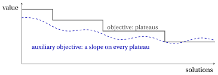
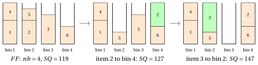

# 31.9 Flat landscapes and auxiliary objectives { #sez-sec-flat }

**Part 4 · Heuristic algorithms · Chapter 31** · [:material-book-open-variant: Chapter 31: Local search](index.md) · [:material-file-pdf-box: Lecture notes, volume 4 (PDF)](../../pdf/lecture-notes-4-heuristic-algorithms.pdf) · [:material-pencil: Exercises: Local search](../../exercises/local-search.md) · [:material-gesture-tap: App: TSP: nearest neighbour and 2-opt](../../lab/tsp-nn-2opt.md)

## 31.9.1 Plateaus

- The objectives of the BPP and of $P\,||\,C_{\max}$ are very “coarse”: the number of bins takes few values, and the makespan depends only on the critical machines. Many solutions have the same value, and most moves do not change it: the landscape is made of large <strong>plateaus</strong>.

- On a plateau a local search that accepts only strictly improving moves stops, even if a sequence of moves of value zero would lead to a better solution. The search is <strong>blind</strong>: the objective does not say which neighbours are closer to an improvement.

{ .fig loading=lazy  }

- How flat? On the $P\,||\,C_{\max}$ instance with $m=4$ and $12$ jobs of the previous section, we generate $100$ random assignments (seed $1$) and examine their $100\cdot 12\cdot 3=3600$ move neighbours: $1290$ of them ($35.8\%$) have the <em>same</em> makespan as the current solution. For the BPP the situation is extreme: on the instance with $c=10$ and weights $w=(7,6,6,5,5,4,4,4,3,3,2,1)$, for which $z(I)=5=\lceil 50/10\rceil$, the $100$ solutions computed by $FF$ on random orders of the items (seed $1$) have $2374$ move and swap neighbours, and <strong>all</strong> of them have the same number of bins as the current solution.

## 31.9.2 The auxiliary objective

- The remedy is to guide the search with an <strong>auxiliary objective</strong>, which distinguishes the solutions with the same value and rewards those that are “closer” to an improvement. For both problems it is a function of the loads:

!!! chiave ""

    $$
    \text{BPP:}\quad \max\ \sum_{b} L_b^2 = \sum_b\Big(\sum_{j\in P_b} w_j\Big)^2,
    \qquad\qquad
    P\,||\,C_{\max}:\quad \min\ \sum_{h=1}^{m} L_h^2 .
    $$

- Both problems redistribute a <em>fixed</em> total, $\sum_j w_j$ or $\sum_j t_j$, among the bins or the machines. For a fixed total, the sum of the squares is small when the loads are <em>balanced</em> and large when they are <em>unbalanced</em>. For $P\,||\,C_{\max}$ balanced loads are exactly what we want; for the BPP we want the opposite: a few full bins and the others empty.

!!! teorema "Proposition 31.4"

    If the amount $\delta$ is transferred from the load $L_a$ to the load $L_b$ ($a\ne b$), the sum of the squared loads changes by

    $$
    \big(L_a-\delta\big)^2+\big(L_b+\delta\big)^2-L_a^2-L_b^2 \;=\; 2\,\delta\,\big(L_b-L_a+\delta\big).
    $$

??? dimostrazione "Proof"

    Expanding the squares, $(L_a-\delta)^2-L_a^2=-2\delta L_a+\delta^2$ and $(L_b+\delta)^2-L_b^2=2\delta L_b+\delta^2$; the sum is $2\delta(L_b-L_a+\delta)$. The other loads do not change. □

- The change is computed in $O(1)$ time: the auxiliary objective is also cheaper to evaluate than the makespan. For a move, $\delta>0$ is the weight (or time) of the moved element, and the sum of the squares <strong>increases</strong> if and only if $L_b+\delta>L_a$: the element goes to a load that, after the move, is larger than the load it left.

## 31.9.3 The move local search for the BPP

!!! chiave ""

    The <em>move</em> local search for the BPP examines the moves of one item into another non-empty bin where it fits, applies an improving one chosen by the first- or the best-improvement rule, and stops when no move improves. The objective is either the number of bins, $f=nb$, or the auxiliary objective $f=SQ=\sum_bL_b^2$; the <strong>gain</strong> $G$ of a move is the improvement of $f$.

!!! algoritmo "Algorithm: Move step for the BPP"

    

<strong>Input:</strong> \(n\) items, weights \(w[1..n]\), capacity \(c\), bins \(bin[1..n]\), loads \(L\), \(f\in\{nb, SQ\}\), rule

<strong>Output:</strong> <em>true</em> if an improving move was applied, <em>false</em> otherwise

1<strong>Function</strong> BPPMoveStep(\(n, w, c, bin, L, f, \textit{rule}\))

2\(\bar G := 0\); \((\bar\jmath,\bar b) := (0,0)\) ▹ best move found so far

3<strong>for</strong> \(j := 1\) <strong>to</strong> \(n\) <strong>do</strong>

4\(a := bin[j]\) ▹ bin of item \(j\)

5<strong>for</strong> every bin \(b\), in increasing order <strong>do</strong>

6<strong>if</strong> \(b = a\) <strong>or</strong> \(L[b]=0\) <strong>or</strong> \(L[b]+w[j] > c\) <strong>then</strong> <strong>continue</strong> ▹ same, empty or too full

7<strong>if</strong> \(f = SQ\) <strong>then</strong>

8\(G := 2\,w[j]\,(L[b]-L[a]+w[j])\) ▹ [Proposition 31.4](#box-9-prop-transfer)

9<strong>else</strong>

10\(G := 1\) <strong>if</strong> \(L[a]=w[j]\) <strong>else</strong> \(0\) ▹ bin \(a\) is emptied

11<strong>end</strong>

12<strong>if</strong> \(G > \bar G\) <strong>then</strong>

13\(\bar G \leftarrow G\); \((\bar\jmath,\bar b) \leftarrow (j,b)\) ▹ improving move

14<strong>if</strong> \(\textit{rule}=\textit{first}\) <strong>then</strong>

15<strong>leave</strong> both loops

16<strong>end</strong>

17<strong>end</strong>

18<strong>end</strong>

19<strong>end</strong>

20<strong>if</strong> \(\bar\jmath = 0\) <strong>then</strong> <strong>return</strong> <em>false</em> ▹ no improving move: local optimum

21\(L[bin[\bar\jmath]] \leftarrow L[bin[\bar\jmath]]-w[\bar\jmath]\); \(L[\bar b] \leftarrow L[\bar b]+w[\bar\jmath]\)
    \(bin[\bar\jmath] \leftarrow \bar b\) ▹ update the loads apply the move

22<strong>return</strong> <em>true</em>

Run in Colab:

## 31.9.4 The swap local search for the BPP

!!! chiave ""

    The <em>swap</em> local search for the BPP examines the exchanges of two items of different weight in different bins that keep both bins feasible, applies an improving one chosen by the first- or the best-improvement rule, and stops when no exchange improves. A swap never changes the number of bins, so it is used only with the auxiliary objective $SQ$.

!!! algoritmo "Algorithm: Swap step for the BPP"

    

<strong>Input:</strong> \(n\) items, weights \(w[1..n]\), capacity \(c\), bins \(bin[1..n]\), loads \(L\), rule

<strong>Output:</strong> <em>true</em> if an improving swap was applied, <em>false</em> otherwise

1<strong>Function</strong> BPPSwapStep(\(n, w, c, bin, L, \textit{rule}\))

2\(\bar G := 0\); \((\bar\jmath,\bar k) := (0,0)\) ▹ best swap found so far

3<strong>for</strong> \(j := 1\) <strong>to</strong> \(n\) <strong>do</strong>

4<strong>for</strong> \(k := j+1\) <strong>to</strong> \(n\) <strong>do</strong>

5\(a := bin[j]\); \(b := bin[k]\)

6<strong>if</strong> \(a = b\) <strong>or</strong> \(w[j]=w[k]\) <strong>then</strong> <strong>continue</strong> ▹ the loads would not change

7\(\delta := w[j]-w[k]\) ▹ weight transferred from \(a\) to \(b\)

8<strong>if</strong> \(L[b]+\delta > c\) <strong>or</strong> \(L[a]-\delta > c\) <strong>then</strong> <strong>continue</strong> ▹ a bin would be overfull

9\(G := 2\,\delta\,(L[b]-L[a]+\delta)\) ▹ [Proposition 31.4](#box-9-prop-transfer)

10<strong>if</strong> \(G > \bar G\) <strong>then</strong>

11\(\bar G \leftarrow G\); \((\bar\jmath,\bar k) \leftarrow (j,k)\) ▹ improving swap

12<strong>if</strong> \(\textit{rule}=\textit{first}\) <strong>then</strong>

13<strong>leave</strong> both loops

14<strong>end</strong>

15<strong>end</strong>

16<strong>end</strong>

17<strong>end</strong>

18<strong>if</strong> \(\bar\jmath = 0\) <strong>then</strong> <strong>return</strong> <em>false</em> ▹ no improving swap: local optimum

19\(a := bin[\bar\jmath]\); \(b := bin[\bar k]\); \(\delta := w[\bar\jmath]-w[\bar k]\)

20\(L[a] \leftarrow L[a]-\delta\); \(L[b] \leftarrow L[b]+\delta\)
    \(bin[\bar\jmath] \leftarrow b\); \(bin[\bar k] \leftarrow a\) ▹ update the loads apply the swap

21<strong>return</strong> <em>true</em>

Run in Colab:

## 31.9.5 Properties of the auxiliary objective

!!! teorema "Proposition 31.5"

    For the BPP, with the neighbourhoods move and swap:

    1. a move that empties a bin increases $\sum_b L_b^2$;

    2. a swap does not change the number of bins.

    Hence every move or swap that decreases the number of bins also increases $\sum_b L_b^2$.

??? dimostrazione "Proof"

    If the move of item $j$ from bin $a$ to bin $b$ empties bin $a$, then $L_a=w_j$, and bin $b$ is not empty, so $L_b>0$. By [Proposition 31.4](#box-9-prop-transfer) with $\delta=w_j$ the change is $2w_j(L_b-w_j+w_j)=2w_jL_b>0$. A swap exchanges one item of bin $a$ with one item of bin $b$, so both bins remain non-empty and no bin is created. □

!!! teorema "Proposition 31.6"

    For $P\,||\,C_{\max}$, with the neighbourhoods move and swap:

    1. a move or a swap that decreases $\sum_h L_h^2$ does not increase the makespan;

    2. a move or a swap that decreases the makespan decreases $\sum_h L_h^2$.

??? dimostrazione "Proof"

    Let $\delta$ be transferred from machine $a$ to machine $b$; exchanging the names of $a$ and $b$ if necessary, $\delta>0$. Only $L_a$ and $L_b$ change. (1) By [Proposition 31.4](#box-9-prop-transfer), $\sum_hL_h^2$ decreases if and only if $L_b+\delta<L_a$; then both new loads $L_a-\delta$ and $L_b+\delta$ are smaller than $L_a\le C_{\max}$, and the makespan does not increase. (2) If the makespan decreases, machine $b$, whose load increases, is not critical after the move, so $L_b+\delta<C_{\max}$; machine $a$ must have been the unique critical machine, $L_a=C_{\max}$. Hence $L_b+\delta<L_a$, and $\sum_hL_h^2$ decreases. □

- The two propositions say that, for the auxiliary objective, every move that improves the original objective is improving, and so are some moves that the original objective sees as neutral; for $P\,||\,C_{\max}$, no move that worsens the makespan is improving. For the BPP a move that increases $\sum_bL_b^2$ never increases the number of bins, since no bin is created.

- The auxiliary objective is a guide, not the objective: a solution with more bins can have a larger $\sum_bL_b^2$. With $c=7$, the loads $(5,5)$ use $2$ bins and give $25+25=50$, while the loads $(7,2,1)$ use $3$ bins and give $49+4+1=54$. The quality of the solution returned is always measured with the original objective.

## 31.9.6 Examples

!!! esempio "Example 31.6: The number of bins is blind, the auxiliary objective is not"

    The solution of $FF$ on the BPP reference instance ($c=7$) has the packing patterns $P_1=\{1,4\}$, $P_2=\{2,5\}$, $P_3=\{3\}$, $P_4=\{6\}$, with loads $(7,6,5,3)$, $nb=4$ and $SQ=49+36+25+9=119$. Its feasible moves are

    
<table>
    <tr>
    <th>move</th>
    <th>loads</th>
    <th>\(nb\)</th>
    <th>gain \(2w_j(L_b-L_a+w_j)\)</th>
    <th>\(SQ\)</th>
    </tr>
    <tr>
    <td>item \(1\) (\(w_1=4\)): bin \(1\to 4\)</td>
    <td>\((3,6,5,7)\)</td>
    <td>\(4\)</td>
    <td>\(2\cdot4\cdot(3-7+4)=0\)</td>
    <td>\(119\)</td>
    </tr>
    <tr>
    <td>item \(2\) (\(w_2=4\)): bin \(2\to 4\)</td>
    <td>\((7,2,5,7)\)</td>
    <td>\(4\)</td>
    <td>\(2\cdot4\cdot(3-6+4)=8\)</td>
    <td>\(127\)</td>
    </tr>
    <tr>
    <td>item \(4\) (\(w_4=3\)): bin \(1\to 4\)</td>
    <td>\((4,6,5,6)\)</td>
    <td>\(4\)</td>
    <td>\(2\cdot3\cdot(3-7+3)=-6\)</td>
    <td>\(113\)</td>
    </tr>
    <tr>
    <td>item \(5\) (\(w_5=2\)): bin \(2\to 3\)</td>
    <td>\((7,4,7,3)\)</td>
    <td>\(4\)</td>
    <td>\(2\cdot2\cdot(5-6+2)=4\)</td>
    <td>\(123\)</td>
    </tr>
    <tr>
    <td>item \(5\) (\(w_5=2\)): bin \(2\to 4\)</td>
    <td>\((7,4,5,5)\)</td>
    <td>\(4\)</td>
    <td>\(2\cdot2\cdot(3-6+2)=-4\)</td>
    <td>\(115\)</td>
    </tr>
    </table>

    <strong>With $f=nb$</strong>, no move empties a bin: items $3$ and $6$, alone in their bins, fit nowhere else. The solution of $FF$ is a local optimum with $4$ bins, and so it is for the swap neighbourhood, by [Proposition 31.5](#box-10-prop-bppsq).

    <strong>With $f=SQ$</strong>, both rules accept the move of item $2$ into bin $4$ (gain $8$, $SQ=127$), which leaves item $5$ alone in bin $2$. In the next iteration, two moves have the largest gain, $20$: item $3$ into bin $2$, with gain $2\cdot5\cdot(2-5+5)=20$, and item $5$ into bin $3$, with gain $2\cdot2\cdot(5-2+2)=20$. Item $3$ is examined first, so both rules choose it. It empties bin $3$: the loads become $(7,7,7)$, $SQ=147$, and the packing patterns $\{1,4\}$, $\{3,5\}$, $\{2,6\}$ use $3$ bins, which is <strong>optimal</strong>. The first move did not change the number of bins: it prepared the second one.

    { .fig loading=lazy  }

!!! esempio "Example 31.7: Starting from $NF$"

    The solution of $NF$ on the BPP reference instance has the packing patterns $\{1\}$, $\{2\}$, $\{3\}$, $\{4,5\}$, $\{6\}$ (bins $1,\dots,5$), loads $(4,4,5,5,3)$, $nb=5$ and $SQ=91$.

    <strong>With $f=nb$</strong>, the first move examined, item $1$ into bin $5$ ($3+4=7$), empties bin $1$: the solution has $4$ bins, $\{2\},\{3\},\{4,5\},\{1,6\}$. It is a local optimum: items $2$ and $3$ fit in no other bin, and bins $4$ and $5$ contain two items each. Both rules stop with $4$ bins.

    <strong>With $f=SQ$</strong>, best improvement makes three moves:

    
<table>
    <tr>
    <th>move</th>
    <th>packing patterns</th>
    <th>gain</th>
    <th>\(SQ\)</th>
    </tr>
    <tr>
    <td>item \(1\) into bin \(5\)</td>
    <td>\(\{2\},\{3\},\{4,5\},\{1,6\}\)</td>
    <td>\(2\cdot4\cdot(3-4+4)=24\)</td>
    <td>\(115\)</td>
    </tr>
    <tr>
    <td>item \(4\) into bin \(2\)</td>
    <td>\(\{2,4\},\{3\},\{5\},\{1,6\}\)</td>
    <td>\(2\cdot3\cdot(4-5+3)=12\)</td>
    <td>\(127\)</td>
    </tr>
    <tr>
    <td>item \(3\) into bin \(4\)</td>
    <td>\(\{2,4\},\{3,5\},\{1,6\}\)</td>
    <td>\(2\cdot5\cdot(2-5+5)=20\)</td>
    <td>\(147\)</td>
    </tr>
    </table>

    and reaches an optimal solution with $3$ bins, through a move (the second) that does not change the number of bins. First improvement makes the same three moves.

## 31.9.7 Experiments on two medium instances

- On a single small instance anything can happen; the following experiments repeat the local searches from $100$ random starting solutions (seed $1$), with best improvement.

- $P\,||\,C_{\max}$ with $m=4$ and $t=(11,10,9,8,7,7,6,5,4,4,3,2)$, $z(I)=19$. The $100$ random assignments have an average makespan of $33.32$. The table gives the average makespan of the local optima, and the number of runs that end in an optimal solution:

<table>
<tr>
<th></th>
<th colspan="2">\(f=C_{\max}\)</th>
<th colspan="2">\(f=\sum_h L_h^2\)</th>
</tr>
<tr>
<td>neighbourhood</td>
<td>average</td>
<td>optimal</td>
<td>average</td>
<td>optimal</td>
</tr>
<tr>
<td>move</td>
<td>\(20.94\)</td>
<td>\(3\)</td>
<td>\(20.39\)</td>
<td>\(4\)</td>
</tr>
<tr>
<td>swap</td>
<td>\(24.31\)</td>
<td>\(7\)</td>
<td>\(23.09\)</td>
<td>\(20\)</td>
</tr>
</table>

- The auxiliary objective improves both neighbourhoods. Swap alone is poor because it cannot change the number of jobs on the machines, which in a random assignment is often far from balanced.

- BPP with $c=10$ and $w=(7,6,6,5,5,4,4,4,3,3,2,1)$, $z(I)=5$. The $100$ solutions of $FF$ on random orders of the items use $5$ bins in $14$ cases, $6$ bins in $85$ cases and $7$ bins in $1$ case. The table gives the number of runs that end with $5$ bins:

<table>
<tr>
<th>neighbourhood</th>
<th>\(f=nb\)</th>
<th>\(f=\sum_b L_b^2\)</th>
</tr>
<tr>
<td>none (the solutions of \(FF\))</td>
<td>\(14\)</td>
<td>\(14\)</td>
</tr>
<tr>
<td>move</td>
<td>\(14\)</td>
<td>\(76\)</td>
</tr>
<tr>
<td>swap</td>
<td>—</td>
<td>\(14\)</td>
</tr>
</table>

- With $f=nb$ the move local search does not improve any of the $100$ solutions: they are all on a plateau. With the auxiliary objective, $62$ more runs reach the optimum. Swap alone cannot change the number of bins, but it can prepare moves that do.

---

**Next:** [31.10 KP: feasibility and penalties](kp-feasibility-and-penalties.md)
