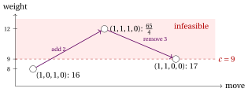

# 31.10 KP: feasibility and penalties { #sez-sec-kp }

**Part 4 · Heuristic algorithms · Chapter 31** · [:material-book-open-variant: Chapter 31: Local search](index.md) · [:material-file-pdf-box: Lecture notes, volume 4 (PDF)](../../pdf/lecture-notes-4-heuristic-algorithms.pdf) · [:material-pencil: Exercises: Local search](../../exercises/local-search.md) · [:material-gesture-tap: App: TSP: nearest neighbour and 2-opt](../../lab/tsp-nn-2opt.md)

- The representation of the KP by a binary vector $x$ describes also infeasible objects, whose weight exceeds the capacity. There are two ways of dealing with them:

    1. <strong>stay feasible</strong>: the neighbourhood contains only the feasible neighbours, as done so far;

    2. <strong>penalize</strong>: the infeasible vectors are allowed, and the search maximizes a function that subtracts from the profit a penalty proportional to the excess weight.

- Staying feasible can make the search short-sighted. In the chapter [«Heuristic algorithms: definitions»](../heuristics.md), $x=(1,0,1,0)$ is a local optimum for flip: to reach the optimal solution $(1,1,0,0)$ with flips one has to add item $2$ and remove item $3$, and the intermediate vector is either $(1,1,1,0)$, infeasible, or $(1,0,0,0)$, of profit $10<16$. The swap neighbourhood solves this case by performing the two flips at once; penalties solve it by letting the search walk through the infeasible vector.

- With penalties, the search space is the whole set $\{0,1\}^n$, and the function to maximize is

!!! chiave ""

    $$
    g_\alpha(x) \;=\; \sum_{j\in\mathscr{I}} p_j x_j \;-\; \alpha\cdot\max\Big\{0,\ \sum_{j\in\mathscr{I}} w_jx_j-c\Big\},
    $$

    where $\alpha>0$ is the <strong>penalty</strong> for each unit of excess weight. For a feasible $x$, $g_\alpha(x)$ is the profit of $x$.

## 31.10.1 Staying feasible

!!! chiave ""

    The <em>flip+swap</em> local search for the KP examines the flips and then the swaps of the current solution, discards those that exceed the capacity, applies an improving one chosen by the first- or the best-improvement rule, and stops when no feasible neighbour has a larger profit.

!!! algoritmo "Algorithm: Flip+swap step for the KP"

    

<strong>Input:</strong> \(n\) items, profits \(p[1..n]\), weights \(w[1..n]\), capacity \(c\), feasible solution \(x[1..n]\), rule

<strong>Output:</strong> <em>true</em> if an improving move was applied to \(x\), <em>false</em> otherwise

1<strong>Function</strong> KPFlipSwapStep(\(n, p, w, c, x, \textit{rule}\))

2\(W := \sum_{j=1}^n w[j]\,x[j]\)
    \(\bar\Delta := 0\); \((\bar\jmath,\bar k) := (0,0)\) ▹ weight of the current solution best move found so far (\(\bar k=0\): flip)

3<strong>for</strong> \(j := 1\) <strong>to</strong> \(n\) <strong>do</strong> ▹ flip of item \(j\)

4\(\Delta p := (1-2x[j])\,p[j]\); \(\Delta w := (1-2x[j])\,w[j]\) ▹ remove, or add, item \(j\)

5<strong>if</strong> \(W+\Delta w \le c\) <strong>and</strong> \(\Delta p > \bar\Delta\) <strong>then</strong>

6\(\bar\Delta \leftarrow \Delta p\); \((\bar\jmath,\bar k) \leftarrow (j,0)\)

7<strong>if</strong> \(\textit{rule}=\textit{first}\) <strong>then</strong>

8<strong>leave</strong> all the loops

9<strong>end</strong>

10<strong>end</strong>

11<strong>end</strong>

12<strong>for</strong> \(j := 1\) <strong>to</strong> \(n\) with \(x[j]=1\) <strong>do</strong> ▹ swap: \(j\) out, \(k\) in

13<strong>for</strong> \(k := 1\) <strong>to</strong> \(n\) with \(x[k]=0\) <strong>do</strong>

14\(\Delta p := p[k]-p[j]\); \(\Delta w := w[k]-w[j]\)

15<strong>if</strong> \(W+\Delta w \le c\) <strong>and</strong> \(\Delta p > \bar\Delta\) <strong>then</strong>

16\(\bar\Delta \leftarrow \Delta p\); \((\bar\jmath,\bar k) \leftarrow (j,k)\)

17<strong>if</strong> \(\textit{rule}=\textit{first}\) <strong>then</strong>

18<strong>leave</strong> all the loops

19<strong>end</strong>

20<strong>end</strong>

21<strong>end</strong>

22<strong>end</strong>

23<strong>if</strong> \(\bar\jmath = 0\) <strong>then</strong> <strong>return</strong> <em>false</em> ▹ no improving move: local optimum

24\(x[\bar\jmath] \leftarrow 1-x[\bar\jmath]\) ▹ flip, or remove the item that goes out

25<strong>if</strong> \(\bar k \ne 0\) <strong>then</strong>

26\(x[\bar k] \leftarrow 1\) ▹ add the item that comes in

27<strong>end</strong>

28<strong>return</strong> <em>true</em>

Run in Colab:

- With the first-improvement rule, if an improving flip is found the swaps are not examined. Only flips that <em>add</em> an item can improve the profit; flips that remove an item are kept in the neighbourhood for uniformity. An iteration costs $O(n^2)$ time, because of the swaps.

## 31.10.2 Penalizing the excess weight

!!! chiave ""

    The <em>penalty flip</em> local search for the KP examines the flips of the current vector, feasible or not, evaluates them with $g_\alpha$, applies an improving one chosen by the first- or the best-improvement rule, and stops when no flip increases $g_\alpha$.

!!! algoritmo "Algorithm: Penalty flip step for the KP"

    

<strong>Input:</strong> \(n\) items, profits \(p[1..n]\), weights \(w[1..n]\), capacity \(c\), penalty \(\alpha\), vector \(x[1..n]\), rule

<strong>Output:</strong> <em>true</em> if an improving flip was applied to \(x\), <em>false</em> otherwise

1<strong>Function</strong> KPPenaltyFlipStep(\(n, p, w, c, \alpha, x, \textit{rule}\))

2\(P := \sum_{j=1}^n p[j]\,x[j]\); \(W := \sum_{j=1}^n w[j]\,x[j]\)
    \(g := P - \alpha \max\{0, W-c\}\)
    \(\bar\Delta := 0\); \(\bar\jmath := 0\) ▹ profit and weight of \(x\) value of \(x\) best flip found so far

3<strong>for</strong> \(j := 1\) <strong>to</strong> \(n\) <strong>do</strong>

4\(P' := P+(1-2x[j])\,p[j]\); \(W' := W+(1-2x[j])\,w[j]\)
    \(\Delta := P' - \alpha \max\{0, W'-c\} - g\) ▹ flip of item \(j\) change of \(g_\alpha\)

5<strong>if</strong> \(\Delta > \bar\Delta\) <strong>then</strong>

6\(\bar\Delta \leftarrow \Delta\); \(\bar\jmath \leftarrow j\) ▹ improving flip

7<strong>if</strong> \(\textit{rule}=\textit{first}\) <strong>then</strong>

8<strong>leave</strong> the loop

9<strong>end</strong>

10<strong>end</strong>

11<strong>end</strong>

12<strong>if</strong> \(\bar\jmath = 0\) <strong>then</strong> <strong>return</strong> <em>false</em> ▹ no improving flip: local optimum

13\(x[\bar\jmath] \leftarrow 1-x[\bar\jmath]\) ▹ apply the flip

14<strong>return</strong> <em>true</em>

Run in Colab:

- The local optimum may be infeasible. The search must therefore remember the <strong>best feasible solution</strong> visited, which is the solution it returns.

!!! esempio "Example 31.8: Penalties on the KP reference instance"

    We start from the solution of $GR$, $x=(1,0,1,0)$, of weight $8$ and profit $16$, which is a local optimum for the flip neighbourhood restricted to feasible solutions. The values $g_\alpha$ of its four flips are

    
<table>
    <tr>
    <th>flip</th>
    <th>vector</th>
    <th>weight</th>
    <th>excess</th>
    <th>\(\alpha=1\)</th>
    <th>\(\alpha=2\)</th>
    <th>\(\alpha=\frac94\)</th>
    <th>\(\alpha=3\)</th>
    </tr>
    <tr>
    <td>\(1\)</td>
    <td>\((0,0,1,0)\)</td>
    <td>\(3\)</td>
    <td>\(0\)</td>
    <td>\(6\)</td>
    <td>\(6\)</td>
    <td>\(6\)</td>
    <td>\(6\)</td>
    </tr>
    <tr>
    <td>\(2\)</td>
    <td>\((1,1,1,0)\)</td>
    <td>\(12\)</td>
    <td>\(3\)</td>
    <td>\(20\)</td>
    <td>\(17\)</td>
    <td>\(\frac{65}{4}\)</td>
    <td>\(14\)</td>
    </tr>
    <tr>
    <td>\(3\)</td>
    <td>\((1,0,0,0)\)</td>
    <td>\(5\)</td>
    <td>\(0\)</td>
    <td>\(10\)</td>
    <td>\(10\)</td>
    <td>\(10\)</td>
    <td>\(10\)</td>
    </tr>
    <tr>
    <td>\(4\)</td>
    <td>\((1,0,1,1)\)</td>
    <td>\(11\)</td>
    <td>\(2\)</td>
    <td>\(18\)</td>
    <td>\(16\)</td>
    <td>\(\frac{31}{2}\)</td>
    <td>\(14\)</td>
    </tr>
    </table>

    The two rules make the same moves:

    - $\alpha=1$: the search adds item $2$ ($g_1=20$), then item $4$ ($g_1=27-6=21$), and stops in $(1,1,1,1)$, of weight $15$: every flip of it removes one item and gives $16$, $18$, $18$ or $20$. The penalty is too small: the local optimum is infeasible, and the best feasible solution visited is the starting one, of profit $16$.

    - $\alpha=2$: the search adds item $2$ ($g_2=17>16$) and stops in $(1,1,1,0)$, infeasible: removing item $3$ gives $(1,1,0,0)$ with $g_2=17$, not strictly better.

    - $\alpha=\frac94$: the search adds item $2$ ($g=\frac{65}{4}=16.25>16$) and then removes item $3$, reaching $(1,1,0,0)$, of profit $17$: the <strong>optimal</strong> solution, through an infeasible vector (see the figure).

    - $\alpha=3$: no flip improves, and the search stops at once in $(1,0,1,0)$, as the feasible search.

    { .fig loading=lazy  }

!!! teorema "Proposition 31.7"

    Let the data be integer and let $\alpha>\max_{j\in\mathscr{I}} p_j$. Then:

    1. from a feasible vector, no flip that produces an infeasible vector increases $g_\alpha$;

    2. every infeasible vector has a flip that increases $g_\alpha$.

??? dimostrazione "Proof"

    (1) If adding item $k$ to a feasible vector produces an excess $e\ge1$, then $g_\alpha$ changes by $p_k-\alpha e\le p_k-\alpha<0$. (2) Let $x$ be infeasible, with excess $e\ge 1$, and let $j$ be a selected item. Removing $j$ decreases the excess by $\min\{w_j,e\}\ge 1$, so $g_\alpha$ changes by $-p_j+\alpha\min\{w_j,e\}\ge -p_j+\alpha>0$. □

- With a <strong>large</strong> penalty the local optima are feasible, but the search never leaves the feasible region; with a <strong>small</strong> penalty it crosses the infeasible region, but may stop there. The useful values depend on the instance (here $\frac94$ works, $1$, $2$ and $3$ do not), so in practice $\alpha$ is adjusted during the search: increased while the search stays among infeasible vectors, decreased while it stays among feasible ones.

---

**Next:** [31.11 Variable neighbourhood descent](variable-neighbourhood-descent.md)
