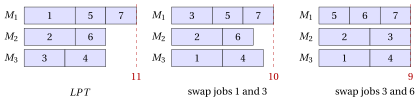

# 31.8 $P\,||\,C_{\max}$: move and swap { #sez-sec-pcmax }

**Part 4 · Heuristic algorithms · Chapter 31** · [:material-book-open-variant: Chapter 31: Local search](index.md) · [:material-file-pdf-box: Lecture notes, volume 4 (PDF)](../../pdf/lecture-notes-4-heuristic-algorithms.pdf) · [:material-presentation: Slides (1/2)](../../pdf/slides-local-search-1.pdf) · [:material-presentation: Slides (2/2)](../../pdf/slides-local-search-2.pdf) · [:material-pencil: Exercises: Local search](../../exercises/local-search.md) · [:material-gesture-tap: App: TSP: nearest neighbour and 2-opt](../../lab/tsp-nn-2opt.md)

- The moves of $P\,||\,C_{\max}$ transfer processing time between two machines: a move of job $j$ from machine $a$ to machine $b$ transfers $\delta=t_j$ from $a$ to $b$; a swap of jobs $j$ (on $a$) and $k$ (on $b$) transfers $\delta=t_j-t_k$, which can be negative. In both cases the new loads are $L_a-\delta$ and $L_b+\delta$, and $F(L,a,b,\delta)$ denotes the resulting change of the objective.

## 31.8.1 The move local search

!!! chiave ""

    The <em>move</em> local search for $P\,||\,C_{\max}$ examines the reassignments of one job to another machine, applies an improving one chosen by the first- or the best-improvement rule, updates the two loads involved, and stops when no reassignment decreases the objective.

!!! algoritmo "Algorithm: Move step for $P\,||\,C_{\max}$"

    

<strong>Input:</strong> \(n\) jobs, \(m\) machines, times \(t[1..n]\), assignment \(mach[1..n]\), loads \(L[1..m]\), rule

<strong>Output:</strong> <em>true</em> if an improving move was applied, <em>false</em> otherwise

1<strong>Function</strong> PCmaxMoveStep(\(n, m, t, mach, L, \textit{rule}\))

2\(\bar\Delta := 0\); \((\bar\jmath,\bar h) := (0,0)\) ▹ best move found so far

3<strong>for</strong> \(j := 1\) <strong>to</strong> \(n\) <strong>do</strong>

4\(a := mach[j]\) ▹ machine of job \(j\)

5<strong>for</strong> \(h := 1\) <strong>to</strong> \(m\) <strong>do</strong>

6<strong>if</strong> \(h = a\) <strong>then</strong>

7<strong>continue</strong>

8<strong>end</strong>

9\(\Delta := F(L, a, h, t[j])\) ▹ change of the objective

10<strong>if</strong> \(\Delta < \bar\Delta\) <strong>then</strong>

11\(\bar\Delta \leftarrow \Delta\); \((\bar\jmath,\bar h) \leftarrow (j,h)\) ▹ improving move

12<strong>if</strong> \(\textit{rule}=\textit{first}\) <strong>then</strong>

13<strong>leave</strong> both loops

14<strong>end</strong>

15<strong>end</strong>

16<strong>end</strong>

17<strong>end</strong>

18<strong>if</strong> \(\bar\jmath = 0\) <strong>then</strong> <strong>return</strong> <em>false</em> ▹ no improving move: local optimum

19\(L[mach[\bar\jmath]] \leftarrow L[mach[\bar\jmath]]-t[\bar\jmath]\); \(L[\bar h] \leftarrow L[\bar h]+t[\bar\jmath]\)
    \(mach[\bar\jmath] \leftarrow \bar h\) ▹ update the loads apply the move

20<strong>return</strong> <em>true</em>

Run in Colab:

## 31.8.2 The swap local search

!!! chiave ""

    The <em>swap</em> local search for $P\,||\,C_{\max}$ examines the exchanges of two jobs on different machines, applies an improving one chosen by the first- or the best-improvement rule, updates the two loads involved, and stops when no exchange decreases the objective.

!!! algoritmo "Algorithm: Swap step for $P\,||\,C_{\max}$"

    

<strong>Input:</strong> \(n\) jobs, \(m\) machines, times \(t[1..n]\), assignment \(mach[1..n]\), loads \(L[1..m]\), rule

<strong>Output:</strong> <em>true</em> if an improving swap was applied, <em>false</em> otherwise

1<strong>Function</strong> PCmaxSwapStep(\(n, m, t, mach, L, \textit{rule}\))

2\(\bar\Delta := 0\); \((\bar\jmath,\bar k) := (0,0)\) ▹ best swap found so far

3<strong>for</strong> \(j := 1\) <strong>to</strong> \(n\) <strong>do</strong>

4<strong>for</strong> \(k := j+1\) <strong>to</strong> \(n\) <strong>do</strong>

5\(a := mach[j]\); \(b := mach[k]\)

6<strong>if</strong> \(a = b\) <strong>or</strong> \(t[j]=t[k]\) <strong>then</strong> <strong>continue</strong> ▹ the loads would not change

7\(\Delta := F(L, a, b, t[j]-t[k])\) ▹ change of the objective

8<strong>if</strong> \(\Delta < \bar\Delta\) <strong>then</strong>

9\(\bar\Delta \leftarrow \Delta\); \((\bar\jmath,\bar k) \leftarrow (j,k)\) ▹ improving swap

10<strong>if</strong> \(\textit{rule}=\textit{first}\) <strong>then</strong>

11<strong>leave</strong> both loops

12<strong>end</strong>

13<strong>end</strong>

14<strong>end</strong>

15<strong>end</strong>

16<strong>if</strong> \(\bar\jmath = 0\) <strong>then</strong> <strong>return</strong> <em>false</em> ▹ no improving swap: local optimum

17\(a := mach[\bar\jmath]\); \(b := mach[\bar k]\); \(\delta := t[\bar\jmath]-t[\bar k]\)

18\(L[a] \leftarrow L[a]-\delta\); \(L[b] \leftarrow L[b]+\delta\)
    \(mach[\bar\jmath] \leftarrow b\); \(mach[\bar k] \leftarrow a\) ▹ update the loads apply the swap

19<strong>return</strong> <em>true</em>

Run in Colab:

- For the makespan, the change of the objective is

!!! chiave ""

    $$
    F(L,a,b,\delta) \;=\; \max\Big\{\,L_a-\delta,\; L_b+\delta,\; \max_{q\ne a,b} L_q\Big\} \;-\; \max_{q} L_q ,
    $$

    computed in $O(m)$ time from the loads $L_1,\dots,L_m$ of the current solution.

- A move or a swap is improving if and only if $F(L,a,b,\delta)<0$. Since only $L_a$ and $L_b$ change, the makespan can decrease only if $a$ is the <strong>unique</strong> critical machine: if another machine has load $C_{\max}$, no move between two machines can lower the makespan.

- An iteration costs $O(nm^2)$ time for move and $O(n^2m)$ for swap, because of the $O(m)$ evaluation of $F$; keeping the loads sorted reduces it, but the simple version is enough here.

- A move changes the number of jobs on two machines, a swap keeps the number of jobs on every machine: if a machine has too many jobs, only a move can fix it, and the two neighbourhoods complement each other.

!!! esempio "Example 31.5: The solution of $LPT$ is a local optimum for move, but not for swap"

    The solution of $LPT$ on the $P\,||\,C_{\max}$ reference instance has $J_1=\{1,5,7\}$, $J_2=\{2,6\}$, $J_3=\{3,4\}$, loads $(11,8,8)$ and $C_{\max}=11$. Machine $1$ is the unique critical machine.

    <strong>Move.</strong> The $14$ moves give the loads

    
<table>
    <tr>
    <th>move</th>
    <th>loads</th>
    <th>\(C_{\max}\)</th>
    <th>move</th>
    <th>loads</th>
    <th>\(C_{\max}\)</th>
    </tr>
    <tr>
    <td>job \(1\): \(M_1\to M_2\)</td>
    <td>\((6,13,8)\)</td>
    <td>\(13\)</td>
    <td>job \(4\): \(M_3\to M_2\)</td>
    <td>\((11,12,4)\)</td>
    <td>\(12\)</td>
    </tr>
    <tr>
    <td>job \(1\): \(M_1\to M_3\)</td>
    <td>\((6,8,13)\)</td>
    <td>\(13\)</td>
    <td>job \(5\): \(M_1\to M_2\)</td>
    <td>\((8,11,8)\)</td>
    <td>\(11\)</td>
    </tr>
    <tr>
    <td>job \(2\): \(M_2\to M_1\)</td>
    <td>\((16,3,8)\)</td>
    <td>\(16\)</td>
    <td>job \(5\): \(M_1\to M_3\)</td>
    <td>\((8,8,11)\)</td>
    <td>\(11\)</td>
    </tr>
    <tr>
    <td>job \(2\): \(M_2\to M_3\)</td>
    <td>\((11,3,13)\)</td>
    <td>\(13\)</td>
    <td>job \(6\): \(M_2\to M_1\)</td>
    <td>\((14,5,8)\)</td>
    <td>\(14\)</td>
    </tr>
    <tr>
    <td>job \(3\): \(M_3\to M_1\)</td>
    <td>\((15,8,4)\)</td>
    <td>\(15\)</td>
    <td>job \(6\): \(M_2\to M_3\)</td>
    <td>\((11,5,11)\)</td>
    <td>\(11\)</td>
    </tr>
    <tr>
    <td>job \(3\): \(M_3\to M_2\)</td>
    <td>\((11,12,4)\)</td>
    <td>\(12\)</td>
    <td>job \(7\): \(M_1\to M_2\)</td>
    <td>\((8,11,8)\)</td>
    <td>\(11\)</td>
    </tr>
    <tr>
    <td>job \(4\): \(M_3\to M_1\)</td>
    <td>\((15,8,4)\)</td>
    <td>\(15\)</td>
    <td>job \(7\): \(M_1\to M_3\)</td>
    <td>\((8,8,11)\)</td>
    <td>\(11\)</td>
    </tr>
    </table>

    No move decreases the makespan: moving job $1$ away from machine $1$ makes the receiving machine reach $8+5=13$, and moving job $5$ or $7$ lowers machine $1$ to $8$ but raises the receiving machine to $8+3=11$. The solution of $LPT$ is a <strong>local optimum for move</strong>, with $C_{\max}=11$.

    <strong>Swap.</strong> The first swap examined exchanges job $1$ (on $M_1$, $t_1=5$) and job $3$ (on $M_3$, $t_3=4$): $\delta=1$, the loads become $(10,8,9)$ and $C_{\max}=10$. It is improving, and first improvement accepts it at once; best improvement examines all the $13$ swaps and finds two more with $C_{\max}=10$ (jobs $1$ and $4$, jobs $1$ and $6$), so it accepts the same swap, the first one found. Now $J_1=\{3,5,7\}$, $J_2=\{2,6\}$, $J_3=\{1,4\}$.

    In the second iteration, the swap of job $3$ (on $M_1$, $t_3=4$) and job $6$ (on $M_2$, $t_6=3$) has $\delta=1$ and gives the loads $(9,9,9)$: it is found after $9$ evaluations, and it is the only swap with $C_{\max}<10$, so both rules accept it. The new solution $J_1=\{5,6,7\}$, $J_2=\{2,3\}$, $J_3=\{1,4\}$ has $C_{\max}=9=\left\lceil 27/3\right\rceil$: it is <strong>optimal</strong>.

    { .fig loading=lazy  }

- On this example the move neighbourhood stops at $11$, and the swap neighbourhood reaches the optimum $9$. As observed for the KP in the chapter [«Heuristic algorithms: definitions»](../heuristics.md), <strong>the local optimum depends on the neighbourhood</strong>.

- A larger neighbourhood does not always help. On the instance with $m=4$ machines and $12$ jobs with times $t=(11,10,9,8,7,7,6,5,4,4,3,2)$, whose optimal makespan is $z(I)=19=\lceil 76/4\rceil$, $LPT$ gives $J_1=\{1,8,10\}$, $J_2=\{2,7,11\}$, $J_3=\{3,6,12\}$, $J_4=\{4,5,9\}$, with loads $(20,19,18,19)$: this solution is a local optimum for both move and swap.

---

**Next:** [31.9 Flat landscapes and auxiliary objectives](flat-landscapes-and-auxiliary-objectives.md)
