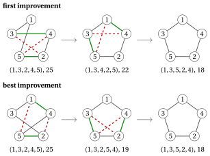
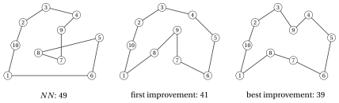

# 30.7 TSP: 2-opt and Or-opt { #sez-sec-tsp }

**Part 4 · Heuristic algorithms · Chapter 30** · [:material-book-open-variant: Chapter 30: Local search](index.md) · [:material-file-pdf-box: Lecture notes, volume 4 (PDF)](../../pdf/lecture-notes-4-heuristic-algorithms.pdf) · [:material-pencil: Exercises: Local search](../../exercises/local-search.md) · [:material-gesture-tap: App: TSP: nearest neighbour and 2-opt](../../lab/tsp-nn-2opt.md)

## 30.7.1 The 2-opt local search

!!! chiave ""

    The <em>2-opt</em> local search (denoted by $2OPT$) is a local search for the TSP with the 2-opt neighbourhood. At every iteration it evaluates the 2-opt moves of the current tour with the incremental formula, applies an improving move chosen by the first- or the best-improvement rule, and stops when no move shortens the tour.

!!! algoritmo "Algorithm: 2-opt step"

    

<strong>Input:</strong> \(n\) cities, distances \(d[1..n][1..n]\), tour \(\sigma[1..n]\) with \(\sigma[1]=1\), rule \(\in\{\textit{first},\textit{best}\}\)

<strong>Output:</strong> <em>true</em> if an improving 2-opt move was applied to \(\sigma\), <em>false</em> otherwise

1<strong>Function</strong> TwoOptStep(\(n, d, \sigma, \textit{rule}\))

2\(\Delta^* := 0\)
    \((i^<em>, j^</em>) := (0,0)\) ▹ best length change found so far best move found so far

3<strong>for</strong> \(i := 1\) <strong>to</strong> \(n-2\) <strong>do</strong>

4<strong>for</strong> \(j := i+2\) <strong>to</strong> \(n\) <strong>do</strong>

5<strong>if</strong> \(i=1\) <strong>and</strong> \(j=n\) <strong>then</strong> <strong>continue</strong> ▹ the two edges are adjacent

6\(u_1 := \sigma[i]\); \(v_1 := \sigma[i+1]\)
    \(u_2 := \sigma[j]\); \(v_2 := \sigma[j \bmod n+1]\)
    \(\Delta := d[u_1][u_2]+d[v_1][v_2]-d[u_1][v_1]-d[u_2][v_2]\) ▹ first removed edge second removed edge

7<strong>if</strong> \(\Delta < \Delta^*\) <strong>then</strong>

8\(\Delta^* \leftarrow \Delta\); \((i^<em>,j^</em>) \leftarrow (i,j)\) ▹ improving move

9<strong>if</strong> \(\textit{rule}=\textit{first}\) <strong>then</strong>

10<strong>leave</strong> both loops

11<strong>end</strong>

12<strong>end</strong>

13<strong>end</strong>

14<strong>end</strong>

15<strong>if</strong> \(i^* = 0\) <strong>then</strong> <strong>return</strong> <em>false</em> ▹ no improving move: local optimum

16reverse the path \(\sigma[i^<em>+1], \dots, \sigma[j^</em>]\) ▹ apply the move

17<strong>return</strong> <em>true</em>

- In the implementation, $\textit{Improve}$ and the move to the improving neighbour are merged in a single function $\textit{Step}$, which explores the neighbourhood with the incremental evaluation and, if it finds an improving move, applies it to the current solution and returns <em>true</em>; otherwise it returns <em>false</em>. $LS$ calls $\textit{Step}$ until it returns <em>false</em>.

- $2OPT$ is $\textit{LocalSearch}$ with $\textit{TwoOptStep}$; it never changes $\sigma[1]=1$, since $i\ge 1$ and the reversed path starts at position $i+1\ge 2$.

- An iteration costs $O(n^2)$ time; the reversal of the path costs $O(n)$.

- When the distances are Euclidean, a 2-opt local optimum has no crossing edges: if the edges $\{u_1,v_1\}$ and $\{u_2,v_2\}$ cross at a point $X$, the triangle inequality gives $d_{u_1u_2}\le d_{u_1X}+d_{Xu_2}$ and $d_{v_1v_2}\le d_{v_1X}+d_{Xv_2}$, so $\Delta\le 0$, with $\Delta<0$ unless the four cities are on a line. The 2-opt move “uncrosses” the two edges.

!!! esempio "Example 30.2: $2OPT$ on the TSP reference instance"

    We start from the tour of $NN$ from city $1$, $\sigma=(1,3,2,4,5)$, of length $25$. Its $5$ moves are

    
<table>
    <tr>
    <th>\((i,j)\)</th>
    <th>removed edges</th>
    <th>added edges</th>
    <th>\(\Delta\)</th>
    <th>new tour, length</th>
    </tr>
    <tr>
    <td>\((1,3)\)</td>
    <td>\(\{1,3\},\{2,4\}\)</td>
    <td>\(\{1,2\},\{3,4\}\)</td>
    <td>\(5+4-2-3=+4\)</td>
    <td>\((1,2,3,4,5)\), \(29\)</td>
    </tr>
    <tr>
    <td>\((1,4)\)</td>
    <td>\(\{1,3\},\{4,5\}\)</td>
    <td>\(\{1,4\},\{3,5\}\)</td>
    <td>\(2+7-2-7=0\)</td>
    <td>\((1,4,2,3,5)\), \(25\)</td>
    </tr>
    <tr>
    <td>\((2,4)\)</td>
    <td>\(\{3,2\},\{4,5\}\)</td>
    <td>\(\{3,4\},\{2,5\}\)</td>
    <td>\(4+4-4-7=-3\)</td>
    <td>\((1,3,4,2,5)\), \(22\)</td>
    </tr>
    <tr>
    <td>\((2,5)\)</td>
    <td>\(\{3,2\},\{5,1\}\)</td>
    <td>\(\{3,5\},\{2,1\}\)</td>
    <td>\(7+5-4-9=-1\)</td>
    <td>\((1,3,5,4,2)\), \(24\)</td>
    </tr>
    <tr>
    <td>\((3,5)\)</td>
    <td>\(\{2,4\},\{5,1\}\)</td>
    <td>\(\{2,5\},\{4,1\}\)</td>
    <td>\(4+2-3-9=-6\)</td>
    <td>\((1,3,2,5,4)\), \(19\)</td>
    </tr>
    </table>

    <strong>First improvement</strong> accepts the move $(2,4)$, the first with $\Delta<0$, after $3$ evaluations: $\sigma=(1,3,4,2,5)$, of length $22$. Its moves have $\Delta=+1,+6,+3,-4,0$; the move $(2,5)$, which removes $\{3,4\}$ and $\{5,1\}$ and adds $\{3,5\}$ and $\{4,1\}$, is accepted after $4$ evaluations: $\sigma=(1,3,5,2,4)$, of length $18$. All its $5$ moves have $\Delta>0$ ($+7,+4,+1,+4,+6$): the search stops after $3+4+5=12$ evaluations.

    <strong>Best improvement</strong> accepts the move $(3,5)$, with $\Delta=-6$: $\sigma=(1,3,2,5,4)$, of length $19$. Its moves have $\Delta=+6,+4,-1,+3,+6$, and the move $(2,4)$, which removes $\{3,2\}$ and $\{5,4\}$ and adds $\{3,5\}$ and $\{2,4\}$, gives $\sigma=(1,3,5,2,4)$, of length $18$. The search stops after $5+5+5=15$ evaluations.

    Both rules reach the optimal tour, with $2$ moves each. The figure shows the two paths; the cities are placed in the order of the optimal tour, so the optimal tour is the boundary of the pentagon (the instance is not Euclidean: the drawing is only a schematic). Dashed red edges are removed, green edges are added.

    { .fig loading=lazy  }

## 30.7.2 The Or-opt local search

!!! chiave ""

    The <em>Or-opt</em> local search (denoted by $OROPT$) is a local search for the TSP with the Or-opt neighbourhood. At every iteration it evaluates, with the incremental formula, the insertion of every segment of $1$, $2$ or $3$ consecutive cities between two other consecutive cities, applies an improving move chosen by the first- or the best-improvement rule, and stops when no move shortens the tour.

!!! algoritmo "Algorithm: Or-opt step"

    

<strong>Input:</strong> \(n\) cities, distances \(d[1..n][1..n]\), tour \(\sigma[1..n]\) with \(\sigma[1]=1\), rule \(\in\{\textit{first},\textit{best}\}\)

<strong>Output:</strong> <em>true</em> if an improving Or-opt move was applied to \(\sigma\), <em>false</em> otherwise

1<strong>Function</strong> OrOptStep(\(n, d, \sigma, \textit{rule}\))

2\(\Delta^* := 0\); \((\ell^<em>,i^</em>,k^*) := (0,0,0)\) ▹ best move found so far

3<strong>for</strong> \(\ell := 1\) <strong>to</strong> \(3\) <strong>do</strong>

4<strong>for</strong> \(i := 2\) <strong>to</strong> \(n-\ell+1\) <strong>do</strong>

5\(p := \sigma[i-1]\); \(s_1 := \sigma[i]\)
    \(s_\ell := \sigma[i+\ell-1]\); \(q := \sigma[(i+\ell-1) \bmod n+1]\) ▹ predecessor, first city of the segment last city, successor

6<strong>for</strong> \(k := 1\) <strong>to</strong> \(n\) <strong>do</strong>

7<strong>if</strong> \(i-1 \le k \le i+\ell-1\) <strong>then</strong> <strong>continue</strong> ▹ same place, or inside the segment

8\(a := \sigma[k]\); \(b := \sigma[k \bmod n+1]\)
    \(\Delta := d[p][q]+d[a][s_1]+d[s_\ell][b]-d[p][s_1]-d[s_\ell][q]-d[a][b]\) ▹ edge where the segment goes

9<strong>if</strong> \(\Delta < \Delta^*\) <strong>then</strong>

10\(\Delta^* \leftarrow \Delta\); \((\ell^<em>,i^</em>,k^*) \leftarrow (\ell,i,k)\) ▹ improving move

11<strong>if</strong> \(\textit{rule}=\textit{first}\) <strong>then</strong>

12<strong>leave</strong> the three loops

13<strong>end</strong>

14<strong>end</strong>

15<strong>end</strong>

16<strong>end</strong>

17<strong>end</strong>

18<strong>if</strong> \(\ell^* = 0\) <strong>then</strong> <strong>return</strong> <em>false</em> ▹ no improving move: local optimum

19move \(\sigma[i^<em>],\dots,\sigma[i^</em>+\ell^<em>-1]\) between \(\sigma[k^</em>]\) and \(\sigma[k^* \bmod n+1]\) ▹ apply

20<strong>return</strong> <em>true</em>

- Or-opt moves a short piece of the tour to a better place, without reversing anything: it is the natural neighbourhood when a few cities have been “left behind” by the construction. An iteration costs $O(n^2)$ time.

- A 2-opt local optimum need not be an Or-opt local optimum, and vice versa: the two neighbourhoods contain different moves.

## 30.7.3 First and best improvement on a medium instance

- On $5$ cities the 2-opt neighbourhood is small and both rules reach the optimum. To see the difference between the two rules, and the role of Or-opt, we use a medium instance with $10$ cities. This instance is not metric: $d_{68}=8>d_{67}+d_{78}=4+3$ and $d_{6,10}=11>d_{67}+d_{7,10}=4+6$.

!!! esempio "Example 30.3: A TSP instance with $10$ cities"

    The cities have integer coordinates, and $d_{ij}$ is the Euclidean distance rounded to the nearest integer:

    
<table>
    <tr>
    <th>city</th>
    <th>\(1\)</th>
    <th>\(2\)</th>
    <th>\(3\)</th>
    <th>\(4\)</th>
    <th>\(5\)</th>
    <th>\(6\)</th>
    <th>\(7\)</th>
    <th>\(8\)</th>
    <th>\(9\)</th>
    <th>\(10\)</th>
    </tr>
    <tr>
    <td>coordinates</td>
    <td>\((1,1)\)</td>
    <td>\((3,8)\)</td>
    <td>\((6,10)\)</td>
    <td>\((10,9)\)</td>
    <td>\((13,6)\)</td>
    <td>\((12,1)\)</td>
    <td>\((8,3)\)</td>
    <td>\((5,4)\)</td>
    <td>\((8,7)\)</td>
    <td>\((2,5)\)</td>
    </tr>
    </table>

    $$
    \begin{array}{c|cccccccccc}
    \hline {d_{ij}} & {1} & {2} & {3} & {4} & {5} & {6} & {7} & {8} & {9} & {10} \\
    \hline {1} & --- & {7} & {10} & {12} & {13} & {11} & {7} & {5} & {9} & {4} \\
    {2} & {7} & --- & {4} & {7} & {10} & {11} & {7} & {4} & {5} & {3} \\
    {3} & {10} & {4} & --- & {4} & {8} & {11} & {7} & {6} & {4} & {6} \\
    {4} & {12} & {7} & {4} & --- & {4} & {8} & {6} & {7} & {3} & {9} \\
    {5} & {13} & {10} & {8} & {4} & --- & {5} & {6} & {8} & {5} & {11} \\
    {6} & {11} & {11} & {11} & {8} & {5} & --- & {4} & {8} & {7} & {11} \\
    {7} & {7} & {7} & {7} & {6} & {6} & {4} & --- & {3} & {4} & {6} \\
    {8} & {5} & {4} & {6} & {7} & {8} & {8} & {3} & --- & {4} & {3} \\
    {9} & {9} & {5} & {4} & {3} & {5} & {7} & {4} & {4} & --- & {6} \\
    {10} & {4} & {3} & {6} & {9} & {11} & {11} & {6} & {3} & {6} & --- \\
    \hline
    \end{array}
    $$

    Among its $181\,440$ distinct tours, the unique optimal one is $(1,10,2,3,9,4,5,6,7,8)$, of length $z(I)=39$. The tour of $NN$ from city $1$ is $(1,10,2,3,4,9,7,8,5,6)$, of length $49$, and the 2-opt neighbourhood has $\frac{10\cdot 7}{2}=35$ moves.

    <strong>First improvement</strong> makes $4$ moves:

    
<table>
    <tr>
    <th>removed edges</th>
    <th>new tour</th>
    <th>\(\Delta\)</th>
    <th>length</th>
    <th>evaluations</th>
    </tr>
    <tr>
    <td>\(\{3,4\},\{8,5\}\)</td>
    <td>\((1,10,2,3,8,7,9,4,5,6)\)</td>
    <td>\(-2\)</td>
    <td>\(47\)</td>
    <td>\(23\)</td>
    </tr>
    <tr>
    <td>\(\{3,8\},\{6,1\}\)</td>
    <td>\((1,10,2,3,6,5,4,9,7,8)\)</td>
    <td>\(-1\)</td>
    <td>\(46\)</td>
    <td>\(25\)</td>
    </tr>
    <tr>
    <td>\(\{3,6\},\{4,9\}\)</td>
    <td>\((1,10,2,3,4,5,6,9,7,8)\)</td>
    <td>\(-3\)</td>
    <td>\(43\)</td>
    <td>\(22\)</td>
    </tr>
    <tr>
    <td>\(\{6,9\},\{7,8\}\)</td>
    <td>\((1,10,2,3,4,5,6,7,9,8)\)</td>
    <td>\(-2\)</td>
    <td>\(41\)</td>
    <td>\(33\)</td>
    </tr>
    </table>

    and stops in the local optimum $(1,10,2,3,4,5,6,7,9,8)$, of length $41$, after $138$ evaluations in total (the last $35$ to certify the local optimum).

    <strong>Best improvement</strong> makes $3$ moves:

    
<table>
    <tr>
    <th>removed edges</th>
    <th>new tour</th>
    <th>\(\Delta\)</th>
    <th>length</th>
    </tr>
    <tr>
    <td>\(\{7,8\},\{6,1\}\)</td>
    <td>\((1,10,2,3,4,9,7,6,5,8)\)</td>
    <td>\(-5\)</td>
    <td>\(44\)</td>
    </tr>
    <tr>
    <td>\(\{9,7\},\{5,8\}\)</td>
    <td>\((1,10,2,3,4,9,5,6,7,8)\)</td>
    <td>\(-4\)</td>
    <td>\(40\)</td>
    </tr>
    <tr>
    <td>\(\{3,4\},\{9,5\}\)</td>
    <td>\((1,10,2,3,9,4,5,6,7,8)\)</td>
    <td>\(-1\)</td>
    <td>\(39\)</td>
    </tr>
    </table>

    and stops in the optimal tour after $4\cdot 35=140$ evaluations.

    From the same starting tour, the two rules stop in <strong>different local optima</strong>, after almost the same number of evaluations. Among all the $181\,440$ tours, only $3$ are 2-opt local optima, of length $39$, $41$ and $43$.

    { .fig loading=lazy  }

!!! esempio "Example 30.4: $OROPT$ from a 2-opt local optimum"

    On the instance of [Example 30.3](#box-6-ex-tsp10), first improvement stopped in the 2-opt local optimum $\sigma=(1,10,2,3,4,5,6,7,9,8)$, of length $41$. The Or-opt move that takes the segment $(9)$, with $\ell=1$, between $p=7$ and $q=8$, and inserts it between $a=3$ and $b=4$ has

    $$
    \Delta = d_{78}+d_{39}+d_{94}-d_{79}-d_{98}-d_{34} = 3+4+3-4-4-4 = -2 .
    $$

    It is the first improving move found, after $60$ evaluations, and also the best of the $170$ moves. The new tour $(1,10,2,3,9,4,5,6,7,8)$, of length $39$, is optimal. Among all the $181\,440$ tours, only $3$ are Or-opt local optima, of length $39$, $43$ and $44$, and only the optimal tour is a local optimum for both 2-opt and Or-opt.

## 30.7.4 3-opt and Lin–Kernighan

- The <strong>3-opt</strong> neighbourhood removes three edges and reconnects the three paths in all the possible ways (Lin, 1965). Its local optima are better than those of 2-opt, but an iteration costs $O(n^3)$ time, and the neighbourhood is explored only partially in practice.

- The <strong>Lin–Kernighan</strong> heuristic (Lin, Kernighan, <em>Operations Research</em> 21, 1973) builds a <em>variable</em> number $k$ of edge exchanges, one at a time, choosing every exchange greedily and stopping when the total gain cannot become positive. It explores part of the $k$-opt neighbourhood for every $k$, in a time close to that of 2-opt, and its implementations are among the best heuristics for the TSP.

- The sequence 2-opt, 3-opt, $k$-opt shows the compromise of the notes on definitions: a larger neighbourhood has better local optima, and costs more to explore.

---

**Next:** [30.8 $P\,||\,C_{\max}$: move and swap](p-cmax-move-and-swap.md)
