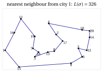
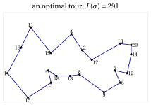
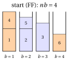
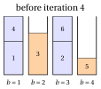
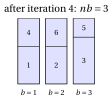

# Metaheuristics

<div class="info-capitolo" markdown>

**Part 4 · Heuristic algorithms · Chapter 21** · [:material-file-pdf-box: Lecture notes, volume 4 (PDF)](../pdf/lecture-notes-4-heuristic-algorithms.pdf) · [:material-pencil: Exercises: Metaheuristics](../exercises/metaheuristics.md)

</div>

!!! nota "Prerequisites"

    - From this module, the chapter «Local search»: neighbourhoods, first and best improvement, variable neighbourhood descent and multi-start.

    - From this module, the chapters «Constructive heuristics» (randomized construction) and «Heuristic algorithms» (intensification and diversification, experimental evaluation).

!!! chiave "Objectives"

    At the end of this chapter you will be able to:

    - execute by hand simulated annealing, tabu search, iterated local search and variable neighbourhood search, with given random numbers;

    - execute GRASP, large neighbourhood search and a genetic or memetic algorithm on small instances;

    - explain how each method escapes from a local optimum, and which parameters tune it;

    - compare the methods on the same instances, over several seeds;

    - say what metaheuristics do not give: a dual bound.

## 21.1 Metaheuristics { #sez-sec-metaheuristic }

<a id="box-1-def-metaheuristic"></a>

!!! definizione "Definition 21.1: Metaheuristic"

    A <strong>metaheuristic</strong> is a general strategy that guides a local search beyond the first local optimum, to explore other regions of the set of feasible solutions.

- A metaheuristic is a <em>scheme</em>, not an algorithm: an algorithm is obtained by choosing the representation, the neighbourhoods, the local search and the parameters (Section [21.3](#sez-sec-escape)).

- Every metaheuristic balances <strong>intensification</strong> and <strong>diversification</strong>, defined in the chapter «Heuristic algorithms: definitions».

!!! chiave ""

    A local search stops in the first local optimum; a metaheuristic escapes from it by accepting worse solutions, by jumping to a new starting solution, or by combining several good solutions.

## 21.2 The problems and the assumptions { #sez-sec-problems }

- The metaheuristics of these notes are illustrated on the four combinatorial optimization problems of the notes on heuristic algorithms. Their definitions and assumptions are given in the notes on combinatorial optimization problems; we recall them briefly.

<div class="tabella" markdown="0"><table>
<tr>
<th>problem</th>
<th>data</th>
<th>solution</th>
<th>objective</th>
</tr>
<tr>
<td>KP</td>
<td>items <span class="arithmatex">\(\mathscr{I}\)</span>, profits <span class="arithmatex">\(p_i\)</span>, weights <span class="arithmatex">\(w_i\)</span>, capacity <span class="arithmatex">\(c\)</span></td>
<td>subset of items</td>
<td>max total profit</td>
</tr>
<tr>
<td>BPP</td>
<td>items <span class="arithmatex">\(\mathscr{I}\)</span>, weights <span class="arithmatex">\(w_i\)</span>, capacity <span class="arithmatex">\(c\)</span></td>
<td>patterns <span class="arithmatex">\(P_b\)</span></td>
<td>min number of bins</td>
</tr>
<tr>
<td>TSP</td>
<td>cities <span class="arithmatex">\(\mathscr{V}\)</span>, distances <span class="arithmatex">\(d_{ij}\)</span></td>
<td>tour <span class="arithmatex">\(\sigma\)</span></td>
<td>min length <span class="arithmatex">\(L(\sigma)\)</span></td>
</tr>
<tr>
<td><span class="arithmatex">\(P\,||\,C_{\max}\)</span></td>
<td>jobs <span class="arithmatex">\(\mathscr{J}\)</span>, times <span class="arithmatex">\(t_j\)</span>, machines <span class="arithmatex">\(m\)</span></td>
<td>sets <span class="arithmatex">\(J_1,\dots,J_m\)</span></td>
<td>min makespan</td>
</tr>
</table></div>

- Every instance satisfies the assumptions of its problem: $w_i\le c$ for all items and $\sum_i w_i > c$ for the KP and the BPP; $n\ge 3$ and symmetric distances for the TSP; $n>m$ for $P\,||\,C_{\max}$. For $P\,||\,C_{\max}$, $L_h=\sum_{j\in J_h}t_j$ is the <strong>load</strong> of machine $h$ and $C_{\max}=\max_h L_h$.

- As in the notes on heuristic algorithms, $\mathscr{A}(I)$ is the value of the solution computed by the algorithm $\mathscr{A}$ on the instance $I$, and $z(I)$ is the optimal value. We write $f(S)$ for the value of a solution $S$, and we describe the algorithms for a <strong>minimization</strong> problem; for the KP, a maximization problem, the inequalities are reversed.

### 21.2.1 The neighbourhoods { #sez-sec-neigh }

- All the metaheuristics of these notes are built on the neighbourhoods of the notes on local search. We recall them by name, with the moves that define them; $n$ is the number of items, cities or jobs.

<div class="tabella" markdown="0"><table>
<tr>
<th>problem</th>
<th>name</th>
<th>move</th>
<th>size</th>
</tr>
<tr>
<td>KP</td>
<td>flip</td>
<td>add one item to the knapsack, or remove one</td>
<td><span class="arithmatex">\(n\)</span></td>
</tr>
<tr>
<td></td>
<td>swap</td>
<td>remove one selected item and add one unselected item</td>
<td><span class="arithmatex">\(\le \frac{n^2}{4}\)</span></td>
</tr>
<tr>
<td>BPP</td>
<td>move</td>
<td>move one item to another bin</td>
<td><span class="arithmatex">\(\le n\cdot nb\)</span></td>
</tr>
<tr>
<td></td>
<td>swap</td>
<td>exchange two items packed in different bins</td>
<td><span class="arithmatex">\(\le \frac{n(n-1)}{2}\)</span></td>
</tr>
<tr>
<td>TSP</td>
<td>2-opt</td>
<td>remove two non-adjacent edges of the tour and reconnect it with the two other edges, reversing the segment between them</td>
<td><span class="arithmatex">\(\frac{n(n-3)}{2}\)</span></td>
</tr>
<tr>
<td></td>
<td>Or-opt</td>
<td>move a segment of <span class="arithmatex">\(1\)</span>, <span class="arithmatex">\(2\)</span> or <span class="arithmatex">\(3\)</span> consecutive cities to another position</td>
<td><span class="arithmatex">\(O(n^2)\)</span></td>
</tr>
<tr>
<td><span class="arithmatex">\(P\,||\,C_{\max}\)</span></td>
<td>move</td>
<td>move one job to another machine</td>
<td><span class="arithmatex">\(n(m-1)\)</span></td>
</tr>
<tr>
<td></td>
<td>swap</td>
<td>exchange two jobs assigned to different machines</td>
<td><span class="arithmatex">\(\le \frac{n(n-1)}{2}\)</span></td>
</tr>
</table></div>

- A TSP tour is stored as a permutation $\sigma=(\sigma_1,\dots,\sigma_n)$ with $\sigma_1=1$. The <strong>2-opt move</strong> $(i,j)$, with $1\le i$, $i+2\le j\le n$ and $(i,j)\neq(1,n)$, removes the edges $(\sigma_i,\sigma_{i+1})$ and $(\sigma_j,\sigma_{j+1})$ (with $\sigma_{n+1}=\sigma_1$), adds the edges $(\sigma_i,\sigma_j)$ and $(\sigma_{i+1},\sigma_{j+1})$, and reverses the segment $\sigma_{i+1},\dots,\sigma_j$. Its effect on the length is computed in $O(1)$:

    $$
    \delta(i,j) \;=\; d_{\sigma_i\sigma_j} + d_{\sigma_{i+1}\sigma_{j+1}} - d_{\sigma_i\sigma_{i+1}} - d_{\sigma_j\sigma_{j+1}} .
    $$

- The objectives of the BPP and of $P\,||\,C_{\max}$ are <strong>flat</strong>: most moves do not change the number of bins, or the makespan. Two solutions with the same value are then compared with an <strong>auxiliary objective</strong>:

    - BPP: the sum of the squared loads $\sum_b \big(\sum_{i\in P_b} w_i\big)^2$, to be <em>maximized</em>: it grows when the items concentrate in fewer, fuller bins;

    - $P\,||\,C_{\max}$: the sum of the squared loads $\sum_h L_h^2$, to be <em>minimized</em>: it decreases when the loads become balanced.

    For $P\,||\,C_{\max}$ we compare two solutions <strong>lexicographically</strong>: first by $C_{\max}$, and if the makespans are equal, by $\sum_h L_h^2$. For move and swap this selects the same improving moves as the auxiliary objective $\sum_h L_h^2$ of the notes on local search: a transfer that decreases $\sum_h L_h^2$ never increases $C_{\max}$, and a transfer that decreases $C_{\max}$ also decreases $\sum_h L_h^2$.

- For the KP the flip neighbourhood contains infeasible solutions (adding an item may exceed the capacity). A local search either discards them or accepts them with a <strong>penalty</strong> on the excess weight; both options appear in these notes.

- The <strong>local searches</strong> used inside the metaheuristics are the descents of the notes on local search: TWOOPTLS (2-opt, best improvement) for the TSP, MOVEDESCENT (move, best improvement, lexicographic comparison) for $P\,||\,C_{\max}$, and KPLOCALSEARCH (feasible flips and swaps, best improvement) for the KP. In every best-improvement descent, ties between equally good moves are broken in favour of the first move found, scanning the indices in increasing order.

### 21.2.2 Random numbers { #sez-sec-random }

- Most metaheuristics make <strong>random choices</strong>. To make every example and every exercise reproducible, all the random numbers of these notes, and of their <code>C++</code> code, are produced by the <strong>minimal standard generator</strong> of Park and Miller (1988):

!!! chiave ""

    $$
    seed \;\leftarrow\; 16807\cdot seed \bmod (2^{31}-1), \qquad\qquad u \;=\; \frac{seed}{2^{31}-1}\in(0,1).
    $$

    A call $\textsc{Rand}()$ updates $seed$ and returns $u$. A random integer in $\{0,1,\dots,K-1\}$ is $\lfloor u\cdot K\rfloor$, and a random element of a list of $K$ elements is the element in position $1+\lfloor u\cdot K\rfloor$.

- The initial value of $seed$, the <strong>seed</strong>, is an integer in $\{1,\dots,2^{31}-2\}$. The same seed always gives the same sequence of numbers; different seeds give different runs of the same algorithm. With $seed=1$ the first numbers are, rounded to four decimals,

    $$
    0.0000,\ 0.1315,\ 0.7556,\ 0.4587,\ 0.5328,\ 0.2190,\ 0.0470,\ 0.6789,\ \dots
    $$

    The first number produced from a small seed is always very close to $0$; it is a property of the generator, not an error.

- In the worked examples the random numbers are written in the text, rounded to four decimals, so that every step can be checked by hand; the rounding never changes a decision.

### 21.2.3 The instances { #sez-sec-instances }

- The worked examples use the four <strong>reference instances</strong> of the notes on heuristic algorithms, whose optimal values are known:

<div class="tabella" markdown="0"><table>
<tr>
<th>problem</th>
<th>reference instance</th>
<th>optimal value and solution</th>
</tr>
<tr>
<td>KP</td>
<td><span class="arithmatex">\(p=(10,7,6,4)\)</span>, <span class="arithmatex">\(w=(5,4,3,3)\)</span>, <span class="arithmatex">\(c=9\)</span></td>
<td><span class="arithmatex">\(z(I)=17\)</span>, items <span class="arithmatex">\(\{1,2\}\)</span></td>
</tr>
<tr>
<td>BPP</td>
<td><span class="arithmatex">\(w=(4,4,5,3,2,3)\)</span>, <span class="arithmatex">\(c=7\)</span></td>
<td><span class="arithmatex">\(z(I)=3\)</span>, patterns <span class="arithmatex">\(\{1,4\},\{2,6\},\{3,5\}\)</span></td>
</tr>
<tr>
<td>TSP</td>
<td><span class="arithmatex">\(5\)</span> cities, distances <span class="arithmatex">\(d_{ij}\)</span> below</td>
<td><span class="arithmatex">\(z(I)=18\)</span>, tour <span class="arithmatex">\((1,3,5,2,4)\)</span></td>
</tr>
<tr>
<td><span class="arithmatex">\(P\,||\,C_{\max}\)</span></td>
<td><span class="arithmatex">\(t=(5,5,4,4,3,3,3)\)</span>, <span class="arithmatex">\(m=3\)</span></td>
<td><span class="arithmatex">\(z(I)=9\)</span>, sets <span class="arithmatex">\(\{1,3\},\{2,4\},\{5,6,7\}\)</span></td>
</tr>
</table></div>

$$
\begin{array}{c|ccccc}
\hline {d_{ij}} & {1} & {2} & {3} & {4} & {5} \\
\hline {1} & --- & {5} & {2} & {2} & {9} \\
{2} & {5} & --- & {4} & {3} & {4} \\
{3} & {2} & {4} & --- & {4} & {7} \\
{4} & {2} & {3} & {4} & --- & {7} \\
{5} & {9} & {4} & {7} & {7} & --- \\
\hline
\end{array}
$$

- The reference instances are small enough to follow every iteration by hand, but too small to show the behaviour of a metaheuristic over thousands of iterations. For the experiments we use one <strong>medium instance</strong> per problem, generated once with the random number generator of Section [21.2.2](#sez-sec-random) and fixed below. Their optimal values have been computed with an exact algorithm, and are used only to measure the quality of the heuristic solutions.

<a id="box-2-ex-tsp20"></a>

!!! esempio "Example 21.1: The medium TSP instance (TSP20)"

    $20$ cities in the plane, with integer coordinates $(x_i,y_i)$, and distances $d_{ij}=\big\lfloor \sqrt{(x_i-x_j)^2+(y_i-y_j)^2} + \frac{1}{2}\big\rfloor$ (the Euclidean distance rounded to the nearest integer):

    $$
    \begin{array}{c|cccccccccc}
    \hline {i} & {1} & {2} & {3} & {4} & {5} & {6} & {7} & {8} & {9} & {10} \\
    \hline {x_i} & {0} & {55} & {32} & {47} & {79} & {83} & {30} & {53} & {71} & {83} \\
    {y_i} & {18} & {35} & {11} & {47} & {20} & {11} & {20} & {17} & {4} & {40} \\
    \hline \hline {i} & {11} & {12} & {13} & {14} & {15} & {16} & {17} & {18} & {19} & {20} \\
    \hline {x_i} & {17} & {88} & {46} & {91} & {15} & {10} & {62} & {36} & {32} & {91} \\
    {y_i} & {52} & {18} & {16} & {32} & {0} & {37} & {28} & {16} & {33} & {39} \\
    \hline
    \end{array}
    $$

    { .fig loading=lazy  }

    { .fig loading=lazy  }

    The nearest neighbour tour from city $1$ has length $326$; the 2-opt local search started from it stops at a local optimum of length $319$, after two improving moves. The optimal value is $z(I)=291$: the local optimum is $9.6\%$ above it.

<a id="box-3-ex-medium"></a>

!!! esempio "Example 21.2: The medium instances of the KP, the BPP and $P\,||\,C_{\max}$"

    <strong>KP20</strong>: $n=20$ items, capacity $c=389$ (half of the total weight, rounded down),

    $$
    \begin{array}{l|cccccccccc}
    \hline {i} & {1} & {2} & {3} & {4} & {5} & {6} & {7} & {8} & {9} & {10} \\
    \hline {p_i} & {54} & {55} & {55} & {52} & {58} & {42} & {53} & {53} & {22} & {64} \\
    {w_i} & {39} & {43} & {49} & {47} & {44} & {35} & {43} & {44} & {16} & {50} \\
    \hline \hline {i} & {11} & {12} & {13} & {14} & {15} & {16} & {17} & {18} & {19} & {20} \\
    \hline {p_i} & {54} & {51} & {39} & {49} & {53} & {46} & {28} & {64} & {58} & {34} \\
    {w_i} & {40} & {42} & {28} & {38} & {46} & {39} & {14} & {50} & {45} & {27} \\
    \hline
    \end{array}
    $$

    The greedy algorithm by efficiency finds profit $490$, and the local search with flips and swaps started from it reaches $514$; the optimal value is $z(I)=521$.

    <strong>PCM15</strong>: $m=4$ machines and $n=15$ jobs with processing times

    $$
    t=(10,23,26,16,23,11,14,18,18,24,29,22,13,13,15).
    $$

    The total time is $275$, so $z(I)\ge\lceil 275/4\rceil=69$, and an assignment of makespan $69$ exists: $z(I)=69$. LPT finds makespan $73$.

    <strong>BPP24</strong>: bins of capacity $c=100$ and $n=24$ items with weights

    $$
    w=(30,40,57,22,37,23,34,34,55,51,21,47,22,24,22,34,20,51,25,54,35,27,55,48).
    $$

    The total weight is $868$, so at least $\lceil 868/100\rceil=9$ bins are needed, and a packing into $9$ bins exists: $z(I)=9$. FF and FFD both use $10$ bins.

## 21.3 How to escape from a local optimum { #sez-sec-escape }

- A local search moves from a solution to a better neighbour, and stops at the first <strong>local optimum</strong>: a solution with no better neighbour. In the landscape of the objective function, it descends to the bottom of the valley where it starts, and stays there. This is pure <strong>intensification</strong>.

- Repeating the local search from many starting solutions (multi-start) explores many valleys, but each start ignores everything learnt before, and good valleys are usually found close to other good valleys.

- The table below lists the ways to escape from a local optimum; it is the map of the chapter.

{ .fig loading=lazy  }

<div class="tabella" markdown="0"><table>
<tr>
<th>how to escape</th>
<th>idea</th>
<th>metaheuristic</th>
</tr>
<tr>
<td>accept worse moves <em>at random</em></td>
<td>a worse neighbour is accepted with a probability that decreases with the worsening and with time</td>
<td>simulated annealing (Section [21.4](#sez-sec-sa))</td>
</tr>
<tr>
<td>accept worse moves <em>deterministically, with memory</em></td>
<td>move to the best neighbour even if it is worse, and forbid going back to the solutions just visited</td>
<td>tabu search (Section [21.5](#sez-sec-ts))</td>
</tr>
<tr>
<td><em>perturb</em> the local optimum and restart</td>
<td>apply a random modification that the local search cannot undo, and descend again</td>
<td>iterated local search (Section [21.6](#sez-sec-ils))</td>
</tr>
<tr>
<td><em>change the neighbourhood</em></td>
<td>when the search is stuck, use a larger neighbourhood, of which the local optimum is no longer a local optimum</td>
<td>variable neighbourhood search (Section [21.7](#sez-sec-vns))</td>
</tr>
<tr>
<td><em>restart</em> from a randomized construction</td>
<td>build a different good solution at every restart, and improve it</td>
<td>GRASP (Section [21.8](#sez-sec-grasp))</td>
</tr>
<tr>
<td><em>destroy and repair</em></td>
<td>remove a large part of the solution and rebuild it with a heuristic or an exact algorithm</td>
<td>large neighbourhood search (Section [21.9](#sez-sec-lns))</td>
</tr>
<tr>
<td>work with a <em>population</em></td>
<td>combine the parts of several good solutions into new ones</td>
<td>genetic and memetic algorithms (Section [21.10](#sez-sec-ga))</td>
</tr>
</table></div>

- The first two ways keep <strong>one current solution</strong> and change the <strong>acceptance rule</strong> of the local search: they walk out of the valley through worse solutions. The next four <strong>jump</strong>: they generate a new starting point, far enough to leave the valley but close enough to keep what is good. The last one keeps <strong>many solutions</strong> at the same time.

- Every metaheuristic must balance <strong>intensification</strong> (descend to the bottom of the current valley) and <strong>diversification</strong> (leave it for another one). For each method we point out which component does what, and Section [21.11](#sez-sec-closing) compares them.

- A metaheuristic is a <em>scheme</em>, not an algorithm: to obtain an algorithm one must choose the representation, the neighbourhoods, the local search and the parameters, and these choices matter at least as much as the scheme. We present every metaheuristic on the problems where its idea is most natural, not on all four.

## 21.4 Simulated annealing { #sez-sec-sa }

!!! chiave ""

    <em>Simulated annealing</em> (denoted by $SA$) is a local search that chooses a <em>random</em> neighbour of the current solution and moves to it if it is better; if it is worse, it moves to it anyway with a probability that decreases with the worsening and with a parameter $T$, the <em>temperature</em>. The temperature starts high, so that at the beginning almost every move is accepted, and is lowered gradually, so that at the end only improving moves are accepted. The best solution visited is returned.

- The pseudo-code of $SA$, for a minimization problem with objective $f$ and neighbourhood $N$, reads as follows:

!!! algoritmo "Algorithm: Simulated annealing"

    <div class="pseudocodice" markdown="0"><div class="pc" style="--liv:0"><strong>Input:</strong> starting solution <span class="arithmatex">\(S\)</span>, initial temperature <span class="arithmatex">\(T_0\)</span>, cooling factor <span class="arithmatex">\(\alpha\in(0,1)\)</span>, number <span class="arithmatex">\(L\)</span> of moves
    per temperature, final temperature <span class="arithmatex">\(T_{\min}\)</span></div><div class="pc" style="--liv:0"><strong>Output:</strong> best solution found</div><div class="pc" style="--liv:0"><span class="pc-n">1</span><strong>Function</strong> SimulatedAnnealing(<span class="arithmatex">\(S, T_0, \alpha, L, T_{\min}\)</span>)</div><div class="pc" style="--liv:1"><span class="pc-n">2</span><span class="arithmatex">\(cur := S\)</span>;  <span class="arithmatex">\(fcur := f(cur)\)</span>
    <span class="arithmatex">\(best := cur\)</span>;  <span class="arithmatex">\(fbest := fcur\)</span>
    <span class="arithmatex">\(T := T_0\)</span> <span class="pc-com">▹ current solution best solution found temperature</span></div><div class="pc" style="--liv:1"><span class="pc-n">3</span><strong>while</strong> <span class="arithmatex">\(T > T_{\min}\)</span> <strong>do</strong></div><div class="pc" style="--liv:2"><span class="pc-n">4</span><strong>for</strong> <span class="arithmatex">\(l := 1\)</span> <strong>to</strong> <span class="arithmatex">\(L\)</span> <strong>do</strong></div><div class="pc" style="--liv:3"><span class="pc-n">5</span><span class="arithmatex">\(S' :=\)</span> random neighbour in <span class="arithmatex">\(N(cur)\)</span></div><div class="pc" style="--liv:3"><span class="pc-n">6</span><span class="arithmatex">\(\delta := f(S') - fcur\)</span></div><div class="pc" style="--liv:3"><span class="pc-n">7</span><span class="arithmatex">\(v := \textsc{Rand}()\)</span></div><div class="pc" style="--liv:3"><span class="pc-n">8</span><strong>if</strong> <span class="arithmatex">\(\delta \le 0\)</span> <strong>or</strong> <span class="arithmatex">\(v < e^{-\delta/T}\)</span> <strong>then</strong></div><div class="pc" style="--liv:4"><span class="pc-n">9</span><span class="arithmatex">\(cur := S'\)</span>;  <span class="arithmatex">\(fcur := fcur + \delta\)</span> <span class="pc-com">▹ move accepted</span></div><div class="pc" style="--liv:4"><span class="pc-n">10</span><strong>if</strong> <span class="arithmatex">\(fcur < fbest\)</span> <strong>then</strong></div><div class="pc" style="--liv:5"><span class="pc-n">11</span><span class="arithmatex">\(best := cur\)</span>;  <span class="arithmatex">\(fbest := fcur\)</span></div><div class="pc" style="--liv:4"><span class="pc-n">12</span><strong>end</strong></div><div class="pc" style="--liv:3"><span class="pc-n">13</span><strong>end</strong></div><div class="pc" style="--liv:2"><span class="pc-n">14</span><strong>end</strong></div><div class="pc" style="--liv:2"><span class="pc-n">15</span><span class="arithmatex">\(T := \alpha\cdot T\)</span> <span class="pc-com">▹ cooling</span></div><div class="pc" style="--liv:1"><span class="pc-n">16</span><strong>end</strong></div><div class="pc" style="--liv:1"><span class="pc-n">17</span><strong>return</strong> <span class="arithmatex">\(best\)</span></div></div>

- The name comes from metallurgy: <em>annealing</em> is the process of heating a metal and cooling it slowly, so that its atoms settle into a state of minimum energy; cooled too fast, the metal freezes into a disordered state of higher energy. Kirkpatrick, Gelatt and Vecchi (1983) and, independently, Černy (1985) proposed to simulate this process on an optimization problem, with the objective $f$ in the role of the energy. The acceptance rule is the one used by Metropolis et al. (1953) to simulate the atoms.

!!! chiave ""

    <strong>Metropolis acceptance rule.</strong> At temperature $T$, a neighbour $S'$ of the current solution, with $\delta=f(S')-f(cur)$, is accepted with probability

    $$
    P(\text{accept } S') \;=\;
    \begin{cases}
    1 & \text{if } \delta\le 0,\\[1ex]
    e^{-\delta/T} & \text{if } \delta>0.
    \end{cases}
    $$

- The probability is implemented by drawing $v=\textsc{Rand}()$, uniform in $(0,1)$, and accepting if $v<e^{-\delta/T}$, which happens with probability $e^{-\delta/T}$.

- A worsening move is accepted more easily if the worsening $\delta$ is <strong>small</strong>, and if the temperature $T$ is <strong>high</strong>. As $T\to\infty$ every move is accepted, and $SA$ becomes a random walk (pure diversification); as $T\to 0$ only the moves with $\delta\le 0$ are accepted, and $SA$ becomes a local search with random choice of the neighbour (pure intensification). Lowering the temperature moves gradually from the first behaviour to the second.

- Moves with $\delta=0$ are always accepted: $SA$ walks freely on the plateaus of flat objectives.

- $SA$ never stops at a local optimum: a local optimum is left as soon as a worsening move is drawn and accepted. For this reason the <strong>best</strong> solution visited must be stored separately: the current solution at the end is not necessarily the best one.

- Only <strong>one random neighbour</strong> is evaluated per iteration, not the whole neighbourhood: an iteration of $SA$ is very cheap, and $SA$ performs many more iterations than a local search. For the TSP, a random 2-opt move is drawn by numbering the $M=\frac{n(n-3)}{2}$ moves $(i,j)$ in lexicographic order and choosing the one in position $1+\lfloor \textsc{Rand}()\cdot M\rfloor$; its $\delta$ is computed in $O(1)$.

{ .fig loading=lazy  }

- The figure shows the acceptance probability as a function of the worsening, for four temperatures. At $T=10$ a worsening of $5$ is accepted with probability $e^{-0.5}\approx 0.61$; at $T=1$ with probability $e^{-5}\approx 0.007$. The temperature has the same unit as the objective: $T$ is “large” or “small” only compared with the typical values of $\delta$.

### 21.4.1 The cooling schedule and the parameters { #sez-sec-sa-param }

- The <strong>cooling schedule</strong> is the sequence of temperatures. The pseudo-code uses the <strong>geometric</strong> schedule $T\leftarrow\alpha T$, the most common in practice, with $\alpha$ between $0.8$ and $0.99$, and $L$ moves at each temperature. Other schedules are the <em>linear</em> one, $T_k=T_0-k\beta$, and the <em>logarithmic</em> one, $T_k=\frac{\Gamma}{\ln(k+1)}$, which matters in the theory of $SA$ but is far too slow in practice.

- <strong>Initial temperature $T_0$.</strong> It must be high enough to accept most worsening moves at the beginning. A common rule fixes a target initial acceptance ratio $\chi_0$ (for instance $\chi_0=0.8$), estimates the average worsening $\bar\delta$ of a sample of random moves, and sets $T_0=-\bar\delta/\ln\chi_0$, so that $e^{-\bar\delta/T_0}=\chi_0$.

- <strong>Moves per temperature $L$.</strong> The search must be given time to adapt to each temperature; $L$ is often taken proportional to the size of the neighbourhood.

- <strong>Stopping rule.</strong> The pseudo-code stops when $T\le T_{\min}$. With the geometric schedule the number of temperatures is the smallest integer $K$ with $T_0\alpha^K\le T_{\min}$, i.e., $K=\big\lceil \ln(T_{\min}/T_0)/\ln\alpha\big\rceil$ when the ratio is not an integer, and the number of iterations is $K\cdot L$. Other common rules stop after a number of temperatures without any accepted move, or at a time limit.

- Slow cooling ($\alpha$ close to $1$) gives better solutions but more iterations: the parameters trade quality for time, as every heuristic does.

### 21.4.2 Examples

<a id="box-4-ex-saTSP"></a>

!!! esempio "Example 21.3: $SA$ with the 2-opt neighbourhood on the TSP reference instance"

    We start from the tour computed by the nearest neighbour heuristic from city $1$ in the notes on constructive heuristics, $\sigma=(1,3,2,4,5)$ of length $25$, with $T_0=5$, $\alpha=0.8$, $L=2$ and $T_{\min}=3$: the temperatures are $5$, $4$ and $3.2$ (then $2.56\le 3$ stops the search), for a total of $6$ iterations. The $M=5$ moves of 2-opt on $5$ cities are numbered

    $$
    1:(1,3),\quad 2:(1,4),\quad 3:(2,4),\quad 4:(2,5),\quad 5:(3,5),
    $$

    and the random numbers, with $seed=1$, are those of Section [21.2.2](#sez-sec-random): the first number of each iteration ($u$) chooses the move $1+\lfloor 5u\rfloor$, the second ($v$) is used in the acceptance test.

    <div class="tabella" markdown="0"><table>
    <tr>
    <th>it</th>
    <th><span class="arithmatex">\(T\)</span></th>
    <th><span class="arithmatex">\(u\)</span></th>
    <th>move</th>
    <th><span class="arithmatex">\(\delta\)</span></th>
    <th><span class="arithmatex">\(v\)</span></th>
    <th><span class="arithmatex">\(e^{-\delta/T}\)</span></th>
    <th>decision</th>
    <th>current tour</th>
    <th><span class="arithmatex">\(L\)</span></th>
    </tr>
    <tr>
    <td><span class="arithmatex">\(1\)</span></td>
    <td><span class="arithmatex">\(5\)</span></td>
    <td><span class="arithmatex">\(0.0000\)</span></td>
    <td><span class="arithmatex">\(1:(1,3)\)</span></td>
    <td><span class="arithmatex">\(4\)</span></td>
    <td><span class="arithmatex">\(0.1315\)</span></td>
    <td><span class="arithmatex">\(0.4493\)</span></td>
    <td>accept</td>
    <td><span class="arithmatex">\((1,2,3,4,5)\)</span></td>
    <td><span class="arithmatex">\(29\)</span></td>
    </tr>
    <tr>
    <td><span class="arithmatex">\(2\)</span></td>
    <td><span class="arithmatex">\(5\)</span></td>
    <td><span class="arithmatex">\(0.7556\)</span></td>
    <td><span class="arithmatex">\(4:(2,5)\)</span></td>
    <td><span class="arithmatex">\(-7\)</span></td>
    <td>—</td>
    <td>—</td>
    <td>accept</td>
    <td><span class="arithmatex">\((1,2,5,4,3)\)</span></td>
    <td><span class="arithmatex">\(22\)</span></td>
    </tr>
    <tr>
    <td><span class="arithmatex">\(3\)</span></td>
    <td><span class="arithmatex">\(4\)</span></td>
    <td><span class="arithmatex">\(0.5328\)</span></td>
    <td><span class="arithmatex">\(3:(2,4)\)</span></td>
    <td><span class="arithmatex">\(2\)</span></td>
    <td><span class="arithmatex">\(0.2190\)</span></td>
    <td><span class="arithmatex">\(0.6065\)</span></td>
    <td>accept</td>
    <td><span class="arithmatex">\((1,2,4,5,3)\)</span></td>
    <td><span class="arithmatex">\(24\)</span></td>
    </tr>
    <tr>
    <td><span class="arithmatex">\(4\)</span></td>
    <td><span class="arithmatex">\(4\)</span></td>
    <td><span class="arithmatex">\(0.0470\)</span></td>
    <td><span class="arithmatex">\(1:(1,3)\)</span></td>
    <td><span class="arithmatex">\(-6\)</span></td>
    <td>—</td>
    <td>—</td>
    <td>accept</td>
    <td><span class="arithmatex">\((1,4,2,5,3)\)</span></td>
    <td><span class="arithmatex">\(18\)</span></td>
    </tr>
    <tr>
    <td><span class="arithmatex">\(5\)</span></td>
    <td><span class="arithmatex">\(3.2\)</span></td>
    <td><span class="arithmatex">\(0.6793\)</span></td>
    <td><span class="arithmatex">\(4:(2,5)\)</span></td>
    <td><span class="arithmatex">\(4\)</span></td>
    <td><span class="arithmatex">\(0.9347\)</span></td>
    <td><span class="arithmatex">\(0.2865\)</span></td>
    <td>reject</td>
    <td><span class="arithmatex">\((1,4,2,5,3)\)</span></td>
    <td><span class="arithmatex">\(18\)</span></td>
    </tr>
    <tr>
    <td><span class="arithmatex">\(6\)</span></td>
    <td><span class="arithmatex">\(3.2\)</span></td>
    <td><span class="arithmatex">\(0.3835\)</span></td>
    <td><span class="arithmatex">\(2:(1,4)\)</span></td>
    <td><span class="arithmatex">\(4\)</span></td>
    <td><span class="arithmatex">\(0.5194\)</span></td>
    <td><span class="arithmatex">\(0.2865\)</span></td>
    <td>reject</td>
    <td><span class="arithmatex">\((1,4,2,5,3)\)</span></td>
    <td><span class="arithmatex">\(18\)</span></td>
    </tr>
    </table></div>

    At iterations $1$ and $3$ a <strong>worse</strong> tour is accepted ($25\to 29$ and $22\to 24$), because $v$ is smaller than the acceptance probability; at iterations $5$ and $6$ the temperature is lower, the worsening moves are less likely to be accepted, and both are rejected. The best tour, $(1,4,2,5,3)$, is the optimal tour $(1,3,5,2,4)$ traversed in the opposite direction: $SA(I)=18=z(I)$.

- On this small instance the optimal tour is the only 2-opt local optimum among the $12$ tours, so a 2-opt local search would reach it as well: the example shows the mechanics of $SA$; its ability to escape from local optima needs instances with bad local optima, as the next ones.

### 21.4.3 Infeasible solutions: simulated annealing with a penalty { #sez-sec-sa-kp }

- For the KP, the flip neighbourhood of a solution close to the capacity contains many infeasible solutions. Instead of discarding them, $SA$ can <strong>visit</strong> them, with a penalty on the excess weight that makes them less attractive:

!!! chiave ""

    $$
    f_\beta(x) \;=\; \sum_{i\in\mathscr{I}} p_i x_i \;-\; \beta\cdot \max\Big\{0,\ \sum_{i\in\mathscr{I}} w_i x_i - c\Big\},
    \qquad \beta>0 .
    $$

    $SA$ maximizes $f_\beta$ over all $x\in\{0,1\}^n$; the worsening of a move from $x$ to $y$ is $\delta=f_\beta(x)-f_\beta(y)$, and the best solution is updated with <strong>feasible</strong> solutions only.

- On a feasible solution $f_\beta$ is the profit. Passing through an infeasible solution, $SA$ can reach feasible solutions that are not reachable through feasible flips only: the infeasible region acts as a <strong>bridge</strong> between valleys.

- The <strong>penalty coefficient</strong> $\beta$ is a parameter: if it is too small the search wanders in the infeasible region, where the profit is larger; if it is too large the infeasible solutions are never accepted, and the bridge is closed.

<a id="box-5-ex-saKP"></a>

!!! esempio "Example 21.4: $SA$ with a penalty on the KP reference instance"

    We start from $x=(1,0,1,0)$, the solution $\{1,3\}$ of the greedy algorithm by efficiency, of profit $16$. It is a local optimum for the flip neighbourhood (notes on heuristic algorithms): its feasible neighbours have profit $6$ and $10$. We use $\beta=3$, $T_0=4$, $\alpha=0.8$, $L=2$, $T_{\min}=2.5$ (temperatures $4$, $3.2$, $2.56$: $6$ iterations) and $seed=3$. At each iteration $u$ chooses the item $k=1+\lfloor 4u\rfloor$ to flip, and $v$ is used in the acceptance test.

    <div class="tabella" markdown="0"><table>
    <tr>
    <th>it</th>
    <th><span class="arithmatex">\(T\)</span></th>
    <th><span class="arithmatex">\(u\)</span></th>
    <th><span class="arithmatex">\(k\)</span></th>
    <th><span class="arithmatex">\(y\)</span></th>
    <th><span class="arithmatex">\(\sum w_iy_i\)</span></th>
    <th><span class="arithmatex">\(f_3(y)\)</span></th>
    <th><span class="arithmatex">\(\delta\)</span></th>
    <th><span class="arithmatex">\(v\)</span> vs <span class="arithmatex">\(e^{-\delta/T}\)</span></th>
    <th>decision</th>
    </tr>
    <tr>
    <td><span class="arithmatex">\(1\)</span></td>
    <td><span class="arithmatex">\(4\)</span></td>
    <td><span class="arithmatex">\(0.0000\)</span></td>
    <td><span class="arithmatex">\(1\)</span></td>
    <td><span class="arithmatex">\((0,0,1,0)\)</span></td>
    <td><span class="arithmatex">\(3\)</span></td>
    <td><span class="arithmatex">\(6\)</span></td>
    <td><span class="arithmatex">\(10\)</span></td>
    <td><span class="arithmatex">\(0.3946\ge 0.0821\)</span></td>
    <td>reject</td>
    </tr>
    <tr>
    <td><span class="arithmatex">\(2\)</span></td>
    <td><span class="arithmatex">\(4\)</span></td>
    <td><span class="arithmatex">\(0.2668\)</span></td>
    <td><span class="arithmatex">\(2\)</span></td>
    <td><span class="arithmatex">\((1,1,1,0)\)</span></td>
    <td><span class="arithmatex">\(12\)</span></td>
    <td><span class="arithmatex">\(14\)</span></td>
    <td><span class="arithmatex">\(2\)</span></td>
    <td><span class="arithmatex">\(0.3760<0.6065\)</span></td>
    <td>accept</td>
    </tr>
    <tr>
    <td><span class="arithmatex">\(3\)</span></td>
    <td><span class="arithmatex">\(3.2\)</span></td>
    <td><span class="arithmatex">\(0.5983\)</span></td>
    <td><span class="arithmatex">\(3\)</span></td>
    <td><span class="arithmatex">\((1,1,0,0)\)</span></td>
    <td><span class="arithmatex">\(9\)</span></td>
    <td><span class="arithmatex">\(17\)</span></td>
    <td><span class="arithmatex">\(-3\)</span></td>
    <td>—</td>
    <td>accept</td>
    </tr>
    <tr>
    <td><span class="arithmatex">\(4\)</span></td>
    <td><span class="arithmatex">\(3.2\)</span></td>
    <td><span class="arithmatex">\(0.1411\)</span></td>
    <td><span class="arithmatex">\(1\)</span></td>
    <td><span class="arithmatex">\((0,1,0,0)\)</span></td>
    <td><span class="arithmatex">\(4\)</span></td>
    <td><span class="arithmatex">\(7\)</span></td>
    <td><span class="arithmatex">\(10\)</span></td>
    <td><span class="arithmatex">\(0.0366<0.0439\)</span></td>
    <td>accept</td>
    </tr>
    <tr>
    <td><span class="arithmatex">\(5\)</span></td>
    <td><span class="arithmatex">\(2.56\)</span></td>
    <td><span class="arithmatex">\(0.0379\)</span></td>
    <td><span class="arithmatex">\(1\)</span></td>
    <td><span class="arithmatex">\((1,1,0,0)\)</span></td>
    <td><span class="arithmatex">\(9\)</span></td>
    <td><span class="arithmatex">\(17\)</span></td>
    <td><span class="arithmatex">\(-10\)</span></td>
    <td>—</td>
    <td>accept</td>
    </tr>
    <tr>
    <td><span class="arithmatex">\(6\)</span></td>
    <td><span class="arithmatex">\(2.56\)</span></td>
    <td><span class="arithmatex">\(0.1505\)</span></td>
    <td><span class="arithmatex">\(1\)</span></td>
    <td><span class="arithmatex">\((0,1,0,0)\)</span></td>
    <td><span class="arithmatex">\(4\)</span></td>
    <td><span class="arithmatex">\(7\)</span></td>
    <td><span class="arithmatex">\(10\)</span></td>
    <td><span class="arithmatex">\(0.5582\ge 0.0201\)</span></td>
    <td>reject</td>
    </tr>
    </table></div>

    At iteration $2$ the search moves to the <strong>infeasible</strong> solution $(1,1,1,0)$, of weight $12>9$: its profit is $23$ and its penalized value $23-3\cdot 3=14$, a worsening of $2$ accepted with probability $0.6065$. From there, removing item $3$ gives the feasible solution $(1,1,0,0)$ of profit $17$: the optimum, $SA(I)=17=z(I)$. Iteration $4$ shows that at this temperature even a worsening of $10$ can be accepted, with a small probability; iteration $5$ goes back to the optimum.

### 21.4.4 An experiment on the medium TSP instance { #sez-sec-sa-exp }

- We run $SA$ with the 2-opt neighbourhood on TSP20 ([Example 21.1](#box-2-ex-tsp20)), from the nearest neighbour tour of length $326$, with $L=100$ and $T_{\min}=0.5$. The figure shows one run, with $T_0=20$, $\alpha=0.95$ and $seed=1$: the length of the current tour (gray) and of the best tour (blue) along the $7200$ iterations, every $10$ iterations. The data are produced by the <code>C++</code> code of these notes (<code>make data</code>).

{ .fig loading=lazy  }

- At the beginning the temperature is high compared with the typical worsening of a 2-opt move, and the current tour gets much <strong>worse</strong> than the starting one (up to length $765$): the search is almost a random walk. As $T$ decreases, fewer worsening moves are accepted and the current tour descends into a valley; at the end the search is a local search. The best tour, of length $298$, is found at iteration $4479$: it is better than the 2-opt local optimum ($319$), but it is not optimal.

- The table reports, for $10$ runs with $seed=1,\dots,10$ and several parameters, the number of iterations, the minimum, the average and the maximum length of the best tour, and the number of runs that reach the optimum $291$.

<div class="tabella" markdown="0"><table>
<tr>
<th><span class="arithmatex">\(\alpha\)</span></th>
<th><span class="arithmatex">\(T_0\)</span></th>
<th>iterations</th>
<th>min</th>
<th>average</th>
<th>max</th>
<th>optimal runs</th>
</tr>
<tr>
<td><span class="arithmatex">\(0.9\)</span></td>
<td><span class="arithmatex">\(1\)</span></td>
<td><span class="arithmatex">\(700\)</span></td>
<td><span class="arithmatex">\(291\)</span></td>
<td><span class="arithmatex">\(310.3\)</span></td>
<td><span class="arithmatex">\(322\)</span></td>
<td><span class="arithmatex">\(1\)</span></td>
</tr>
<tr>
<td><span class="arithmatex">\(0.9\)</span></td>
<td><span class="arithmatex">\(5\)</span></td>
<td><span class="arithmatex">\(2200\)</span></td>
<td><span class="arithmatex">\(291\)</span></td>
<td><span class="arithmatex">\(297.3\)</span></td>
<td><span class="arithmatex">\(305\)</span></td>
<td><span class="arithmatex">\(4\)</span></td>
</tr>
<tr>
<td><span class="arithmatex">\(0.9\)</span></td>
<td><span class="arithmatex">\(20\)</span></td>
<td><span class="arithmatex">\(3600\)</span></td>
<td><span class="arithmatex">\(291\)</span></td>
<td><span class="arithmatex">\(300.3\)</span></td>
<td><span class="arithmatex">\(323\)</span></td>
<td><span class="arithmatex">\(4\)</span></td>
</tr>
<tr>
<td><span class="arithmatex">\(0.9\)</span></td>
<td><span class="arithmatex">\(100\)</span></td>
<td><span class="arithmatex">\(5100\)</span></td>
<td><span class="arithmatex">\(291\)</span></td>
<td><span class="arithmatex">\(297.8\)</span></td>
<td><span class="arithmatex">\(311\)</span></td>
<td><span class="arithmatex">\(3\)</span></td>
</tr>
<tr>
<td><span class="arithmatex">\(0.95\)</span></td>
<td><span class="arithmatex">\(1\)</span></td>
<td><span class="arithmatex">\(1400\)</span></td>
<td><span class="arithmatex">\(291\)</span></td>
<td><span class="arithmatex">\(302.3\)</span></td>
<td><span class="arithmatex">\(319\)</span></td>
<td><span class="arithmatex">\(3\)</span></td>
</tr>
<tr>
<td><span class="arithmatex">\(0.95\)</span></td>
<td><span class="arithmatex">\(5\)</span></td>
<td><span class="arithmatex">\(4500\)</span></td>
<td><span class="arithmatex">\(291\)</span></td>
<td><span class="arithmatex">\(294.3\)</span></td>
<td><span class="arithmatex">\(298\)</span></td>
<td><span class="arithmatex">\(5\)</span></td>
</tr>
<tr>
<td><span class="arithmatex">\(0.95\)</span></td>
<td><span class="arithmatex">\(20\)</span></td>
<td><span class="arithmatex">\(7200\)</span></td>
<td><span class="arithmatex">\(291\)</span></td>
<td><span class="arithmatex">\(294.3\)</span></td>
<td><span class="arithmatex">\(298\)</span></td>
<td><span class="arithmatex">\(5\)</span></td>
</tr>
<tr>
<td><span class="arithmatex">\(0.95\)</span></td>
<td><span class="arithmatex">\(100\)</span></td>
<td><span class="arithmatex">\(10400\)</span></td>
<td><span class="arithmatex">\(291\)</span></td>
<td><span class="arithmatex">\(293.2\)</span></td>
<td><span class="arithmatex">\(299\)</span></td>
<td><span class="arithmatex">\(7\)</span></td>
</tr>
<tr>
<td><span class="arithmatex">\(0.99\)</span></td>
<td><span class="arithmatex">\(1\)</span></td>
<td><span class="arithmatex">\(6900\)</span></td>
<td><span class="arithmatex">\(291\)</span></td>
<td><span class="arithmatex">\(298.8\)</span></td>
<td><span class="arithmatex">\(305\)</span></td>
<td><span class="arithmatex">\(4\)</span></td>
</tr>
<tr>
<td><span class="arithmatex">\(0.99\)</span></td>
<td><span class="arithmatex">\(5\)</span></td>
<td><span class="arithmatex">\(23000\)</span></td>
<td><span class="arithmatex">\(291\)</span></td>
<td><span class="arithmatex">\(291.7\)</span></td>
<td><span class="arithmatex">\(298\)</span></td>
<td><span class="arithmatex">\(9\)</span></td>
</tr>
<tr>
<td><span class="arithmatex">\(0.99\)</span></td>
<td><span class="arithmatex">\(20\)</span></td>
<td><span class="arithmatex">\(36800\)</span></td>
<td><span class="arithmatex">\(291\)</span></td>
<td><span class="arithmatex">\(291.0\)</span></td>
<td><span class="arithmatex">\(291\)</span></td>
<td><span class="arithmatex">\(10\)</span></td>
</tr>
<tr>
<td><span class="arithmatex">\(0.99\)</span></td>
<td><span class="arithmatex">\(100\)</span></td>
<td><span class="arithmatex">\(52800\)</span></td>
<td><span class="arithmatex">\(291\)</span></td>
<td><span class="arithmatex">\(291.0\)</span></td>
<td><span class="arithmatex">\(291\)</span></td>
<td><span class="arithmatex">\(10\)</span></td>
</tr>
</table></div>

- With $T_0=1$ the temperature is too low from the beginning: few worsening moves are accepted, and $SA$ behaves like a randomized local search. Slower cooling ($\alpha=0.99$) spends more iterations at every temperature range and reaches the optimum in almost every run, at the price of many more iterations. A single run says little: the comparison must look at the distribution over several seeds, as recalled in the notes on heuristic algorithms.

### 21.4.5 Properties { #sez-sec-sa-prop }

- At a fixed temperature $T$, the sequence of current solutions of $SA$ is a Markov chain: the next solution depends only on the current one. If the neighbourhood is symmetric ($S'\in N(S)$ if and only if $S\in N(S')$, all neighbourhoods having the same size) and connected (every solution can reach every other one through moves), the chain has a unique stationary distribution, the <strong>Boltzmann distribution</strong>:

!!! chiave ""

    $$
    \pi_T(S) \;=\; \frac{e^{-f(S)/T}}{\sum_{S'} e^{-f(S')/T}} \qquad \text{for every solution } S.
    $$

- For two solutions $S_1$ and $S_2$, $\frac{\pi_T(S_1)}{\pi_T(S_2)}=e^{(f(S_2)-f(S_1))/T}$: better solutions are more probable, and the more so the lower the temperature. As $T\to 0$, $\pi_T$ concentrates on the optimal solutions.

- Hajek (1988) proved that with the logarithmic schedule $T_k=\frac{\Gamma}{\ln(k+1)}$, with $\Gamma$ at least the depth of the deepest valley that does not contain an optimal solution, the probability that the current solution is optimal tends to $1$. The result is a guarantee <em>in the limit</em>: the number of iterations needed can be larger than the number of solutions, and in practice the faster geometric schedule is used, without guarantees.

## 21.5 Tabu search { #sez-sec-ts }

!!! chiave ""

    <em>Tabu search</em> (denoted by $TS$) explores the neighbourhood of the current solution completely and moves to the <em>best</em> neighbour, even if it is worse than the current solution. To avoid going back to the solutions just visited, it keeps a short-term memory, the <em>tabu list</em>: the moves that would undo the recent moves are forbidden (<em>tabu</em>) for a number of iterations, the <em>tenure</em>, unless they lead to a solution better than the best one found (<em>aspiration criterion</em>).

- The pseudo-code of $TS$ for $P\,||\,C_{\max}$, with the move neighbourhood and the lexicographic comparison of Section [21.2.1](#sez-sec-neigh), reads as follows; the attribute $(j,h)$ forbids moving job $j$ back to machine $h$.

!!! algoritmo "Algorithm: Tabu search for $P\,||\,C_{\max}$"

    <div class="pseudocodice" markdown="0"><div class="pc" style="--liv:0"><strong>Input:</strong> times <span class="arithmatex">\(t[1..n]\)</span>, <span class="arithmatex">\(m\)</span> machines, starting assignment <span class="arithmatex">\(mach[1..n]\)</span>, <span class="arithmatex">\(tenure\)</span>, <span class="arithmatex">\(maxIter\)</span></div><div class="pc" style="--liv:0"><strong>Output:</strong> best assignment found</div><div class="pc" style="--liv:0"><span class="pc-n">1</span><strong>Function</strong> TabuSearch(<span class="arithmatex">\(t, m, mach, tenure, maxIter\)</span>)</div><div class="pc" style="--liv:1"><span class="pc-n">2</span><span class="arithmatex">\(L :=\)</span> loads of <span class="arithmatex">\(mach\)</span>;  <span class="arithmatex">\(tabu[j][h] := 0\)</span> for all <span class="arithmatex">\(j\)</span>, <span class="arithmatex">\(h\)</span></div><div class="pc" style="--liv:1"><span class="pc-n">3</span><span class="arithmatex">\(best := mach\)</span>;  <span class="arithmatex">\(bestC := \max_h L[h]\)</span></div><div class="pc" style="--liv:1"><span class="pc-n">4</span><span class="arithmatex">\(\LB := \max\{\max_j t[j],\ \lceil \sum_j t[j]/m\rceil\}\)</span>
    <span class="arithmatex">\(it := 0\)</span> <span class="pc-com">▹ stop if reached</span></div><div class="pc" style="--liv:1"><span class="pc-n">5</span><strong>while</strong> <span class="arithmatex">\(it < maxIter\)</span> <strong>and</strong> <span class="arithmatex">\(bestC > \LB\)</span> <strong>do</strong></div><div class="pc" style="--liv:2"><span class="pc-n">6</span><span class="arithmatex">\(it := it+1\)</span>;  <span class="arithmatex">\(bj := 0\)</span> <span class="pc-com">▹ best non-tabu move <span class="arithmatex">\((bj,bh)\)</span></span></div><div class="pc" style="--liv:2"><span class="pc-n">7</span><strong>for</strong> <span class="arithmatex">\(j := 1\)</span> <strong>to</strong> <span class="arithmatex">\(n\)</span> <strong>do</strong></div><div class="pc" style="--liv:3"><span class="pc-n">8</span><strong>for</strong> <span class="arithmatex">\(h := 1\)</span> <strong>to</strong> <span class="arithmatex">\(m\)</span>, <span class="arithmatex">\(h\ne mach[j]\)</span> <strong>do</strong></div><div class="pc" style="--liv:4"><span class="pc-n">9</span><span class="arithmatex">\(L' :=\)</span> the loads after moving job <span class="arithmatex">\(j\)</span> from <span class="arithmatex">\(mach[j]\)</span> to <span class="arithmatex">\(h\)</span></div><div class="pc" style="--liv:4"><span class="pc-n">10</span><strong>if</strong> <span class="arithmatex">\(tabu[j][h]\ge it\)</span> <strong>and not</strong> <span class="arithmatex">\(\max_k L'[k] < bestC\)</span> <strong>then</strong> <strong>continue</strong> <span class="pc-com">▹ tabu</span></div><div class="pc" style="--liv:4"><span class="pc-n">11</span><strong>if</strong> <span class="arithmatex">\(bj=0\)</span> <strong>or</strong> <span class="arithmatex">\(L'\)</span> is lexicographically better than <span class="arithmatex">\(bL\)</span> <strong>then</strong> <span class="arithmatex">\((bj,bh,bL) := (j,h,L')\)</span></div><div class="pc" style="--liv:3"><span class="pc-n">12</span><strong>end</strong></div><div class="pc" style="--liv:2"><span class="pc-n">13</span><strong>end</strong></div><div class="pc" style="--liv:2"><span class="pc-n">14</span><strong>if</strong> <span class="arithmatex">\(bj=0\)</span> <strong>then</strong> <strong>break</strong></div><div class="pc" style="--liv:2"><span class="pc-n">15</span><span class="arithmatex">\(tabu[bj][mach[bj]] := it+tenure\)</span>
    <span class="arithmatex">\(mach[bj] := bh\)</span>;  <span class="arithmatex">\(L := bL\)</span> <span class="pc-com">▹ forbid going back even if worse</span></div><div class="pc" style="--liv:2"><span class="pc-n">16</span><strong>if</strong> <span class="arithmatex">\(\max_k L[k] < bestC\)</span> <strong>then</strong></div><div class="pc" style="--liv:3"><span class="pc-n">17</span><span class="arithmatex">\(bestC := \max_k L[k]\)</span>;  <span class="arithmatex">\(best := mach\)</span></div><div class="pc" style="--liv:2"><span class="pc-n">18</span><strong>end</strong></div><div class="pc" style="--liv:1"><span class="pc-n">19</span><strong>end</strong></div><div class="pc" style="--liv:1"><span class="pc-n">20</span><strong>return</strong> <span class="arithmatex">\(best\)</span></div></div>

- Tabu search was proposed by Glover (1986); the reference book is Glover and Laguna, <em>Tabu Search</em>, Kluwer, 1997. Unlike $SA$, it is <strong>deterministic</strong>: it escapes from a local optimum because it always moves, to the least bad neighbour if no neighbour is better.

- Without memory, this rule would <strong>cycle</strong>: from a local optimum $S$ the search moves to the best neighbour $S'$, which is worse, and from $S'$ the best neighbour is typically $S$ again. The tabu list breaks the cycle by forbidding the reverse move.

- <strong>Attributes.</strong> Storing the visited solutions and comparing every neighbour with them would be too expensive. The tabu list stores <strong>attributes</strong> of the recent moves instead: here the pair $(j,h)$ “job $j$ has left machine $h$”; for the TSP, the edges just removed from the tour.

- An attribute forbids more than the single solution just left: every solution with job $j$ on machine $h$ is tabu, even the ones never visited. The <strong>aspiration criterion</strong> repairs this excess of caution: a tabu move is allowed if it leads to a solution better than the best one found, which certainly has not been visited.

- <strong>Tenure.</strong> If it is too short, the search can still cycle through longer cycles; if it is too long, too many moves are forbidden and the search is driven far from the good regions. Typical values are between $5$ and $20$, or proportional to $\sqrt{n}$; drawing the tenure at random in an interval at every iteration (robust tabu search, Taillard 1991) makes cycles unlikely.

- <strong>Stopping rule.</strong> A maximum number of iterations, or of iterations without improvement of the best solution. For $P\,||\,C_{\max}$ we can also stop when the makespan reaches the lower bound $\LB$: then the solution is optimal, and the search can only waste time.

- <strong>Long-term memory.</strong> Besides the tabu list (short-term memory), $TS$ can record how often each attribute appears in the visited solutions. <em>Diversification</em> penalizes the frequent attributes, to push the search toward unexplored regions; <em>intensification</em> restarts from the best solutions found, and fixes the attributes they share.

### 21.5.1 Example

<a id="box-6-ex-tsPCM"></a>

!!! esempio "Example 21.5: $TS$ on the $P\,||\,C_{\max}$ reference instance"

    We start from the solution computed by LPT in the notes on constructive heuristics, $J_1=\{1,5,7\}$, $J_2=\{2,6\}$, $J_3=\{3,4\}$, with loads $(11,8,8)$, $C_{\max}=11$ and $\sum_h L_h^2=249$. It is a local optimum for the move neighbourhood: at the first iteration the $14$ neighbours are

    <div class="tabella" markdown="0"><table>
    <tr>
    <th>move</th>
    <th><span class="arithmatex">\(1\to M_2\)</span></th>
    <th><span class="arithmatex">\(1\to M_3\)</span></th>
    <th><span class="arithmatex">\(2\to M_1\)</span></th>
    <th><span class="arithmatex">\(2\to M_3\)</span></th>
    <th><span class="arithmatex">\(3\to M_1\)</span></th>
    <th><span class="arithmatex">\(3\to M_2\)</span></th>
    <th><span class="arithmatex">\(4\to M_1\)</span></th>
    </tr>
    <tr>
    <td><span class="arithmatex">\((C_{\max},\sum_hL_h^2)\)</span></td>
    <td><span class="arithmatex">\((13,269)\)</span></td>
    <td><span class="arithmatex">\((13,269)\)</span></td>
    <td><span class="arithmatex">\((16,329)\)</span></td>
    <td><span class="arithmatex">\((13,299)\)</span></td>
    <td><span class="arithmatex">\((15,305)\)</span></td>
    <td><span class="arithmatex">\((12,281)\)</span></td>
    <td><span class="arithmatex">\((15,305)\)</span></td>
    </tr>
    <tr>
    <td>move</td>
    <td><span class="arithmatex">\(4\to M_2\)</span></td>
    <td><span class="arithmatex">\(5\to M_2\)</span></td>
    <td><span class="arithmatex">\(5\to M_3\)</span></td>
    <td><span class="arithmatex">\(6\to M_1\)</span></td>
    <td><span class="arithmatex">\(6\to M_3\)</span></td>
    <td><span class="arithmatex">\(7\to M_2\)</span></td>
    <td><span class="arithmatex">\(7\to M_3\)</span></td>
    </tr>
    <tr>
    <td><span class="arithmatex">\((C_{\max},\sum_hL_h^2)\)</span></td>
    <td><span class="arithmatex">\((12,281)\)</span></td>
    <td><span class="arithmatex">\((11,249)\)</span></td>
    <td><span class="arithmatex">\((11,249)\)</span></td>
    <td><span class="arithmatex">\((14,285)\)</span></td>
    <td><span class="arithmatex">\((11,267)\)</span></td>
    <td><span class="arithmatex">\((11,249)\)</span></td>
    <td><span class="arithmatex">\((11,249)\)</span></td>
    </tr>
    </table></div>

    No neighbour has $C_{\max}<11$, and the four best ones have $C_{\max}=11$ and $\sum_hL_h^2=249$, as the current solution: a local search stops here. $TS$, with $tenure=6$, moves instead to the best non-tabu neighbour (the first of the four, job $5$ to $M_2$), and continues:

    <div class="tabella" markdown="0"><table>
    <tr>
    <th>it</th>
    <th>move</th>
    <th>loads</th>
    <th><span class="arithmatex">\(C_{\max}\)</span></th>
    <th><span class="arithmatex">\(\sum_h L_h^2\)</span></th>
    <th><span class="arithmatex">\(bestC\)</span></th>
    <th>new tabu attribute</th>
    </tr>
    <tr>
    <td><span class="arithmatex">\(1\)</span></td>
    <td>job <span class="arithmatex">\(5\)</span>: <span class="arithmatex">\(M_1\to M_2\)</span></td>
    <td><span class="arithmatex">\((8,11,8)\)</span></td>
    <td><span class="arithmatex">\(11\)</span></td>
    <td><span class="arithmatex">\(249\)</span></td>
    <td><span class="arithmatex">\(11\)</span></td>
    <td><span class="arithmatex">\((5,M_1)\)</span> until it. <span class="arithmatex">\(7\)</span></td>
    </tr>
    <tr>
    <td><span class="arithmatex">\(2\)</span></td>
    <td>job <span class="arithmatex">\(5\)</span>: <span class="arithmatex">\(M_2\to M_3\)</span></td>
    <td><span class="arithmatex">\((8,8,11)\)</span></td>
    <td><span class="arithmatex">\(11\)</span></td>
    <td><span class="arithmatex">\(249\)</span></td>
    <td><span class="arithmatex">\(11\)</span></td>
    <td><span class="arithmatex">\((5,M_2)\)</span> until it. <span class="arithmatex">\(8\)</span></td>
    </tr>
    <tr>
    <td><span class="arithmatex">\(3\)</span></td>
    <td>job <span class="arithmatex">\(6\)</span>: <span class="arithmatex">\(M_2\to M_1\)</span></td>
    <td><span class="arithmatex">\((11,5,11)\)</span></td>
    <td><span class="arithmatex">\(11\)</span></td>
    <td><span class="arithmatex">\(267\)</span></td>
    <td><span class="arithmatex">\(11\)</span></td>
    <td><span class="arithmatex">\((6,M_2)\)</span> until it. <span class="arithmatex">\(9\)</span></td>
    </tr>
    <tr>
    <td><span class="arithmatex">\(4\)</span></td>
    <td>job <span class="arithmatex">\(7\)</span>: <span class="arithmatex">\(M_1\to M_2\)</span></td>
    <td><span class="arithmatex">\((8,8,11)\)</span></td>
    <td><span class="arithmatex">\(11\)</span></td>
    <td><span class="arithmatex">\(249\)</span></td>
    <td><span class="arithmatex">\(11\)</span></td>
    <td><span class="arithmatex">\((7,M_1)\)</span> until it. <span class="arithmatex">\(10\)</span></td>
    </tr>
    <tr>
    <td><span class="arithmatex">\(5\)</span></td>
    <td>job <span class="arithmatex">\(3\)</span>: <span class="arithmatex">\(M_3\to M_1\)</span></td>
    <td><span class="arithmatex">\((12,8,7)\)</span></td>
    <td><span class="arithmatex">\(12\)</span></td>
    <td><span class="arithmatex">\(257\)</span></td>
    <td><span class="arithmatex">\(11\)</span></td>
    <td><span class="arithmatex">\((3,M_3)\)</span> until it. <span class="arithmatex">\(11\)</span></td>
    </tr>
    <tr>
    <td><span class="arithmatex">\(6\)</span></td>
    <td>job <span class="arithmatex">\(6\)</span>: <span class="arithmatex">\(M_1\to M_3\)</span></td>
    <td><span class="arithmatex">\((9,8,10)\)</span></td>
    <td><span class="arithmatex">\(10\)</span></td>
    <td><span class="arithmatex">\(245\)</span></td>
    <td><span class="arithmatex">\(10\)</span></td>
    <td><span class="arithmatex">\((6,M_1)\)</span> until it. <span class="arithmatex">\(12\)</span></td>
    </tr>
    <tr>
    <td><span class="arithmatex">\(7\)</span></td>
    <td>job <span class="arithmatex">\(4\)</span>: <span class="arithmatex">\(M_3\to M_2\)</span></td>
    <td><span class="arithmatex">\((9,12,6)\)</span></td>
    <td><span class="arithmatex">\(12\)</span></td>
    <td><span class="arithmatex">\(261\)</span></td>
    <td><span class="arithmatex">\(10\)</span></td>
    <td><span class="arithmatex">\((4,M_3)\)</span> until it. <span class="arithmatex">\(13\)</span></td>
    </tr>
    <tr>
    <td><span class="arithmatex">\(8\)</span></td>
    <td>job <span class="arithmatex">\(7\)</span>: <span class="arithmatex">\(M_2\to M_3\)</span></td>
    <td><span class="arithmatex">\((9,9,9)\)</span></td>
    <td><span class="arithmatex">\(9\)</span></td>
    <td><span class="arithmatex">\(243\)</span></td>
    <td><span class="arithmatex">\(9\)</span></td>
    <td><span class="arithmatex">\((7,M_2)\)</span> until it. <span class="arithmatex">\(14\)</span></td>
    </tr>
    </table></div>

    - At iteration $2$ the best neighbour would move job $5$ back to $M_1$, returning to the starting solution: the move is tabu (attribute $(5,M_1)$ until iteration $7$), and the search moves job $5$ to $M_3$.

    - At iteration $5$ the four neighbours with $C_{\max}=11$ are all tabu, and none satisfies the aspiration criterion ($C_{\max}<bestC=11$): the best non-tabu move <strong>worsens</strong> the makespan to $12$. This is how $TS$ leaves the plateau.

    - At iteration $6$ the makespan drops to $10$, and at iteration $8$ to $9$: $C_{\max}=\LB=9$, so the solution $J_1=\{1,3\}$, $J_2=\{2,4\}$, $J_3=\{5,6,7\}$ is optimal and the search stops: $TS(I)=9=z(I)$.

{ .fig loading=lazy  }

{ .fig loading=lazy  }

{ .fig loading=lazy  }

- The figure shows the Gantt charts of the starting solution, of the solution after the worsening move of iteration $5$ (the moved job in orange), and of the optimal solution reached at iteration $8$.

- With $tenure\le 5$, $TS$ does not reach the optimum on this instance within $50$ iterations: the tabu list is too short to prevent the search from going back to the plateau of makespan $11$.

### 21.5.2 Tabu search for the TSP, and the effect of the tenure { #sez-sec-ts-tsp }

- For the TSP with the 2-opt neighbourhood, the natural attributes are the <strong>edges</strong>: when a move removes the edges $(\sigma_i,\sigma_{i+1})$ and $(\sigma_j,\sigma_{j+1})$, these two edges may not be added back to the tour for $tenure$ iterations, unless the move gives a tour shorter than the best one. Everything else is as in the pseudo-code of Section [21.5](#sez-sec-ts): at every iteration all the $\frac{n(n-3)}{2}$ moves are evaluated in $O(1)$ each, and the best non-tabu one is performed.

- The tables report the result of $TS$ on the medium instances, from the nearest neighbour tour ($326$) for TSP20 with $200$ iterations, and from the LPT solution ($73$) for PCM15 with $300$ iterations, for several values of the tenure; for PCM15 the table also gives the number of iterations performed ($300$ unless the lower bound is reached).

<div class="tabella" markdown="0"><table>
<tr>
<th colspan="7">TSP20: <span class="arithmatex">\(TS\)</span> with 2-opt, <span class="arithmatex">\(200\)</span> iterations (<span class="arithmatex">\(z(I)=291\)</span>)</th>
</tr>
<tr>
<td><span class="arithmatex">\(tenure\)</span></td>
<td><span class="arithmatex">\(0\)</span></td>
<td><span class="arithmatex">\(1\)</span></td>
<td><span class="arithmatex">\(2\)</span></td>
<td><span class="arithmatex">\(5\)</span></td>
<td><span class="arithmatex">\(10\)</span></td>
<td><span class="arithmatex">\(20\)</span></td>
</tr>
<tr>
<td>best length</td>
<td><span class="arithmatex">\(319\)</span></td>
<td><span class="arithmatex">\(291\)</span></td>
<td><span class="arithmatex">\(291\)</span></td>
<td><span class="arithmatex">\(291\)</span></td>
<td><span class="arithmatex">\(291\)</span></td>
<td><span class="arithmatex">\(291\)</span></td>
</tr>
</table></div>

<div class="tabella" markdown="0"><table>
<tr>
<th colspan="11">PCM15: <span class="arithmatex">\(TS\)</span> with the move neighbourhood, at most <span class="arithmatex">\(300\)</span> iterations (<span class="arithmatex">\(z(I)=69\)</span>)</th>
</tr>
<tr>
<td><span class="arithmatex">\(tenure\)</span></td>
<td><span class="arithmatex">\(0\)</span></td>
<td><span class="arithmatex">\(1\)</span></td>
<td><span class="arithmatex">\(2\)</span></td>
<td><span class="arithmatex">\(3\)</span></td>
<td><span class="arithmatex">\(5\)</span></td>
<td><span class="arithmatex">\(7\)</span></td>
<td><span class="arithmatex">\(10\)</span></td>
<td><span class="arithmatex">\(15\)</span></td>
<td><span class="arithmatex">\(20\)</span></td>
<td><span class="arithmatex">\(30\)</span></td>
</tr>
<tr>
<td>best <span class="arithmatex">\(C_{\max}\)</span></td>
<td><span class="arithmatex">\(73\)</span></td>
<td><span class="arithmatex">\(73\)</span></td>
<td><span class="arithmatex">\(73\)</span></td>
<td><span class="arithmatex">\(73\)</span></td>
<td><span class="arithmatex">\(73\)</span></td>
<td><span class="arithmatex">\(72\)</span></td>
<td><span class="arithmatex">\(71\)</span></td>
<td><span class="arithmatex">\(69\)</span></td>
<td><span class="arithmatex">\(70\)</span></td>
<td><span class="arithmatex">\(70\)</span></td>
</tr>
<tr>
<td>iterations</td>
<td><span class="arithmatex">\(300\)</span></td>
<td><span class="arithmatex">\(300\)</span></td>
<td><span class="arithmatex">\(300\)</span></td>
<td><span class="arithmatex">\(300\)</span></td>
<td><span class="arithmatex">\(300\)</span></td>
<td><span class="arithmatex">\(300\)</span></td>
<td><span class="arithmatex">\(300\)</span></td>
<td><span class="arithmatex">\(231\)</span></td>
<td><span class="arithmatex">\(300\)</span></td>
<td><span class="arithmatex">\(300\)</span></td>
</tr>
</table></div>

- With $tenure=0$ there is no memory, and $TS$ cycles: on TSP20 it never leaves the first 2-opt local optimum. On PCM15 the move neighbourhood has a large plateau, and $TS$ needs a long tabu list to cross it; but a tabu list that is too long forbids too much, and with $tenure\ge 20$ the optimum is lost again. The tenure must be tuned, and its best value depends on the problem and on the instance.

## 21.6 Iterated local search { #sez-sec-ils }

!!! chiave ""

    <em>Iterated local search</em> (denoted by $ILS$) applies a local search, and then repeats: it <em>perturbs</em> the current local optimum with a random modification (a <em>kick</em>) that the local search cannot easily undo, applies the local search to the perturbed solution, and decides with an <em>acceptance criterion</em> whether the new local optimum replaces the current one. It is a walk among the local optima.

- The pseudo-code of $ILS$ for the TSP, with the 2-opt local search and the double-bridge kick, reads as follows:

!!! algoritmo "Algorithm: Iterated local search for the TSP"

    <div class="pseudocodice" markdown="0"><div class="pc" style="--liv:0"><strong>Input:</strong> distances <span class="arithmatex">\(d\)</span>, starting tour <span class="arithmatex">\(\sigma[1..n]\)</span>, number of iterations <span class="arithmatex">\(maxIter\)</span></div><div class="pc" style="--liv:0"><strong>Output:</strong> the last accepted local optimum</div><div class="pc" style="--liv:0"><span class="pc-n">1</span><strong>Function</strong> IteratedLocalSearch(<span class="arithmatex">\(d, \sigma, maxIter\)</span>)</div><div class="pc" style="--liv:1"><span class="pc-n">2</span><span class="arithmatex">\(cur := \textsc{TwoOptLS}(\sigma)\)</span>;  <span class="arithmatex">\(lcur := L(cur)\)</span> <span class="pc-com">▹ first local optimum</span></div><div class="pc" style="--liv:1"><span class="pc-n">3</span><strong>for</strong> <span class="arithmatex">\(it := 1\)</span> <strong>to</strong> <span class="arithmatex">\(maxIter\)</span> <strong>do</strong></div><div class="pc" style="--liv:2"><span class="pc-n">4</span><span class="arithmatex">\(nw := \textsc{DoubleBridge}(cur)\)</span>
    <span class="arithmatex">\(nw := \textsc{TwoOptLS}(nw)\)</span>;  <span class="arithmatex">\(lnew := L(nw)\)</span> <span class="pc-com">▹ perturbation local search</span></div><div class="pc" style="--liv:2"><span class="pc-n">5</span><strong>if</strong> <span class="arithmatex">\(lnew < lcur\)</span> <strong>then</strong></div><div class="pc" style="--liv:3"><span class="pc-n">6</span><span class="arithmatex">\(cur := nw\)</span>;  <span class="arithmatex">\(lcur := lnew\)</span> <span class="pc-com">▹ acceptance</span></div><div class="pc" style="--liv:2"><span class="pc-n">7</span><strong>end</strong></div><div class="pc" style="--liv:1"><span class="pc-n">8</span><strong>end</strong></div><div class="pc" style="--liv:1"><span class="pc-n">9</span><strong>return</strong> <span class="arithmatex">\(cur\)</span></div><div class="pc" style="--liv:0"><span class="pc-n">10</span><strong>Function</strong> DoubleBridge(<span class="arithmatex">\(\sigma\)</span>)</div><div class="pc" style="--liv:1"><span class="pc-n">11</span><span class="arithmatex">\(p_1 := 1+\lfloor\textsc{Rand}()\cdot(n-3)\rfloor\)</span></div><div class="pc" style="--liv:1"><span class="pc-n">12</span><span class="arithmatex">\(p_2 := p_1+1+\lfloor\textsc{Rand}()\cdot(n-2-p_1)\rfloor\)</span></div><div class="pc" style="--liv:1"><span class="pc-n">13</span><span class="arithmatex">\(p_3 := p_2+1+\lfloor\textsc{Rand}()\cdot(n-1-p_2)\rfloor\)</span></div><div class="pc" style="--liv:1"><span class="pc-n">14</span><span class="arithmatex">\(A := \sigma[1..p_1]\)</span>;  <span class="arithmatex">\(B := \sigma[p_1{+}1..p_2]\)</span>;  <span class="arithmatex">\(C := \sigma[p_2{+}1..p_3]\)</span>;  <span class="arithmatex">\(D := \sigma[p_3{+}1..n]\)</span></div><div class="pc" style="--liv:1"><span class="pc-n">15</span><strong>return</strong> <span class="arithmatex">\((A,C,B,D)\)</span></div></div>

- The scheme was described in its general form by Lourenço, Martin and Stützle (2003), in the <em>Handbook of Metaheuristics</em>; for the TSP it goes back to the “large-step Markov chains” of Martin, Otto and Felten (1991), who introduced the double-bridge kick.

- $ILS$ has three components, and each one has a role:

    - the <strong>local search</strong> intensifies: it brings every perturbed solution to the bottom of its valley;

    - the <strong>perturbation</strong> diversifies: it moves the search to another valley;

    - the <strong>acceptance criterion</strong> balances the two: accepting only better local optima (as in the pseudo-code) intensifies, accepting every new local optimum diversifies; intermediate rules accept a worse local optimum with a probability, as in $SA$.

- The <strong>strength</strong> of the perturbation is the key parameter. If it is too weak, the local search undoes it and returns to the same local optimum; if it is too strong, the perturbed solution has nothing in common with the local optimum, and $ILS$ becomes a random multi-start. A good kick changes the solution in a way that the local search <em>cannot</em> undo, but keeps most of it.

{ .fig loading=lazy  }

- The <strong>double bridge</strong> cuts the tour into four segments $A$, $B$, $C$, $D$ and reconnects them as $A\,C\,B\,D$: it removes three edges (dashed) and adds three new ones (red), while the edge between the end of $D$ and the beginning of $A$ is kept. No segment is reversed, whereas every 2-opt move reverses a segment: when $B$ and $C$ have at least two cities each, a single 2-opt move cannot undo the kick, and the 2-opt local search, which accepts only improving moves, rarely goes back to the same local optimum. (If $B$ and $C$ are single cities, the kick changes only two edges and is itself a 2-opt move: exercise EX\_IV\_2 uses this case.)

### 21.6.1 Example

<a id="box-7-ex-ilsTSP"></a>

!!! esempio "Example 21.6: $ILS$ on the medium TSP instance"

    On TSP20, the 2-opt local search from the nearest neighbour tour (length $326$) stops at the local optimum

    $$
    cur=(1,16,11,19,7,18,13,8,17,2,4,10,20,14,12,5,6,9,3,15),\qquad L(cur)=319.
    $$

    With $seed=1$, the three random numbers of the first kick are $0.0000$, $0.1315$, $0.7556$, so

    $$
    p_1=1+\lfloor 0.0000\cdot 17\rfloor=1,\quad
    p_2=1+1+\lfloor 0.1315\cdot 17\rfloor=4,\quad
    p_3=4+1+\lfloor 0.7556\cdot 15\rfloor=16,
    $$

    and the segments are $A=(1)$, $B=(16,11,19)$, $C=(7,18,13,8,17,2,4,10,20,14,12,5)$, $D=(6,9,3,15)$. The kick removes the edges $(1,16)$, $(19,7)$, $(5,6)$ and adds $(1,7)$, $(5,16)$, $(19,6)$: the perturbed tour $A\,C\,B\,D$ has length $432$, much worse. The 2-opt local search brings it to a new local optimum of length $303<319$, which is accepted. The second kick ($p=(8,14,16)$) gives, after 2-opt, a tour of length $291=z(I)$; the third gives again a tour of length $291$, not better, and it is rejected.

{ .fig loading=lazy  }

{ .fig loading=lazy  }

{ .fig loading=lazy  }

{ .fig loading=lazy  }

- Panel (a) shows the local optimum with the three edges removed by the kick (dashed), panel (b) the perturbed tour with the three new edges, panels (c) and (d) the local optima after the first and the second iteration. The kick moves the segment $C$ before $B$; the 2-opt local search then repairs the long edges it created, keeping the good parts of the old tour.

- With $100$ iterations and $seed=1,\dots,10$, $ILS$ reaches the optimum $291$ in every run; the iteration at which the optimum is reached is

    $$
    2,\ 3,\ 1,\ 7,\ 8,\ 11,\ 15,\ 6,\ 2,\ 3
    $$

    for the ten seeds. Each iteration costs one kick and one 2-opt local search, which starts from a solution close to a local optimum and needs few moves.

## 21.7 Variable neighbourhood search { #sez-sec-vns }

!!! chiave ""

    <em>Variable neighbourhood search</em> (denoted by $VNS$) uses a sequence of neighbourhoods $N_1,N_2,\dots,N_{k_{\max}}$ of increasing size. From the current local optimum it draws a random solution in $N_k$ (<em>shaking</em>), applies a local search to it, and moves to the new local optimum if it is better, restarting from $k=1$; otherwise it tries the next, larger neighbourhood $N_{k+1}$.

- The pseudo-code of $VNS$ for $P\,||\,C_{\max}$, where $N_k$ contains the assignments obtained with $k$ moves and the local search is MOVEDESCENT, reads as follows:

!!! algoritmo "Algorithm: Variable neighbourhood search for $P\,||\,C_{\max}$"

    <div class="pseudocodice" markdown="0"><div class="pc" style="--liv:0"><strong>Input:</strong> times <span class="arithmatex">\(t[1..n]\)</span>, <span class="arithmatex">\(m\)</span> machines, starting assignment <span class="arithmatex">\(mach[1..n]\)</span>, <span class="arithmatex">\(k_{\max}\)</span>, <span class="arithmatex">\(maxIter\)</span></div><div class="pc" style="--liv:0"><strong>Output:</strong> an assignment <span class="arithmatex">\(mach\)</span> and its makespan <span class="arithmatex">\(C\)</span></div><div class="pc" style="--liv:0"><span class="pc-n">1</span><strong>Function</strong> VNS(<span class="arithmatex">\(t, m, mach, k_{\max}, maxIter\)</span>)</div><div class="pc" style="--liv:1"><span class="pc-n">2</span><span class="arithmatex">\(\LB := \max\{\max_j t[j],\ \lceil \sum_j t[j]/m\rceil\}\)</span></div><div class="pc" style="--liv:1"><span class="pc-n">3</span><span class="arithmatex">\(mach := \textsc{MoveDescent}(mach)\)</span>;  <span class="arithmatex">\(L :=\)</span> loads of <span class="arithmatex">\(mach\)</span>;  <span class="arithmatex">\(C := \max_h L[h]\)</span></div><div class="pc" style="--liv:1"><span class="pc-n">4</span><span class="arithmatex">\(it := 0\)</span>;  <span class="arithmatex">\(k := 1\)</span></div><div class="pc" style="--liv:1"><span class="pc-n">5</span><strong>while</strong> <span class="arithmatex">\(it < maxIter\)</span> <strong>and</strong> <span class="arithmatex">\(C > \LB\)</span> <strong>do</strong></div><div class="pc" style="--liv:2"><span class="pc-n">6</span><span class="arithmatex">\(it := it+1\)</span></div><div class="pc" style="--liv:2"><span class="pc-n">7</span><span class="arithmatex">\(nw := \textsc{Shake}(mach, k)\)</span>
    <span class="arithmatex">\(nw := \textsc{MoveDescent}(nw)\)</span>;  <span class="arithmatex">\(Lnew :=\)</span> loads of <span class="arithmatex">\(nw\)</span> <span class="pc-com">▹ random solution in <span class="arithmatex">\(N_k\)</span> local search</span></div><div class="pc" style="--liv:2"><span class="pc-n">8</span><strong>if</strong> <span class="arithmatex">\(Lnew\)</span> is lexicographically better than <span class="arithmatex">\(L\)</span> <strong>then</strong></div><div class="pc" style="--liv:3"><span class="pc-n">9</span><span class="arithmatex">\(mach := nw\)</span>;  <span class="arithmatex">\(L := Lnew\)</span>;  <span class="arithmatex">\(k := 1\)</span>;  <span class="arithmatex">\(C := \max_h L[h]\)</span> <span class="pc-com">▹ move</span></div><div class="pc" style="--liv:2"><span class="pc-n">10</span><strong>else</strong></div><div class="pc" style="--liv:3"><span class="pc-n">11</span><strong>if</strong> <span class="arithmatex">\(k < k_{\max}\)</span> <strong>then</strong> <span class="arithmatex">\(k := k+1\)</span> <strong>else</strong> <span class="arithmatex">\(k := 1\)</span></div><div class="pc" style="--liv:2"><span class="pc-n">12</span><strong>end</strong></div><div class="pc" style="--liv:1"><span class="pc-n">13</span><strong>end</strong></div><div class="pc" style="--liv:1"><span class="pc-n">14</span><strong>return</strong> <span class="arithmatex">\(mach\)</span>, <span class="arithmatex">\(C\)</span></div><div class="pc" style="--liv:0"><span class="pc-n">15</span><strong>Function</strong> Shake(<span class="arithmatex">\(mach, k\)</span>)</div><div class="pc" style="--liv:1"><span class="pc-n">16</span><strong>for</strong> <span class="arithmatex">\(s := 1\)</span> <strong>to</strong> <span class="arithmatex">\(k\)</span> <strong>do</strong></div><div class="pc" style="--liv:2"><span class="pc-n">17</span><span class="arithmatex">\(j := 1+\lfloor \textsc{Rand}()\cdot n\rfloor\)</span>;  <span class="arithmatex">\(g := 1+\lfloor\textsc{Rand}()\cdot(m-1)\rfloor\)</span></div><div class="pc" style="--liv:2"><span class="pc-n">18</span><span class="arithmatex">\(mach[j] :=\)</span> the <span class="arithmatex">\(g\)</span>-th machine different from <span class="arithmatex">\(mach[j]\)</span></div><div class="pc" style="--liv:1"><span class="pc-n">19</span><strong>end</strong></div><div class="pc" style="--liv:1"><span class="pc-n">20</span><strong>return</strong> <span class="arithmatex">\(mach\)</span></div></div>

- $VNS$ was proposed by Mladenovic and Hansen (1997). It rests on three observations: a local optimum for one neighbourhood need not be a local optimum for another; a global optimum is a local optimum for every neighbourhood; and the local optima of different neighbourhoods are often close to each other.

- <strong>Shaking</strong> diversifies, and the size $k$ controls how much: small $k$ explores the solutions close to the current local optimum, larger $k$ goes farther only when the closer ones have failed. The <strong>local search</strong> intensifies. Returning to $k=1$ after every improvement concentrates the search near the new, better solution.

- The variable neighbourhood descent ($VND$) of the notes on local search also uses several neighbourhoods, but <em>deterministically</em>: it explores them completely, one after the other, and stops at a solution that is a local optimum for all of them. $VNS$ explores the large neighbourhoods only by <em>random samples</em>, which is what makes very large neighbourhoods usable; the local search inside $VNS$ can itself be a $VND$.

- Here $N_k$ contains the assignments obtained by moving $k$ jobs (or fewer, if the same job is drawn twice). Since a swap of two jobs is the combination of two moves, $N_2$ contains the swap neighbourhood: shaking with $k=2$ can reproduce the swaps that the move neighbourhood cannot see.

### 21.7.1 Example

<a id="box-8-ex-vnsPCM"></a>

!!! esempio "Example 21.7: $VNS$ on the $P\,||\,C_{\max}$ reference instance"

    We start from the LPT solution, with loads $(11,8,8)$, and use $k_{\max}=3$ and $seed=1$ (random numbers $0.0000$, $0.1315$, $0.7556$, $0.4587$, $0.5328$, $0.2190$, $0.0470$, $0.6789$). MOVEDESCENT does not change the LPT solution, which is a local optimum for the move neighbourhood ([Example 21.5](#box-6-ex-tsPCM)). Each random move uses two numbers: $j=1+\lfloor 7u\rfloor$ and $g=1+\lfloor 2u\rfloor$.

    - <strong>Iteration 1</strong>, $k=1$: job $j=1+\lfloor 7\cdot 0.0000\rfloor=1$ moves from $M_1$ to the first other machine ($g=1+\lfloor 2\cdot 0.1315\rfloor=1$), $M_2$: loads $(6,13,8)$. MOVEDESCENT moves job $6$ from $M_2$ to $M_1$: loads $(9,10,8)$, $C_{\max}=10$, better than $11$. The new solution $J_1=\{5,6,7\}$, $J_2=\{1,2\}$, $J_3=\{3,4\}$ is accepted, and $k=1$.

    - <strong>Iteration 2</strong>, $k=1$: job $j=1+\lfloor 7\cdot 0.7556\rfloor=6$ moves from $M_1$ to $M_2$ ($g=1+\lfloor 2\cdot 0.4587\rfloor=1$): loads $(6,13,8)$. MOVEDESCENT moves job $6$ back to $M_1$ and returns the current solution, which is not better: $k=2$.

    - <strong>Iteration 3</strong>, $k=2$: job $j=1+\lfloor 7\cdot 0.5328\rfloor=4$ moves from $M_3$ to the first other machine $M_1$ ($g=1+\lfloor 2\cdot 0.2190\rfloor=1$); then job $j=1+\lfloor 7\cdot 0.0470\rfloor=1$ moves from $M_2$ to the second other machine $M_3$ ($g=1+\lfloor 2\cdot 0.6789\rfloor=2$): loads $(13,5,9)$. MOVEDESCENT moves job $4$ from $M_1$ to $M_2$: loads $(9,9,9)$. The solution is accepted, and since $C_{\max}=9=\LB$ the search stops: $VNS(I)=9=z(I)$.

    In terms of the current solution of iteration $3$, the two random moves and the descent have exchanged jobs $1$ and $4$: a swap, which the move neighbourhood of MOVEDESCENT cannot perform.

{ .fig loading=lazy  }

{ .fig loading=lazy  }

- On PCM15, from the LPT solution ($73$) and with at most $300$ iterations, $VNS$ gives the following makespans for $seed=1,\dots,10$, and the number of iterations performed:

<div class="tabella" markdown="0"><table>
<tr>
<th><span class="arithmatex">\(seed\)</span></th>
<th><span class="arithmatex">\(1\)</span></th>
<th><span class="arithmatex">\(2\)</span></th>
<th><span class="arithmatex">\(3\)</span></th>
<th><span class="arithmatex">\(4\)</span></th>
<th><span class="arithmatex">\(5\)</span></th>
<th><span class="arithmatex">\(6\)</span></th>
<th><span class="arithmatex">\(7\)</span></th>
<th><span class="arithmatex">\(8\)</span></th>
<th><span class="arithmatex">\(9\)</span></th>
<th><span class="arithmatex">\(10\)</span></th>
</tr>
<tr>
<td><span class="arithmatex">\(k_{\max}=1\)</span>: <span class="arithmatex">\(C_{\max}\)</span></td>
<td><span class="arithmatex">\(69\)</span></td>
<td><span class="arithmatex">\(70\)</span></td>
<td><span class="arithmatex">\(70\)</span></td>
<td><span class="arithmatex">\(70\)</span></td>
<td><span class="arithmatex">\(69\)</span></td>
<td><span class="arithmatex">\(69\)</span></td>
<td><span class="arithmatex">\(69\)</span></td>
<td><span class="arithmatex">\(69\)</span></td>
<td><span class="arithmatex">\(70\)</span></td>
<td><span class="arithmatex">\(69\)</span></td>
</tr>
<tr>
<td>iterations</td>
<td><span class="arithmatex">\(27\)</span></td>
<td><span class="arithmatex">\(300\)</span></td>
<td><span class="arithmatex">\(300\)</span></td>
<td><span class="arithmatex">\(300\)</span></td>
<td><span class="arithmatex">\(48\)</span></td>
<td><span class="arithmatex">\(59\)</span></td>
<td><span class="arithmatex">\(20\)</span></td>
<td><span class="arithmatex">\(43\)</span></td>
<td><span class="arithmatex">\(300\)</span></td>
<td><span class="arithmatex">\(13\)</span></td>
</tr>
<tr>
<td><span class="arithmatex">\(k_{\max}=2\)</span>: <span class="arithmatex">\(C_{\max}\)</span></td>
<td><span class="arithmatex">\(70\)</span></td>
<td><span class="arithmatex">\(69\)</span></td>
<td><span class="arithmatex">\(69\)</span></td>
<td><span class="arithmatex">\(69\)</span></td>
<td><span class="arithmatex">\(69\)</span></td>
<td><span class="arithmatex">\(70\)</span></td>
<td><span class="arithmatex">\(69\)</span></td>
<td><span class="arithmatex">\(70\)</span></td>
<td><span class="arithmatex">\(70\)</span></td>
<td><span class="arithmatex">\(69\)</span></td>
</tr>
<tr>
<td>iterations</td>
<td><span class="arithmatex">\(300\)</span></td>
<td><span class="arithmatex">\(41\)</span></td>
<td><span class="arithmatex">\(126\)</span></td>
<td><span class="arithmatex">\(285\)</span></td>
<td><span class="arithmatex">\(33\)</span></td>
<td><span class="arithmatex">\(300\)</span></td>
<td><span class="arithmatex">\(31\)</span></td>
<td><span class="arithmatex">\(300\)</span></td>
<td><span class="arithmatex">\(300\)</span></td>
<td><span class="arithmatex">\(26\)</span></td>
</tr>
<tr>
<td><span class="arithmatex">\(k_{\max}=3\)</span>: <span class="arithmatex">\(C_{\max}\)</span></td>
<td><span class="arithmatex">\(70\)</span></td>
<td><span class="arithmatex">\(69\)</span></td>
<td><span class="arithmatex">\(69\)</span></td>
<td><span class="arithmatex">\(69\)</span></td>
<td><span class="arithmatex">\(69\)</span></td>
<td><span class="arithmatex">\(69\)</span></td>
<td><span class="arithmatex">\(69\)</span></td>
<td><span class="arithmatex">\(70\)</span></td>
<td><span class="arithmatex">\(70\)</span></td>
<td><span class="arithmatex">\(69\)</span></td>
</tr>
<tr>
<td>iterations</td>
<td><span class="arithmatex">\(300\)</span></td>
<td><span class="arithmatex">\(32\)</span></td>
<td><span class="arithmatex">\(38\)</span></td>
<td><span class="arithmatex">\(29\)</span></td>
<td><span class="arithmatex">\(26\)</span></td>
<td><span class="arithmatex">\(11\)</span></td>
<td><span class="arithmatex">\(25\)</span></td>
<td><span class="arithmatex">\(300\)</span></td>
<td><span class="arithmatex">\(300\)</span></td>
<td><span class="arithmatex">\(25\)</span></td>
</tr>
</table></div>

- With $k_{\max}=3$, $VNS$ reaches the optimum $69$ in $7$ runs out of $10$, usually in a few tens of iterations; the best tabu search of Section [21.5.2](#sez-sec-ts-tsp) needed a carefully tuned tenure. When $VNS$ fails, the search is stuck at $70$: the shaking explores at most three moves away, and the optimum is farther. Larger $k_{\max}$, or restarts, can be added at the price of more iterations.

## 21.8 GRASP { #sez-sec-grasp }

!!! chiave ""

    The <em>greedy randomized adaptive search procedure</em> (denoted by $GRASP$) is a multi-start method: at every iteration it builds a solution with a <em>randomized</em> greedy algorithm, which chooses the next element at random among the best candidates (the <em>restricted candidate list</em>, RCL) instead of always taking the best one, and improves the solution with a local search. The best local optimum found is returned.

- The pseudo-code of $GRASP$ for the KP, with the randomized greedy algorithm by efficiency and KPLOCALSEARCH, reads as follows:

!!! algoritmo "Algorithm: GRASP for the KP"

    <div class="pseudocodice" markdown="0"><div class="pc" style="--liv:0"><strong>Input:</strong> KP instance <span class="arithmatex">\(p[1..n]\)</span>, <span class="arithmatex">\(w[1..n]\)</span>, <span class="arithmatex">\(c\)</span>; parameter <span class="arithmatex">\(\alpha\in[0,1]\)</span>; number of iterations <span class="arithmatex">\(maxIter\)</span></div><div class="pc" style="--liv:0"><strong>Output:</strong> best solution found</div><div class="pc" style="--liv:0"><span class="pc-n">1</span><strong>Function</strong> GRASP(<span class="arithmatex">\(p, w, c, \alpha, maxIter\)</span>)</div><div class="pc" style="--liv:1"><span class="pc-n">2</span><span class="arithmatex">\(zbest := -1\)</span></div><div class="pc" style="--liv:1"><span class="pc-n">3</span><strong>for</strong> <span class="arithmatex">\(it := 1\)</span> <strong>to</strong> <span class="arithmatex">\(maxIter\)</span> <strong>do</strong></div><div class="pc" style="--liv:2"><span class="pc-n">4</span><span class="arithmatex">\(x := \textsc{RandomizedGreedy}(p, w, c, \alpha)\)</span>
    <span class="arithmatex">\(x := \textsc{KPLocalSearch}(x)\)</span> <span class="pc-com">▹ construction local search</span></div><div class="pc" style="--liv:2"><span class="pc-n">5</span><strong>if</strong> <span class="arithmatex">\(\sum_i p[i]x[i] > zbest\)</span> <strong>then</strong> <span class="arithmatex">\(best := x\)</span>;  <span class="arithmatex">\(zbest := \sum_i p[i]x[i]\)</span></div><div class="pc" style="--liv:1"><span class="pc-n">6</span><strong>end</strong></div><div class="pc" style="--liv:1"><span class="pc-n">7</span><strong>return</strong> <span class="arithmatex">\(best\)</span></div><div class="pc" style="--liv:0"><span class="pc-n">8</span><strong>Function</strong> RandomizedGreedy(<span class="arithmatex">\(p, w, c, \alpha\)</span>)</div><div class="pc" style="--liv:1"><span class="pc-n">9</span><span class="arithmatex">\(x := (0,\dots,0)\)</span>;  <span class="arithmatex">\(rc := c\)</span> <span class="pc-com">▹ residual capacity</span></div><div class="pc" style="--liv:1"><span class="pc-n">10</span><strong>while</strong> some item with <span class="arithmatex">\(x[i]=0\)</span> has <span class="arithmatex">\(w[i]\le rc\)</span> <strong>do</strong></div><div class="pc" style="--liv:2"><span class="pc-n">11</span><span class="arithmatex">\(e_{\max}\)</span>, <span class="arithmatex">\(e_{\min} :=\)</span> maximum and minimum of <span class="arithmatex">\(p[i]/w[i]\)</span> over these candidate items</div><div class="pc" style="--liv:2"><span class="pc-n">12</span><span class="arithmatex">\(RCL :=\)</span> candidates with <span class="arithmatex">\(p[i]/w[i] \ge e_{\max} - \alpha\,(e_{\max}-e_{\min})\)</span>, by non-increasing <span class="arithmatex">\(p[i]/w[i]\)</span></div><div class="pc" style="--liv:2"><span class="pc-n">13</span><span class="arithmatex">\(i :=\)</span> the element of <span class="arithmatex">\(RCL\)</span> in position <span class="arithmatex">\(1+\lfloor \textsc{Rand}()\cdot |RCL|\rfloor\)</span></div><div class="pc" style="--liv:2"><span class="pc-n">14</span><span class="arithmatex">\(x[i] := 1\)</span>;  <span class="arithmatex">\(rc := rc - w[i]\)</span></div><div class="pc" style="--liv:1"><span class="pc-n">15</span><strong>end</strong></div><div class="pc" style="--liv:1"><span class="pc-n">16</span><strong>return</strong> <span class="arithmatex">\(x\)</span></div></div>

- $GRASP$ was introduced by Feo and Resende (1989) for the set covering problem and presented as a general metaheuristic in Feo and Resende (1995). The randomized construction with a restricted candidate list is the one of the notes on constructive heuristics.

- The RCL is defined by a threshold on the greedy score, controlled by $\alpha$:

!!! chiave ""

    KP (maximize the efficiency $p_i/w_i$ of the items that fit):

    $$
    RCL=\Big\{i \text{ candidate}: \tfrac{p_i}{w_i}\ \ge\ e_{\max}-\alpha\,(e_{\max}-e_{\min})\Big\}.
    $$

    TSP (minimize the distance from the last city $\ell$ of the partial tour):

    $$
    RCL=\big\{j \text{ unvisited}: d_{\ell j}\ \le\ d_{\min}+\alpha\,(d_{\max}-d_{\min})\big\}.
    $$

- With $\alpha=0$ the RCL contains only the best candidates, and the construction is the greedy algorithm: every iteration builds the same solution (up to ties), and $GRASP$ is a single local search. With $\alpha=1$ the RCL contains all the candidates, and the construction is random. Intermediate values give solutions that are <strong>different</strong> (diversification) and <strong>good</strong> (a good start for the local search, which then intensifies).

- The iterations of $GRASP$ are <strong>independent</strong>: nothing is learnt from one to the next, and the iterations can be run in parallel. Extensions add memory: <em>reactive</em> GRASP adapts $\alpha$ to the results, and <em>path relinking</em> explores the solutions between two good local optima.

<a id="box-9-ex-graspKP"></a>

!!! esempio "Example 21.8: $GRASP$ on the KP reference instance"

    With $\alpha=\frac12$ and $seed=2$ (random numbers $0.0000$, $0.2631$, $0.5112$, $0.9173$) we perform two iterations. The efficiencies are $\frac{10}{5}=2$, $\frac74=1.75$, $\frac63=2$, $\frac43\approx 1.33$.

    <strong>Iteration 1.</strong> With $rc=9$ all items fit: $e_{\max}=2$, $e_{\min}=\frac43$, the threshold is $2-\frac12\cdot\frac23=\frac53\approx 1.67$, and $RCL=(1,3,2)$. With $u=0.0000$ the first element is chosen: item $1$, $rc=4$. The candidates are items $2$, $3$, $4$, the threshold is again $\frac53$, $RCL=(3,2)$, and $u=0.2631$ chooses position $1+\lfloor 2\cdot 0.2631\rfloor=1$: item $3$, $rc=1$, and no item fits. The construction gives $\{1,3\}$, of profit $16$; KPLOCALSEARCH swaps item $3$ out and item $2$ in: $\{1,2\}$, profit $17$.

    <strong>Iteration 2.</strong> $RCL=(1,3,2)$ and $u=0.5112$ chooses position $1+\lfloor 3\cdot 0.5112\rfloor=2$: item $3$, $rc=6$. The candidates are items $1$, $2$, $4$, the threshold is $\frac53$, $RCL=(1,2)$, and $u=0.9173$ chooses position $2$: item $2$, $rc=2$. The construction gives $\{2,3\}$, of profit $13$, a <em>different</em> and worse solution than the greedy one; the local search swaps item $3$ out and item $1$ in: $\{1,2\}$, profit $17$.

    $GRASP(I)=17=z(I)$. On this small instance every start leads to the optimum; on larger instances different starts lead to different local optima, as the experiment below shows.

### 21.8.1 GRASP for the TSP, and the effect of $\alpha$ { #sez-sec-grasp-exp }

- For the TSP the randomized construction is the nearest neighbour heuristic with an RCL: from the last city $\ell$ of the partial tour, the next city is chosen at random among the unvisited cities whose distance from $\ell$ is at most $d_{\min}+\alpha(d_{\max}-d_{\min})$, and the local search is TWOOPTLS.

- The table reports the results of $GRASP$ with $20$ iterations on TSP20 and on KP20, for $10$ runs ($seed=1,\dots,10$): minimum, average and maximum value of the best solution, and number of runs that reach the optimum.

<div class="tabella" markdown="0"><table>
<tr>
<th></th>
<th colspan="4">TSP20 (<span class="arithmatex">\(z(I)=291\)</span>)</th>
<th colspan="4">KP20 (<span class="arithmatex">\(z(I)=521\)</span>)</th>
</tr>
<tr>
<td><span class="arithmatex">\(\alpha\)</span></td>
<td>min</td>
<td>average</td>
<td>max</td>
<td>optimal</td>
<td>min</td>
<td>average</td>
<td>max</td>
<td>optimal</td>
</tr>
<tr>
<td><span class="arithmatex">\(0\)</span></td>
<td><span class="arithmatex">\(319\)</span></td>
<td><span class="arithmatex">\(319.0\)</span></td>
<td><span class="arithmatex">\(319\)</span></td>
<td><span class="arithmatex">\(0\)</span></td>
<td><span class="arithmatex">\(514\)</span></td>
<td><span class="arithmatex">\(514.0\)</span></td>
<td><span class="arithmatex">\(514\)</span></td>
<td><span class="arithmatex">\(0\)</span></td>
</tr>
<tr>
<td><span class="arithmatex">\(0.1\)</span></td>
<td><span class="arithmatex">\(291\)</span></td>
<td><span class="arithmatex">\(291.0\)</span></td>
<td><span class="arithmatex">\(291\)</span></td>
<td><span class="arithmatex">\(10\)</span></td>
<td><span class="arithmatex">\(521\)</span></td>
<td><span class="arithmatex">\(521.0\)</span></td>
<td><span class="arithmatex">\(521\)</span></td>
<td><span class="arithmatex">\(10\)</span></td>
</tr>
<tr>
<td><span class="arithmatex">\(0.25\)</span></td>
<td><span class="arithmatex">\(291\)</span></td>
<td><span class="arithmatex">\(291.0\)</span></td>
<td><span class="arithmatex">\(291\)</span></td>
<td><span class="arithmatex">\(10\)</span></td>
<td><span class="arithmatex">\(521\)</span></td>
<td><span class="arithmatex">\(521.0\)</span></td>
<td><span class="arithmatex">\(521\)</span></td>
<td><span class="arithmatex">\(10\)</span></td>
</tr>
<tr>
<td><span class="arithmatex">\(0.5\)</span></td>
<td><span class="arithmatex">\(291\)</span></td>
<td><span class="arithmatex">\(291.0\)</span></td>
<td><span class="arithmatex">\(291\)</span></td>
<td><span class="arithmatex">\(10\)</span></td>
<td><span class="arithmatex">\(521\)</span></td>
<td><span class="arithmatex">\(521.0\)</span></td>
<td><span class="arithmatex">\(521\)</span></td>
<td><span class="arithmatex">\(10\)</span></td>
</tr>
<tr>
<td><span class="arithmatex">\(1\)</span></td>
<td><span class="arithmatex">\(291\)</span></td>
<td><span class="arithmatex">\(291.0\)</span></td>
<td><span class="arithmatex">\(291\)</span></td>
<td><span class="arithmatex">\(10\)</span></td>
<td><span class="arithmatex">\(519\)</span></td>
<td><span class="arithmatex">\(520.8\)</span></td>
<td><span class="arithmatex">\(521\)</span></td>
<td><span class="arithmatex">\(9\)</span></td>
</tr>
</table></div>

- With $\alpha=0$ all the iterations are the same: the result is the local optimum reached from the greedy solution ($319$ for TSP20, $514$ for KP20), in every run. A little randomization is enough to reach the optimum in every run on these instances; with $\alpha=1$ the constructions are random, and on KP20 one run misses the optimum.

## 21.9 Large neighbourhood search { #sez-sec-lns }

!!! chiave ""

    <em>Large neighbourhood search</em> (denoted by $LNS$) improves a solution by <em>destroying</em> a part of it and <em>repairing</em> it: a destroy method removes some elements (items, cities, jobs) from the current solution, a repair method reinserts them, and the new solution replaces the current one if an acceptance criterion is satisfied. The neighbourhood of a solution is the set of all the solutions that destroy and repair can produce, and it is <em>large</em>.

- The pseudo-code of $LNS$ for the TSP, which removes $q$ random cities and reinserts them by cheapest insertion, reads as follows:

!!! algoritmo "Algorithm: Large neighbourhood search for the TSP"

    <div class="pseudocodice" markdown="0"><div class="pc" style="--liv:0"><strong>Input:</strong> distances <span class="arithmatex">\(d\)</span>, starting tour <span class="arithmatex">\(\sigma\)</span>, number <span class="arithmatex">\(q\)</span> of cities to remove, number of iterations <span class="arithmatex">\(maxIter\)</span></div><div class="pc" style="--liv:0"><strong>Output:</strong> the current tour at the end</div><div class="pc" style="--liv:0"><span class="pc-n">1</span><strong>Function</strong> LNS(<span class="arithmatex">\(d, \sigma, q, maxIter\)</span>)</div><div class="pc" style="--liv:1"><span class="pc-n">2</span><span class="arithmatex">\(cur := \sigma\)</span>;  <span class="arithmatex">\(lcur := L(cur)\)</span></div><div class="pc" style="--liv:1"><span class="pc-n">3</span><strong>for</strong> <span class="arithmatex">\(it := 1\)</span> <strong>to</strong> <span class="arithmatex">\(maxIter\)</span> <strong>do</strong></div><div class="pc" style="--liv:2"><span class="pc-n">4</span><span class="arithmatex">\(nw := cur\)</span></div><div class="pc" style="--liv:2"><span class="pc-n">5</span><span class="arithmatex">\(removed := \textsc{RandomRemoval}(nw, q)\)</span>
    <span class="arithmatex">\(\textsc{CheapestInsertionRepair}(nw, removed)\)</span> <span class="pc-com">▹ destroy repair</span></div><div class="pc" style="--liv:2"><span class="pc-n">6</span><strong>if</strong> <span class="arithmatex">\(L(nw) < lcur\)</span> <strong>then</strong> <span class="arithmatex">\(cur := nw\)</span>;  <span class="arithmatex">\(lcur := L(nw)\)</span> <span class="pc-com">▹ acceptance</span></div><div class="pc" style="--liv:1"><span class="pc-n">7</span><strong>end</strong></div><div class="pc" style="--liv:1"><span class="pc-n">8</span><strong>return</strong> <span class="arithmatex">\(cur\)</span></div><div class="pc" style="--liv:0"><span class="pc-n">9</span><strong>Function</strong> RandomRemoval(<span class="arithmatex">\(\sigma, q\)</span>)</div><div class="pc" style="--liv:1"><span class="pc-n">10</span><strong>for</strong> <span class="arithmatex">\(s := 1\)</span> <strong>to</strong> <span class="arithmatex">\(q\)</span> <strong>do</strong></div><div class="pc" style="--liv:2"><span class="pc-n">11</span><span class="arithmatex">\(k := 2+\lfloor\textsc{Rand}()\cdot(|\sigma|-1)\rfloor\)</span>
    append <span class="arithmatex">\(\sigma[k]\)</span> to <span class="arithmatex">\(removed\)</span>, and delete it from <span class="arithmatex">\(\sigma\)</span> <span class="pc-com">▹ city <span class="arithmatex">\(1\)</span> is never removed</span></div><div class="pc" style="--liv:1"><span class="pc-n">12</span><strong>end</strong></div><div class="pc" style="--liv:1"><span class="pc-n">13</span><strong>return</strong> <span class="arithmatex">\(removed\)</span></div><div class="pc" style="--liv:0"><span class="pc-n">14</span><strong>Function</strong> CheapestInsertionRepair(<span class="arithmatex">\(\sigma, removed\)</span>)</div><div class="pc" style="--liv:1"><span class="pc-n">15</span><strong>for each</strong> city <span class="arithmatex">\(v\)</span> of <span class="arithmatex">\(removed\)</span>, in the order of removal <strong>do</strong></div><div class="pc" style="--liv:2"><span class="pc-n">16</span>insert <span class="arithmatex">\(v\)</span> between the consecutive cities <span class="arithmatex">\(a\)</span>, <span class="arithmatex">\(b\)</span> of <span class="arithmatex">\(\sigma\)</span> of minimum <span class="arithmatex">\(d_{av}+d_{vb}-d_{ab}\)</span></div><div class="pc" style="--liv:1"><span class="pc-n">17</span><strong>end</strong></div></div>

- $LNS$ was introduced by Shaw (1998) for vehicle routing problems, where the repair was done by constraint programming. The <strong>size</strong> of the neighbourhood grows very quickly with the number $q$ of removed elements: for the TSP there are $\binom{n-1}{q}$ ways to choose the removed cities, and many ways to reinsert them. Such a neighbourhood cannot be listed and evaluated move by move, as in a local search: it is explored <strong>implicitly</strong>, by the repair method.

- The repair method is a <strong>sub-algorithm</strong>: a constructive heuristic (cheapest insertion, FFD), or an <em>exact</em> algorithm for the subproblem left by the destroy method. The stronger the repair, the better the best neighbour found; the larger $q$, the larger the neighbourhood, and the more expensive its exploration.

- The destroy method diversifies (it is usually random, and $q$ controls how far the search goes); the repair method intensifies (it rebuilds the destroyed part in the best way it can). Removing <em>related</em> elements (cities close to each other, items of the same bins) makes the repair more effective than removing unrelated ones, which can only be put back where they were.

<a id="box-10-ex-lnsTSP"></a>

!!! esempio "Example 21.9: $LNS$ on the TSP reference instance"

    From the nearest neighbour tour $(1,3,2,4,5)$ of length $25$, with $q=2$ and $seed=1$. The first random number $0.0000$ removes the city in position $2+\lfloor 4\cdot 0.0000\rfloor=2$, city $3$; the partial tour is $(1,2,4,5)$, and $0.1315$ removes the city in position $2+\lfloor 3\cdot 0.1315\rfloor=2$, city $2$. The partial tour $(1,4,5)$ has length $2+7+9=18$. Cheapest insertion of city $3$:

    $$
    (1,4):\ d_{13}+d_{34}-d_{14}=2+4-2=4,\qquad
    (4,5):\ 4+7-7=4,\qquad
    (5,1):\ 7+2-9=0,
    $$

    so city $3$ goes between $5$ and $1$: $(1,4,5,3)$. Cheapest insertion of city $2$:

    $$
    \begin{gathered}
    (1,4):\ 5+3-2=6,\qquad (4,5):\ 3+4-7=0,\qquad (5,3):\ 4+4-7=1,\\
    (3,1):\ 4+5-2=7,
    \end{gathered}
    $$

    so city $2$ goes between $4$ and $5$: $(1,4,2,5,3)$, of length $18$, accepted. It is the optimal tour, traversed in the opposite direction: one destroy-and-repair step has changed four edges of the tour.

### 21.9.1 Large neighbourhood search for the BPP: heuristic and exact repair { #sez-sec-lns-bpp }

- For the BPP the natural destroy method <strong>empties bins</strong>: the least loaded bin, which is the one we would like to get rid of, and $q-1$ other bins chosen at random. The repair method repacks the removed items into new bins, while the other bins are kept as they are. The new packing is accepted if it uses fewer bins, or the same number of bins and a value of the auxiliary objective $\sum_b(\sum_{i\in P_b}w_i)^2$ not smaller: on the plateaus of the flat objective, the search moves toward fuller bins.

- The repair solves a <strong>BPP subproblem</strong>, on the removed items only, and can do it in two ways: with FFD, or <strong>exactly</strong>, by a branch and bound that tries every bin for every item and keeps the packing with the fewest bins. The subproblem has only the items of $q$ bins, so an exact repair is affordable.

!!! algoritmo "Algorithm: Large neighbourhood search for the BPP"

    <div class="pseudocodice" markdown="0"><div class="pc" style="--liv:0"><strong>Input:</strong> weights <span class="arithmatex">\(w[1..n]\)</span>, capacity <span class="arithmatex">\(c\)</span>, packing <span class="arithmatex">\(bin[1..n]\)</span> with <span class="arithmatex">\(nb\)</span> bins, <span class="arithmatex">\(q\)</span>, <span class="arithmatex">\(exact\)</span>, <span class="arithmatex">\(maxIter\)</span></div><div class="pc" style="--liv:0"><strong>Output:</strong> a packing <span class="arithmatex">\(bin\)</span> and its number of bins <span class="arithmatex">\(nb\)</span></div><div class="pc" style="--liv:0"><span class="pc-n">1</span><strong>Function</strong> LNS-BPP(<span class="arithmatex">\(w, c, bin, nb, q, exact, maxIter\)</span>)</div><div class="pc" style="--liv:1"><span class="pc-n">2</span><span class="arithmatex">\(\LB := \lceil \sum_i w[i]/c\rceil\)</span>;  <span class="arithmatex">\(it := 0\)</span></div><div class="pc" style="--liv:1"><span class="pc-n">3</span><strong>while</strong> <span class="arithmatex">\(it < maxIter\)</span> <strong>and</strong> <span class="arithmatex">\(nb > \LB\)</span> <strong>do</strong></div><div class="pc" style="--liv:2"><span class="pc-n">4</span><span class="arithmatex">\(it := it+1\)</span></div><div class="pc" style="--liv:2"><span class="pc-n">5</span><span class="arithmatex">\(empty :=\)</span> the least loaded bin and <span class="arithmatex">\(q-1\)</span> other bins at random
    <span class="arithmatex">\(items :=\)</span> the items packed in the bins of <span class="arithmatex">\(empty\)</span> <span class="pc-com">▹ destroy</span></div><div class="pc" style="--liv:2"><span class="pc-n">6</span><span class="arithmatex">\(newbin :=\)</span> the other bins, renumbered <span class="arithmatex">\(1,\dots,nb-q\)</span></div><div class="pc" style="--liv:2"><span class="pc-n">7</span><strong>if</strong> <span class="arithmatex">\(exact\)</span> <strong>then</strong> pack <span class="arithmatex">\(items\)</span> optimally in <span class="arithmatex">\(k\)</span> new bins <strong>else</strong> pack <span class="arithmatex">\(items\)</span> by FFD in <span class="arithmatex">\(k\)</span> new bins</div><div class="pc" style="--liv:2"><span class="pc-n">8</span><span class="arithmatex">\(nb' := nb-q+k\)</span></div><div class="pc" style="--liv:2"><span class="pc-n">9</span><strong>if</strong> <span class="arithmatex">\(nb' < nb\)</span> <strong>or</strong> (<span class="arithmatex">\(nb'=nb\)</span> <strong>and</strong> <span class="arithmatex">\(\sum_b (\text{load of } b \text{ in } newbin)^2 \ge \sum_b (\text{load of } b \text{ in } bin)^2\)</span>) <strong>then</strong></div><div class="pc" style="--liv:3"><span class="pc-n">10</span><span class="arithmatex">\(bin := newbin\)</span>;  <span class="arithmatex">\(nb := nb'\)</span> <span class="pc-com">▹ acceptance</span></div><div class="pc" style="--liv:2"><span class="pc-n">11</span><strong>end</strong></div><div class="pc" style="--liv:1"><span class="pc-n">12</span><strong>end</strong></div><div class="pc" style="--liv:1"><span class="pc-n">13</span><strong>return</strong> <span class="arithmatex">\(bin\)</span>, <span class="arithmatex">\(nb\)</span></div></div>

<a id="box-11-ex-lnsBPP"></a>

!!! esempio "Example 21.10: $LNS$ on the BPP reference instance"

    We start from the packing computed by First Fit, $P_1=\{1,4\}$, $P_2=\{2,5\}$, $P_3=\{3\}$, $P_4=\{6\}$, with loads $(7,6,5,3)$, and use $q=2$, repair by FFD and $seed=3$ (random numbers $0.0000$, $0.3946$, $0.2668$, $0.3760$). At every iteration the least loaded bin is emptied, together with the bin in position $1+\lfloor 3u\rfloor$ among the other three.

    <div class="tabella" markdown="0"><table>
    <tr>
    <th>it</th>
    <th>loads</th>
    <th>emptied</th>
    <th>items</th>
    <th>FFD</th>
    <th><span class="arithmatex">\(nb'\)</span></th>
    <th><span class="arithmatex">\(\sum_b(\cdot)^2\)</span></th>
    </tr>
    <tr>
    <td><span class="arithmatex">\(1\)</span></td>
    <td><span class="arithmatex">\((7,6,5,3)\)</span></td>
    <td><span class="arithmatex">\(P_4,P_1\)</span></td>
    <td><span class="arithmatex">\(\{1,4,6\}\)</span></td>
    <td><span class="arithmatex">\(\{1,4\}, \{6\}\)</span></td>
    <td><span class="arithmatex">\(4\)</span></td>
    <td><span class="arithmatex">\(119\to 119\)</span></td>
    </tr>
    <tr>
    <td><span class="arithmatex">\(2\)</span></td>
    <td><span class="arithmatex">\((6,5,7,3)\)</span></td>
    <td><span class="arithmatex">\(P_4,P_2\)</span></td>
    <td><span class="arithmatex">\(\{3,6\}\)</span></td>
    <td><span class="arithmatex">\(\{3\}, \{6\}\)</span></td>
    <td><span class="arithmatex">\(4\)</span></td>
    <td><span class="arithmatex">\(119\to 119\)</span></td>
    </tr>
    <tr>
    <td><span class="arithmatex">\(3\)</span></td>
    <td><span class="arithmatex">\((6,7,5,3)\)</span></td>
    <td><span class="arithmatex">\(P_4,P_1\)</span></td>
    <td><span class="arithmatex">\(\{2,5,6\}\)</span></td>
    <td><span class="arithmatex">\(\{2,6\}, \{5\}\)</span></td>
    <td><span class="arithmatex">\(4\)</span></td>
    <td><span class="arithmatex">\(119\to 127\)</span></td>
    </tr>
    <tr>
    <td><span class="arithmatex">\(4\)</span></td>
    <td><span class="arithmatex">\((7,5,7,2)\)</span></td>
    <td><span class="arithmatex">\(P_4,P_2\)</span></td>
    <td><span class="arithmatex">\(\{3,5\}\)</span></td>
    <td><span class="arithmatex">\(\{3,5\}\)</span></td>
    <td><span class="arithmatex">\(3\)</span></td>
    <td><span class="arithmatex">\(127\to 147\)</span></td>
    </tr>
    </table></div>

    Iterations $1$ and $2$ only reshuffle the items and keep the same loads (the auxiliary objective stays $119$, and the new packing is accepted because it is not worse); iteration $3$ builds the full bin $\{2,6\}$, raising the auxiliary objective to $127$; iteration $4$ empties the bins $\{5\}$ and $\{3\}$, and FFD packs items $3$ and $5$ together: $3$ bins, the optimum, and the search stops since $nb=\LB$.

{ .fig loading=lazy  }

{ .fig loading=lazy  }

{ .fig loading=lazy  }

- On BPP24, starting from the FFD packing ($10$ bins), with $200$ iterations and $seed=1,\dots,10$, the result depends on the repair:

<div class="tabella" markdown="0"><table>
<tr>
<th><span class="arithmatex">\(q\)</span></th>
<th>repair</th>
<th>bins at the end (10 seeds)</th>
<th>iterations to reach <span class="arithmatex">\(9\)</span></th>
</tr>
<tr>
<td><span class="arithmatex">\(2\)</span></td>
<td>FFD</td>
<td><span class="arithmatex">\(10,10,10,10,10,10,10,10,10,10\)</span></td>
<td>never</td>
</tr>
<tr>
<td><span class="arithmatex">\(2\)</span></td>
<td>exact</td>
<td><span class="arithmatex">\(10,10,10,10,10,10,10,10,10,10\)</span></td>
<td>never</td>
</tr>
<tr>
<td><span class="arithmatex">\(3\)</span></td>
<td>FFD</td>
<td><span class="arithmatex">\(10,10,10,10,10,10,10,10,10,10\)</span></td>
<td>never</td>
</tr>
<tr>
<td><span class="arithmatex">\(3\)</span></td>
<td>exact</td>
<td><span class="arithmatex">\(9,9,9,9,9,9,9,9,9,9\)</span></td>
<td><span class="arithmatex">\(4,4,12,38,3,20,5,2,7,5\)</span></td>
</tr>
<tr>
<td><span class="arithmatex">\(4\)</span></td>
<td>FFD</td>
<td><span class="arithmatex">\(10,10,10,10,10,10,10,10,10,10\)</span></td>
<td>never</td>
</tr>
<tr>
<td><span class="arithmatex">\(4\)</span></td>
<td>exact</td>
<td><span class="arithmatex">\(9,9,9,9,9,9,9,9,9,9\)</span></td>
<td><span class="arithmatex">\(2,3,9,12,4,5,1,3,10,2\)</span></td>
</tr>
</table></div>

- With the FFD repair, $LNS$ <strong>never</strong> improves the FFD packing: the items removed from an FFD packing are repacked by FFD in the same way. With the exact repair and $q\ge 3$ it reaches the optimum in every run, in a few iterations: it finds three bins whose items fit into two, which is what FFD cannot see. With $q=2$ even the exact repair fails, because the items of two bins of an FFD packing never fit into one.

!!! chiave ""

    A large neighbourhood is explored by solving a <strong>subproblem</strong>: the part of the solution left free by the destroy method is re-optimized, while the rest is fixed. The more powerful the method that solves the subproblem, the more powerful the neighbourhood.

### 21.9.2 Adaptive large neighbourhood search { #sez-sec-alns }

- Which destroy method works best depends on the instance, and on the phase of the search. <strong>Adaptive</strong> LNS (ALNS), introduced by Ropke and Pisinger (2006), uses several destroy (and repair) methods, chooses one at random at every iteration, and <strong>learns</strong> which ones work, by giving to each method $o$ a weight $w_o$:

!!! chiave ""

    $$
    P(\text{choose } o) \;=\; \frac{w_o}{\sum_{o'} w_{o'}},
    \qquad\qquad
    w_o \;\leftarrow\; (1-\rho)\,w_o + \rho\,\psi ,
    $$

    where $\rho\in[0,1]$ is the <em>reaction factor</em> and the score $\psi$ rewards the outcome of the iteration in which $o$ was used: $\psi=3$ if the new solution is the best found so far, $2$ if it is better than the current one, $1$ if it is as good, $0$ if it is worse.

!!! algoritmo "Algorithm: Adaptive large neighbourhood search for the TSP"

    <div class="pseudocodice" markdown="0"><div class="pc" style="--liv:0"><strong>Input:</strong> distances <span class="arithmatex">\(d\)</span>, starting tour <span class="arithmatex">\(\sigma\)</span>, <span class="arithmatex">\(q\)</span>, <span class="arithmatex">\(maxIter\)</span>, reaction factor <span class="arithmatex">\(\rho\)</span></div><div class="pc" style="--liv:0"><strong>Output:</strong> best tour found</div><div class="pc" style="--liv:0"><span class="pc-n">1</span><strong>Function</strong> ALNS(<span class="arithmatex">\(d, \sigma, q, maxIter, \rho\)</span>)</div><div class="pc" style="--liv:1"><span class="pc-n">2</span><span class="arithmatex">\(cur := \sigma\)</span>;  <span class="arithmatex">\(best := \sigma\)</span>;  <span class="arithmatex">\(w_1 := 1\)</span>;  <span class="arithmatex">\(w_2 := 1\)</span></div><div class="pc" style="--liv:1"><span class="pc-n">3</span><strong>for</strong> <span class="arithmatex">\(it := 1\)</span> <strong>to</strong> <span class="arithmatex">\(maxIter\)</span> <strong>do</strong></div><div class="pc" style="--liv:2"><span class="pc-n">4</span><strong>if</strong> <span class="arithmatex">\(\textsc{Rand}()\cdot(w_1+w_2) < w_1\)</span> <strong>then</strong> <span class="arithmatex">\(o := 1\)</span> <strong>else</strong> <span class="arithmatex">\(o := 2\)</span></div><div class="pc" style="--liv:2"><span class="pc-n">5</span><span class="arithmatex">\(nw := cur\)</span></div><div class="pc" style="--liv:2"><span class="pc-n">6</span><strong>if</strong> <span class="arithmatex">\(o=1\)</span> <strong>then</strong> <span class="arithmatex">\(removed := \textsc{RandomRemoval}(nw, q)\)</span> <strong>else</strong> <span class="arithmatex">\(removed := \textsc{WorstRemoval}(nw, q)\)</span></div><div class="pc" style="--liv:2"><span class="pc-n">7</span><span class="arithmatex">\(\textsc{CheapestInsertionRepair}(nw, removed)\)</span></div><div class="pc" style="--liv:2"><span class="pc-n">8</span><span class="arithmatex">\(\psi := 3\)</span>, <span class="arithmatex">\(2\)</span>, <span class="arithmatex">\(1\)</span> or <span class="arithmatex">\(0\)</span> if <span class="arithmatex">\(L(nw)<L(best)\)</span>, <span class="arithmatex">\(L(nw)<L(cur)\)</span>, <span class="arithmatex">\(L(nw)=L(cur)\)</span>, <span class="arithmatex">\(L(nw)>L(cur)\)</span></div><div class="pc" style="--liv:2"><span class="pc-n">9</span><strong>if</strong> <span class="arithmatex">\(L(nw)\le L(cur)\)</span> <strong>then</strong> <span class="arithmatex">\(cur := nw\)</span></div><div class="pc" style="--liv:2"><span class="pc-n">10</span><strong>if</strong> <span class="arithmatex">\(L(cur) < L(best)\)</span> <strong>then</strong> <span class="arithmatex">\(best := cur\)</span></div><div class="pc" style="--liv:2"><span class="pc-n">11</span><span class="arithmatex">\(w_o := (1-\rho)\,w_o + \rho\,\psi\)</span> <span class="pc-com">▹ adaptive weights</span></div><div class="pc" style="--liv:1"><span class="pc-n">12</span><strong>end</strong></div><div class="pc" style="--liv:1"><span class="pc-n">13</span><strong>return</strong> <span class="arithmatex">\(best\)</span></div></div>

- WORSTREMOVAL removes, $q$ times, the city whose removal shortens the tour the most: the city $v$, between $a$ and $b$, of maximum $d_{av}+d_{vb}-d_{ab}$. It is a deterministic, greedy destroy method: it removes the cities that seem badly placed.

- On TSP20, from the nearest neighbour tour, with $q=5$, $200$ iterations and $\rho=0.1$, ALNS reaches the optimum in $7$ runs out of $10$ (average $299.4$). At the end the weight of the random removal is between $0.77$ and $0.98$, the weight of the worst removal between $0.03$ and $0.08$: the method has learnt that, from a good tour, removing the worst-placed cities and reinserting them by cheapest insertion almost always rebuilds a tour that is not better, and it has almost stopped using it. In these runs plain $LNS$ with random removal ($q=5$) does slightly better: adaptivity pays off when there are many methods, of unknown quality, and long runs.

## 21.10 Population-based methods: genetic and memetic algorithms { #sez-sec-ga }

!!! chiave ""

    A <em>genetic algorithm</em> (denoted by $GA$) keeps a <em>population</em> of solutions, encoded as strings (<em>chromosomes</em>). At every iteration it <em>selects</em> two parents, preferring the fitter ones, <em>recombines</em> them into a child (<em>crossover</em>), changes a few random genes of the child (<em>mutation</em>), <em>repairs</em> it if it is infeasible, and inserts it into the population in place of a worse individual. A <em>memetic algorithm</em> also applies a local search to every child.

- The pseudo-code of a steady-state $GA$ for the KP with binary encoding reads as follows; with $memetic=\mathrm{true}$ it is a memetic algorithm.

!!! algoritmo "Algorithm: Genetic and memetic algorithm for the KP"

    <div class="pseudocodice" markdown="0"><div class="pc" style="--liv:0"><strong>Input:</strong> KP instance <span class="arithmatex">\(p[1..n]\)</span>, <span class="arithmatex">\(w[1..n]\)</span>, <span class="arithmatex">\(c\)</span>; population size <span class="arithmatex">\(P\)</span>; mutation probability <span class="arithmatex">\(p_m\)</span>;
    <span class="arithmatex">\(maxIter\)</span>; <span class="arithmatex">\(memetic\)</span></div><div class="pc" style="--liv:0"><strong>Output:</strong> best individual of the final population</div><div class="pc" style="--liv:0"><span class="pc-n">1</span><strong>Function</strong> GeneticKP(<span class="arithmatex">\(p, w, c, P, p_m, maxIter, memetic\)</span>)</div><div class="pc" style="--liv:1"><span class="pc-n">2</span><strong>for</strong> <span class="arithmatex">\(s := 1\)</span> <strong>to</strong> <span class="arithmatex">\(P\)</span> <strong>do</strong> <span class="pc-com">▹ random initial population</span></div><div class="pc" style="--liv:2"><span class="pc-n">3</span><strong>for</strong> <span class="arithmatex">\(i := 1\)</span> <strong>to</strong> <span class="arithmatex">\(n\)</span> <strong>do</strong> <span class="arithmatex">\(pop[s][i] := 1\)</span> if <span class="arithmatex">\(\textsc{Rand}()<0.5\)</span>, else <span class="arithmatex">\(0\)</span></div><div class="pc" style="--liv:2"><span class="pc-n">4</span><span class="arithmatex">\(\textsc{RepairKP}(pop[s])\)</span>; </div><div class="pc" style="--liv:2"><span class="pc-n">5</span><strong>if</strong> <span class="arithmatex">\(memetic\)</span> <strong>then</strong> <span class="arithmatex">\(\textsc{KPLocalSearch}(pop[s])\)</span></div><div class="pc" style="--liv:2"><span class="pc-n">6</span><span class="arithmatex">\(fit[s] := \sum_i p[i]\,pop[s][i]\)</span></div><div class="pc" style="--liv:1"><span class="pc-n">7</span><strong>end</strong></div><div class="pc" style="--liv:1"><span class="pc-n">8</span><strong>for</strong> <span class="arithmatex">\(it := 1\)</span> <strong>to</strong> <span class="arithmatex">\(maxIter\)</span> <strong>do</strong></div><div class="pc" style="--liv:2"><span class="pc-n">9</span><span class="arithmatex">\(a := \textsc{Tournament}()\)</span>;  <span class="arithmatex">\(b := \textsc{Tournament}()\)</span>
    <span class="arithmatex">\(cut := 1+\lfloor\textsc{Rand}()\cdot(n-1)\rfloor\)</span>
    <span class="arithmatex">\(child := (pop[a][1..cut],\ pop[b][cut{+}1..n])\)</span> <span class="pc-com">▹ selection one-point crossover</span></div><div class="pc" style="--liv:2"><span class="pc-n">10</span><strong>for</strong> <span class="arithmatex">\(i := 1\)</span> <strong>to</strong> <span class="arithmatex">\(n\)</span> <strong>do</strong> <span class="arithmatex">\(\textsc{Rand}()<p_m\)</span><span class="arithmatex">\(child[i] := 1-child[i]\)</span></div><div class="pc" style="--liv:2"><span class="pc-n">11</span><span class="arithmatex">\(\textsc{RepairKP}(child)\)</span>; </div><div class="pc" style="--liv:2"><span class="pc-n">12</span><strong>if</strong> <span class="arithmatex">\(memetic\)</span> <strong>then</strong> <span class="arithmatex">\(\textsc{KPLocalSearch}(child)\)</span></div><div class="pc" style="--liv:2"><span class="pc-n">13</span><span class="arithmatex">\(worst :=\)</span> the last index <span class="arithmatex">\(s\)</span> of minimum <span class="arithmatex">\(fit[s]\)</span></div><div class="pc" style="--liv:2"><span class="pc-n">14</span><strong>if</strong> <span class="arithmatex">\(child\notin pop\)</span> <strong>and</strong> <span class="arithmatex">\(\sum_ip[i]\,child[i] > fit[worst]\)</span> <strong>then</strong> <span class="pc-com">▹ replacement</span></div><div class="pc" style="--liv:3"><span class="pc-n">15</span><span class="arithmatex">\(pop[worst] := child\)</span>;  <span class="arithmatex">\(fit[worst] := \sum_ip[i]\,child[i]\)</span></div><div class="pc" style="--liv:2"><span class="pc-n">16</span><strong>end</strong></div><div class="pc" style="--liv:1"><span class="pc-n">17</span><strong>end</strong></div><div class="pc" style="--liv:1"><span class="pc-n">18</span><strong>return</strong> the individual of maximum <span class="arithmatex">\(fit\)</span></div><div class="pc" style="--liv:0"><span class="pc-n">19</span><strong>Function</strong> Tournament()</div><div class="pc" style="--liv:1"><span class="pc-n">20</span><span class="arithmatex">\(a := 1+\lfloor\textsc{Rand}()\cdot P\rfloor\)</span>;  <span class="arithmatex">\(b := 1+\lfloor\textsc{Rand}()\cdot P\rfloor\)</span></div><div class="pc" style="--liv:1"><span class="pc-n">21</span><strong>if</strong> <span class="arithmatex">\(fit[a]\ge fit[b]\)</span> <strong>then</strong> <strong>return</strong> <span class="arithmatex">\(a\)</span> <strong>else</strong> <strong>return</strong> <span class="arithmatex">\(b\)</span></div></div>

- Genetic algorithms were introduced by Holland (1975) as a model of natural evolution, and made popular as optimization methods by Goldberg (1989). Memetic algorithms, in which every individual is improved by a local search, were proposed by Moscato (1989).

- <strong>Encoding.</strong> For the KP the binary vector $x$ is a natural chromosome: the gene $i$ says whether item $i$ is selected. The <strong>fitness</strong> of an individual is its profit.

- <strong>Selection.</strong> A binary tournament draws two individuals at random and keeps the fitter one: good individuals are more likely to become parents, but every individual has a chance.

- <strong>Crossover.</strong> One-point crossover takes the genes $1,\dots,cut$ from the first parent and the genes $cut+1,\dots,n$ from the second one. The idea is that good solutions share good <em>building blocks</em>, and recombining two good parents can put the good blocks of both into one child.

- <strong>Mutation.</strong> Each gene is flipped with a small probability $p_m$, typically $\frac1n$: it brings back into the population genes that selection may have lost.

- <strong>Repair.</strong> The child can be infeasible. REPAIRKP removes the selected item of minimum efficiency until the capacity is respected (ties: the item of largest index). Alternatives are penalties, as in Section [21.4.3](#sez-sec-sa-kp), or encodings in which every chromosome is feasible.

- <strong>Replacement.</strong> In the steady-state version of the pseudo-code, the child replaces the worst individual if it is better and not already in the population; duplicates would make the population lose its diversity.

- Selection and replacement <strong>intensify</strong> (the population concentrates on good solutions); crossover and mutation <strong>diversify</strong>. Without local search, a $GA$ is good at finding promising regions but slow at reaching their local optima: the memetic algorithm adds the missing intensification.

<a id="box-12-ex-gaKP"></a>

!!! esempio "Example 21.11: $GA$ on the KP reference instance"

    With $P=4$, $p_m=\frac14$ and $seed=36$. The first $16$ random numbers build the initial population (gene $1$ if the number is smaller than $0.5$):

    $$
    \begin{array}{lll}pop[1]: & 0.0003,\ 0.7354,\ 0.2018,\ 0.5114 & \to (1,0,1,0) \\ pop[2]: & 0.1796,\ 0.8825,\ 0.6936,\ 0.4391 & \to (1,0,0,1) \\ pop[3]: & 0.4547,\ 0.6489,\ 0.8061,\ 0.6990 & \to (1,0,0,0) \\ pop[4]: & 0.9148,\ 0.2446,\ 0.9246,\ 0.0692 & \to (0,1,0,1)\end{array}
    $$

    All four individuals are feasible: $pop[1]=(1,0,1,0)$, $pop[2]=(1,0,0,1)$, $pop[3]=(1,0,0,0)$, $pop[4]=(0,1,0,1)$, with fitness $(16,14,10,11)$.

    <strong>Iteration 1</strong> (random numbers $0.1614$, $0.2771$, $0.8030$, $0.4063$, $0.0295$, $0.7238$, $0.2032$, $0.4957$, $0.4620$). The first tournament draws individuals $1+\lfloor 4\cdot 0.1614\rfloor=1$ and $1+\lfloor 4\cdot 0.2771\rfloor=2$, and selects $a=1$ (fitness $16>14$); the second draws $4$ and $2$ and selects $b=2$ (fitness $14>11$). The cut is $1+\lfloor 3\cdot 0.0295\rfloor=1$: the child takes gene $1$ from $pop[1]$ and genes $2$, $3$, $4$ from $pop[2]$, $child=(1,0,0,1)$. Only the second mutation number, $0.2032$, is smaller than $p_m=0.25$: gene $2$ flips, $child=(1,1,0,1)$, of weight $12>9$. The repair removes item $4$, the selected item of minimum efficiency: $child=(1,1,0,0)$, of weight $9$ and profit $17$. It replaces the worst individual, $pop[3]$ of fitness $10$.

    <strong>Iteration 2</strong> selects $a=2$ and $b=3$, cuts after gene $1$ and builds $(1,1,0,0)$, with no mutation: it is already in the population, and it is discarded. <strong>Iteration 3</strong> selects $a=2$ and $b=1$, cuts after gene $3$, builds $(1,0,0,0)$, and the mutation flips genes $1$ and $4$: $(0,0,0,1)$, of profit $4$, worse than every individual, discarded.

    The best individual is $(1,1,0,0)$: $GA(I)=17=z(I)$, found by crossover, mutation and repair together.

{ .fig loading=lazy  }

- On KP20, with $P=10$, $p_m=0.05$ and $300$ iterations, for $seed=1,\dots,10$:

<div class="tabella" markdown="0"><table>
<tr>
<th></th>
<th>min</th>
<th>average</th>
<th>max</th>
<th>optimal</th>
<th>best profit per seed</th>
</tr>
<tr>
<td><span class="arithmatex">\(GA\)</span></td>
<td><span class="arithmatex">\(508\)</span></td>
<td><span class="arithmatex">\(516.9\)</span></td>
<td><span class="arithmatex">\(521\)</span></td>
<td><span class="arithmatex">\(4\)</span></td>
<td><span class="arithmatex">\(521,519,521,508,514,521,510,519,521,515\)</span></td>
</tr>
<tr>
<td>memetic</td>
<td><span class="arithmatex">\(521\)</span></td>
<td><span class="arithmatex">\(521.0\)</span></td>
<td><span class="arithmatex">\(521\)</span></td>
<td><span class="arithmatex">\(10\)</span></td>
<td><span class="arithmatex">\(521,521,521,521,521,521,521,521,521,521\)</span></td>
</tr>
</table></div>

- The plain $GA$ reaches the optimum $521$ in $4$ runs out of $10$; the memetic algorithm in every run. The local search makes every individual a local optimum, and the crossover then recombines local optima instead of arbitrary solutions.

## 21.11 Comparison and conclusions { #sez-sec-closing }

### 21.11.1 The methods on the medium instances

- The table collects the results of the experiments of the previous sections: for each method, the best value found in $10$ runs ($seed=1,\dots,10$), as minimum, average and maximum, and the number of runs that reach the optimum. Deterministic methods give the same value in every run.

<div class="tabella" markdown="0"><table>
<tr>
<th>instance</th>
<th>method</th>
<th>parameters</th>
<th>min</th>
<th>average</th>
<th>max</th>
<th>optimal</th>
</tr>
<tr>
<td>TSP20</td>
<td>NN</td>
<td>—</td>
<td><span class="arithmatex">\(326\)</span></td>
<td><span class="arithmatex">\(326\)</span></td>
<td><span class="arithmatex">\(326\)</span></td>
<td><span class="arithmatex">\(0\)</span></td>
</tr>
<tr>
<td></td>
<td>NN + 2-opt</td>
<td>—</td>
<td><span class="arithmatex">\(319\)</span></td>
<td><span class="arithmatex">\(319\)</span></td>
<td><span class="arithmatex">\(319\)</span></td>
<td><span class="arithmatex">\(0\)</span></td>
</tr>
<tr>
<td></td>
<td><span class="arithmatex">\(SA\)</span></td>
<td><span class="arithmatex">\(T_0=20\)</span>, <span class="arithmatex">\(\alpha=0.95\)</span></td>
<td><span class="arithmatex">\(291\)</span></td>
<td><span class="arithmatex">\(294.3\)</span></td>
<td><span class="arithmatex">\(298\)</span></td>
<td><span class="arithmatex">\(5\)</span></td>
</tr>
<tr>
<td></td>
<td><span class="arithmatex">\(SA\)</span></td>
<td><span class="arithmatex">\(T_0=20\)</span>, <span class="arithmatex">\(\alpha=0.99\)</span></td>
<td><span class="arithmatex">\(291\)</span></td>
<td><span class="arithmatex">\(291.0\)</span></td>
<td><span class="arithmatex">\(291\)</span></td>
<td><span class="arithmatex">\(10\)</span></td>
</tr>
<tr>
<td></td>
<td><span class="arithmatex">\(TS\)</span></td>
<td><span class="arithmatex">\(tenure=5\)</span>, <span class="arithmatex">\(200\)</span> it.</td>
<td><span class="arithmatex">\(291\)</span></td>
<td><span class="arithmatex">\(291\)</span></td>
<td><span class="arithmatex">\(291\)</span></td>
<td><span class="arithmatex">\(10\)</span></td>
</tr>
<tr>
<td></td>
<td><span class="arithmatex">\(ILS\)</span></td>
<td><span class="arithmatex">\(100\)</span> it.</td>
<td><span class="arithmatex">\(291\)</span></td>
<td><span class="arithmatex">\(291.0\)</span></td>
<td><span class="arithmatex">\(291\)</span></td>
<td><span class="arithmatex">\(10\)</span></td>
</tr>
<tr>
<td></td>
<td><span class="arithmatex">\(GRASP\)</span></td>
<td><span class="arithmatex">\(\alpha=0.25\)</span>, <span class="arithmatex">\(20\)</span> it.</td>
<td><span class="arithmatex">\(291\)</span></td>
<td><span class="arithmatex">\(291.0\)</span></td>
<td><span class="arithmatex">\(291\)</span></td>
<td><span class="arithmatex">\(10\)</span></td>
</tr>
<tr>
<td></td>
<td><span class="arithmatex">\(LNS\)</span></td>
<td><span class="arithmatex">\(q=5\)</span>, <span class="arithmatex">\(200\)</span> it.</td>
<td><span class="arithmatex">\(291\)</span></td>
<td><span class="arithmatex">\(293.8\)</span></td>
<td><span class="arithmatex">\(319\)</span></td>
<td><span class="arithmatex">\(9\)</span></td>
</tr>
<tr>
<td></td>
<td>ALNS</td>
<td><span class="arithmatex">\(q=5\)</span>, <span class="arithmatex">\(200\)</span> it.</td>
<td><span class="arithmatex">\(291\)</span></td>
<td><span class="arithmatex">\(299.4\)</span></td>
<td><span class="arithmatex">\(319\)</span></td>
<td><span class="arithmatex">\(7\)</span></td>
</tr>
<tr>
<td>KP20</td>
<td>greedy</td>
<td>—</td>
<td><span class="arithmatex">\(490\)</span></td>
<td><span class="arithmatex">\(490\)</span></td>
<td><span class="arithmatex">\(490\)</span></td>
<td><span class="arithmatex">\(0\)</span></td>
</tr>
<tr>
<td></td>
<td>greedy + local search</td>
<td>—</td>
<td><span class="arithmatex">\(514\)</span></td>
<td><span class="arithmatex">\(514\)</span></td>
<td><span class="arithmatex">\(514\)</span></td>
<td><span class="arithmatex">\(0\)</span></td>
</tr>
<tr>
<td></td>
<td><span class="arithmatex">\(GRASP\)</span></td>
<td><span class="arithmatex">\(\alpha=0.25\)</span>, <span class="arithmatex">\(20\)</span> it.</td>
<td><span class="arithmatex">\(521\)</span></td>
<td><span class="arithmatex">\(521.0\)</span></td>
<td><span class="arithmatex">\(521\)</span></td>
<td><span class="arithmatex">\(10\)</span></td>
</tr>
<tr>
<td></td>
<td><span class="arithmatex">\(GA\)</span></td>
<td><span class="arithmatex">\(P=10\)</span>, <span class="arithmatex">\(300\)</span> it.</td>
<td><span class="arithmatex">\(508\)</span></td>
<td><span class="arithmatex">\(516.9\)</span></td>
<td><span class="arithmatex">\(521\)</span></td>
<td><span class="arithmatex">\(4\)</span></td>
</tr>
<tr>
<td></td>
<td>memetic</td>
<td><span class="arithmatex">\(P=10\)</span>, <span class="arithmatex">\(300\)</span> it.</td>
<td><span class="arithmatex">\(521\)</span></td>
<td><span class="arithmatex">\(521.0\)</span></td>
<td><span class="arithmatex">\(521\)</span></td>
<td><span class="arithmatex">\(10\)</span></td>
</tr>
<tr>
<td>PCM15</td>
<td>LPT</td>
<td>—</td>
<td><span class="arithmatex">\(73\)</span></td>
<td><span class="arithmatex">\(73\)</span></td>
<td><span class="arithmatex">\(73\)</span></td>
<td><span class="arithmatex">\(0\)</span></td>
</tr>
<tr>
<td></td>
<td><span class="arithmatex">\(TS\)</span></td>
<td><span class="arithmatex">\(tenure=15\)</span>, <span class="arithmatex">\(300\)</span> it.</td>
<td><span class="arithmatex">\(69\)</span></td>
<td><span class="arithmatex">\(69\)</span></td>
<td><span class="arithmatex">\(69\)</span></td>
<td><span class="arithmatex">\(10\)</span></td>
</tr>
<tr>
<td></td>
<td><span class="arithmatex">\(VNS\)</span></td>
<td><span class="arithmatex">\(k_{\max}=3\)</span>, <span class="arithmatex">\(300\)</span> it.</td>
<td><span class="arithmatex">\(69\)</span></td>
<td><span class="arithmatex">\(69.3\)</span></td>
<td><span class="arithmatex">\(70\)</span></td>
<td><span class="arithmatex">\(7\)</span></td>
</tr>
<tr>
<td>BPP24</td>
<td>FFD</td>
<td>—</td>
<td><span class="arithmatex">\(10\)</span></td>
<td><span class="arithmatex">\(10\)</span></td>
<td><span class="arithmatex">\(10\)</span></td>
<td><span class="arithmatex">\(0\)</span></td>
</tr>
<tr>
<td></td>
<td><span class="arithmatex">\(LNS\)</span>, FFD repair</td>
<td><span class="arithmatex">\(q=3\)</span>, <span class="arithmatex">\(200\)</span> it.</td>
<td><span class="arithmatex">\(10\)</span></td>
<td><span class="arithmatex">\(10.0\)</span></td>
<td><span class="arithmatex">\(10\)</span></td>
<td><span class="arithmatex">\(0\)</span></td>
</tr>
<tr>
<td></td>
<td><span class="arithmatex">\(LNS\)</span>, exact repair</td>
<td><span class="arithmatex">\(q=3\)</span>, <span class="arithmatex">\(200\)</span> it.</td>
<td><span class="arithmatex">\(9\)</span></td>
<td><span class="arithmatex">\(9.0\)</span></td>
<td><span class="arithmatex">\(9\)</span></td>
<td><span class="arithmatex">\(10\)</span></td>
</tr>
</table></div>

- Every metaheuristic improves on the local search it is built on, and with suitable parameters several of them reach the optimum in every run. The table, however, also shows how much the result depends on the parameters (the tenure of $TS$, the strength $q$ of the destruction, the cooling of $SA$) and on the components (the repair of $LNS$, the local search of the memetic algorithm). On four small instances it does not rank the methods: such a ranking needs many instances and equal running times, as discussed in the notes on heuristic algorithms.

### 21.11.2 Intensification and diversification

- Every metaheuristic of these notes combines a component that <strong>intensifies</strong> (searches around the good solutions already found) and a component that <strong>diversifies</strong> (moves the search to unexplored regions), and has parameters that set the balance between the two.

<div class="tabella" markdown="0"><table>
<tr>
<th>method</th>
<th>intensification</th>
<th>diversification</th>
<th>balance set by</th>
</tr>
<tr>
<td><span class="arithmatex">\(SA\)</span></td>
<td>accepting only improving moves at low temperature</td>
<td>accepting worse moves at high temperature</td>
<td><span class="arithmatex">\(T_0\)</span>, cooling factor <span class="arithmatex">\(\alpha\)</span>, <span class="arithmatex">\(L\)</span></td>
</tr>
<tr>
<td><span class="arithmatex">\(TS\)</span></td>
<td>moving to the best neighbour; restarting from elite solutions</td>
<td>tabu list; penalties on frequent attributes</td>
<td>tenure, aspiration criterion</td>
</tr>
<tr>
<td><span class="arithmatex">\(ILS\)</span></td>
<td>local search after every kick; accepting only better local optima</td>
<td>the kick</td>
<td>strength of the kick, acceptance criterion</td>
</tr>
<tr>
<td><span class="arithmatex">\(VNS\)</span></td>
<td>local search; return to <span class="arithmatex">\(k=1\)</span> after an improvement</td>
<td>shaking in <span class="arithmatex">\(N_k\)</span> with growing <span class="arithmatex">\(k\)</span></td>
<td><span class="arithmatex">\(k_{\max}\)</span>, the neighbourhoods <span class="arithmatex">\(N_k\)</span></td>
</tr>
<tr>
<td><span class="arithmatex">\(GRASP\)</span></td>
<td>local search on every constructed solution</td>
<td>randomized construction</td>
<td><span class="arithmatex">\(\alpha\)</span></td>
</tr>
<tr>
<td><span class="arithmatex">\(LNS\)</span> / ALNS</td>
<td>repair (heuristic or exact), acceptance</td>
<td>random destroy</td>
<td><span class="arithmatex">\(q\)</span>, choice of the methods, weights</td>
</tr>
<tr>
<td><span class="arithmatex">\(GA\)</span> / memetic</td>
<td>selection, replacement, local search (memetic)</td>
<td>crossover, mutation</td>
<td>population size, <span class="arithmatex">\(p_m\)</span></td>
</tr>
</table></div>

### 21.11.3 Parameters and tuning

- A metaheuristic is an algorithm only after its parameters are fixed, and the experiments of these notes show that the parameters can make the difference between finding the optimum in every run and never finding it. Choosing them is called <strong>tuning</strong>.

- The parameters must be tuned on <strong>training</strong> instances and evaluated on <em>different</em> ones, otherwise the picture is optimistic. Tuning one parameter at a time ignores their interactions (for $SA$, the best $T_0$ depends on $\alpha$); tools such as <code>irace</code> (López-Ibáñez et al., 2016) tune all of them together. A method that works well for a wide range of parameters is preferable to one that works very well only for a narrow range.

### 21.11.4 What these methods do not use

- None of the metaheuristics of these notes uses a <strong>relaxation</strong> of the problem or a <strong>MIP solver</strong>. They manipulate feasible (or penalized) solutions only, and they produce only <em>primal</em> bounds.

- As a consequence, they cannot tell how good their solutions are. On the medium instances we could measure the quality only because the optimal values had been computed separately, by exact algorithms. The two exceptions confirm the rule: for $P\,||\,C_{\max}$ and the BPP, $TS$, $VNS$ and $LNS$ stopped as soon as they reached a simple lower bound, which is a <em>dual</em> bound that certifies optimality; when the optimum is above the bound, no such certificate exists, and the search goes on until the iteration limit. The exact repair of $LNS$ (Section [21.9.1](#sez-sec-lns-bpp)), finally, showed that re-optimizing a part of the solution exactly, with the rest fixed, gives very powerful neighbourhoods.

!!! chiave ""

    Metaheuristics escape from local optima, but they give only one side of the gap. The notes on MIP-based heuristics use the MIP formulation of the problem, its relaxation and a MIP solver, both to guide the search and to obtain the dual bound on the other side.

## 21.12 Typical mistakes

!!! attenzione "Warning"

    - <strong>Reporting one run.</strong> The results depend on the seed: report minimum, average and maximum over several runs.

    - <strong>Tuning and evaluating on the same instances.</strong> The picture is optimistic; use training instances for the parameters and different ones for the evaluation.

    - <strong>Losing the best solution.</strong> In simulated annealing and tabu search the current solution can be worse than the best one found: the best is stored apart.

    - <strong>Choosing the tenure without testing it.</strong> With tenure $0$ tabu search is a local search; a tenure that is too small cycles, one that is too large forbids almost every move.

    - <strong>Miscounting the random numbers.</strong> Every iteration consumes a fixed number of them (ten in the genetic algorithm of the exercises, with $n=5$); a wrong count changes every later step.

## 21.13 In summary

!!! chiave "In summary"

    - A metaheuristic escapes from local optima by accepting worse solutions (SA, TS), by perturbing (ILS, VNS), by randomizing the construction (GRASP), by destroying and repairing (LNS) or by recombining a population (GA).

    - Each method balances intensification and diversification through a few parameters, and the results depend strongly on them.

    - They use no relaxation: they produce primal bounds only, and cannot tell how good their solutions are.

    <strong>Dashboard of the medium instances.</strong> Best value of the methods against the optimum (the optimum computed by an exact algorithm):

    <div class="tabella" markdown="0"><table>
    <tr>
    <th>instance</th>
    <th>constructive</th>
    <th>local search</th>
    <th>best metaheuristic</th>
    <th>optimum</th>
    </tr>
    <tr>
    <td>TSP20 (min)</td>
    <td><span class="arithmatex">\(326\)</span> (<span class="arithmatex">\(NN\)</span>)</td>
    <td><span class="arithmatex">\(319\)</span> (2-opt)</td>
    <td><span class="arithmatex">\(291\)</span></td>
    <td><span class="arithmatex">\(291\)</span></td>
    </tr>
    <tr>
    <td>KP20 (max)</td>
    <td><span class="arithmatex">\(490\)</span> (greedy)</td>
    <td><span class="arithmatex">\(514\)</span></td>
    <td><span class="arithmatex">\(521\)</span></td>
    <td><span class="arithmatex">\(521\)</span></td>
    </tr>
    <tr>
    <td>PCM15 (min)</td>
    <td><span class="arithmatex">\(73\)</span> (<span class="arithmatex">\(LPT\)</span>)</td>
    <td>—</td>
    <td><span class="arithmatex">\(69\)</span></td>
    <td><span class="arithmatex">\(69\)</span></td>
    </tr>
    <tr>
    <td>BPP24 (min)</td>
    <td><span class="arithmatex">\(10\)</span> (FFD)</td>
    <td>—</td>
    <td><span class="arithmatex">\(9\)</span></td>
    <td><span class="arithmatex">\(9\)</span></td>
    </tr>
    </table></div>

## 21.14 <code>C++</code> implementation { #sez-sec-code }

- All the functions of this section are in the folder <code>METAHEUR\_CODE/src</code>, one function per file, and are declared in the header <code>Metaheuristics.h</code>. The items, cities and jobs are indexed $0,1,\dots,n-1$, the machines $0,\dots,m-1$ and the bins $0,\dots,nb-1$: the algorithmic logic is the one of the pseudo-codes, with $0$-based indices. Vectors are <code>Vec</code> (<code>vector&lt;int&gt;</code>) and matrices <code>Matrix</code> (<code>vector&lt;Vec&gt;</code>).

- The command <code>make test</code> compiles the code and runs every example of these notes and every instance of the exercises, checking the value found against the expected one; <code>make data</code> writes the data of the figure of Section [21.4.4](#sez-sec-sa-exp).

- The random numbers are produced by <code>Rand</code>, the generator of Section [21.2.2](#sez-sec-random). The structure <code>Random</code> contains the seed and, optionally, a list of given numbers, which are returned instead: the exercises give their random numbers explicitly.

??? codice "Rand.cpp"

    ```cpp
    // Park-Miller minimal standard generator: seed = 16807 * seed mod (2^31 - 1), u = seed /
    // (2^31 - 1)
    // if a list of numbers is given, they are returned in order instead

    double Rand(Random& r)
    {
        double u;
        if (r.given.size() > 0)
        {
            u = r.given[r.used];
        }
        else
        {
            r.seed = (16807 * r.seed) % 2147483647;
            u = (double) r.seed / 2147483647.0;
        }
        r.used = r.used + 1;
        return u;
    }
    ```

### 21.14.1 Local searches and auxiliary functions

- The 2-opt local search for the TSP, with the $O(1)$ evaluation of a move:

??? codice "TourLength.cpp"

    ```cpp
    // length L(pi) of the tour pi

    int TourLength(const Vec& pi, const Matrix& d)
    {
        int n = pi.size();
        int len = 0;
        for (int k = 0; k < n; ++k)
        {
            len = len + d[pi[k]][pi[(k + 1) % n]];
        }
        return len;
    }
    ```

??? codice "TwoOptDelta.cpp"

    ```cpp
    // change of length of the 2-opt move (i,j): the edges (pi[i],pi[i+1]) and (pi[j],pi[j+1])
    // are replaced by (pi[i],pi[j]) and (pi[i+1],pi[j+1]); computed in O(1)

    int TwoOptDelta(const Vec& pi, const Matrix& d, int i, int j)
    {
        int n = pi.size();
        int a = pi[i], b = pi[i + 1], c = pi[j], e = pi[(j + 1) % n];
        return d[a][c] + d[b][e] - d[a][b] - d[c][e];
    }
    ```

??? codice "ApplyTwoOpt.cpp"

    ```cpp
    // performs the 2-opt move (i,j): reverses the segment pi[i+1..j]

    void ApplyTwoOpt(Vec& pi, int i, int j)
    {
        int lo = i + 1, hi = j;
        while (lo < hi)
        {
            int tmp = pi[lo]; pi[lo] = pi[hi]; pi[hi] = tmp;
            lo = lo + 1; hi = hi - 1;
        }
    }
    ```

??? codice "TwoOptLS.cpp"

    ```cpp
    // 2-opt local search with best improvement: stops at a local optimum
    // ties between moves are broken in favour of the first move (i,j) in lexicographic order

    void TwoOptLS(Vec& pi, const Matrix& d)
    {
        int n = pi.size();
        while (true)
        {
            int bdelta = 0, bi = -1, bj = -1;
            for (int i = 0; i < n - 1; ++i)
            {
                for (int j = i + 2; j < n; ++j)
                {
                    if (i == 0 && j == n - 1) continue;      // same two edges: no change
                    int delta = TwoOptDelta(pi, d, i, j);
                    if (delta < bdelta) { bdelta = delta; bi = i; bj = j; }
                }
            }
            // no improving move: local optimum
            if (bi < 0) return;
            ApplyTwoOpt(pi, bi, bj);
        }
    }
    ```

??? codice "NearestNeighbour.cpp"

    ```cpp
    // nearest neighbour tour from city 0 (ties: smallest index)

    Vec NearestNeighbour(const Matrix& d)
    {
        int n = d.size();
        Vec pi(1, 0);
        vector<bool> visited(n, false);
        visited[0] = true;
        for (int k = 1; k < n; ++k)
        {
            int last = pi.back(), next = -1;
            for (int j = 0; j < n; ++j)
            {
                if (!visited[j] && (next < 0 || d[last][j] < d[last][next])) next = j;
            }
            pi.push_back(next);
            visited[next] = true;
        }
        return pi;
    }
    ```

- The move descent for $P\,||\,C_{\max}$ with the lexicographic comparison, and the LPT starting solution:

??? codice "Loads.cpp"

    ```cpp
    // loads L[h] of the machines for the assignment mach

    Vec Loads(const Vec& mach, const Vec& t, int m)
    {
        Vec L(m, 0);
        for (int j = 0; j < (int) t.size(); ++j) L[mach[j]] = L[mach[j]] + t[j];
        return L;
    }
    ```

??? codice "LexLess.cpp"

    ```cpp
    // true if the loads L1 are better than L2 in the lexicographic order
    // (makespan first, then sum of the squared loads)

    bool LexLess(const Vec& L1, const Vec& L2)
    {
        int C1 = 0, C2 = 0, S1 = 0, S2 = 0;
        for (int h = 0; h < (int) L1.size(); ++h)
        {
            if (L1[h] > C1) C1 = L1[h];
            if (L2[h] > C2) C2 = L2[h];
            S1 = S1 + L1[h] * L1[h];
            S2 = S2 + L2[h] * L2[h];
        }
        return C1 < C2 || (C1 == C2 && S1 < S2);
    }
    ```

??? codice "MoveDescent.cpp"

    ```cpp
    // local search for P||Cmax with the move neighbourhood and best improvement,
    // with respect to the lexicographic order (makespan, sum of squared loads)

    void MoveDescent(const Vec& t, int m, Vec& mach)
    {
        int n = t.size();
        Vec L = Loads(mach, t, m);
        while (true)
        {
            int bj = -1, bh = -1;
            Vec bL = L;
            for (int j = 0; j < n; ++j)
            {
                for (int h = 0; h < m; ++h)
                {
                    if (h == mach[j]) continue;
                    Vec L2 = L;
                    L2[mach[j]] = L2[mach[j]] - t[j];
                    L2[h] = L2[h] + t[j];
                    if (LexLess(L2, bL)) { bj = j; bh = h; bL = L2; }
                }
            }
            if (bj < 0) return;                              // local optimum
            mach[bj] = bh;
            L = bL;
        }
    }
    ```

??? codice "LPT.cpp"

    ```cpp
    // longest processing time first: jobs by non-increasing t (ties: smallest index),
    // each assigned to the least loaded machine (ties: smallest index)

    Vec LPT(const Vec& t, int m)
    {
        int n = t.size();
        Vec order(n), mach(n), L(m, 0);
        for (int j = 0; j < n; ++j) order[j] = j;
        for (int a = 1; a < n; ++a)                          // insertion sort, stable
        {
            int j = order[a], b = a;
            while (b > 0 && t[order[b - 1]] < t[j]) { order[b] = order[b - 1]; b = b - 1; }
            order[b] = j;
        }
        for (int a = 0; a < n; ++a)
        {
            int j = order[a], h = 0;
            for (int k = 1; k < m; ++k) if (L[k] < L[h]) h = k;
            mach[j] = h;
            L[h] = L[h] + t[j];
        }
        return mach;
    }
    ```

- The local search for the KP with feasible flips and swaps:

??? codice "Profit.cpp"

    ```cpp
    // total profit of the items selected by x

    int Profit(const Vec& p, const Vec& x)
    {
        int P = 0;
        for (int i = 0; i < (int) p.size(); ++i) if (x[i] == 1) P = P + p[i];
        return P;
    }
    ```

??? codice "Weight.cpp"

    ```cpp
    // total weight of the items selected by x

    int Weight(const Vec& w, const Vec& x)
    {
        int W = 0;
        for (int i = 0; i < (int) w.size(); ++i) if (x[i] == 1) W = W + w[i];
        return W;
    }
    ```

??? codice "KPLocalSearch.cpp"

    ```cpp
    // local search for the KP with best improvement on the feasible neighbours of the flip
    // neighbourhood (only additions can improve) and of the swap neighbourhood

    void KPLocalSearch(const Vec& p, const Vec& w, int c, Vec& x)
    {
        int n = p.size();
        while (true)
        {
            int W = Weight(w, x), P = Profit(p, x);
            // bi = -1: add item bk; else swap bi out, bk in
            int bP = P, bi = -1, bk = -1;
            for (int k = 0; k < n; ++k)
                if (x[k] == 0 && W + w[k] <= c && P + p[k] > bP)
                { bP = P + p[k]; bi = -1; bk = k; }
            for (int i = 0; i < n; ++i)
            {
                if (x[i] != 1) continue;
                for (int k = 0; k < n; ++k)
                    if (x[k] == 0 && W - w[i] + w[k] <= c && P - p[i] + p[k] > bP)
                    { bP = P - p[i] + p[k]; bi = i; bk = k; }
            }
            if (bk < 0) return;                              // local optimum
            if (bi >= 0) x[bi] = 0;
            x[bk] = 1;
        }
    }
    ```

### 21.14.2 Simulated annealing

- Simulated annealing for the TSP (Section [21.4](#sez-sec-sa), with the 2-opt neighbourhood), and for the KP with the penalized objective of Section [21.4.3](#sez-sec-sa-kp):

??? codice "SimulatedAnnealingTSP.cpp"

    ```cpp
    // simulated annealing for the TSP with the 2-opt neighbourhood and geometric cooling
    // pi: starting tour on input, best tour found on output; returns its length
    // if curve is not NULL, the length of the current tour after each move is appended to it

    int SimulatedAnnealingTSP(const Matrix& d, Vec& pi, double T0, double alpha, int L,
                              double Tmin, Random& r, Vec* curve)
    {
        int n = pi.size();
        // the M = n(n-3)/2 moves (i,j) of 2-opt
        Vec mi, mj;
        for (int i = 0; i < n - 1; ++i)
            for (int j = i + 2; j < n; ++j)
                if (!(i == 0 && j == n - 1)) { mi.push_back(i); mj.push_back(j); }
        int M = mi.size();

        Vec cur = pi;                                        // current solution
        int fcur = TourLength(cur, d);
        Vec best = cur;                                      // best solution found
        int fbest = fcur;
        double T = T0;                                       // temperature
        while (T > Tmin)
        {
            for (int l = 0; l < L; ++l)                      // L moves at temperature T
            {
                int k = (int) (Rand(r) * M);                 // random neighbour
                int delta = TwoOptDelta(cur, d, mi[k], mj[k]);
                double v = Rand(r);
                if (delta <= 0 || v < exp(-delta / T))       // Metropolis acceptance rule
                {
                    ApplyTwoOpt(cur, mi[k], mj[k]);
                    fcur = fcur + delta;
                    if (fcur < fbest) { best = cur; fbest = fcur; }
                }
                if (curve != NULL) curve->push_back(fcur);
            }
            T = alpha * T;                                   // cooling
        }
        pi = best;
        return fbest;
    }
    ```

??? codice "SimulatedAnnealingKP.cpp"

    ```cpp
    // simulated annealing for the KP with the flip neighbourhood and the penalized objective
    // f(x) = profit(x) - beta * max{0, weight(x) - c}; infeasible solutions may be visited,
    // the best solution is updated with feasible solutions only
    // x: feasible starting solution on input, best solution found on output; returns its
    // profit

    int SimulatedAnnealingKP(const Vec& p, const Vec& w, int c, Vec& x, int beta,
                             double T0, double alpha, int L, double Tmin, Random& r)
    {
        int n = p.size();
        int excess = Weight(w, x) - c;
        int f = Profit(p, x) - beta * (excess > 0 ? excess : 0);
        Vec best = x;
        int zbest = Profit(p, x);
        double T = T0;
        while (T > Tmin)
        {
            for (int l = 0; l < L; ++l)
            {
                int k = (int) (Rand(r) * n);                 // random flip
                Vec y = x;
                y[k] = 1 - y[k];
                int ey = Weight(w, y) - c;
                int fy = Profit(p, y) - beta * (ey > 0 ? ey : 0);
                // maximization: delta > 0 is a worsening
                int delta = f - fy;
                double v = Rand(r);
                if (delta <= 0 || v < exp(-delta / T))
                {
                    x = y; f = fy;
                    if (ey <= 0 && Profit(p, x) > zbest) { best = x; zbest = Profit(p, x); }
                }
            }
            T = alpha * T;
        }
        x = best;
        return zbest;
    }
    ```

### 21.14.3 Tabu search

- Tabu search for $P\,||\,C_{\max}$ (Section [21.5](#sez-sec-ts)) and for the TSP (Section [21.5.2](#sez-sec-ts-tsp)):

??? codice "TabuSearchPCmax.cpp"

    ```cpp
    // tabu search for P||Cmax with the move neighbourhood (one job to another machine);
    // the best non-tabu move is performed even if it is worse (makespan first, then sum of
    // squares);
    // after moving job j away from machine h, the attribute (j,h) is tabu for tenure
    // iterations;
    // a tabu move is allowed if it gives a makespan smaller than the best one (aspiration)
    // mach: starting assignment on input, best assignment on output; returns its makespan

    int TabuSearchPCmax(const Vec& t, int m, Vec& mach, int tenure, int maxIter)
    {
        int n = t.size();
        Vec L = Loads(mach, t, m);
        // tabu[j][h] >= it: j may not go to h
        Matrix tabu(n, Vec(m, 0));
        Vec best = mach;
        int bestC = 0, sum = 0, LB = 0;
        for (int h = 0; h < m; ++h) if (L[h] > bestC) bestC = L[h];
        for (int j = 0; j < n; ++j) { sum = sum + t[j]; if (t[j] > LB) LB = t[j]; }
        // LB = max{ max t_j, ceil(sum/m) }
        if ((sum + m - 1) / m > LB) LB = (sum + m - 1) / m;
        int it = 0;
        while (it < maxIter && bestC > LB)
        {
            it = it + 1;
            int bj = -1, bh = -1;
            Vec bL;
            for (int j = 0; j < n; ++j)
            {
                for (int h = 0; h < m; ++h)
                {
                    if (h == mach[j]) continue;
                    Vec L2 = L;
                    L2[mach[j]] = L2[mach[j]] - t[j];
                    L2[h] = L2[h] + t[j];
                    int C2 = 0;
                    for (int k = 0; k < m; ++k) if (L2[k] > C2) C2 = L2[k];
                    // tabu and no aspiration
                    if (tabu[j][h] >= it && !(C2 < bestC)) continue;
                    if (bj < 0 || LexLess(L2, bL)) { bj = j; bh = h; bL = L2; }
                }
            }
            if (bj < 0) break;
            // j may not go back for tenure iterations
            tabu[bj][mach[bj]] = it + tenure;
            mach[bj] = bh;
            L = bL;
            int C = 0;
            for (int k = 0; k < m; ++k) if (L[k] > C) C = L[k];
            if (C < bestC) { bestC = C; best = mach; }
        }
        mach = best;
        return bestC;
    }
    ```

??? codice "TabuSearchTSP.cpp"

    ```cpp
    // tabu search for the TSP with the 2-opt neighbourhood
    // the two edges removed by a move may not be added back for tenure iterations,
    // unless the move gives a tour shorter than the best one (aspiration criterion)

    int TabuSearchTSP(const Matrix& d, Vec& pi, int tenure, int maxIter)
    {
        int n = pi.size();
        Vec cur = pi;
        int lcur = TourLength(cur, d);
        Vec best = cur;
        int lbest = lcur;
        // tabu[a][b] >= it: edge (a,b) is tabu
        Matrix tabu(n, Vec(n, 0));
        for (int it = 1; it <= maxIter; ++it)
        {
            int bdelta = 0, bi = -1, bj = -1;
            for (int i = 0; i < n - 1; ++i)
            {
                for (int j = i + 2; j < n; ++j)
                {
                    if (i == 0 && j == n - 1) continue;
                    int a = cur[i], b = cur[i + 1], c = cur[j], e = cur[(j + 1) % n];
                    int delta = d[a][c] + d[b][e] - d[a][b] - d[c][e];
                    bool isTabu = tabu[a][c] >= it || tabu[b][e] >= it;
                    if (isTabu && !(lcur + delta < lbest)) continue;
                    if (bi < 0 || delta < bdelta) { bdelta = delta; bi = i; bj = j; }
                }
            }
            if (bi < 0) break;                               // every move is tabu
            int a = cur[bi], b = cur[bi + 1], c = cur[bj], e = cur[(bj + 1) % n];
            tabu[a][b] = tabu[b][a] = it + tenure;           // removed edges become tabu
            tabu[c][e] = tabu[e][c] = it + tenure;
            // best non-tabu move, even if worse
            ApplyTwoOpt(cur, bi, bj);
            lcur = lcur + bdelta;
            if (lcur < lbest) { best = cur; lbest = lcur; }
        }
        pi = best;
        return lbest;
    }
    ```

### 21.14.4 Iterated local search and variable neighbourhood search

- Iterated local search for the TSP with the double-bridge kick (Section [21.6](#sez-sec-ils)):

??? codice "DoubleBridge.cpp"

    ```cpp
    // double-bridge kick: the tour A B C D, cut at the positions p1 < p2 < p3, becomes A C B
    // D

    Vec DoubleBridge(const Vec& pi, Random& r)
    {
        int n = pi.size();
        int p1 = 1 + (int) (Rand(r) * (n - 3));
        int p2 = p1 + 1 + (int) (Rand(r) * (n - 2 - p1));
        int p3 = p2 + 1 + (int) (Rand(r) * (n - 1 - p2));
        Vec kick;
        for (int k = 0; k < p1; ++k) kick.push_back(pi[k]);     // A
        for (int k = p2; k < p3; ++k) kick.push_back(pi[k]);    // C
        for (int k = p1; k < p2; ++k) kick.push_back(pi[k]);    // B
        for (int k = p3; k < n; ++k) kick.push_back(pi[k]);     // D
        return kick;
    }
    ```

??? codice "IteratedLocalSearchTSP.cpp"

    ```cpp
    // iterated local search for the TSP: double-bridge kick + 2-opt local search,
    // the new local optimum is accepted if it is better than the current one

    int IteratedLocalSearchTSP(const Matrix& d, Vec& pi, int maxIter, Random& r)
    {
        Vec cur = pi;
        TwoOptLS(cur, d);                                    // first local optimum
        int lcur = TourLength(cur, d);
        for (int it = 1; it <= maxIter; ++it)
        {
            Vec nw = DoubleBridge(cur, r);                   // perturbation
            TwoOptLS(nw, d);                                 // local search
            int lnew = TourLength(nw, d);
            if (lnew < lcur) { cur = nw; lcur = lnew; }      // acceptance criterion
        }
        pi = cur;
        return lcur;
    }
    ```

- Variable neighbourhood search for $P\,||\,C_{\max}$ (Section [21.7](#sez-sec-vns)):

??? codice "Shake.cpp"

    ```cpp
    // shaking in the k-th neighbourhood: k random moves, each one moving a random job j
    // to a random machine different from mach[j]

    Vec Shake(const Vec& t, int m, const Vec& mach, int k, Random& r)
    {
        int n = t.size();
        Vec sh = mach;
        for (int s = 0; s < k; ++s)
        {
            int j = (int) (Rand(r) * n);
            int g = (int) (Rand(r) * (m - 1));
            // the (g+1)-th machine other than sh[j]
            sh[j] = (g < sh[j]) ? g : g + 1;
        }
        return sh;
    }
    ```

??? codice "VNSPCmax.cpp"

    ```cpp
    // basic variable neighbourhood search for P||Cmax: shaking with k random moves,
    // local search by MoveDescent; k returns to 1 after an improvement, otherwise it grows
    // up to kmax

    int VNSPCmax(const Vec& t, int m, Vec& mach, int kmax, int maxIter, Random& r)
    {
        int n = t.size(), sum = 0, LB = 0;
        for (int j = 0; j < n; ++j) { sum = sum + t[j]; if (t[j] > LB) LB = t[j]; }
        if ((sum + m - 1) / m > LB) LB = (sum + m - 1) / m;
        MoveDescent(t, m, mach);
        Vec L = Loads(mach, t, m);
        int C = 0;
        for (int h = 0; h < m; ++h) if (L[h] > C) C = L[h];
        int it = 0, k = 1;
        while (it < maxIter && C > LB)
        {
            it = it + 1;
            Vec nw = Shake(t, m, mach, k, r);                // shaking
            MoveDescent(t, m, nw);                           // local search
            Vec Lnew = Loads(nw, t, m);
            if (LexLess(Lnew, L))                            // move or not
            {
                mach = nw; L = Lnew; k = 1;
                C = 0;
                for (int h = 0; h < m; ++h) if (L[h] > C) C = L[h];
            }
            else
            {
                k = (k < kmax) ? k + 1 : 1;
            }
        }
        return C;
    }
    ```

### 21.14.5 GRASP

- GRASP for the KP (Section [21.8](#sez-sec-grasp)) and for the TSP (Section [21.8.1](#sez-sec-grasp-exp)):

??? codice "RandomizedGreedyKP.cpp"

    ```cpp
    // greedy randomized construction for the KP: at each step the candidates are the items
    // that fit,
    // RCL = { i candidate : p_i/w_i >= emax - alpha (emax - emin) }, sorted by non-increasing
    // efficiency (ties: smallest index), and the item is chosen at random in the RCL

    Vec RandomizedGreedyKP(const Vec& p, const Vec& w, int c, double alpha, Random& r)
    {
        int n = p.size(), rc = c;                            // rc: residual capacity
        Vec x(n, 0);
        while (true)
        {
            double emax = -1, emin = -1;
            for (int i = 0; i < n; ++i)
            {
                if (x[i] == 1 || w[i] > rc) continue;
                double e = (double) p[i] / w[i];
                if (emax < 0 || e > emax) emax = e;
                if (emin < 0 || e < emin) emin = e;
            }
            if (emax < 0) return x;                          // no item fits
            double thr = emax - alpha * (emax - emin);
            Vec rcl;
            for (int i = 0; i < n; ++i)
            {
                if (x[i] == 1 || w[i] > rc || (double) p[i] / w[i] < thr - 1e-9) continue;
                int pos = rcl.size();                        // insertion in sorted position
                rcl.push_back(i);
                while (pos > 0 && p[rcl[pos - 1]] * w[i] < p[i] * w[rcl[pos - 1]])
                { rcl[pos] = rcl[pos - 1]; pos = pos - 1; }
                rcl[pos] = i;
            }
            int i = rcl[(int) (Rand(r) * rcl.size())];
            x[i] = 1;
            rc = rc - w[i];
        }
    }
    ```

??? codice "GraspKP.cpp"

    ```cpp
    // GRASP for the KP: greedy randomized construction + local search, maxIter times

    int GraspKP(const Vec& p, const Vec& w, int c, Vec& best, double alpha, int maxIter,
                Random& r)
    {
        int zbest = -1;
        for (int it = 1; it <= maxIter; ++it)
        {
            Vec x = RandomizedGreedyKP(p, w, c, alpha, r);   // construction
            KPLocalSearch(p, w, c, x);                       // local search
            int z = Profit(p, x);
            if (z > zbest) { best = x; zbest = z; }
        }
        return zbest;
    }
    ```

??? codice "RandomizedNN.cpp"

    ```cpp
    // randomized nearest neighbour from city 0: the next city is chosen at random in the
    // restricted candidate list RCL = { j unvisited : d[last][j] <= dmin + alpha (dmax -
    // dmin) },
    // sorted by non-decreasing distance (ties: smallest index)

    Vec RandomizedNN(const Matrix& d, double alpha, Random& r)
    {
        int n = d.size();
        Vec pi(1, 0);
        vector<bool> visited(n, false);
        visited[0] = true;
        for (int k = 1; k < n; ++k)
        {
            int last = pi.back();
            int dmin = -1, dmax = -1;
            for (int j = 0; j < n; ++j)
            {
                if (visited[j]) continue;
                if (dmin < 0 || d[last][j] < dmin) dmin = d[last][j];
                if (dmax < 0 || d[last][j] > dmax) dmax = d[last][j];
            }
            double thr = dmin + alpha * (dmax - dmin);
            Vec rcl;
            for (int j = 0; j < n; ++j)
            {
                if (visited[j] || d[last][j] > thr + 1e-9) continue;
                int pos = rcl.size();                        // insertion in sorted position
                rcl.push_back(j);
                while (pos > 0 && d[last][rcl[pos - 1]] > d[last][j])
                { rcl[pos] = rcl[pos - 1]; pos = pos - 1; }
                rcl[pos] = j;
            }
            int next = rcl[(int) (Rand(r) * rcl.size())];
            pi.push_back(next);
            visited[next] = true;
        }
        return pi;
    }
    ```

??? codice "GraspTSP.cpp"

    ```cpp
    // GRASP for the TSP: randomized nearest neighbour + 2-opt local search, maxIter times

    int GraspTSP(const Matrix& d, Vec& best, double alpha, int maxIter, Random& r)
    {
        int lbest = -1;
        for (int it = 1; it <= maxIter; ++it)
        {
            Vec pi = RandomizedNN(d, alpha, r);              // greedy randomized construction
            TwoOptLS(pi, d);                                 // local search
            int len = TourLength(pi, d);
            if (lbest < 0 || len < lbest) { best = pi; lbest = len; }
        }
        return lbest;
    }
    ```

### 21.14.6 Large neighbourhood search

- LNS and ALNS for the TSP (Sections [21.9](#sez-sec-lns) and [21.9.2](#sez-sec-alns)):

??? codice "RandomRemoval.cpp"

    ```cpp
    // destroy: removes q random cities from the tour pi (never the first city) and returns
    // them

    Vec RandomRemoval(Vec& pi, int q, Random& r)
    {
        Vec removed;
        for (int s = 0; s < q; ++s)
        {
            int k = 1 + (int) (Rand(r) * (pi.size() - 1));
            removed.push_back(pi[k]);
            pi.erase(pi.begin() + k);
        }
        return removed;
    }
    ```

??? codice "WorstRemoval.cpp"

    ```cpp
    // destroy: removes, q times, the city whose removal saves the most length (never the
    // first city)

    Vec WorstRemoval(Vec& pi, int q, const Matrix& d)
    {
        Vec removed;
        for (int s = 0; s < q; ++s)
        {
            int n = pi.size(), bk = -1, bs = 0;
            for (int k = 1; k < n; ++k)
            {
                int a = pi[k - 1], v = pi[k], b = pi[(k + 1) % n];
                int saving = d[a][v] + d[v][b] - d[a][b];
                if (bk < 0 || saving > bs) { bk = k; bs = saving; }
            }
            removed.push_back(pi[bk]);
            pi.erase(pi.begin() + bk);
        }
        return removed;
    }
    ```

??? codice "CheapestInsertionRepair.cpp"

    ```cpp
    // repair: inserts the removed cities, in the order of removal, each in the position
    // of minimum insertion cost d[a][v] + d[v][b] - d[a][b] (ties: first position)

    void CheapestInsertionRepair(Vec& pi, const Vec& removed, const Matrix& d)
    {
        for (int s = 0; s < (int) removed.size(); ++s)
        {
            int v = removed[s], n = pi.size(), bpos = -1, bcost = 0;
            for (int k = 0; k < n; ++k)
            {
                int a = pi[k], b = pi[(k + 1) % n];
                int cost = d[a][v] + d[v][b] - d[a][b];
                if (bpos < 0 || cost < bcost) { bpos = k; bcost = cost; }
            }
            pi.insert(pi.begin() + bpos + 1, v);
        }
    }
    ```

??? codice "LnsTSP.cpp"

    ```cpp
    // large neighbourhood search for the TSP: random removal of q cities + cheapest
    // insertion,
    // the new tour is accepted if it is shorter than the current one

    int LnsTSP(const Matrix& d, Vec& pi, int q, int maxIter, Random& r)
    {
        Vec cur = pi;
        int lcur = TourLength(cur, d);
        for (int it = 1; it <= maxIter; ++it)
        {
            Vec nw = cur;
            Vec removed = RandomRemoval(nw, q, r);           // destroy
            CheapestInsertionRepair(nw, removed, d);         // repair
            int lnew = TourLength(nw, d);
            if (lnew < lcur) { cur = nw; lcur = lnew; }      // acceptance
        }
        pi = cur;
        return lcur;
    }
    ```

??? codice "AlnsTSP.cpp"

    ```cpp
    // adaptive large neighbourhood search for the TSP with two destroy operators
    // (o = 0: random removal, o = 1: worst removal) and cheapest insertion as repair;
    // the operator is chosen with probability proportional to its weight wgt[o],
    // updated as wgt[o] = (1 - rho) wgt[o] + rho psi, with psi = 3, 2, 1, 0 if the new tour
    // is a new best, better than the current one, as good as the current one, worse

    int AlnsTSP(const Matrix& d, Vec& pi, int q, int maxIter, double rho, Random& r,
                double* wgt)
    {
        Vec cur = pi;
        int lcur = TourLength(cur, d);
        Vec best = cur;
        int lbest = lcur;
        wgt[0] = 1.0; wgt[1] = 1.0;
        for (int it = 1; it <= maxIter; ++it)
        {
            int o = (Rand(r) * (wgt[0] + wgt[1]) < wgt[0]) ? 0 : 1;     // roulette wheel
            Vec nw = cur;
            Vec removed = (o == 0) ? RandomRemoval(nw, q, r) : WorstRemoval(nw, q, d);
            CheapestInsertionRepair(nw, removed, d);
            int lnew = TourLength(nw, d);
            double psi;
            if (lnew < lbest) psi = 3.0;
            else if (lnew < lcur) psi = 2.0;
            else if (lnew == lcur) psi = 1.0;
            else psi = 0.0;
            if (lnew <= lcur) { cur = nw; lcur = lnew; }
            if (lcur < lbest) { best = cur; lbest = lcur; }
            wgt[o] = (1 - rho) * wgt[o] + rho * psi;                   // adaptive weights
        }
        pi = best;
        return lbest;
    }
    ```

- LNS for the BPP (Section [21.9.1](#sez-sec-lns-bpp)), with the First Fit starting packing, the destroy method and the two repair methods:

??? codice "FirstFit.cpp"

    ```cpp
    // first fit on the items in the given order; returns the number of bins nb, bin[i] = bin
    // of item i

    int FirstFit(const Vec& w, int c, const Vec& order, Vec& bin)
    {
        Vec load;
        bin.assign(w.size(), -1);
        for (int a = 0; a < (int) order.size(); ++a)
        {
            int i = order[a], b = 0;
            while (b < (int) load.size() && load[b] + w[i] > c) b = b + 1;
            if (b == (int) load.size()) load.push_back(0);   // open a new bin
            bin[i] = b;
            load[b] = load[b] + w[i];
        }
        return load.size();
    }
    ```

??? codice "DestroyBins.cpp"

    ```cpp
    // destroy for the BPP: the least loaded bin (ties: smallest index) and q-1 other bins at
    // random

    Vec DestroyBins(const Vec& bin, int nb, const Vec& w, int q, Random& r)
    {
        Vec load(nb, 0);
        for (int i = 0; i < (int) w.size(); ++i) load[bin[i]] = load[bin[i]] + w[i];
        int e = 0;
        for (int b = 1; b < nb; ++b) if (load[b] < load[e]) e = b;
        Vec empty(1, e);
        while ((int) empty.size() < q && (int) empty.size() < nb)
        {
            Vec others;
            for (int b = 0; b < nb; ++b)
            {
                bool chosen = false;
                for (int s = 0; s < (int) empty.size(); ++s) if (empty[s] == b) chosen = true;
                if (!chosen) others.push_back(b);
            }
            empty.push_back(others[(int) (Rand(r) * others.size())]);
        }
        return empty;
    }
    ```

??? codice "RepairFFD.cpp"

    ```cpp
    // heuristic repair for the BPP: first fit decreasing on the removed items, in new bins;
    // asg[s] = bin (0, 1, ...) of items[s]; returns the number of new bins

    int RepairFFD(const Vec& items, const Vec& w, int c, Vec& asg)
    {
        int k = items.size();
        Vec order(k);
        for (int s = 0; s < k; ++s) order[s] = s;
        for (int a = 1; a < k; ++a)                          // non-increasing weight, stable
        {
            int s = order[a], b = a;
            while (b > 0 && w[items[order[b - 1]]] < w[items[s]])
            { order[b] = order[b - 1]; b = b - 1; }
            order[b] = s;
        }
        Vec load;
        asg.assign(k, -1);
        for (int a = 0; a < k; ++a)
        {
            int s = order[a], b = 0;
            while (b < (int) load.size() && load[b] + w[items[s]] > c) b = b + 1;
            if (b == (int) load.size()) load.push_back(0);
            asg[s] = b;
            load[b] = load[b] + w[items[s]];
        }
        return load.size();
    }
    ```

??? codice "RepairExact.cpp"

    ```cpp
    // exact repair for the BPP: optimal packing of the removed items in new bins, by a
    // depth-first
    // branch and bound (items by non-increasing weight; each item goes in an open bin or in
    // a new one)

    static void Branch(int a, const Vec& order, const Vec& items, const Vec& w, int c,
                       Vec& load, Vec& cur, Vec& asg, int& best)
    {
        if ((int) load.size() >= best) return;              // bound: cannot improve
        if (a == (int) order.size()) { best = load.size(); asg = cur; return; }
        int s = order[a];
        for (int b = 0; b < (int) load.size(); ++b)
        {
            if (load[b] + w[items[s]] > c) continue;
            load[b] = load[b] + w[items[s]]; cur[s] = b;
            Branch(a + 1, order, items, w, c, load, cur, asg, best);
            load[b] = load[b] - w[items[s]];
        }
        load.push_back(w[items[s]]); cur[s] = load.size() - 1;
        Branch(a + 1, order, items, w, c, load, cur, asg, best);
        load.pop_back();
    }

    int RepairExact(const Vec& items, const Vec& w, int c, Vec& asg)
    {
        int k = items.size();
        Vec order(k);
        for (int s = 0; s < k; ++s) order[s] = s;
        for (int a = 1; a < k; ++a)
        {
            int s = order[a], b = a;
            while (b > 0 && w[items[order[b - 1]]] < w[items[s]])
            { order[b] = order[b - 1]; b = b - 1; }
            order[b] = s;
        }
        Vec load, cur(k, -1);
        int best = k + 1;
        Branch(0, order, items, w, c, load, cur, asg, best);
        return best;
    }
    ```

??? codice "LnsBPP.cpp"

    ```cpp
    // large neighbourhood search for the BPP: empty q bins (DestroyBins) and repack their
    // items
    // with FFD (exact = false) or optimally (exact = true); the new packing is accepted if
    // it uses
    // fewer bins, or the same number of bins and a sum of squared loads not smaller
    // bin, nb: starting packing on input, final packing on output; returns the number of bins

    int LnsBPP(const Vec& w, int c, Vec& bin, int nb, int q, bool exact, int maxIter,
               Random& r)
    {
        int n = w.size(), sum = 0;
        for (int i = 0; i < n; ++i) sum = sum + w[i];
        int LB = (sum + c - 1) / c;
        int it = 0;
        while (it < maxIter && nb > LB)
        {
            it = it + 1;
            Vec empty = DestroyBins(bin, nb, w, q, r);      // destroy
            vector<bool> isEmptied(nb, false);
            for (int s = 0; s < (int) empty.size(); ++s) isEmptied[empty[s]] = true;
            Vec items, newbin(n, -1), newIndex(nb, -1);
            int kept = 0;
            for (int b = 0; b < nb; ++b)
                if (!isEmptied[b]) { newIndex[b] = kept; kept = kept + 1; }
            for (int i = 0; i < n; ++i)
            {
                if (isEmptied[bin[i]]) items.push_back(i);
                else newbin[i] = newIndex[bin[i]];
            }
            Vec asg;                                         // repair
            int k = exact ? RepairExact(items, w, c, asg) : RepairFFD(items, w, c, asg);
            for (int s = 0; s < (int) items.size(); ++s) newbin[items[s]] = kept + asg[s];
            int nb2 = kept + k;
            Vec load(nb, 0), load2(nb2, 0);
            for (int i = 0; i < n; ++i) { load[bin[i]] += w[i]; load2[newbin[i]] += w[i]; }
            // auxiliary objective: sum of squared loads
            long long aux = 0, aux2 = 0;
            for (int b = 0; b < nb; ++b) aux = aux + load[b] * load[b];
            for (int b = 0; b < nb2; ++b) aux2 = aux2 + load2[b] * load2[b];
            // acceptance
            if (nb2 < nb || (nb2 == nb && aux2 >= aux)) { bin = newbin; nb = nb2; }
        }
        return nb;
    }
    ```

### 21.14.7 Genetic and memetic algorithm

- The genetic and memetic algorithm for the KP (Section [21.10](#sez-sec-ga)):

??? codice "RepairKP.cpp"

    ```cpp
    // repair of an infeasible KP solution: removes the selected item of minimum efficiency
    // (ties: largest index) until the capacity is respected

    void RepairKP(const Vec& p, const Vec& w, int c, Vec& x)
    {
        int n = p.size(), W = Weight(w, x);
        while (W > c)
        {
            int s = -1;
            for (int i = 0; i < n; ++i)
                if (x[i] == 1 && (s < 0 || p[i] * w[s] <= p[s] * w[i])) s = i;
            x[s] = 0;
            W = W - w[s];
        }
    }
    ```

??? codice "Tournament.cpp"

    ```cpp
    // binary tournament: two random individuals, the fitter one wins (ties: the first drawn)

    int Tournament(const Vec& fit, Random& r)
    {
        int P = fit.size();
        int a = (int) (Rand(r) * P);
        int b = (int) (Rand(r) * P);
        return (fit[a] >= fit[b]) ? a : b;
    }
    ```

??? codice "GeneticKP.cpp"

    ```cpp
    // steady-state genetic algorithm for the KP with binary encoding: binary tournament
    // selection,
    // one-point crossover, bit-flip mutation with probability pm, repair; if memetic is true,
    // every new individual is also improved by KPLocalSearch; the child replaces the worst
    // individual (ties: last index) if it is better and not already in the population

    int GeneticKP(const Vec& p, const Vec& w, int c, Vec& best, int P, double pm, int maxIter,
                  bool memetic, Random& r)
    {
        int n = p.size();
        Matrix pop(P, Vec(n, 0));
        Vec fit(P, 0);
        for (int s = 0; s < P; ++s)                          // random initial population
        {
            for (int i = 0; i < n; ++i) pop[s][i] = (Rand(r) < 0.5) ? 1 : 0;
            RepairKP(p, w, c, pop[s]);
            if (memetic) KPLocalSearch(p, w, c, pop[s]);
            fit[s] = Profit(p, pop[s]);
        }
        for (int it = 1; it <= maxIter; ++it)
        {
            int a = Tournament(fit, r);                      // selection
            int b = Tournament(fit, r);
            int cut = 1 + (int) (Rand(r) * (n - 1));         // one-point crossover
            Vec child(n);
            for (int i = 0; i < n; ++i) child[i] = (i < cut) ? pop[a][i] : pop[b][i];
            for (int i = 0; i < n; ++i)                      // mutation
                if (Rand(r) < pm) child[i] = 1 - child[i];
            RepairKP(p, w, c, child);                        // repair
            if (memetic) KPLocalSearch(p, w, c, child);      // memetic: local search
            int fc = Profit(p, child);
            int worst = 0;
            for (int s = 1; s < P; ++s) if (fit[s] <= fit[worst]) worst = s;
            bool present = false;
            for (int s = 0; s < P; ++s) if (pop[s] == child) present = true;
            // replacement
            if (!present && fc > fit[worst]) { pop[worst] = child; fit[worst] = fc; }
        }
        int sb = 0;
        for (int s = 1; s < P; ++s) if (fit[s] > fit[sb]) sb = s;
        best = pop[sb];
        return fit[sb];
    }
    ```

## References

- V. Černy, Thermodynamical approach to the traveling salesman problem: an efficient simulation algorithm, <em>Journal of Optimization Theory and Applications</em> 45 (1985) 41–51.

- T.A. Feo, M.G.C. Resende, A probabilistic heuristic for a computationally difficult set covering problem, <em>Operations Research Letters</em> 8 (1989) 67–71.

- T.A. Feo, M.G.C. Resende, Greedy randomized adaptive search procedures, <em>Journal of Global Optimization</em> 6 (1995) 109–133.

- F. Glover, Future paths for integer programming and links to artificial intelligence, <em>Computers &amp; Operations Research</em> 13 (1986) 533–549.

- F. Glover, M. Laguna, <em>Tabu Search</em>, Kluwer, 1997.

- D.E. Goldberg, <em>Genetic Algorithms in Search, Optimization and Machine Learning</em>, Addison-Wesley, 1989.

- B. Hajek, Cooling schedules for optimal annealing, <em>Mathematics of Operations Research</em> 13 (1988) 311–329.

- J.H. Holland, <em>Adaptation in Natural and Artificial Systems</em>, University of Michigan Press, 1975.

- S. Kirkpatrick, C.D. Gelatt, M.P. Vecchi, Optimization by simulated annealing, <em>Science</em> 220 (1983) 671–680.

- M. López-Ibáñez, J. Dubois-Lacoste, L. Pérez Cáceres, M. Birattari, T. Stützle, The irace package: iterated racing for automatic algorithm configuration, <em>Operations Research Perspectives</em> 3 (2016) 43–58.

- H.R. Lourenço, O.C. Martin, T. Stützle, Iterated local search, in F. Glover, G.A. Kochenberger (eds.), <em>Handbook of Metaheuristics</em>, Kluwer, 2003, 321–353.

- O. Martin, S.W. Otto, E.W. Felten, Large-step Markov chains for the traveling salesman problem, <em>Complex Systems</em> 5 (1991) 299–326.

- N. Metropolis, A.W. Rosenbluth, M.N. Rosenbluth, A.H. Teller, E. Teller, Equation of state calculations by fast computing machines, <em>The Journal of Chemical Physics</em> 21 (1953) 1087–1092.

- N. Mladenovic, P. Hansen, Variable neighborhood search, <em>Computers &amp; Operations Research</em> 24 (1997) 1097–1100.

- P. Moscato, On evolution, search, optimization, genetic algorithms and martial arts: towards memetic algorithms, Technical Report C3P 826, Caltech, 1989.

- S.K. Park, K.W. Miller, Random number generators: good ones are hard to find, <em>Communications of the ACM</em> 31 (1988) 1192–1201.

- S. Ropke, D. Pisinger, An adaptive large neighborhood search heuristic for the pickup and delivery problem with time windows, <em>Transportation Science</em> 40 (2006) 455–472.

- P. Shaw, Using constraint programming and local search methods to solve vehicle routing problems, in <em>Principles and Practice of Constraint Programming – CP98</em>, Lecture Notes in Computer Science 1520, Springer, 1998, 417–431.

- É. Taillard, Robust taboo search for the quadratic assignment problem, <em>Parallel Computing</em> 17 (1991) 443–455.

---

**Exercises on this chapter:** [:material-pencil: Metaheuristics](../exercises/metaheuristics.md)
