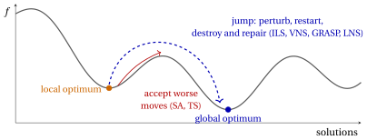
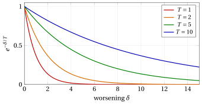
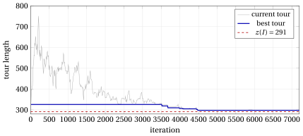

# How to escape from a local optimum · Simulated annealing

**Part 4 · Heuristic algorithms · Chapter 32** · [:material-book-open-variant: Chapter 32: Metaheuristics](index.md) · [:material-file-pdf-box: Lecture notes, volume 4 (PDF)](../../pdf/lecture-notes-4-heuristic-algorithms.pdf) · [:material-pencil: Exercises: Metaheuristics](../../exercises/metaheuristics.md)

## 32.3 How to escape from a local optimum { #sez-sec-escape }

- A local search moves from a solution to a better neighbour, and stops at the first <strong>local optimum</strong>: a solution with no better neighbour. In the landscape of the objective function, it descends to the bottom of the valley where it starts, and stays there. This is pure <strong>intensification</strong>.

- Repeating the local search from many starting solutions (multi-start) explores many valleys, but each start ignores everything learnt before, and good valleys are usually found close to other good valleys.

- The table below lists the ways to escape from a local optimum; it is the map of the chapter.

{ .fig loading=lazy  }

<table>
<tr>
<th>how to escape</th>
<th>idea</th>
<th>metaheuristic</th>
</tr>
<tr>
<td>accept worse moves <em>at random</em></td>
<td>a worse neighbour is accepted with a probability that decreases with the worsening and with time</td>
<td>simulated annealing (Section <a href="#sez-sec-sa">32.4</a>)</td>
</tr>
<tr>
<td>accept worse moves <em>deterministically, with memory</em></td>
<td>move to the best neighbour even if it is worse, and forbid going back to the solutions just visited</td>
<td>tabu search (Section <a href="../tabu-search/#sez-sec-ts">32.5</a>)</td>
</tr>
<tr>
<td><em>perturb</em> the local optimum and restart</td>
<td>apply a random modification that the local search cannot undo, and descend again</td>
<td>iterated local search (Section <a href="../iterated-local-search/#sez-sec-ils">32.6</a>)</td>
</tr>
<tr>
<td><em>change the neighbourhood</em></td>
<td>when the search is stuck, use a larger neighbourhood, of which the local optimum is no longer a local optimum</td>
<td>variable neighbourhood search (Section <a href="../variable-neighbourhood-search/#sez-sec-vns">32.7</a>)</td>
</tr>
<tr>
<td><em>restart</em> from a randomized construction</td>
<td>build a different good solution at every restart, and improve it</td>
<td>GRASP (Section <a href="../grasp/#sez-sec-grasp">32.8</a>)</td>
</tr>
<tr>
<td><em>destroy and repair</em></td>
<td>remove a large part of the solution and rebuild it with a heuristic or an exact algorithm</td>
<td>large neighbourhood search (Section <a href="../large-neighbourhood-search/#sez-sec-lns">32.9</a>)</td>
</tr>
<tr>
<td>work with a <em>population</em></td>
<td>combine the parts of several good solutions into new ones</td>
<td>genetic and memetic algorithms (Section <a href="../population-based-methods-genetic-and-memetic-algorithms/#sez-sec-ga">32.10</a>)</td>
</tr>
</table>

- The first two ways keep <strong>one current solution</strong> and change the <strong>acceptance rule</strong> of the local search: they walk out of the valley through worse solutions. The next four <strong>jump</strong>: they generate a new starting point, far enough to leave the valley but close enough to keep what is good. The last one keeps <strong>many solutions</strong> at the same time.

- Every metaheuristic must balance <strong>intensification</strong> (descend to the bottom of the current valley) and <strong>diversification</strong> (leave it for another one). For each method we point out which component does what, and Section [32.11](comparison-and-conclusions.md#sez-sec-closing) compares them.

- A metaheuristic is a <em>scheme</em>, not an algorithm: to obtain an algorithm one must choose the representation, the neighbourhoods, the local search and the parameters, and these choices matter at least as much as the scheme. We present every metaheuristic on the problems where its idea is most natural, not on all four.

## 32.4 Simulated annealing { #sez-sec-sa }

!!! chiave ""

    <em>Simulated annealing</em> (denoted by $SA$) is a local search that chooses a <em>random</em> neighbour of the current solution and moves to it if it is better; if it is worse, it moves to it anyway with a probability that decreases with the worsening and with a parameter $T$, the <em>temperature</em>. The temperature starts high, so that at the beginning almost every move is accepted, and is lowered gradually, so that at the end only improving moves are accepted. The best solution visited is returned.

- The pseudo-code of $SA$, for a minimization problem with objective $f$ and neighbourhood $N$, reads as follows:

!!! algoritmo "Algorithm: Simulated annealing"

    

<strong>Input:</strong> starting solution \(S\), initial temperature \(T_0\), cooling factor \(\alpha\in(0,1)\), number \(L\) of moves
    per temperature, final temperature \(T_{\min}\)

<strong>Output:</strong> best solution found

1<strong>Function</strong> SimulatedAnnealing(\(S, T_0, \alpha, L, T_{\min}\))

2\(cur := S\);  \(fcur := f(cur)\)
    \(best := cur\);  \(fbest := fcur\)
    \(T := T_0\) ▹ current solution best solution found temperature

3<strong>while</strong> \(T > T_{\min}\) <strong>do</strong>

4<strong>for</strong> \(l := 1\) <strong>to</strong> \(L\) <strong>do</strong>

5\(S' :=\) random neighbour in \(N(cur)\)

6\(\delta := f(S') - fcur\)

7\(v := \textsc{Rand}()\)

8<strong>if</strong> \(\delta \le 0\) <strong>or</strong> \(v < e^{-\delta/T}\) <strong>then</strong>

9\(cur := S'\);  \(fcur := fcur + \delta\) ▹ move accepted

10<strong>if</strong> \(fcur < fbest\) <strong>then</strong>

11\(best := cur\);  \(fbest := fcur\)

12<strong>end</strong>

13<strong>end</strong>

14<strong>end</strong>

15\(T := \alpha\cdot T\) ▹ cooling

16<strong>end</strong>

17<strong>return</strong> \(best\)

Run in Colab:

- The name comes from metallurgy: <em>annealing</em> is the process of heating a metal and cooling it slowly, so that its atoms settle into a state of minimum energy; cooled too fast, the metal freezes into a disordered state of higher energy. Kirkpatrick, Gelatt and Vecchi (1983) and, independently, Černy (1985) proposed to simulate this process on an optimization problem, with the objective $f$ in the role of the energy. The acceptance rule is the one used by Metropolis et al. (1953) to simulate the atoms.

!!! chiave ""

    <strong>Metropolis acceptance rule.</strong> At temperature $T$, a neighbour $S'$ of the current solution, with $\delta=f(S')-f(cur)$, is accepted with probability

    $$
    P(\text{accept } S') \;=\;
    \begin{cases}
    1 & \text{if } \delta\le 0,\\[1ex]
    e^{-\delta/T} & \text{if } \delta>0.
    \end{cases}
    $$

- The probability is implemented by drawing $v=\textsc{Rand}()$, uniform in $(0,1)$, and accepting if $v<e^{-\delta/T}$, which happens with probability $e^{-\delta/T}$.

- A worsening move is accepted more easily if the worsening $\delta$ is <strong>small</strong>, and if the temperature $T$ is <strong>high</strong>. As $T\to\infty$ every move is accepted, and $SA$ becomes a random walk (pure diversification); as $T\to 0$ only the moves with $\delta\le 0$ are accepted, and $SA$ becomes a local search with random choice of the neighbour (pure intensification). Lowering the temperature moves gradually from the first behaviour to the second.

- Moves with $\delta=0$ are always accepted: $SA$ walks freely on the plateaus of flat objectives.

- $SA$ never stops at a local optimum: a local optimum is left as soon as a worsening move is drawn and accepted. For this reason the <strong>best</strong> solution visited must be stored separately: the current solution at the end is not necessarily the best one.

- Only <strong>one random neighbour</strong> is evaluated per iteration, not the whole neighbourhood: an iteration of $SA$ is very cheap, and $SA$ performs many more iterations than a local search. For the TSP, a random 2-opt move is drawn by numbering the $M=\frac{n(n-3)}{2}$ moves $(i,j)$ in lexicographic order and choosing the one in position $1+\lfloor \textsc{Rand}()\cdot M\rfloor$; its $\delta$ is computed in $O(1)$.

{ .fig loading=lazy  }

- The figure shows the acceptance probability as a function of the worsening, for four temperatures. At $T=10$ a worsening of $5$ is accepted with probability $e^{-0.5}\approx 0.61$; at $T=1$ with probability $e^{-5}\approx 0.007$. The temperature has the same unit as the objective: $T$ is “large” or “small” only compared with the typical values of $\delta$.

### 32.4.1 The cooling schedule and the parameters { #sez-sec-sa-param }

- The <strong>cooling schedule</strong> is the sequence of temperatures. The pseudo-code uses the <strong>geometric</strong> schedule $T\leftarrow\alpha T$, the most common in practice, with $\alpha$ between $0.8$ and $0.99$, and $L$ moves at each temperature. Other schedules are the <em>linear</em> one, $T_k=T_0-k\beta$, and the <em>logarithmic</em> one, $T_k=\frac{\Gamma}{\ln(k+1)}$, which matters in the theory of $SA$ but is far too slow in practice.

- <strong>Initial temperature $T_0$.</strong> It must be high enough to accept most worsening moves at the beginning. A common rule fixes a target initial acceptance ratio $\chi_0$ (for instance $\chi_0=0.8$), estimates the average worsening $\bar\delta$ of a sample of random moves, and sets $T_0=-\bar\delta/\ln\chi_0$, so that $e^{-\bar\delta/T_0}=\chi_0$.

- <strong>Moves per temperature $L$.</strong> The search must be given time to adapt to each temperature; $L$ is often taken proportional to the size of the neighbourhood.

- <strong>Stopping rule.</strong> The pseudo-code stops when $T\le T_{\min}$. With the geometric schedule the number of temperatures is the smallest integer $K$ with $T_0\alpha^K\le T_{\min}$, i.e., $K=\big\lceil \ln(T_{\min}/T_0)/\ln\alpha\big\rceil$ when the ratio is not an integer, and the number of iterations is $K\cdot L$. Other common rules stop after a number of temperatures without any accepted move, or at a time limit.

- Slow cooling ($\alpha$ close to $1$) gives better solutions but more iterations: the parameters trade quality for time, as every heuristic does.

### 32.4.2 Examples

!!! esempio "Example 32.3: $SA$ with the 2-opt neighbourhood on the TSP reference instance"

    We start from the tour computed by the nearest neighbour heuristic from city $1$ in the notes on constructive heuristics, $\sigma=(1,3,2,4,5)$ of length $25$, with $T_0=5$, $\alpha=0.8$, $L=2$ and $T_{\min}=3$: the temperatures are $5$, $4$ and $3.2$ (then $2.56\le 3$ stops the search), for a total of $6$ iterations. The $M=5$ moves of 2-opt on $5$ cities are numbered

    $$
    1:(1,3),\quad 2:(1,4),\quad 3:(2,4),\quad 4:(2,5),\quad 5:(3,5),
    $$

    and the random numbers, with $seed=1$, are those of Section [32.2.2](the-problems-and-the-assumptions.md#sez-sec-random): the first number of each iteration ($u$) chooses the move $1+\lfloor 5u\rfloor$, the second ($v$) is used in the acceptance test.

    
<table>
    <tr>
    <th>it</th>
    <th>\(T\)</th>
    <th>\(u\)</th>
    <th>move</th>
    <th>\(\delta\)</th>
    <th>\(v\)</th>
    <th>\(e^{-\delta/T}\)</th>
    <th>decision</th>
    <th>current tour</th>
    <th>\(L\)</th>
    </tr>
    <tr>
    <td>\(1\)</td>
    <td>\(5\)</td>
    <td>\(0.0000\)</td>
    <td>\(1:(1,3)\)</td>
    <td>\(4\)</td>
    <td>\(0.1315\)</td>
    <td>\(0.4493\)</td>
    <td>accept</td>
    <td>\((1,2,3,4,5)\)</td>
    <td>\(29\)</td>
    </tr>
    <tr>
    <td>\(2\)</td>
    <td>\(5\)</td>
    <td>\(0.7556\)</td>
    <td>\(4:(2,5)\)</td>
    <td>\(-7\)</td>
    <td>—</td>
    <td>—</td>
    <td>accept</td>
    <td>\((1,2,5,4,3)\)</td>
    <td>\(22\)</td>
    </tr>
    <tr>
    <td>\(3\)</td>
    <td>\(4\)</td>
    <td>\(0.5328\)</td>
    <td>\(3:(2,4)\)</td>
    <td>\(2\)</td>
    <td>\(0.2190\)</td>
    <td>\(0.6065\)</td>
    <td>accept</td>
    <td>\((1,2,4,5,3)\)</td>
    <td>\(24\)</td>
    </tr>
    <tr>
    <td>\(4\)</td>
    <td>\(4\)</td>
    <td>\(0.0470\)</td>
    <td>\(1:(1,3)\)</td>
    <td>\(-6\)</td>
    <td>—</td>
    <td>—</td>
    <td>accept</td>
    <td>\((1,4,2,5,3)\)</td>
    <td>\(18\)</td>
    </tr>
    <tr>
    <td>\(5\)</td>
    <td>\(3.2\)</td>
    <td>\(0.6793\)</td>
    <td>\(4:(2,5)\)</td>
    <td>\(4\)</td>
    <td>\(0.9347\)</td>
    <td>\(0.2865\)</td>
    <td>reject</td>
    <td>\((1,4,2,5,3)\)</td>
    <td>\(18\)</td>
    </tr>
    <tr>
    <td>\(6\)</td>
    <td>\(3.2\)</td>
    <td>\(0.3835\)</td>
    <td>\(2:(1,4)\)</td>
    <td>\(4\)</td>
    <td>\(0.5194\)</td>
    <td>\(0.2865\)</td>
    <td>reject</td>
    <td>\((1,4,2,5,3)\)</td>
    <td>\(18\)</td>
    </tr>
    </table>

    At iterations $1$ and $3$ a <strong>worse</strong> tour is accepted ($25\to 29$ and $22\to 24$), because $v$ is smaller than the acceptance probability; at iterations $5$ and $6$ the temperature is lower, the worsening moves are less likely to be accepted, and both are rejected. The best tour, $(1,4,2,5,3)$, is the optimal tour $(1,3,5,2,4)$ traversed in the opposite direction: $SA(I)=18=z(I)$.

- On this small instance the optimal tour is the only 2-opt local optimum among the $12$ tours, so a 2-opt local search would reach it as well: the example shows the mechanics of $SA$; its ability to escape from local optima needs instances with bad local optima, as the next ones.

### 32.4.3 Infeasible solutions: simulated annealing with a penalty { #sez-sec-sa-kp }

- For the KP, the flip neighbourhood of a solution close to the capacity contains many infeasible solutions. Instead of discarding them, $SA$ can <strong>visit</strong> them, with a penalty on the excess weight that makes them less attractive:

!!! chiave ""

    $$
    f_\beta(x) \;=\; \sum_{i\in\mathscr{I}} p_i x_i \;-\; \beta\cdot \max\Big\{0,\ \sum_{i\in\mathscr{I}} w_i x_i - c\Big\},
    \qquad \beta>0 .
    $$

    $SA$ maximizes $f_\beta$ over all $x\in\{0,1\}^n$; the worsening of a move from $x$ to $y$ is $\delta=f_\beta(x)-f_\beta(y)$, and the best solution is updated with <strong>feasible</strong> solutions only.

- On a feasible solution $f_\beta$ is the profit. Passing through an infeasible solution, $SA$ can reach feasible solutions that are not reachable through feasible flips only: the infeasible region acts as a <strong>bridge</strong> between valleys.

- The <strong>penalty coefficient</strong> $\beta$ is a parameter: if it is too small the search wanders in the infeasible region, where the profit is larger; if it is too large the infeasible solutions are never accepted, and the bridge is closed.

!!! esempio "Example 32.4: $SA$ with a penalty on the KP reference instance"

    We start from $x=(1,0,1,0)$, the solution $\{1,3\}$ of the greedy algorithm by efficiency, of profit $16$. It is a local optimum for the flip neighbourhood (notes on heuristic algorithms): its feasible neighbours have profit $6$ and $10$. We use $\beta=3$, $T_0=4$, $\alpha=0.8$, $L=2$, $T_{\min}=2.5$ (temperatures $4$, $3.2$, $2.56$: $6$ iterations) and $seed=3$. At each iteration $u$ chooses the item $k=1+\lfloor 4u\rfloor$ to flip, and $v$ is used in the acceptance test.

    
<table>
    <tr>
    <th>it</th>
    <th>\(T\)</th>
    <th>\(u\)</th>
    <th>\(k\)</th>
    <th>\(y\)</th>
    <th>\(\sum w_iy_i\)</th>
    <th>\(f_3(y)\)</th>
    <th>\(\delta\)</th>
    <th>\(v\) vs \(e^{-\delta/T}\)</th>
    <th>decision</th>
    </tr>
    <tr>
    <td>\(1\)</td>
    <td>\(4\)</td>
    <td>\(0.0000\)</td>
    <td>\(1\)</td>
    <td>\((0,0,1,0)\)</td>
    <td>\(3\)</td>
    <td>\(6\)</td>
    <td>\(10\)</td>
    <td>\(0.3946\ge 0.0821\)</td>
    <td>reject</td>
    </tr>
    <tr>
    <td>\(2\)</td>
    <td>\(4\)</td>
    <td>\(0.2668\)</td>
    <td>\(2\)</td>
    <td>\((1,1,1,0)\)</td>
    <td>\(12\)</td>
    <td>\(14\)</td>
    <td>\(2\)</td>
    <td>\(0.3760<0.6065\)</td>
    <td>accept</td>
    </tr>
    <tr>
    <td>\(3\)</td>
    <td>\(3.2\)</td>
    <td>\(0.5983\)</td>
    <td>\(3\)</td>
    <td>\((1,1,0,0)\)</td>
    <td>\(9\)</td>
    <td>\(17\)</td>
    <td>\(-3\)</td>
    <td>—</td>
    <td>accept</td>
    </tr>
    <tr>
    <td>\(4\)</td>
    <td>\(3.2\)</td>
    <td>\(0.1411\)</td>
    <td>\(1\)</td>
    <td>\((0,1,0,0)\)</td>
    <td>\(4\)</td>
    <td>\(7\)</td>
    <td>\(10\)</td>
    <td>\(0.0366<0.0439\)</td>
    <td>accept</td>
    </tr>
    <tr>
    <td>\(5\)</td>
    <td>\(2.56\)</td>
    <td>\(0.0379\)</td>
    <td>\(1\)</td>
    <td>\((1,1,0,0)\)</td>
    <td>\(9\)</td>
    <td>\(17\)</td>
    <td>\(-10\)</td>
    <td>—</td>
    <td>accept</td>
    </tr>
    <tr>
    <td>\(6\)</td>
    <td>\(2.56\)</td>
    <td>\(0.1505\)</td>
    <td>\(1\)</td>
    <td>\((0,1,0,0)\)</td>
    <td>\(4\)</td>
    <td>\(7\)</td>
    <td>\(10\)</td>
    <td>\(0.5582\ge 0.0201\)</td>
    <td>reject</td>
    </tr>
    </table>

    At iteration $2$ the search moves to the <strong>infeasible</strong> solution $(1,1,1,0)$, of weight $12>9$: its profit is $23$ and its penalized value $23-3\cdot 3=14$, a worsening of $2$ accepted with probability $0.6065$. From there, removing item $3$ gives the feasible solution $(1,1,0,0)$ of profit $17$: the optimum, $SA(I)=17=z(I)$. Iteration $4$ shows that at this temperature even a worsening of $10$ can be accepted, with a small probability; iteration $5$ goes back to the optimum.

### 32.4.4 An experiment on the medium TSP instance { #sez-sec-sa-exp }

- We run $SA$ with the 2-opt neighbourhood on TSP20 ([Example 32.1](the-problems-and-the-assumptions.md#box-2-ex-tsp20)), from the nearest neighbour tour of length $326$, with $L=100$ and $T_{\min}=0.5$. The figure shows one run, with $T_0=20$, $\alpha=0.95$ and $seed=1$: the length of the current tour (gray) and of the best tour (blue) along the $7200$ iterations, every $10$ iterations. The data are produced by the <code>C++</code> code of the chapter, in its Colab notebook.

{ .fig loading=lazy  }

- At the beginning the temperature is high compared with the typical worsening of a 2-opt move, and the current tour gets much <strong>worse</strong> than the starting one (up to length $765$): the search is almost a random walk. As $T$ decreases, fewer worsening moves are accepted and the current tour descends into a valley; at the end the search is a local search. The best tour, of length $298$, is found at iteration $4479$: it is better than the 2-opt local optimum ($319$), but it is not optimal.

- The table reports, for $10$ runs with $seed=1,\dots,10$ and several parameters, the number of iterations, the minimum, the average and the maximum length of the best tour, and the number of runs that reach the optimum $291$.

<table>
<tr>
<th>\(\alpha\)</th>
<th>\(T_0\)</th>
<th>iterations</th>
<th>min</th>
<th>average</th>
<th>max</th>
<th>optimal runs</th>
</tr>
<tr>
<td>\(0.9\)</td>
<td>\(1\)</td>
<td>\(700\)</td>
<td>\(291\)</td>
<td>\(310.3\)</td>
<td>\(322\)</td>
<td>\(1\)</td>
</tr>
<tr>
<td>\(0.9\)</td>
<td>\(5\)</td>
<td>\(2200\)</td>
<td>\(291\)</td>
<td>\(297.3\)</td>
<td>\(305\)</td>
<td>\(4\)</td>
</tr>
<tr>
<td>\(0.9\)</td>
<td>\(20\)</td>
<td>\(3600\)</td>
<td>\(291\)</td>
<td>\(300.3\)</td>
<td>\(323\)</td>
<td>\(4\)</td>
</tr>
<tr>
<td>\(0.9\)</td>
<td>\(100\)</td>
<td>\(5100\)</td>
<td>\(291\)</td>
<td>\(297.8\)</td>
<td>\(311\)</td>
<td>\(3\)</td>
</tr>
<tr>
<td>\(0.95\)</td>
<td>\(1\)</td>
<td>\(1400\)</td>
<td>\(291\)</td>
<td>\(302.3\)</td>
<td>\(319\)</td>
<td>\(3\)</td>
</tr>
<tr>
<td>\(0.95\)</td>
<td>\(5\)</td>
<td>\(4500\)</td>
<td>\(291\)</td>
<td>\(294.3\)</td>
<td>\(298\)</td>
<td>\(5\)</td>
</tr>
<tr>
<td>\(0.95\)</td>
<td>\(20\)</td>
<td>\(7200\)</td>
<td>\(291\)</td>
<td>\(294.3\)</td>
<td>\(298\)</td>
<td>\(5\)</td>
</tr>
<tr>
<td>\(0.95\)</td>
<td>\(100\)</td>
<td>\(10400\)</td>
<td>\(291\)</td>
<td>\(293.2\)</td>
<td>\(299\)</td>
<td>\(7\)</td>
</tr>
<tr>
<td>\(0.99\)</td>
<td>\(1\)</td>
<td>\(6900\)</td>
<td>\(291\)</td>
<td>\(298.8\)</td>
<td>\(305\)</td>
<td>\(4\)</td>
</tr>
<tr>
<td>\(0.99\)</td>
<td>\(5\)</td>
<td>\(23000\)</td>
<td>\(291\)</td>
<td>\(291.7\)</td>
<td>\(298\)</td>
<td>\(9\)</td>
</tr>
<tr>
<td>\(0.99\)</td>
<td>\(20\)</td>
<td>\(36800\)</td>
<td>\(291\)</td>
<td>\(291.0\)</td>
<td>\(291\)</td>
<td>\(10\)</td>
</tr>
<tr>
<td>\(0.99\)</td>
<td>\(100\)</td>
<td>\(52800\)</td>
<td>\(291\)</td>
<td>\(291.0\)</td>
<td>\(291\)</td>
<td>\(10\)</td>
</tr>
</table>

- With $T_0=1$ the temperature is too low from the beginning: few worsening moves are accepted, and $SA$ behaves like a randomized local search. Slower cooling ($\alpha=0.99$) spends more iterations at every temperature range and reaches the optimum in almost every run, at the price of many more iterations. A single run says little: the comparison must look at the distribution over several seeds, as recalled in the notes on heuristic algorithms.

### 32.4.5 Properties { #sez-sec-sa-prop }

- At a fixed temperature $T$, the sequence of current solutions of $SA$ is a Markov chain: the next solution depends only on the current one. If the neighbourhood is symmetric ($S'\in N(S)$ if and only if $S\in N(S')$, all neighbourhoods having the same size) and connected (every solution can reach every other one through moves), the chain has a unique stationary distribution, the <strong>Boltzmann distribution</strong>:

!!! chiave ""

    $$
    \pi_T(S) \;=\; \frac{e^{-f(S)/T}}{\sum_{S'} e^{-f(S')/T}} \qquad \text{for every solution } S.
    $$

- For two solutions $S_1$ and $S_2$, $\frac{\pi_T(S_1)}{\pi_T(S_2)}=e^{(f(S_2)-f(S_1))/T}$: better solutions are more probable, and the more so the lower the temperature. As $T\to 0$, $\pi_T$ concentrates on the optimal solutions.

- Hajek (1988) proved that with the logarithmic schedule $T_k=\frac{\Gamma}{\ln(k+1)}$, with $\Gamma$ at least the depth of the deepest valley that does not contain an optimal solution, the probability that the current solution is optimal tends to $1$. The result is a guarantee <em>in the limit</em>: the number of iterations needed can be larger than the number of solutions, and in practice the faster geometric schedule is used, without guarantees.

---

**Next:** [32.5 Tabu search](tabu-search.md)
