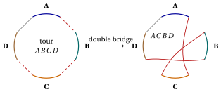
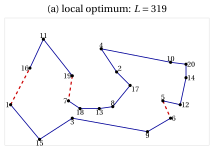
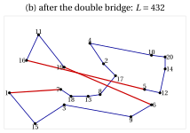
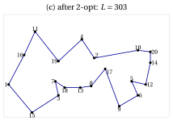
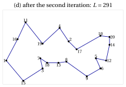

# 32.6 Iterated local search { #sez-sec-ils }

**Part 4 · Heuristic algorithms · Chapter 32** · [:material-book-open-variant: Chapter 32: Metaheuristics](index.md) · [:material-file-pdf-box: Lecture notes, volume 4 (PDF)](../../pdf/lecture-notes-4-heuristic-algorithms.pdf) · [:material-pencil: Exercises: Metaheuristics](../../exercises/metaheuristics.md)

!!! chiave ""

    <em>Iterated local search</em> (denoted by $ILS$) applies a local search, and then repeats: it <em>perturbs</em> the current local optimum with a random modification (a <em>kick</em>) that the local search cannot easily undo, applies the local search to the perturbed solution, and decides with an <em>acceptance criterion</em> whether the new local optimum replaces the current one. It is a walk among the local optima.

- The pseudo-code of $ILS$ for the TSP, with the 2-opt local search and the double-bridge kick, reads as follows:

!!! algoritmo "Algorithm: Iterated local search for the TSP"

    

<strong>Input:</strong> distances \(d\), starting tour \(\sigma[1..n]\), number of iterations \(maxIter\)

<strong>Output:</strong> the last accepted local optimum

1<strong>Function</strong> IteratedLocalSearch(\(d, \sigma, maxIter\))

2\(cur := \textsc{TwoOptLS}(\sigma)\);  \(lcur := L(cur)\) ▹ first local optimum

3<strong>for</strong> \(it := 1\) <strong>to</strong> \(maxIter\) <strong>do</strong>

4\(nw := \textsc{DoubleBridge}(cur)\)
    \(nw := \textsc{TwoOptLS}(nw)\);  \(lnew := L(nw)\) ▹ perturbation local search

5<strong>if</strong> \(lnew < lcur\) <strong>then</strong>

6\(cur := nw\);  \(lcur := lnew\) ▹ acceptance

7<strong>end</strong>

8<strong>end</strong>

9<strong>return</strong> \(cur\)

10<strong>Function</strong> DoubleBridge(\(\sigma\))

11\(p_1 := 1+\lfloor\textsc{Rand}()\cdot(n-3)\rfloor\)

12\(p_2 := p_1+1+\lfloor\textsc{Rand}()\cdot(n-2-p_1)\rfloor\)

13\(p_3 := p_2+1+\lfloor\textsc{Rand}()\cdot(n-1-p_2)\rfloor\)

14\(A := \sigma[1..p_1]\);  \(B := \sigma[p_1{+}1..p_2]\);  \(C := \sigma[p_2{+}1..p_3]\);  \(D := \sigma[p_3{+}1..n]\)

15<strong>return</strong> \((A,C,B,D)\)

Run in Colab:

- The scheme was described in its general form by Lourenço, Martin and Stützle (2003), in the <em>Handbook of Metaheuristics</em>; for the TSP it goes back to the “large-step Markov chains” of Martin, Otto and Felten (1991), who introduced the double-bridge kick.

- $ILS$ has three components, and each one has a role:

    - the <strong>local search</strong> intensifies: it brings every perturbed solution to the bottom of its valley;

    - the <strong>perturbation</strong> diversifies: it moves the search to another valley;

    - the <strong>acceptance criterion</strong> balances the two: accepting only better local optima (as in the pseudo-code) intensifies, accepting every new local optimum diversifies; intermediate rules accept a worse local optimum with a probability, as in $SA$.

- The <strong>strength</strong> of the perturbation is the key parameter. If it is too weak, the local search undoes it and returns to the same local optimum; if it is too strong, the perturbed solution has nothing in common with the local optimum, and $ILS$ becomes a random multi-start. A good kick changes the solution in a way that the local search <em>cannot</em> undo, but keeps most of it.

{ .fig loading=lazy  }

- The <strong>double bridge</strong> cuts the tour into four segments $A$, $B$, $C$, $D$ and reconnects them as $A\,C\,B\,D$: it removes three edges (dashed) and adds three new ones (red), while the edge between the end of $D$ and the beginning of $A$ is kept. No segment is reversed, whereas every 2-opt move reverses a segment: when $B$ and $C$ have at least two cities each, a single 2-opt move cannot undo the kick, and the 2-opt local search, which accepts only improving moves, rarely goes back to the same local optimum. (If $B$ and $C$ are single cities, the kick changes only two edges and is itself a 2-opt move: exercise EX\_IV\_2 uses this case.)

## 32.6.1 Example

!!! esempio "Example 32.6: $ILS$ on the medium TSP instance"

    On TSP20, the 2-opt local search from the nearest neighbour tour (length $326$) stops at the local optimum

    $$
    cur=(1,16,11,19,7,18,13,8,17,2,4,10,20,14,12,5,6,9,3,15),\qquad L(cur)=319.
    $$

    With $seed=1$, the three random numbers of the first kick are $0.0000$, $0.1315$, $0.7556$, so

    $$
    p_1=1+\lfloor 0.0000\cdot 17\rfloor=1,\quad
    p_2=1+1+\lfloor 0.1315\cdot 17\rfloor=4,\quad
    p_3=4+1+\lfloor 0.7556\cdot 15\rfloor=16,
    $$

    and the segments are $A=(1)$, $B=(16,11,19)$, $C=(7,18,13,8,17,2,4,10,20,14,12,5)$, $D=(6,9,3,15)$. The kick removes the edges $(1,16)$, $(19,7)$, $(5,6)$ and adds $(1,7)$, $(5,16)$, $(19,6)$: the perturbed tour $A\,C\,B\,D$ has length $432$, much worse. The 2-opt local search brings it to a new local optimum of length $303<319$, which is accepted. The second kick ($p=(8,14,16)$) gives, after 2-opt, a tour of length $291=z(I)$; the third gives again a tour of length $291$, not better, and it is rejected.

{ .fig loading=lazy  }

{ .fig loading=lazy  }

{ .fig loading=lazy  }

{ .fig loading=lazy  }

- Panel (a) shows the local optimum with the three edges removed by the kick (dashed), panel (b) the perturbed tour with the three new edges, panels (c) and (d) the local optima after the first and the second iteration. The kick moves the segment $C$ before $B$; the 2-opt local search then repairs the long edges it created, keeping the good parts of the old tour.

- With $100$ iterations and $seed=1,\dots,10$, $ILS$ reaches the optimum $291$ in every run; the iteration at which the optimum is reached is

    $$
    2,\ 3,\ 1,\ 7,\ 8,\ 11,\ 15,\ 6,\ 2,\ 3
    $$

    for the ten seeds. Each iteration costs one kick and one 2-opt local search, which starts from a solution close to a local optimum and needs few moves.

---

**Next:** [32.7 Variable neighbourhood search](variable-neighbourhood-search.md)
