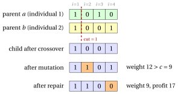

# 31.10 Population-based methods: genetic and memetic algorithms { #sez-sec-ga }

**Part 4 · Heuristic algorithms · Chapter 31** · [:material-book-open-variant: Chapter 31: Metaheuristics](index.md) · [:material-file-pdf-box: Lecture notes, volume 4 (PDF)](../../pdf/lecture-notes-4-heuristic-algorithms.pdf) · [:material-pencil: Exercises: Metaheuristics](../../exercises/metaheuristics.md)

!!! chiave ""

    A <em>genetic algorithm</em> (denoted by $GA$) keeps a <em>population</em> of solutions, encoded as strings (<em>chromosomes</em>). At every iteration it <em>selects</em> two parents, preferring the fitter ones, <em>recombines</em> them into a child (<em>crossover</em>), changes a few random genes of the child (<em>mutation</em>), <em>repairs</em> it if it is infeasible, and inserts it into the population in place of a worse individual. A <em>memetic algorithm</em> also applies a local search to every child.

- The pseudo-code of a steady-state $GA$ for the KP with binary encoding reads as follows; with $memetic=\mathrm{true}$ it is a memetic algorithm.

!!! algoritmo "Algorithm: Genetic and memetic algorithm for the KP"

    

<strong>Input:</strong> KP instance \(p[1..n]\), \(w[1..n]\), \(c\); population size \(P\); mutation probability \(p_m\);
    \(maxIter\); \(memetic\)

<strong>Output:</strong> best individual of the final population

1<strong>Function</strong> GeneticKP(\(p, w, c, P, p_m, maxIter, memetic\))

2<strong>for</strong> \(s := 1\) <strong>to</strong> \(P\) <strong>do</strong> ▹ random initial population

3<strong>for</strong> \(i := 1\) <strong>to</strong> \(n\) <strong>do</strong> \(pop[s][i] := 1\) if \(\textsc{Rand}()<0.5\), else \(0\)

4\(\textsc{RepairKP}(pop[s])\); 

5<strong>if</strong> \(memetic\) <strong>then</strong> \(\textsc{KPLocalSearch}(pop[s])\)

6\(fit[s] := \sum_i p[i]\,pop[s][i]\)

7<strong>end</strong>

8<strong>for</strong> \(it := 1\) <strong>to</strong> \(maxIter\) <strong>do</strong>

9\(a := \textsc{Tournament}()\);  \(b := \textsc{Tournament}()\)
    \(cut := 1+\lfloor\textsc{Rand}()\cdot(n-1)\rfloor\)
    \(child := (pop[a][1..cut],\ pop[b][cut{+}1..n])\) ▹ selection one-point crossover

10<strong>for</strong> \(i := 1\) <strong>to</strong> \(n\) <strong>do</strong> \(\textsc{Rand}()<p_m\)\(child[i] := 1-child[i]\)

11\(\textsc{RepairKP}(child)\); 

12<strong>if</strong> \(memetic\) <strong>then</strong> \(\textsc{KPLocalSearch}(child)\)

13\(worst :=\) the last index \(s\) of minimum \(fit[s]\)

14<strong>if</strong> \(child\notin pop\) <strong>and</strong> \(\sum_ip[i]\,child[i] > fit[worst]\) <strong>then</strong> ▹ replacement

15\(pop[worst] := child\);  \(fit[worst] := \sum_ip[i]\,child[i]\)

16<strong>end</strong>

17<strong>end</strong>

18<strong>return</strong> the individual of maximum \(fit\)

19<strong>Function</strong> Tournament()

20\(a := 1+\lfloor\textsc{Rand}()\cdot P\rfloor\);  \(b := 1+\lfloor\textsc{Rand}()\cdot P\rfloor\)

21<strong>if</strong> \(fit[a]\ge fit[b]\) <strong>then</strong> <strong>return</strong> \(a\) <strong>else</strong> <strong>return</strong> \(b\)

Run in Colab:

- Genetic algorithms were introduced by Holland (1975) as a model of natural evolution, and made popular as optimization methods by Goldberg (1989). Memetic algorithms, in which every individual is improved by a local search, were proposed by Moscato (1989).

- <strong>Encoding.</strong> For the KP the binary vector $x$ is a natural chromosome: the gene $i$ says whether item $i$ is selected. The <strong>fitness</strong> of an individual is its profit.

- <strong>Selection.</strong> A binary tournament draws two individuals at random and keeps the fitter one: good individuals are more likely to become parents, but every individual has a chance.

- <strong>Crossover.</strong> One-point crossover takes the genes $1,\dots,cut$ from the first parent and the genes $cut+1,\dots,n$ from the second one. The idea is that good solutions share good <em>building blocks</em>, and recombining two good parents can put the good blocks of both into one child.

- <strong>Mutation.</strong> Each gene is flipped with a small probability $p_m$, typically $\frac1n$: it brings back into the population genes that selection may have lost.

- <strong>Repair.</strong> The child can be infeasible. REPAIRKP removes the selected item of minimum efficiency until the capacity is respected (ties: the item of largest index). Alternatives are penalties, as in Section [31.4.3](how-to-escape-from-a-local-optimum.md#sez-sec-sa-kp), or encodings in which every chromosome is feasible.

- <strong>Replacement.</strong> In the steady-state version of the pseudo-code, the child replaces the worst individual if it is better and not already in the population; duplicates would make the population lose its diversity.

- Selection and replacement <strong>intensify</strong> (the population concentrates on good solutions); crossover and mutation <strong>diversify</strong>. Without local search, a $GA$ is good at finding promising regions but slow at reaching their local optima: the memetic algorithm adds the missing intensification.

!!! esempio "Example 31.11: $GA$ on the KP reference instance"

    With $P=4$, $p_m=\frac14$ and $seed=36$. The first $16$ random numbers build the initial population (gene $1$ if the number is smaller than $0.5$):

    $$
    \begin{array}{lll}pop[1]: & 0.0003,\ 0.7354,\ 0.2018,\ 0.5114 & \to (1,0,1,0) \\ pop[2]: & 0.1796,\ 0.8825,\ 0.6936,\ 0.4391 & \to (1,0,0,1) \\ pop[3]: & 0.4547,\ 0.6489,\ 0.8061,\ 0.6990 & \to (1,0,0,0) \\ pop[4]: & 0.9148,\ 0.2446,\ 0.9246,\ 0.0692 & \to (0,1,0,1)\end{array}
    $$

    All four individuals are feasible: $pop[1]=(1,0,1,0)$, $pop[2]=(1,0,0,1)$, $pop[3]=(1,0,0,0)$, $pop[4]=(0,1,0,1)$, with fitness $(16,14,10,11)$.

    <strong>Iteration 1</strong> (random numbers $0.1614$, $0.2771$, $0.8030$, $0.4063$, $0.0295$, $0.7238$, $0.2032$, $0.4957$, $0.4620$). The first tournament draws individuals $1+\lfloor 4\cdot 0.1614\rfloor=1$ and $1+\lfloor 4\cdot 0.2771\rfloor=2$, and selects $a=1$ (fitness $16>14$); the second draws $4$ and $2$ and selects $b=2$ (fitness $14>11$). The cut is $1+\lfloor 3\cdot 0.0295\rfloor=1$: the child takes gene $1$ from $pop[1]$ and genes $2$, $3$, $4$ from $pop[2]$, $child=(1,0,0,1)$. Only the second mutation number, $0.2032$, is smaller than $p_m=0.25$: gene $2$ flips, $child=(1,1,0,1)$, of weight $12>9$. The repair removes item $4$, the selected item of minimum efficiency: $child=(1,1,0,0)$, of weight $9$ and profit $17$. It replaces the worst individual, $pop[3]$ of fitness $10$.

    <strong>Iteration 2</strong> selects $a=2$ and $b=3$, cuts after gene $1$ and builds $(1,1,0,0)$, with no mutation: it is already in the population, and it is discarded. <strong>Iteration 3</strong> selects $a=2$ and $b=1$, cuts after gene $3$, builds $(1,0,0,0)$, and the mutation flips genes $1$ and $4$: $(0,0,0,1)$, of profit $4$, worse than every individual, discarded.

    The best individual is $(1,1,0,0)$: $GA(I)=17=z(I)$, found by crossover, mutation and repair together.

{ .fig loading=lazy  }

- On KP20, with $P=10$, $p_m=0.05$ and $300$ iterations, for $seed=1,\dots,10$:

<table>
<tr>
<th></th>
<th>min</th>
<th>average</th>
<th>max</th>
<th>optimal</th>
<th>best profit per seed</th>
</tr>
<tr>
<td>\(GA\)</td>
<td>\(508\)</td>
<td>\(516.9\)</td>
<td>\(521\)</td>
<td>\(4\)</td>
<td>\(521,519,521,508,514,521,510,519,521,515\)</td>
</tr>
<tr>
<td>memetic</td>
<td>\(521\)</td>
<td>\(521.0\)</td>
<td>\(521\)</td>
<td>\(10\)</td>
<td>\(521,521,521,521,521,521,521,521,521,521\)</td>
</tr>
</table>

- The plain $GA$ reaches the optimum $521$ in $4$ runs out of $10$; the memetic algorithm in every run. The local search makes every individual a local optimum, and the crossover then recombines local optima instead of arbitrary solutions.

---

**Next:** [31.11 Comparison and conclusions](comparison-and-conclusions.md)
