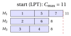
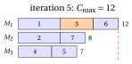
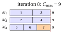

# 32.5 Tabu search { #sez-sec-ts }

**Part 4 · Heuristic algorithms · Chapter 32** · [:material-book-open-variant: Chapter 32: Metaheuristics](index.md) · [:material-file-pdf-box: Lecture notes, volume 4 (PDF)](../../pdf/lecture-notes-4-heuristic-algorithms.pdf) · [:material-pencil: Exercises: Metaheuristics](../../exercises/metaheuristics.md)

!!! chiave ""

    <em>Tabu search</em> (denoted by $TS$) explores the neighbourhood of the current solution completely and moves to the <em>best</em> neighbour, even if it is worse than the current solution. To avoid going back to the solutions just visited, it keeps a short-term memory, the <em>tabu list</em>: the moves that would undo the recent moves are forbidden (<em>tabu</em>) for a number of iterations, the <em>tenure</em>, unless they lead to a solution better than the best one found (<em>aspiration criterion</em>).

- The pseudo-code of $TS$ for $P\,||\,C_{\max}$, with the move neighbourhood and the lexicographic comparison of Section [32.2.1](the-problems-and-the-assumptions.md#sez-sec-neigh), reads as follows; the attribute $(j,h)$ forbids moving job $j$ back to machine $h$.

!!! algoritmo "Algorithm: Tabu search for $P\,||\,C_{\max}$"

    

<strong>Input:</strong> times \(t[1..n]\), \(m\) machines, starting assignment \(mach[1..n]\), \(tenure\), \(maxIter\)

<strong>Output:</strong> best assignment found

1<strong>Function</strong> TabuSearch(\(t, m, mach, tenure, maxIter\))

2\(L :=\) loads of \(mach\);  \(tabu[j][h] := 0\) for all \(j\), \(h\)

3\(best := mach\);  \(bestC := \max_h L[h]\)

4\(\LB := \max\{\max_j t[j],\ \lceil \sum_j t[j]/m\rceil\}\)
    \(it := 0\) ▹ stop if reached

5<strong>while</strong> \(it < maxIter\) <strong>and</strong> \(bestC > \LB\) <strong>do</strong>

6\(it := it+1\);  \(bj := 0\) ▹ best non-tabu move \((bj,bh)\)

7<strong>for</strong> \(j := 1\) <strong>to</strong> \(n\) <strong>do</strong>

8<strong>for</strong> \(h := 1\) <strong>to</strong> \(m\), \(h\ne mach[j]\) <strong>do</strong>

9\(L' :=\) the loads after moving job \(j\) from \(mach[j]\) to \(h\)

10<strong>if</strong> \(tabu[j][h]\ge it\) <strong>and not</strong> \(\max_k L'[k] < bestC\) <strong>then</strong> <strong>continue</strong> ▹ tabu

11<strong>if</strong> \(bj=0\) <strong>or</strong> \(L'\) is lexicographically better than \(bL\) <strong>then</strong> \((bj,bh,bL) := (j,h,L')\)

12<strong>end</strong>

13<strong>end</strong>

14<strong>if</strong> \(bj=0\) <strong>then</strong> <strong>break</strong>

15\(tabu[bj][mach[bj]] := it+tenure\)
    \(mach[bj] := bh\);  \(L := bL\) ▹ forbid going back even if worse

16<strong>if</strong> \(\max_k L[k] < bestC\) <strong>then</strong>

17\(bestC := \max_k L[k]\);  \(best := mach\)

18<strong>end</strong>

19<strong>end</strong>

20<strong>return</strong> \(best\)

Run in Colab:

- Tabu search was proposed by Glover (1986); the reference book is Glover and Laguna, <em>Tabu Search</em>, Kluwer, 1997. Unlike $SA$, it is <strong>deterministic</strong>: it escapes from a local optimum because it always moves, to the least bad neighbour if no neighbour is better.

- Without memory, this rule would <strong>cycle</strong>: from a local optimum $S$ the search moves to the best neighbour $S'$, which is worse, and from $S'$ the best neighbour is typically $S$ again. The tabu list breaks the cycle by forbidding the reverse move.

- <strong>Attributes.</strong> Storing the visited solutions and comparing every neighbour with them would be too expensive. The tabu list stores <strong>attributes</strong> of the recent moves instead: here the pair $(j,h)$ “job $j$ has left machine $h$”; for the TSP, the edges just removed from the tour.

- An attribute forbids more than the single solution just left: every solution with job $j$ on machine $h$ is tabu, even the ones never visited. The <strong>aspiration criterion</strong> repairs this excess of caution: a tabu move is allowed if it leads to a solution better than the best one found, which certainly has not been visited.

- <strong>Tenure.</strong> If it is too short, the search can still cycle through longer cycles; if it is too long, too many moves are forbidden and the search is driven far from the good regions. Typical values are between $5$ and $20$, or proportional to $\sqrt{n}$; drawing the tenure at random in an interval at every iteration (robust tabu search, Taillard 1991) makes cycles unlikely.

- <strong>Stopping rule.</strong> A maximum number of iterations, or of iterations without improvement of the best solution. For $P\,||\,C_{\max}$ we can also stop when the makespan reaches the lower bound $\LB$: then the solution is optimal, and the search can only waste time.

- <strong>Long-term memory.</strong> Besides the tabu list (short-term memory), $TS$ can record how often each attribute appears in the visited solutions. <em>Diversification</em> penalizes the frequent attributes, to push the search toward unexplored regions; <em>intensification</em> restarts from the best solutions found, and fixes the attributes they share.

## 32.5.1 Example

!!! esempio "Example 32.5: $TS$ on the $P\,||\,C_{\max}$ reference instance"

    We start from the solution computed by LPT in the notes on constructive heuristics, $J_1=\{1,5,7\}$, $J_2=\{2,6\}$, $J_3=\{3,4\}$, with loads $(11,8,8)$, $C_{\max}=11$ and $\sum_h L_h^2=249$. It is a local optimum for the move neighbourhood: at the first iteration the $14$ neighbours are

    
<table>
    <tr>
    <th>move</th>
    <th>\(1\to M_2\)</th>
    <th>\(1\to M_3\)</th>
    <th>\(2\to M_1\)</th>
    <th>\(2\to M_3\)</th>
    <th>\(3\to M_1\)</th>
    <th>\(3\to M_2\)</th>
    <th>\(4\to M_1\)</th>
    </tr>
    <tr>
    <td>\((C_{\max},\sum_hL_h^2)\)</td>
    <td>\((13,269)\)</td>
    <td>\((13,269)\)</td>
    <td>\((16,329)\)</td>
    <td>\((13,299)\)</td>
    <td>\((15,305)\)</td>
    <td>\((12,281)\)</td>
    <td>\((15,305)\)</td>
    </tr>
    <tr>
    <td>move</td>
    <td>\(4\to M_2\)</td>
    <td>\(5\to M_2\)</td>
    <td>\(5\to M_3\)</td>
    <td>\(6\to M_1\)</td>
    <td>\(6\to M_3\)</td>
    <td>\(7\to M_2\)</td>
    <td>\(7\to M_3\)</td>
    </tr>
    <tr>
    <td>\((C_{\max},\sum_hL_h^2)\)</td>
    <td>\((12,281)\)</td>
    <td>\((11,249)\)</td>
    <td>\((11,249)\)</td>
    <td>\((14,285)\)</td>
    <td>\((11,267)\)</td>
    <td>\((11,249)\)</td>
    <td>\((11,249)\)</td>
    </tr>
    </table>

    No neighbour has $C_{\max}<11$, and the four best ones have $C_{\max}=11$ and $\sum_hL_h^2=249$, as the current solution: a local search stops here. $TS$, with $tenure=6$, moves instead to the best non-tabu neighbour (the first of the four, job $5$ to $M_2$), and continues:

    
<table>
    <tr>
    <th>it</th>
    <th>move</th>
    <th>loads</th>
    <th>\(C_{\max}\)</th>
    <th>\(\sum_h L_h^2\)</th>
    <th>\(bestC\)</th>
    <th>new tabu attribute</th>
    </tr>
    <tr>
    <td>\(1\)</td>
    <td>job \(5\): \(M_1\to M_2\)</td>
    <td>\((8,11,8)\)</td>
    <td>\(11\)</td>
    <td>\(249\)</td>
    <td>\(11\)</td>
    <td>\((5,M_1)\) until it. \(7\)</td>
    </tr>
    <tr>
    <td>\(2\)</td>
    <td>job \(5\): \(M_2\to M_3\)</td>
    <td>\((8,8,11)\)</td>
    <td>\(11\)</td>
    <td>\(249\)</td>
    <td>\(11\)</td>
    <td>\((5,M_2)\) until it. \(8\)</td>
    </tr>
    <tr>
    <td>\(3\)</td>
    <td>job \(6\): \(M_2\to M_1\)</td>
    <td>\((11,5,11)\)</td>
    <td>\(11\)</td>
    <td>\(267\)</td>
    <td>\(11\)</td>
    <td>\((6,M_2)\) until it. \(9\)</td>
    </tr>
    <tr>
    <td>\(4\)</td>
    <td>job \(7\): \(M_1\to M_2\)</td>
    <td>\((8,8,11)\)</td>
    <td>\(11\)</td>
    <td>\(249\)</td>
    <td>\(11\)</td>
    <td>\((7,M_1)\) until it. \(10\)</td>
    </tr>
    <tr>
    <td>\(5\)</td>
    <td>job \(3\): \(M_3\to M_1\)</td>
    <td>\((12,8,7)\)</td>
    <td>\(12\)</td>
    <td>\(257\)</td>
    <td>\(11\)</td>
    <td>\((3,M_3)\) until it. \(11\)</td>
    </tr>
    <tr>
    <td>\(6\)</td>
    <td>job \(6\): \(M_1\to M_3\)</td>
    <td>\((9,8,10)\)</td>
    <td>\(10\)</td>
    <td>\(245\)</td>
    <td>\(10\)</td>
    <td>\((6,M_1)\) until it. \(12\)</td>
    </tr>
    <tr>
    <td>\(7\)</td>
    <td>job \(4\): \(M_3\to M_2\)</td>
    <td>\((9,12,6)\)</td>
    <td>\(12\)</td>
    <td>\(261\)</td>
    <td>\(10\)</td>
    <td>\((4,M_3)\) until it. \(13\)</td>
    </tr>
    <tr>
    <td>\(8\)</td>
    <td>job \(7\): \(M_2\to M_3\)</td>
    <td>\((9,9,9)\)</td>
    <td>\(9\)</td>
    <td>\(243\)</td>
    <td>\(9\)</td>
    <td>\((7,M_2)\) until it. \(14\)</td>
    </tr>
    </table>

    - At iteration $2$ the best neighbour would move job $5$ back to $M_1$, returning to the starting solution: the move is tabu (attribute $(5,M_1)$ until iteration $7$), and the search moves job $5$ to $M_3$.

    - At iteration $5$ the four neighbours with $C_{\max}=11$ are all tabu, and none satisfies the aspiration criterion ($C_{\max}<bestC=11$): the best non-tabu move <strong>worsens</strong> the makespan to $12$. This is how $TS$ leaves the plateau.

    - At iteration $6$ the makespan drops to $10$, and at iteration $8$ to $9$: $C_{\max}=\LB=9$, so the solution $J_1=\{1,3\}$, $J_2=\{2,4\}$, $J_3=\{5,6,7\}$ is optimal and the search stops: $TS(I)=9=z(I)$.

{ .fig loading=lazy  }

{ .fig loading=lazy  }

{ .fig loading=lazy  }

- The figure shows the Gantt charts of the starting solution, of the solution after the worsening move of iteration $5$ (the moved job in orange), and of the optimal solution reached at iteration $8$.

- With $tenure\le 5$, $TS$ does not reach the optimum on this instance within $50$ iterations: the tabu list is too short to prevent the search from going back to the plateau of makespan $11$.

## 32.5.2 Tabu search for the TSP, and the effect of the tenure { #sez-sec-ts-tsp }

- For the TSP with the 2-opt neighbourhood, the natural attributes are the <strong>edges</strong>: when a move removes the edges $(\sigma_i,\sigma_{i+1})$ and $(\sigma_j,\sigma_{j+1})$, these two edges may not be added back to the tour for $tenure$ iterations, unless the move gives a tour shorter than the best one. Everything else is as in the pseudo-code of Section [32.5](#sez-sec-ts): at every iteration all the $\frac{n(n-3)}{2}$ moves are evaluated in $O(1)$ each, and the best non-tabu one is performed.

- The tables report the result of $TS$ on the medium instances, from the nearest neighbour tour ($326$) for TSP20 with $200$ iterations, and from the LPT solution ($73$) for PCM15 with $300$ iterations, for several values of the tenure; for PCM15 the table also gives the number of iterations performed ($300$ unless the lower bound is reached).

<table>
<tr>
<th colspan="7">TSP20: \(TS\) with 2-opt, \(200\) iterations (\(z(I)=291\))</th>
</tr>
<tr>
<td>\(tenure\)</td>
<td>\(0\)</td>
<td>\(1\)</td>
<td>\(2\)</td>
<td>\(5\)</td>
<td>\(10\)</td>
<td>\(20\)</td>
</tr>
<tr>
<td>best length</td>
<td>\(319\)</td>
<td>\(291\)</td>
<td>\(291\)</td>
<td>\(291\)</td>
<td>\(291\)</td>
<td>\(291\)</td>
</tr>
</table>

<table>
<tr>
<th colspan="11">PCM15: \(TS\) with the move neighbourhood, at most \(300\) iterations (\(z(I)=69\))</th>
</tr>
<tr>
<td>\(tenure\)</td>
<td>\(0\)</td>
<td>\(1\)</td>
<td>\(2\)</td>
<td>\(3\)</td>
<td>\(5\)</td>
<td>\(7\)</td>
<td>\(10\)</td>
<td>\(15\)</td>
<td>\(20\)</td>
<td>\(30\)</td>
</tr>
<tr>
<td>best \(C_{\max}\)</td>
<td>\(73\)</td>
<td>\(73\)</td>
<td>\(73\)</td>
<td>\(73\)</td>
<td>\(73\)</td>
<td>\(72\)</td>
<td>\(71\)</td>
<td>\(69\)</td>
<td>\(70\)</td>
<td>\(70\)</td>
</tr>
<tr>
<td>iterations</td>
<td>\(300\)</td>
<td>\(300\)</td>
<td>\(300\)</td>
<td>\(300\)</td>
<td>\(300\)</td>
<td>\(300\)</td>
<td>\(300\)</td>
<td>\(231\)</td>
<td>\(300\)</td>
<td>\(300\)</td>
</tr>
</table>

- With $tenure=0$ there is no memory, and $TS$ cycles: on TSP20 it never leaves the first 2-opt local optimum. On PCM15 the move neighbourhood has a large plateau, and $TS$ needs a long tabu list to cross it; but a tabu list that is too long forbids too much, and with $tenure\ge 20$ the optimum is lost again. The tenure must be tuned, and its best value depends on the problem and on the instance.

---

**Next:** [32.6 Iterated local search](iterated-local-search.md)
