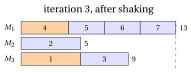
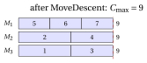

# 31.7 Variable neighbourhood search { #sez-sec-vns }

**Part 4 · Heuristic algorithms · Chapter 31** · [:material-book-open-variant: Chapter 31: Metaheuristics](index.md) · [:material-file-pdf-box: Lecture notes, volume 4 (PDF)](../../pdf/lecture-notes-4-heuristic-algorithms.pdf) · [:material-pencil: Exercises: Metaheuristics](../../exercises/metaheuristics.md)

!!! chiave ""

    <em>Variable neighbourhood search</em> (denoted by $VNS$) uses a sequence of neighbourhoods $N_1,N_2,\dots,N_{k_{\max}}$ of increasing size. From the current local optimum it draws a random solution in $N_k$ (<em>shaking</em>), applies a local search to it, and moves to the new local optimum if it is better, restarting from $k=1$; otherwise it tries the next, larger neighbourhood $N_{k+1}$.

- The pseudo-code of $VNS$ for $P\,||\,C_{\max}$, where $N_k$ contains the assignments obtained with $k$ moves and the local search is MOVEDESCENT, reads as follows:

!!! algoritmo "Algorithm: Variable neighbourhood search for $P\,||\,C_{\max}$"

    

<strong>Input:</strong> times \(t[1..n]\), \(m\) machines, starting assignment \(mach[1..n]\), \(k_{\max}\), \(maxIter\)

<strong>Output:</strong> an assignment \(mach\) and its makespan \(C\)

1<strong>Function</strong> VNS(\(t, m, mach, k_{\max}, maxIter\))

2\(\LB := \max\{\max_j t[j],\ \lceil \sum_j t[j]/m\rceil\}\)

3\(mach := \textsc{MoveDescent}(mach)\);  \(L :=\) loads of \(mach\);  \(C := \max_h L[h]\)

4\(it := 0\);  \(k := 1\)

5<strong>while</strong> \(it < maxIter\) <strong>and</strong> \(C > \LB\) <strong>do</strong>

6\(it := it+1\)

7\(nw := \textsc{Shake}(mach, k)\)
    \(nw := \textsc{MoveDescent}(nw)\);  \(Lnew :=\) loads of \(nw\) ▹ random solution in \(N_k\) local search

8<strong>if</strong> \(Lnew\) is lexicographically better than \(L\) <strong>then</strong>

9\(mach := nw\);  \(L := Lnew\);  \(k := 1\);  \(C := \max_h L[h]\) ▹ move

10<strong>else</strong>

11<strong>if</strong> \(k < k_{\max}\) <strong>then</strong> \(k := k+1\) <strong>else</strong> \(k := 1\)

12<strong>end</strong>

13<strong>end</strong>

14<strong>return</strong> \(mach\), \(C\)

15<strong>Function</strong> Shake(\(mach, k\))

16<strong>for</strong> \(s := 1\) <strong>to</strong> \(k\) <strong>do</strong>

17\(j := 1+\lfloor \textsc{Rand}()\cdot n\rfloor\);  \(g := 1+\lfloor\textsc{Rand}()\cdot(m-1)\rfloor\)

18\(mach[j] :=\) the \(g\)-th machine different from \(mach[j]\)

19<strong>end</strong>

20<strong>return</strong> \(mach\)

- $VNS$ was proposed by Mladenovic and Hansen (1997). It rests on three observations: a local optimum for one neighbourhood need not be a local optimum for another; a global optimum is a local optimum for every neighbourhood; and the local optima of different neighbourhoods are often close to each other.

- <strong>Shaking</strong> diversifies, and the size $k$ controls how much: small $k$ explores the solutions close to the current local optimum, larger $k$ goes farther only when the closer ones have failed. The <strong>local search</strong> intensifies. Returning to $k=1$ after every improvement concentrates the search near the new, better solution.

- The variable neighbourhood descent ($VND$) of the notes on local search also uses several neighbourhoods, but <em>deterministically</em>: it explores them completely, one after the other, and stops at a solution that is a local optimum for all of them. $VNS$ explores the large neighbourhoods only by <em>random samples</em>, which is what makes very large neighbourhoods usable; the local search inside $VNS$ can itself be a $VND$.

- Here $N_k$ contains the assignments obtained by moving $k$ jobs (or fewer, if the same job is drawn twice). Since a swap of two jobs is the combination of two moves, $N_2$ contains the swap neighbourhood: shaking with $k=2$ can reproduce the swaps that the move neighbourhood cannot see.

## 31.7.1 Example

!!! esempio "Example 31.7: $VNS$ on the $P\,||\,C_{\max}$ reference instance"

    We start from the LPT solution, with loads $(11,8,8)$, and use $k_{\max}=3$ and $seed=1$ (random numbers $0.0000$, $0.1315$, $0.7556$, $0.4587$, $0.5328$, $0.2190$, $0.0470$, $0.6789$). MOVEDESCENT does not change the LPT solution, which is a local optimum for the move neighbourhood ([Example 31.5](tabu-search.md#box-6-ex-tsPCM)). Each random move uses two numbers: $j=1+\lfloor 7u\rfloor$ and $g=1+\lfloor 2u\rfloor$.

    - <strong>Iteration 1</strong>, $k=1$: job $j=1+\lfloor 7\cdot 0.0000\rfloor=1$ moves from $M_1$ to the first other machine ($g=1+\lfloor 2\cdot 0.1315\rfloor=1$), $M_2$: loads $(6,13,8)$. MOVEDESCENT moves job $6$ from $M_2$ to $M_1$: loads $(9,10,8)$, $C_{\max}=10$, better than $11$. The new solution $J_1=\{5,6,7\}$, $J_2=\{1,2\}$, $J_3=\{3,4\}$ is accepted, and $k=1$.

    - <strong>Iteration 2</strong>, $k=1$: job $j=1+\lfloor 7\cdot 0.7556\rfloor=6$ moves from $M_1$ to $M_2$ ($g=1+\lfloor 2\cdot 0.4587\rfloor=1$): loads $(6,13,8)$. MOVEDESCENT moves job $6$ back to $M_1$ and returns the current solution, which is not better: $k=2$.

    - <strong>Iteration 3</strong>, $k=2$: job $j=1+\lfloor 7\cdot 0.5328\rfloor=4$ moves from $M_3$ to the first other machine $M_1$ ($g=1+\lfloor 2\cdot 0.2190\rfloor=1$); then job $j=1+\lfloor 7\cdot 0.0470\rfloor=1$ moves from $M_2$ to the second other machine $M_3$ ($g=1+\lfloor 2\cdot 0.6789\rfloor=2$): loads $(13,5,9)$. MOVEDESCENT moves job $4$ from $M_1$ to $M_2$: loads $(9,9,9)$. The solution is accepted, and since $C_{\max}=9=\LB$ the search stops: $VNS(I)=9=z(I)$.

    In terms of the current solution of iteration $3$, the two random moves and the descent have exchanged jobs $1$ and $4$: a swap, which the move neighbourhood of MOVEDESCENT cannot perform.

{ .fig loading=lazy  }

{ .fig loading=lazy  }

- On PCM15, from the LPT solution ($73$) and with at most $300$ iterations, $VNS$ gives the following makespans for $seed=1,\dots,10$, and the number of iterations performed:

<table>
<tr>
<th>\(seed\)</th>
<th>\(1\)</th>
<th>\(2\)</th>
<th>\(3\)</th>
<th>\(4\)</th>
<th>\(5\)</th>
<th>\(6\)</th>
<th>\(7\)</th>
<th>\(8\)</th>
<th>\(9\)</th>
<th>\(10\)</th>
</tr>
<tr>
<td>\(k_{\max}=1\): \(C_{\max}\)</td>
<td>\(69\)</td>
<td>\(70\)</td>
<td>\(70\)</td>
<td>\(70\)</td>
<td>\(69\)</td>
<td>\(69\)</td>
<td>\(69\)</td>
<td>\(69\)</td>
<td>\(70\)</td>
<td>\(69\)</td>
</tr>
<tr>
<td>iterations</td>
<td>\(27\)</td>
<td>\(300\)</td>
<td>\(300\)</td>
<td>\(300\)</td>
<td>\(48\)</td>
<td>\(59\)</td>
<td>\(20\)</td>
<td>\(43\)</td>
<td>\(300\)</td>
<td>\(13\)</td>
</tr>
<tr>
<td>\(k_{\max}=2\): \(C_{\max}\)</td>
<td>\(70\)</td>
<td>\(69\)</td>
<td>\(69\)</td>
<td>\(69\)</td>
<td>\(69\)</td>
<td>\(70\)</td>
<td>\(69\)</td>
<td>\(70\)</td>
<td>\(70\)</td>
<td>\(69\)</td>
</tr>
<tr>
<td>iterations</td>
<td>\(300\)</td>
<td>\(41\)</td>
<td>\(126\)</td>
<td>\(285\)</td>
<td>\(33\)</td>
<td>\(300\)</td>
<td>\(31\)</td>
<td>\(300\)</td>
<td>\(300\)</td>
<td>\(26\)</td>
</tr>
<tr>
<td>\(k_{\max}=3\): \(C_{\max}\)</td>
<td>\(70\)</td>
<td>\(69\)</td>
<td>\(69\)</td>
<td>\(69\)</td>
<td>\(69\)</td>
<td>\(69\)</td>
<td>\(69\)</td>
<td>\(70\)</td>
<td>\(70\)</td>
<td>\(69\)</td>
</tr>
<tr>
<td>iterations</td>
<td>\(300\)</td>
<td>\(32\)</td>
<td>\(38\)</td>
<td>\(29\)</td>
<td>\(26\)</td>
<td>\(11\)</td>
<td>\(25\)</td>
<td>\(300\)</td>
<td>\(300\)</td>
<td>\(25\)</td>
</tr>
</table>

- With $k_{\max}=3$, $VNS$ reaches the optimum $69$ in $7$ runs out of $10$, usually in a few tens of iterations; the best tabu search of Section [31.5.2](tabu-search.md#sez-sec-ts-tsp) needed a carefully tuned tenure. When $VNS$ fails, the search is stuck at $70$: the shaking explores at most three moves away, and the optimum is farther. Larger $k_{\max}$, or restarts, can be added at the price of more iterations.

---

**Next:** [31.8 GRASP](grasp.md)
