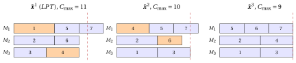
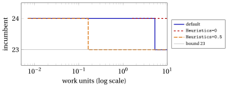

# MIP heuristics for the classical problems

<div class="info-capitolo" markdown>

**Part 4 · Heuristic algorithms · Chapter 32** · [:material-file-pdf-box: Lecture notes, volume 4 (PDF)](../pdf/lecture-notes-4-heuristic-algorithms.pdf) · [:material-pencil: Exercises: MIP heuristics](../exercises/mip-heuristics-classical.md)

</div>

!!! nota "Prerequisites"

    - From the module <em>Integer Linear Programming</em>, [Chapter 10 «MIP heuristics»](https://fabiofurini.github.io/integer-linear-programming/mip-heuristics/mip-heuristics/): the methods of this chapter (rounding, diving, the feasibility pump, RINS, local branching, proximity search, relax-and-fix and fix-and-optimize), their pseudo-codes and the conditions under which they work.

    - From this module, the chapters on the formulations of the classical problems (part «Formulations and their properties»): the models of the knapsack problem, of the bin packing problem, of the travelling salesman problem, of $P\,||\,C_{\max}$ and of lot sizing.

    - From this module, the chapters on heuristic algorithms, from «Heuristic algorithms: definitions» to «Metaheuristics»: the constructive heuristics ($GR$, $FF$, $NN$, $LPT$), local search and metaheuristics, whose solutions are the starting points of this chapter.

!!! chiave "Objectives"

    At the end of this chapter you will be able to:

    - write the MIP models of the classical problems in the form required by the MIP-based heuristics, and compute their LP relaxations;

    - execute by hand rounding, diving, the feasibility pump, RINS, local branching and proximity search on the knapsack problem, on bin packing and on $P\,||\,C_{\max}$;

    - execute relax-and-fix and fix-and-optimize on a lot sizing instance;

    - explain why each method succeeds or fails on each problem;

    - compute the gap of a heuristic solution when a dual bound is available.

## 32.1 MIP-based heuristics { #sez-sec-intro }

<a id="box-1-def-mipheur"></a>

!!! definizione "Definition 32.1: MIP-based heuristic"

    A heuristic algorithm for a problem with a MIP model is <strong>MIP-based</strong> (a <strong>matheuristic</strong>) if it uses the LP relaxation of the model and a MIP solver to search for a feasible solution.

- The MIP-based heuristics are defined in the module <em>Integer Linear Programming</em>, [Chapter 10 «MIP heuristics»](https://fabiofurini.github.io/integer-linear-programming/mip-heuristics/mip-heuristics/). In this chapter they are applied to the classical problems, with the reference instances of the previous chapters.

- The notation is that of that chapter: a MIP with integer variables $\mathscr{D}$, $\tilde{\vet x}$ is an optimal solution of the LP relaxation, $\bar{\vet x}$ a feasible solution (the incumbent), $\rnd{v}=\lfloor v+\frac12\rfloor$ the rounding to the nearest integer, $\Delta(\vet x,\bar{\vet x})=\sum_{j\in\mathscr{D}}|x_j-\bar x_j|$ the distance from an integer point. A maximization problem, such as the KP, is handled by exchanging $\min$ and $\max$, $\le$ and $\ge$ in the comparisons of objective values.

- The examples are solved with the MIP solver Gurobi, used from Python through <code>gurobipy</code>. When an LP has several optimal solutions, the text reports the one returned by the solver; the codes are in the last section.

!!! chiave ""

    Constructive heuristics, local search and metaheuristics work on a representation of the solutions; a MIP-based heuristic works on the model of the problem, through its LP relaxation and a MIP solver.

## 32.2 The problems and their MIP models { #sez-sec-models }

- The heuristics are illustrated on the four problems of the previous notes, whose definitions and assumptions are given in the notes on combinatorial optimization problems, and on their reference instances, recalled in the following table with the values computed in the previous notes on heuristic algorithms.

<div class="tabella" markdown="0"><table>
<tr>
<th>problem</th>
<th>reference instance</th>
<th>values</th>
</tr>
<tr>
<td>KP</td>
<td><span class="arithmatex">\(p=(10,7,6,4)\)</span>, <span class="arithmatex">\(w=(5,4,3,3)\)</span>, <span class="arithmatex">\(c=9\)</span></td>
<td><span class="arithmatex">\(GR\)</span>: <span class="arithmatex">\(\{1,3\}\)</span>, profit <span class="arithmatex">\(16\)</span>; <span class="arithmatex">\(z(I)=17\)</span>, <span class="arithmatex">\(\{1,2\}\)</span></td>
</tr>
<tr>
<td>BPP</td>
<td><span class="arithmatex">\(w=(4,4,5,3,2,3)\)</span>, <span class="arithmatex">\(c=7\)</span></td>
<td><span class="arithmatex">\(FF\)</span>: <span class="arithmatex">\(4\)</span> bins; <span class="arithmatex">\(z(I)=3\)</span></td>
</tr>
<tr>
<td>TSP</td>
<td><span class="arithmatex">\(5\)</span> cities, as in the notes on definitions</td>
<td><span class="arithmatex">\(NN\)</span> from city <span class="arithmatex">\(1\)</span>: <span class="arithmatex">\(25\)</span>; <span class="arithmatex">\(z(I)=18\)</span></td>
</tr>
<tr>
<td><span class="arithmatex">\(P\,||\,C_{\max}\)</span></td>
<td><span class="arithmatex">\(t=(5,5,4,4,3,3,3)\)</span>, <span class="arithmatex">\(m=3\)</span></td>
<td><span class="arithmatex">\(LPT\)</span>: <span class="arithmatex">\(J_1=\{1,5,7\}\)</span>, <span class="arithmatex">\(J_2=\{2,6\}\)</span>, <span class="arithmatex">\(J_3=\{3,4\}\)</span>, <span class="arithmatex">\(11\)</span>; <span class="arithmatex">\(z(I)=9\)</span></td>
</tr>
</table></div>

- The MIP models are those of the part «Formulations and their properties»: the $\mathrm{ILP}_{\mathrm{KP}}$ model of the chapter [«Formulations of the knapsack problem»](https://fabiofurini.github.io/combinatorial-optimization/formulations/knapsack-formulations/), the $\mathrm{ILP}_{\mathrm{BPP}}$ model of the chapter [«Formulations of the bin packing problem»](https://fabiofurini.github.io/combinatorial-optimization/formulations/bin-packing-formulations/), the $\mathrm{ILP}_{\mathrm{TSP}}^{\mathrm{DFJ}}$ model of the chapter [«Formulations of the travelling salesman problem»](https://fabiofurini.github.io/combinatorial-optimization/formulations/tsp-formulations/) and the $\mathrm{ILP}_{P\|C_{\max}}$ model of the chapter [«Formulations of parallel machine scheduling»](https://fabiofurini.github.io/combinatorial-optimization/formulations/pcmax-formulations/). We recall the three models used in the examples, with the variables and the notation of those chapters.

### 32.2.1 The knapsack problem

- The binary variable $x_j$ is equal to $1$ if item $j$ is selected in the knapsack, and to $0$ otherwise, for every $j \in \mathscr{I}$.

!!! chiave ""

    Using these variables, an ILP model for the Knapsack Problem (KP) reads as follows:

    <a id="eq-eq-kp"></a>

    \begin{align*}
    && \max ~~ \sum_{j\in\mathscr{I}} p_j\, x_j \label{eq:kp-obj} \tag{32.1a}\\[1ex]
    && \text{subject to} \quad \sum_{j\in\mathscr{I}} w_j\, x_j &\le c, & \label{eq:kp-cap} \tag{32.1b}\\[1ex]
    && x_j &\in \{0,1\}, & \forall j\in\mathscr{I}. \label{eq:kp-dom} \tag{32.1c}
    \end{align*}

    This ILP model is referred to as the $\mathrm{ILP}_{\mathrm{KP}}$ model.

### 32.2.2 The bin packing problem

- Given an upper bound $m$ on the number of bins used in an optimal solution, and the set $\mathscr{B}=\{1,2,\dots,m\}$ of the available bins, the binary variable $x_{jb}$ is equal to $1$ if item $j$ is packed in bin $b$, and the binary variable $y_b$ is equal to $1$ if bin $b$ is used, for every $j\in\mathscr{I}$ and $b\in\mathscr{B}$.

!!! chiave ""

    Using these variables, an ILP model for the Bin Packing Problem (BPP) reads as follows:

    <a id="eq-eq-bpp"></a>

    \begin{align*}
    && \min ~~ \sum_{b\in\mathscr{B}} y_b \label{eq:bpp-obj} \tag{32.2a}\\[1ex]
    && \text{subject to} \quad \sum_{b\in\mathscr{B}} x_{jb} &= 1, & \forall j\in\mathscr{I}, \label{eq:bpp-assign} \tag{32.2b}\\[1ex]
    && -\sum_{j\in\mathscr{I}} w_j\, x_{jb} + c\, y_b &\ge 0, & \forall b\in\mathscr{B}, \label{eq:bpp-cap} \tag{32.2c}\\[1ex]
    && x_{jb} &\in \{0,1\}, & \forall j\in\mathscr{I},~\forall b\in\mathscr{B}, \label{eq:bpp-domx} \tag{32.2d}\\[1ex]
    && y_b &\in \{0,1\}, & \forall b\in\mathscr{B}. \label{eq:bpp-domy} \tag{32.2e}
    \end{align*}

    This ILP model is referred to as the $\mathrm{ILP}_{\mathrm{BPP}}$ model.

- The content of bin $b$ is the packing pattern $P_b=\{j\in\mathscr{I}: x_{jb}=1\}$. The number $n$ of items is always a valid upper bound $m$; on the reference instance we use $m=n=6$.

### 32.2.3 The travelling salesman problem

- The $\mathrm{ILP}_{\mathrm{TSP}}^{\mathrm{DFJ}}$ model has a binary variable $x_{ij}$ for every arc $(i,j)\in A$, the constraints on the arcs leaving and entering every city, and the subtour elimination constraints on the subsets $S\subseteq\mathscr{V}\setminus\{1\}$ with $|S|\ge2$. On the reference instance, with $n=5$ cities, it has $20$ variables and $5+5+11=21$ constraints.

### 32.2.4 The scheduling problem $P\,||\,C_{\max}$

- Given the set $\mathscr{H}=\{1,2,\dots,m\}$ of the machines, the binary variable $x_{jh}$ is equal to $1$ if job $j$ is assigned to machine $h$, for every $j\in\mathscr{J}$ and $h\in\mathscr{H}$, and the non-negative continuous variable $C_{\max}$ is the makespan.

!!! chiave ""

    Using these variables, an ILP model for $P\|C_{\max}$ reads as follows:

    <a id="eq-eq-pcm"></a>

    \begin{align*}
    && \min ~~ C_{\max} \label{eq:pcm-obj} \tag{32.3a}\\[1ex]
    && \text{subject to} \quad \sum_{h\in\mathscr{H}} x_{jh} &= 1, & \forall j\in\mathscr{J}, \label{eq:pcm-assign} \tag{32.3b}\\[1ex]
    && -\sum_{j\in\mathscr{J}} t_j\, x_{jh} + C_{\max} &\ge 0, & \forall h\in\mathscr{H}, \label{eq:pcm-load} \tag{32.3c}\\[1ex]
    && x_{jh} &\in \{0,1\}, & \forall j\in\mathscr{J},~\forall h\in\mathscr{H}, \label{eq:pcm-domx} \tag{32.3d}\\[1ex]
    && C_{\max} &\ge 0. & \label{eq:pcm-domc} \tag{32.3e}
    \end{align*}

    This ILP model is referred to as the $\mathrm{ILP}_{P\|C_{\max}}$ model.

- $C_{\max}$ is the only continuous variable of the four models: given the assignment, the completion sets it to the largest load $L_h=\sum_{j\in\mathscr{J}} t_j\,x_{jh}$.

### 32.2.5 The LP relaxations on the reference instances

- The following table reports the size of the four models on the reference instances, the value $z(\mathrm{LP})$ of their LP relaxations, computed with Gurobi, and the optimal value $z(I)$.

<div class="tabella" markdown="0"><table>
<tr>
<th>problem</th>
<th>variables</th>
<th>constraints</th>
<th><span class="arithmatex">\(z(\mathrm{LP})\)</span></th>
<th><span class="arithmatex">\(z(I)\)</span></th>
<th>LP solution integer?</th>
</tr>
<tr>
<td>KP</td>
<td><span class="arithmatex">\(4\)</span></td>
<td><span class="arithmatex">\(1\)</span></td>
<td><span class="arithmatex">\(17.75\)</span></td>
<td><span class="arithmatex">\(17\)</span></td>
<td>no</td>
</tr>
<tr>
<td>BPP</td>
<td><span class="arithmatex">\(42\)</span></td>
<td><span class="arithmatex">\(12\)</span></td>
<td><span class="arithmatex">\(3\)</span></td>
<td><span class="arithmatex">\(3\)</span></td>
<td>no</td>
</tr>
<tr>
<td>TSP</td>
<td><span class="arithmatex">\(20\)</span></td>
<td><span class="arithmatex">\(21\)</span></td>
<td><span class="arithmatex">\(18\)</span></td>
<td><span class="arithmatex">\(18\)</span></td>
<td>yes</td>
</tr>
<tr>
<td><span class="arithmatex">\(P\,||\,C_{\max}\)</span></td>
<td><span class="arithmatex">\(22\)</span></td>
<td><span class="arithmatex">\(10\)</span></td>
<td><span class="arithmatex">\(9\)</span></td>
<td><span class="arithmatex">\(9\)</span></td>
<td>no</td>
</tr>
</table></div>

- On all four instances the LP value, rounded in the direction of the bound (down for the KP, up for the three minimization problems), is already the optimal value. The relaxations are <em>strong</em> on these instances: the difficulty is to find a solution that attains the bound, not to prove it.

- This is the typical situation in which MIP-based heuristics are useful.

- On the TSP reference instance the LP solution of the $\mathrm{ILP}_{\mathrm{TSP}}^{\mathrm{DFJ}}$ model is itself the optimal tour $(1,3,5,2,4)$, with $\tilde x_{13}=\tilde x_{35}=\tilde x_{52}=\tilde x_{24}=\tilde x_{41}=1$: every method of these notes finds it at once. The LP relaxation of the $\mathrm{ILP}_{\mathrm{TSP}}^{\mathrm{MTZ}}$ model is weaker: its value is $17$. The TSP is therefore not used in the examples of the following sections.

<a id="box-2-ex-lpsol"></a>

!!! esempio "Example 32.1: The LP solutions of the reference instances"

    <strong>KP.</strong> The LP solution is $\tilde{\vet x}=\big(1,\frac14,1,0\big)$: the items are taken by non-increasing efficiency, and the split item $2$ is taken for the fraction $\frac{9-8}{4}=\frac14$ of its weight, so $z(\mathrm{LP})=10+\frac74+6=17.75$.

    <strong>$P\,||\,C_{\max}$.</strong> The LP solution returned by the solver is (zeros omitted)

    $$
    \begin{array}{l|ccccccc}
    \hline  & {j=1} & {j=2} & {j=3} & {j=4} & {j=5} & {j=6} & {j=7} \\
    \hline {\tilde x_{j1}} &  & {\frac35} &  &  &  & {1} & {1} \\[0.5ex]
    {\tilde x_{j2}} &  &  & {\frac12} & {1} & {1} &  &  \\[0.5ex]
    {\tilde x_{j3}} & {1} & {\frac25} & {\frac12} &  &  &  &  \\
    \hline
    \end{array}
    $$

    with loads $L_1=3+5\cdot\frac35+3=9$, $L_2=4\cdot\frac12+4+3=9$, $L_3=5+5\cdot\frac25+4\cdot\frac12=9$ and $\tilde C_{\max}=9=\frac{27}{3}$. The LP has infinitely many optimal solutions: every fractional assignment with three loads equal to $9$ is optimal.

    <strong>BPP.</strong> The LP solution returned by the solver puts item $1$ into bin $6$, item $2$ into bin $4$, item $3$ for $\frac45$ into bin $3$ and for $\frac15$ into bin $4$, item $4$ into bin $6$, item $5$ into bin $1$, item $6$ into bin $3$, and opens the bins by the fractions

    $$
    \tilde{\vet y} = \Big(\frac27,\, 0,\, 1,\, \frac57,\, 0,\, 1\Big),
    $$

    just enough to contain their loads: $2$, $0$, $7$, $5$, $0$, $7$. Its value is $\frac{21}{7}=3$.

## 32.3 Rounding { #sez-sec-rounding }

- <em>Rounding</em> rounds the LP solution to the nearest integer point and completes the continuous variables; it fails if the rounded point violates a constraint. Rounding down is always feasible when all the coefficients of $A$ are non-negative and $b\ge0$ (the observation on rounding down of Chapter 10 of the module <em>Integer Linear Programming</em>); an equality constraint, such as the assignment constraints of the BPP and of $P\,||\,C_{\max}$, is almost always violated by independent roundings.

<a id="box-3-ex-rounding"></a>

!!! esempio "Example 32.2: Rounding on the reference instances"

    <strong>KP.</strong> The LP solution $\tilde{\vet x}=\big(1,\frac14,1,0\big)$ is rounded to $\bar{\vet x}=(1,0,1,0)$: weight $8\le9$, profit $16$. It is the solution of $GR$ of the chapter on constructive heuristics. Rounding $\tilde x_2=\frac14$ up instead would give $(1,1,1,0)$, of weight $12>9$: infeasible.

    <strong>$P\,||\,C_{\max}$.</strong> In the LP solution of [Example 32.1](#box-2-ex-lpsol), $\rnd{\frac35}=1$ and $\rnd{\frac25}=0$ send job $2$ to machine $1$, but $\rnd{\frac12}=1$ assigns job $3$ to <em>both</em> machines $2$ and $3$:

    $$
    \bar x_{31}+\bar x_{32}+\bar x_{33}=0+1+1=2\neq 1 .
    $$

    The assignment constraint $\eqref{eq:pcm-assign}$ of job $3$ is violated: <strong>rounding fails</strong>.

    <strong>BPP.</strong> Rounding the LP solution of [Example 32.1](#box-2-ex-lpsol) gives $\bar{\vet y}=(0,0,1,1,0,1)$ and puts item $3$ into bin $3$. Two capacity constraints $\eqref{eq:bpp-cap}$ are violated: bin $1$ contains item $5$ but $\bar y_1=0$ ($-2+7\cdot 0\ge 0$ is false), and bin $3$ contains items $3$ and $6$ ($-(5+3)+7\cdot 1\ge 0$ is false). <strong>Rounding fails</strong>.

- The three outcomes summarize the method: on the KP, with a single packing constraint, rounding is safe (the observation on rounding down of Chapter 10 of the module <em>Integer Linear Programming</em>); on the problems with assignment constraints it fails, because the LP spreads a job or an item over several machines or bins, and rounding cannot decide where it goes.

## 32.4 Diving { #sez-sec-diving }

- <em>Diving</em> fixes one fractional variable at a time and re-solves the LP: fractional diving fixes the least fractional variable to its nearest integer, guided diving fixes the variable closest to the incumbent to the incumbent value; it fails when the LP becomes infeasible. Ties are broken in favour of the variable that comes first in the order of the variables ($x_{11},x_{12},\dots$ for the assignment models, then $C_{\max}$ or $y_1,y_2,\dots$).

<a id="box-4-ex-divekp"></a>

!!! esempio "Example 32.3: Fractional diving on the KP"

    <strong>Step 1.</strong> The LP solution is $\tilde{\vet x}=\big(1,\frac14,1,0\big)$, of value $17.75$. The only fractional variable is $x_2$, rounded to $\rnd{\frac14}=0$: fix $x_2:=0$.

    <strong>Step 2.</strong> Without item $2$, the LP takes items $1$ and $3$ (weight $8$) and the fraction $\frac13$ of item $4$: $\tilde{\vet x}=\big(1,0,1,\frac13\big)$, of value $10+6+\frac43=\frac{52}{3}\approx 17.33$. Fix $x_4:=\rnd{\frac13}=0$.

    <strong>Step 3.</strong> The LP solution $\tilde{\vet x}=(1,0,1,0)$, of value $16$, is integer: the dive returns $\{1,3\}$, of profit $16$.

    The dive is the path drawn with solid lines in the branch-and-bound tree below; the dashed nodes are the branches it never visits, with the value of their LP relaxations.

    { .fig loading=lazy  }

    The branch $x_2=1$, abandoned at the first step, contains the optimal solution $\{1,2\}$ of profit $17$, which is an optimal solution of its LP relaxation. The first decision of the dive, $\rnd{\frac14}=0$, was the wrong one.

<a id="box-5-ex-divepcm"></a>

!!! esempio "Example 32.4: Fractional diving on $P\,||\,C_{\max}$"

    The dive starts from the LP solution of [Example 32.1](#box-2-ex-lpsol). The table reports, for each step, the value of the LP, its fractional variables and the fixing; a fractionality $|\tilde x_j-\rnd{\tilde x_j}|$ equal for two variables is broken by the order $x_{11},x_{12},x_{13},x_{21},\dots$

    <div class="tabella" markdown="0"><table>
    <tr>
    <th>step</th>
    <th>LP value</th>
    <th>fractional variables</th>
    <th>fixing</th>
    </tr>
    <tr>
    <td><span class="arithmatex">\(1\)</span></td>
    <td><span class="arithmatex">\(9\)</span></td>
    <td><span class="arithmatex">\(x_{21}=\frac35\)</span>, <span class="arithmatex">\(x_{23}=\frac25\)</span>, <span class="arithmatex">\(x_{32}=\frac12\)</span>, <span class="arithmatex">\(x_{33}=\frac12\)</span></td>
    <td><span class="arithmatex">\(x_{21}:=1\)</span></td>
    </tr>
    <tr>
    <td><span class="arithmatex">\(2\)</span></td>
    <td><span class="arithmatex">\(9\)</span></td>
    <td><span class="arithmatex">\(x_{11}=\frac15\)</span>, <span class="arithmatex">\(x_{13}=\frac45\)</span>, <span class="arithmatex">\(x_{32}=\frac34\)</span>, <span class="arithmatex">\(x_{33}=\frac14\)</span></td>
    <td><span class="arithmatex">\(x_{11}:=0\)</span></td>
    </tr>
    <tr>
    <td><span class="arithmatex">\(3\)</span></td>
    <td><span class="arithmatex">\(9\)</span></td>
    <td><span class="arithmatex">\(x_{32}=\frac34\)</span>, <span class="arithmatex">\(x_{33}=\frac14\)</span>, <span class="arithmatex">\(x_{41}=\frac14\)</span>, <span class="arithmatex">\(x_{43}=\frac34\)</span></td>
    <td><span class="arithmatex">\(x_{32}:=1\)</span></td>
    </tr>
    <tr>
    <td><span class="arithmatex">\(4\)</span></td>
    <td><span class="arithmatex">\(9\)</span></td>
    <td><span class="arithmatex">\(x_{41}=\frac14\)</span>, <span class="arithmatex">\(x_{43}=\frac34\)</span>, <span class="arithmatex">\(x_{52}=\frac23\)</span>, <span class="arithmatex">\(x_{53}=\frac13\)</span></td>
    <td><span class="arithmatex">\(x_{41}:=0\)</span></td>
    </tr>
    <tr>
    <td><span class="arithmatex">\(5\)</span></td>
    <td><span class="arithmatex">\(9\)</span></td>
    <td><span class="arithmatex">\(x_{61}=\frac13\)</span>, <span class="arithmatex">\(x_{62}=\frac23\)</span></td>
    <td><span class="arithmatex">\(x_{61}:=0\)</span></td>
    </tr>
    <tr>
    <td><span class="arithmatex">\(6\)</span></td>
    <td><span class="arithmatex">\(9\)</span></td>
    <td><span class="arithmatex">\(x_{12}=\frac35\)</span>, <span class="arithmatex">\(x_{13}=\frac25\)</span>, <span class="arithmatex">\(x_{71}=\frac13\)</span>, <span class="arithmatex">\(x_{72}=\frac23\)</span></td>
    <td><span class="arithmatex">\(x_{71}:=0\)</span></td>
    </tr>
    <tr>
    <td><span class="arithmatex">\(7\)</span></td>
    <td><span class="arithmatex">\(9.5\)</span></td>
    <td><span class="arithmatex">\(x_{42}=\frac18\)</span>, <span class="arithmatex">\(x_{43}=\frac78\)</span></td>
    <td><span class="arithmatex">\(x_{42}:=0\)</span></td>
    </tr>
    <tr>
    <td><span class="arithmatex">\(8\)</span></td>
    <td><span class="arithmatex">\(9.5\)</span></td>
    <td><span class="arithmatex">\(x_{62}=\frac16\)</span>, <span class="arithmatex">\(x_{63}=\frac56\)</span></td>
    <td><span class="arithmatex">\(x_{62}:=0\)</span></td>
    </tr>
    <tr>
    <td><span class="arithmatex">\(9\)</span></td>
    <td><span class="arithmatex">\(9.5\)</span></td>
    <td><span class="arithmatex">\(x_{12}=\frac12\)</span>, <span class="arithmatex">\(x_{13}=\frac12\)</span></td>
    <td><span class="arithmatex">\(x_{12}:=1\)</span></td>
    </tr>
    <tr>
    <td><span class="arithmatex">\(10\)</span></td>
    <td><span class="arithmatex">\(9.5\)</span></td>
    <td><span class="arithmatex">\(x_{72}=\frac16\)</span>, <span class="arithmatex">\(x_{73}=\frac56\)</span></td>
    <td><span class="arithmatex">\(x_{72}:=0\)</span></td>
    </tr>
    <tr>
    <td><span class="arithmatex">\(11\)</span></td>
    <td><span class="arithmatex">\(10\)</span></td>
    <td>none</td>
    <td>—</td>
    </tr>
    </table></div>

    The last LP solution is integer: $J_1=\{2,5\}$, $J_2=\{1,3\}$, $J_3=\{4,6,7\}$, with loads $8$, $9$, $10$ and makespan $10$. The dive improves on rounding, which failed, and on $LPT$ ($11$), but it does not reach the optimum $9$.

- For six steps the LP value stays at $9$: the LP of $P\,||\,C_{\max}$ has a huge set of optimal solutions, and fixing one variable just moves the LP to another of them. The LP value tells nothing about the quality of the decisions until the load of a machine is forced above $9$, at step $7$, and then it is too late to undo the decisions that caused it. Min-max objectives are as flat for the LP as they are for local search.

<a id="box-6-ex-guided"></a>

!!! esempio "Example 32.5: Guided diving on $P\,||\,C_{\max}$"

    The incumbent is the solution of $LPT$, $J_1=\{1,5,7\}$, $J_2=\{2,6\}$, $J_3=\{3,4\}$, of makespan $11$, i.e., $\bar x_{11}=\bar x_{51}=\bar x_{71}=\bar x_{22}=\bar x_{62}=\bar x_{33}=\bar x_{43}=1$ and all the other $\bar x_{jh}=0$.

    <strong>Step 1.</strong> In the LP solution of [Example 32.1](#box-2-ex-lpsol) the fractional variables and their distances from the incumbent are

    $$
    |\tilde x_{21}-\bar x_{21}|=\tfrac35,\quad |\tilde x_{23}-\bar x_{23}|=\tfrac25,\quad |\tilde x_{32}-\bar x_{32}|=\tfrac12,\quad
    |\tilde x_{33}-\bar x_{33}|=\tfrac12 .
    $$

    The closest is $x_{23}$: fix $x_{23}:=\bar x_{23}=0$.

    <strong>Step 2.</strong> The new LP solution, of value $9$, has the fractional variables $x_{12}=\frac25$, $x_{13}=\frac35$, $x_{31}=\frac12$, $x_{32}=\frac12$, at distances $\frac25$, $\frac35$, $\frac12$, $\frac12$ from the incumbent. Fix $x_{12}:=\bar x_{12}=0$.

    <strong>Step 3.</strong> The LP solution is integer, of value $9$: $J_1=\{5,6,7\}$, $J_2=\{2,4\}$, $J_3=\{1,3\}$, all loads equal to $9$. Guided diving finds an <strong>optimal</strong> solution after two LPs.

- Guided by a solution of makespan $11$, the dive ends at a solution of makespan $9$: the incumbent only decides the <em>values</em> of the two fixed variables, both equal to $0$, while the LP rebuilds the rest of the assignment.

- On the BPP reference instance, fractional diving takes $8$ fixings, all with LP value $3$; the ninth, $x_{12}:=1$, puts item $1$ into bin $2$, which already contains item $2$ by an earlier fixing, and $4+4>7$ makes the LP infeasible: <strong>the dive fails</strong>. The fixings $x_{jb}=1$ commit items to bins one at a time, and the LP of the BPP is so weak ($3$ at every step) that it gives no warning before the dead end.

## 32.5 The feasibility pump { #sez-sec-fp }

- The <em>feasibility pump</em> alternates the projection of an integer point onto the LP feasible region (one LP minimizing $\Delta$) and the rounding of the projection, with a flip when the rounding returns the same integer point and a random restart when the pump cycles, until the distance is $0$. The random numbers are those of the <em>minimal standard</em> generator of Park and Miller with the seeds $1,2,\dots$, as in the metaheuristics chapter.

<a id="box-7-ex-fppcm"></a>

!!! esempio "Example 32.6: The feasibility pump on $P\,||\,C_{\max}$"

    <strong>Iteration 0.</strong> The LP solution of [Example 32.1](#box-2-ex-lpsol) is rounded as in [Example 32.2](#box-3-ex-rounding): job $3$ is assigned to machines $2$ and $3$, and $\bar{\vet x}^0$ is infeasible.

    <strong>Iteration 1.</strong> The projection minimizes $\Delta(\vet x,\bar{\vet x}^0)$, which is linear since all the integer variables are binary. The solver returns the point of $\mathcal{L}$ that keeps all the assignments of $\bar{\vet x}^0$ and removes job $3$ from machine $2$, i.e., it moves $x_{32}$ from $1$ to $0$: $\Delta=1$ (removing job $3$ from machine $3$ would be equally close). The result is integer:

    $$
    J_1=\{2,6,7\},\qquad J_2=\{4,5\},\qquad J_3=\{1,3\},
    $$

    with loads $11$, $7$, $9$, and its rounding is the new integer point $\bar{\vet x}^1$.

    <strong>Iteration 2.</strong> $\bar{\vet x}^1\in\mathcal{L}$, the distance is $0$, and the pump returns a solution of makespan $11$, after two projections.

- The solution has the same makespan as $LPT$: the projection takes care of the assignment constraints and ignores the loads, since $C_{\max}$ is continuous and does not enter $\Delta$. The pump answers the question “is there a feasible solution?”, which for $P\,||\,C_{\max}$ was not a difficult question.

<a id="box-8-ex-fpbpp"></a>

!!! esempio "Example 32.7: The feasibility pump on the BPP"

    On the BPP reference instance, where rounding and diving fail, the pump is run with the seeds $1,2,\dots,10$ of the random numbers. The table reports the number of projections, of flips and of restarts, the number of bins opened by the solution found ($\sum_b \bar y_b$, the value of the solution) and the number of non-empty bins.

    <div class="tabella" markdown="0"><table>
    <tr>
    <th>seed</th>
    <th><span class="arithmatex">\(1\)</span></th>
    <th><span class="arithmatex">\(2\)</span></th>
    <th><span class="arithmatex">\(3\)</span></th>
    <th><span class="arithmatex">\(4\)</span></th>
    <th><span class="arithmatex">\(5\)</span></th>
    <th><span class="arithmatex">\(6\)</span></th>
    <th><span class="arithmatex">\(7\)</span></th>
    <th><span class="arithmatex">\(8\)</span></th>
    <th><span class="arithmatex">\(9\)</span></th>
    <th><span class="arithmatex">\(10\)</span></th>
    </tr>
    <tr>
    <td>projections</td>
    <td><span class="arithmatex">\(15\)</span></td>
    <td><span class="arithmatex">\(12\)</span></td>
    <td><span class="arithmatex">\(9\)</span></td>
    <td><span class="arithmatex">\(9\)</span></td>
    <td><span class="arithmatex">\(6\)</span></td>
    <td><span class="arithmatex">\(6\)</span></td>
    <td><span class="arithmatex">\(19\)</span></td>
    <td><span class="arithmatex">\(5\)</span></td>
    <td><span class="arithmatex">\(10\)</span></td>
    <td><span class="arithmatex">\(20\)</span></td>
    </tr>
    <tr>
    <td>flips</td>
    <td><span class="arithmatex">\(8\)</span></td>
    <td><span class="arithmatex">\(5\)</span></td>
    <td><span class="arithmatex">\(3\)</span></td>
    <td><span class="arithmatex">\(4\)</span></td>
    <td><span class="arithmatex">\(3\)</span></td>
    <td><span class="arithmatex">\(3\)</span></td>
    <td><span class="arithmatex">\(8\)</span></td>
    <td><span class="arithmatex">\(2\)</span></td>
    <td><span class="arithmatex">\(5\)</span></td>
    <td><span class="arithmatex">\(8\)</span></td>
    </tr>
    <tr>
    <td>restarts</td>
    <td><span class="arithmatex">\(4\)</span></td>
    <td><span class="arithmatex">\(3\)</span></td>
    <td><span class="arithmatex">\(3\)</span></td>
    <td><span class="arithmatex">\(2\)</span></td>
    <td><span class="arithmatex">\(1\)</span></td>
    <td><span class="arithmatex">\(1\)</span></td>
    <td><span class="arithmatex">\(5\)</span></td>
    <td><span class="arithmatex">\(1\)</span></td>
    <td><span class="arithmatex">\(2\)</span></td>
    <td><span class="arithmatex">\(4\)</span></td>
    </tr>
    <tr>
    <td>bins opened</td>
    <td><span class="arithmatex">\(4\)</span></td>
    <td><span class="arithmatex">\(4\)</span></td>
    <td><span class="arithmatex">\(4\)</span></td>
    <td><span class="arithmatex">\(5\)</span></td>
    <td><span class="arithmatex">\(5\)</span></td>
    <td><span class="arithmatex">\(4\)</span></td>
    <td><span class="arithmatex">\(3\)</span></td>
    <td><span class="arithmatex">\(4\)</span></td>
    <td><span class="arithmatex">\(4\)</span></td>
    <td><span class="arithmatex">\(5\)</span></td>
    </tr>
    <tr>
    <td>non-empty bins</td>
    <td><span class="arithmatex">\(4\)</span></td>
    <td><span class="arithmatex">\(4\)</span></td>
    <td><span class="arithmatex">\(4\)</span></td>
    <td><span class="arithmatex">\(3\)</span></td>
    <td><span class="arithmatex">\(5\)</span></td>
    <td><span class="arithmatex">\(4\)</span></td>
    <td><span class="arithmatex">\(3\)</span></td>
    <td><span class="arithmatex">\(4\)</span></td>
    <td><span class="arithmatex">\(4\)</span></td>
    <td><span class="arithmatex">\(4\)</span></td>
    </tr>
    </table></div>

    The pump finds a feasible solution with every seed, but always after some restarts: without them it would cycle. Only with seed $7$ the solution is optimal: $\{3,5\}$, $\{2,4\}$, $\{1,6\}$, of value $3$. With seed $4$ the pump opens $5$ bins, two of which stay empty: the packing $\{3,5\}$, $\{1,6\}$, $\{2,4\}$ is optimal, but the solution has value $5$, because nothing in the distance function asks to close the empty bins.

- The pump is a method to find a <em>first</em> feasible solution, and it does that well. The quality of the solution is the job of the improvement methods of the next sections, which start from an incumbent.

## 32.6 RINS, local branching and proximity search { #sez-sec-submip }

- The three methods start from an incumbent $\bar{\vet x}$ and solve a sub-MIP with the cutoff constraint $f(\vet x)\le f(\bar{\vet x})-\theta$, which here has $\theta=1$ since the objective values are integer: RINS fixes the integer variables on which the LP solution and the incumbent agree; local branching adds $\Delta(\vet x,\bar{\vet x})\le k$ and enlarges $k$ when it finds nothing; proximity search minimizes $\Delta(\vet x,\bar{\vet x})$.

### 32.6.1 RINS

<a id="box-9-ex-rinskp"></a>

!!! esempio "Example 32.8: RINS on the KP"

    The incumbent is the solution $\bar{\vet x}=(1,0,1,0)$ of $GR$, of profit $16$, and the LP solution is $\tilde{\vet x}=\big(1,\frac14,1,0\big)$. They agree on $x_1=1$, $x_3=1$, $x_4=0$, which are fixed. The sub-MIP, with the capacity constraint $\eqref{eq:kp-cap}$ and the cutoff constraint, is

    $$
    \begin{array}{rrrrr}
    {\max} & {16} & {+~7\,x_2} &  &  \\[0.5ex]
    \text{subject to} & {8} & {+~4\,x_2} & {\le} & {9} \\[0.5ex]
    & {16} & {+~7\,x_2} & {\ge} & {17} \\[0.5ex]
    &  & {x_2} & {\in} & {\{0,1\}}
    \end{array}
    $$

    and it is infeasible: the capacity requires $x_2=0$, the cutoff $x_2=1$. RINS returns the incumbent. The optimal solution $\{1,2\}$ has $x_3=0$, but $x_3$ is fixed to $1$ because the LP and the incumbent agree on it.

<a id="box-10-ex-rinspcm"></a>

!!! esempio "Example 32.9: RINS on $P\,||\,C_{\max}$"

    The incumbent is the solution of $LPT$ ($J_1=\{1,5,7\}$, $J_2=\{2,6\}$, $J_3=\{3,4\}$, makespan $11$), and $\tilde{\vet x}$ is the LP solution of [Example 32.1](#box-2-ex-lpsol). The table compares, for each job, the machine of the incumbent with the LP solution.

    <div class="tabella" markdown="0"><table>
    <tr>
    <th></th>
    <th><span class="arithmatex">\(j=1\)</span></th>
    <th><span class="arithmatex">\(j=2\)</span></th>
    <th><span class="arithmatex">\(j=3\)</span></th>
    <th><span class="arithmatex">\(j=4\)</span></th>
    <th><span class="arithmatex">\(j=5\)</span></th>
    <th><span class="arithmatex">\(j=6\)</span></th>
    <th><span class="arithmatex">\(j=7\)</span></th>
    </tr>
    <tr>
    <td>machine in <span class="arithmatex">\(\bar{\vet x}\)</span></td>
    <td><span class="arithmatex">\(1\)</span></td>
    <td><span class="arithmatex">\(2\)</span></td>
    <td><span class="arithmatex">\(3\)</span></td>
    <td><span class="arithmatex">\(3\)</span></td>
    <td><span class="arithmatex">\(1\)</span></td>
    <td><span class="arithmatex">\(2\)</span></td>
    <td><span class="arithmatex">\(1\)</span></td>
    </tr>
    <tr>
    <td>machines in <span class="arithmatex">\(\tilde{\vet x}\)</span></td>
    <td><span class="arithmatex">\(3\)</span></td>
    <td><span class="arithmatex">\(1\)</span> (<span class="arithmatex">\(\frac35\)</span>), <span class="arithmatex">\(3\)</span> (<span class="arithmatex">\(\frac25\)</span>)</td>
    <td><span class="arithmatex">\(2\)</span> (<span class="arithmatex">\(\frac12\)</span>), <span class="arithmatex">\(3\)</span> (<span class="arithmatex">\(\frac12\)</span>)</td>
    <td><span class="arithmatex">\(2\)</span></td>
    <td><span class="arithmatex">\(2\)</span></td>
    <td><span class="arithmatex">\(1\)</span></td>
    <td><span class="arithmatex">\(1\)</span></td>
    </tr>
    <tr>
    <td>fixed variables</td>
    <td><span class="arithmatex">\(x_{12}=0\)</span></td>
    <td>—</td>
    <td><span class="arithmatex">\(x_{31}=0\)</span></td>
    <td><span class="arithmatex">\(x_{41}=0\)</span></td>
    <td><span class="arithmatex">\(x_{53}=0\)</span></td>
    <td><span class="arithmatex">\(x_{63}=0\)</span></td>
    <td><span class="arithmatex">\(x_{71}=1\)</span>, <span class="arithmatex">\(x_{72}=x_{73}=0\)</span></td>
    </tr>
    </table></div>

    Only job $7$ is on the same machine in both solutions; for the other jobs, the two solutions agree only on some machines that the job does <em>not</em> use. Eight of the $21$ binary variables are fixed. The sub-MIP with the cutoff $C_{\max}\le 10$ is solved by Gurobi, which returns

    $$
    J_1=\{5,6,7\},\qquad J_2=\{2,3\},\qquad J_3=\{1,4\},
    $$

    with all loads equal to $9$: <strong>RINS finds an optimal solution</strong>.

- On the KP the incumbent and the LP solution are too similar, and the neighbourhood of RINS has a single free variable; on $P\,||\,C_{\max}$ they are very different, and the neighbourhood is large enough to contain the optimum.

### 32.6.2 Local branching

- <strong>Local branching and local search.</strong> With $k=1$ the neighbourhood is the flip neighbourhood of the KP in the notes on definitions; with $k=2$ it contains the swap neighbourhood as well. For the assignment variables of the BPP and of $P\,||\,C_{\max}$ the distance has a simple meaning.

<a id="box-11-obs-assign"></a>

!!! teorema "Observation 32.2"

    Let $\vet x$ and $\bar{\vet x}$ be two feasible assignments of $P\,||\,C_{\max}$. Then $\Delta(\vet x,\bar{\vet x})=2\,r$, where $r$ is the number of jobs assigned to different machines in $\vet x$ and in $\bar{\vet x}$.

??? dimostrazione "Proof"

    A job on the same machine in $\vet x$ and $\bar{\vet x}$ contributes $0$ to $\Delta$. A job on machine $h$ in $\bar{\vet x}$ and on machine $h'\neq h$ in $\vet x$ contributes $1-x_{jh}=1$ and $x_{jh'}=1$, and $0$ for the other machines. <span class="qed">□</span>

- Hence, for $P\,||\,C_{\max}$, the neighbourhood $\Delta(\vet x,\bar{\vet x})\le 2$ is the <strong>move</strong> neighbourhood of the chapter on local search (one job changes machine), and $\Delta(\vet x,\bar{\vet x})\le 4$ contains the <strong>swap</strong> neighbourhood (two jobs change machine). The same holds for the variables $x_{jb}$ of the BPP.

<a id="box-12-ex-lbkp"></a>

!!! esempio "Example 32.10: Local branching on the KP"

    Start from $\bar{\vet x}^1=(1,0,1,0)$, of profit $16$, with $k=1$, $k_{\max}=3$, $k_{step}=1$ and $\theta=1$.

    <strong>$k=1$.</strong> The neighbours at distance $1$ are the flips of $\bar{\vet x}^1$; with the cutoff $\sum_j p_j x_j\ge 17$ no one is feasible. Add $\Delta(\vet x,\bar{\vet x}^1)\ge 2$ and set $k=2$.

    <strong>$k=2$.</strong> The sub-MIP with $2\le\Delta(\vet x,\bar{\vet x}^1)\le 2$ finds the swap $(1,1,0,0)$, of profit $17$: the new incumbent $\bar{\vet x}^2$. Add $\Delta(\vet x,\bar{\vet x}^1)\ge 3$.

    <strong>$k=2$, around $\bar{\vet x}^2$.</strong> No solution of profit at least $18$: add $\Delta(\vet x,\bar{\vet x}^2)\ge 3$ and set $k=3$.  <strong>$k=3$.</strong> No solution of profit at least $18$ either; $k$ becomes $4>k_{\max}$ and the method stops with $\{1,2\}$, of profit $17$: the optimum.

<a id="box-13-ex-lbpcm"></a>

!!! esempio "Example 32.11: Local branching on $P\,||\,C_{\max}$"

    Start from the solution $\bar{\vet x}^1$ of $LPT$, of makespan $11$, with $k=2$, $k_{\max}=6$, $k_{step}=2$ and $\theta=1$, so that the cutoff is $C_{\max}\le 10$, then $9$, and so on.

    <strong>$k=2$.</strong> By [Observation 32.2](#box-11-obs-assign) the neighbourhood is the move neighbourhood, and $LPT$ is a local optimum for it (chapter on local search): the sub-MIP is infeasible. Add $\Delta(\vet x,\bar{\vet x}^1)\ge 3$ and set $k=4$.

    <strong>$k=4$.</strong> The best solution with two jobs reassigned has makespan $10$; the solver returns the swap of jobs $1$ and $4$, $\bar{\vet x}^2$ below. Add $\Delta(\vet x,\bar{\vet x}^1)\ge 5$.

    <strong>$k=4$, around $\bar{\vet x}^2$.</strong> The solver returns the swap of jobs $4$ and $6$, of makespan $9$: $\bar{\vet x}^3$. Add $\Delta(\vet x,\bar{\vet x}^2)\ge 5$.

    <strong>$k=4$ and $k=6$, around $\bar{\vet x}^3$.</strong> No solution of makespan $8$: $k$ becomes $8>k_{\max}$, and the method stops with makespan $9$, the optimum.

    { .fig loading=lazy  }

    The dashed line is the lower bound $9$; the jobs swapped to obtain the next solution are coloured.

- In the language of the chapter on local search, local branching performs a local search with a neighbourhood whose size is controlled by $k$, explored exactly by the solver, and it enlarges the neighbourhood when it gets stuck — exactly the idea of variable neighbourhood search, with the solver doing the exploration.

### 32.6.3 Proximity search

- A proximity sub-MIP that is infeasible with $\theta=1$ proves that the incumbent is optimal, when the objective takes integer values (the proposition of Chapter 10 of the module <em>Integer Linear Programming</em>).

<a id="box-14-ex-pskp"></a>

!!! esempio "Example 32.12: Proximity search on the KP"

    From $\bar{\vet x}=(1,0,1,0)$, of profit $16$: the closest solution of profit at least $17$ is $(1,1,0,0)$, at distance $2$ (item $3$ out, item $2$ in), of profit $17$. Around it, no solution has profit at least $18$: by the optimality condition of proximity search (Chapter 10 of the module <em>Integer Linear Programming</em>), $\{1,2\}$ is <strong>optimal</strong>.

<a id="box-15-ex-pspcm"></a>

!!! esempio "Example 32.13: Proximity search on $P\,||\,C_{\max}$"

    From the solution of $LPT$, of makespan $11$:

    <div class="tabella" markdown="0"><table>
    <tr>
    <th>iteration</th>
    <th>cutoff</th>
    <th><span class="arithmatex">\(\min\Delta\)</span></th>
    <th>solution returned</th>
    <th><span class="arithmatex">\(C_{\max}\)</span></th>
    </tr>
    <tr>
    <td><span class="arithmatex">\(1\)</span></td>
    <td><span class="arithmatex">\(C_{\max}\le 10\)</span></td>
    <td><span class="arithmatex">\(4\)</span></td>
    <td><span class="arithmatex">\(J_1=\{5,6,7\}\)</span>, <span class="arithmatex">\(J_2=\{1,2\}\)</span>, <span class="arithmatex">\(J_3=\{3,4\}\)</span></td>
    <td><span class="arithmatex">\(10\)</span></td>
    </tr>
    <tr>
    <td><span class="arithmatex">\(2\)</span></td>
    <td><span class="arithmatex">\(C_{\max}\le 9\)</span></td>
    <td><span class="arithmatex">\(4\)</span></td>
    <td><span class="arithmatex">\(J_1=\{5,6,7\}\)</span>, <span class="arithmatex">\(J_2=\{1,4\}\)</span>, <span class="arithmatex">\(J_3=\{2,3\}\)</span></td>
    <td><span class="arithmatex">\(9\)</span></td>
    </tr>
    <tr>
    <td><span class="arithmatex">\(3\)</span></td>
    <td><span class="arithmatex">\(C_{\max}\le 8\)</span></td>
    <td>—</td>
    <td>infeasible</td>
    <td>—</td>
    </tr>
    </table></div>

    By [Observation 32.2](#box-11-obs-assign), distance $4$ means two jobs reassigned: jobs $1$ and $6$ at the first iteration, jobs $2$ and $4$ at the second. No solution at distance $2$ improves the makespan, as for local branching with $k=2$. At the third iteration the sub-MIP is infeasible, and the optimality condition of proximity search (Chapter 10 of the module <em>Integer Linear Programming</em>) proves that makespan $9$ is optimal.

- The proof of optimality comes from the solver, which proves the infeasibility of the last sub-MIP with its own dual bounds: proximity search, used with $\theta=1$, is an exact method that improves the incumbent along the way.

## 32.7 Relax-and-fix and fix-and-optimize on lot sizing { #sez-sec-rf }

- Relax-and-fix and fix-and-optimize decompose the MIP into blocks of integer variables. Lot sizing is a natural application, because its variables are indexed by the periods $t\in T=\{1,2,\dots,m\}$ of a planning horizon, and the decisions of a period mainly interact with those of the nearby periods. The blocks are the setup variables of consecutive periods.

- The model is the $\mathrm{ILP}_{\mathrm{CLSP}}$ model of the chapter [«Formulations of capacitated lot sizing»](https://fabiofurini.github.io/combinatorial-optimization/formulations/lot-sizing-formulations/), with the strong big-M value $M_t=\min\{cap_t,\,D_{t,m}\}$, where $D_{t,m}=\sum_{k=t}^{m} d_k$; for an uncapacitated instance, $cap_t=D_{t,m}$. Its variables are the production $x_t$, the inventory $s_t$ at the end of period $t$ and the setup $y_t$, for every period $t\in T$.

!!! chiave ""

    Using these variables, an ILP model for the capacitated lot-sizing problem (CLS) reads as follows:

    <a id="eq-eq-ls"></a>

    \begin{align*}
    && \min ~~ \sum_{t\in T} \left(sc_t\,y_t + vc_t\,x_t + hc_t\,s_t\right) \label{eq:ls-obj} \tag{32.4a}\\[1ex]
    && \text{subject to} \quad s_{t-1}+x_t &= d_t+s_t, & \forall t\in T, \label{eq:ls-bal} \tag{32.4b}\\[1ex]
    && x_t &\le M_t\, y_t, & \forall t\in T, \label{eq:ls-setup} \tag{32.4c}\\[1ex]
    && x_t &\le cap_t, & \forall t\in T, \label{eq:ls-cap} \tag{32.4d}\\[1ex]
    && s_0 = s_m &= 0, & \label{eq:ls-end} \tag{32.4e}\\[1ex]
    && x_t &\in \Z_{\ge 0}, & \forall t\in T, \label{eq:ls-domx} \tag{32.4f}\\[1ex]
    && s_t &\in \Z_{\ge 0}, & \forall t\in T, \label{eq:ls-doms} \tag{32.4g}\\[1ex]
    && y_t &\in\{0,1\}, & \forall t\in T. \label{eq:ls-domy} \tag{32.4h}
    \end{align*}

    This ILP model is referred to as the $\mathrm{ILP}_{\mathrm{CLSP}}$ model.

- Once the setups $y$ are fixed, the rest is an LP with integer data and a network matrix, which has an integer optimal solution. The hard decisions are the $m$ binary variables: as in the codes, the heuristics treat $x_t$ and $s_t$ as continuous variables, with $x_t\ge 0$ and $s_t\ge 0$ in place of $\eqref{eq:ls-domx}$ and $\eqref{eq:ls-doms}$.

- The LP relaxation is weak, because a fraction $y_t=x_t/M_t$ of a setup is enough to produce $x_t$.

<a id="box-16-ex-rfcourse"></a>

!!! esempio "Example 32.14: Relax-and-fix on the lot sizing instance of the MIP course"

    The instance of the MIP course has $m=5$ periods, $d=(20,10,30,40,10)$, $sc_t=50$, $vc_t=0$ and $hc_t=1$ for every $t\in T$, and no capacity. Its LP relaxation has value $\frac{36985}{396}\approx 93.40$, the constructive heuristic least unit cost of the course gives $200$, and the optimal value is $170$. Relax-and-fix with one period per block, $B_t=\{y_t\}$, finds a solution of value $170$: <strong>optimal</strong>.

<a id="box-17-ex-rfcap"></a>

!!! esempio "Example 32.15: Relax-and-fix on a capacitated instance"

    Consider $m=6$ periods, $d=(50,30,10,10,40,10)$, $sc_t=40$, $vc_t=0$, $hc_t=1$ and $cap_t=80$ for every $t\in T$. The LP relaxation has value $\frac{2150}{21}\approx 102.38$ and the optimal value is $160$, with setups in periods $1$, $2$, $5$. Relax-and-fix with $B_t=\{y_t\}$:

    <div class="tabella" markdown="0"><table>
    <tr>
    <th>step <span class="arithmatex">\(r\)</span></th>
    <th>value of the MIP of step <span class="arithmatex">\(r\)</span></th>
    <th><span class="arithmatex">\(y\)</span> of the solution</th>
    <th>fixing</th>
    </tr>
    <tr>
    <td><span class="arithmatex">\(1\)</span></td>
    <td><span class="arithmatex">\(\frac{2465}{21}\approx 117.38\)</span></td>
    <td><span class="arithmatex">\(\big(1,\,0.375,\,0.143,\,0.167,\,1,\,0\big)\)</span></td>
    <td><span class="arithmatex">\(y_1:=1\)</span></td>
    </tr>
    <tr>
    <td><span class="arithmatex">\(2\)</span></td>
    <td><span class="arithmatex">\(\frac{2780}{21}\approx 132.38\)</span></td>
    <td><span class="arithmatex">\(\big(1,\,0,\,0.143,\,0.167,\,1,\,0\big)\)</span></td>
    <td><span class="arithmatex">\(y_2:=0\)</span></td>
    </tr>
    <tr>
    <td><span class="arithmatex">\(3\)</span></td>
    <td><span class="arithmatex">\(\frac{500}{3}\approx 166.67\)</span></td>
    <td><span class="arithmatex">\(\big(1,\,0,\,1,\,0.167,\,1,\,0\big)\)</span></td>
    <td><span class="arithmatex">\(y_3:=1\)</span></td>
    </tr>
    <tr>
    <td><span class="arithmatex">\(4\)</span></td>
    <td><span class="arithmatex">\(170\)</span></td>
    <td><span class="arithmatex">\((1,0,1,0,1,0)\)</span></td>
    <td><span class="arithmatex">\(y_4:=0\)</span></td>
    </tr>
    <tr>
    <td><span class="arithmatex">\(5\)</span></td>
    <td><span class="arithmatex">\(170\)</span></td>
    <td><span class="arithmatex">\((1,0,1,0,1,0)\)</span></td>
    <td><span class="arithmatex">\(y_5:=1\)</span></td>
    </tr>
    <tr>
    <td><span class="arithmatex">\(6\)</span></td>
    <td><span class="arithmatex">\(170\)</span></td>
    <td><span class="arithmatex">\((1,0,1,0,1,0)\)</span></td>
    <td><span class="arithmatex">\(y_6:=0\)</span></td>
    </tr>
    </table></div>

    (the fractional values are rounded to three decimals). The result has setups in periods $1$, $3$, $5$: production $80$, $20$, $50$, stocks $30$, $10$, $10$ at the end of periods $1$, $3$, $5$, cost $3\cdot 40+50=170$. The wrong decision is taken at step $2$: with the future relaxed, $y_2=0$ gives $132.38$ and $y_2=1$ gives $142.38$, so relax-and-fix saves the setup of period $2$; but then the capacity forces a setup in period $3$, which the relaxation had paid only for a fraction $0.143$.

<a id="box-18-ex-fo"></a>

!!! esempio "Example 32.16: Fix-and-optimize on the capacitated instance"

    Start from the solution of relax-and-fix of [Example 32.15](#box-17-ex-rfcap), $\bar{\vet y}=(1,0,1,0,1,0)$ of cost $170$, with the windows of two consecutive periods $W_t=\{y_t,y_{t+1}\}$, $t=1,2,\dots,5$.

    <div class="tabella" markdown="0"><table>
    <tr>
    <th>window</th>
    <th>incumbent after the window</th>
    <th></th>
    </tr>
    <tr>
    <td><span class="arithmatex">\(\{y_1,y_2\}\)</span></td>
    <td><span class="arithmatex">\(170\)</span></td>
    <td>no improvement</td>
    </tr>
    <tr>
    <td><span class="arithmatex">\(\{y_2,y_3\}\)</span></td>
    <td><span class="arithmatex">\(160\)</span></td>
    <td><span class="arithmatex">\(\bar{\vet y}=(1,1,0,0,1,0)\)</span></td>
    </tr>
    <tr>
    <td><span class="arithmatex">\(\{y_3,y_4\}\)</span>, <span class="arithmatex">\(\{y_4,y_5\}\)</span>, <span class="arithmatex">\(\{y_5,y_6\}\)</span></td>
    <td><span class="arithmatex">\(160\)</span></td>
    <td>no improvement</td>
    </tr>
    <tr>
    <td>second pass, all windows</td>
    <td><span class="arithmatex">\(160\)</span></td>
    <td>no improvement: stop</td>
    </tr>
    </table></div>

    The window $\{y_2,y_3\}$ revises the wrong decision of relax-and-fix: the setup moves from period $3$ to period $2$. The plan produces $50$, $50$, $50$ in periods $1$, $2$, $5$, with stocks $20$ and $10$ at the end of periods $2$, $3$ and $10$ at the end of period $5$: cost $3\cdot 40+40=160$, the <strong>optimum</strong>.

## 32.8 Heuristics inside the solver { #sez-sec-gurobi }

- The heuristics of Gurobi, their parameters and the MIP start are described in Chapter 10 of the module <em>Integer Linear Programming</em> and in the chapter «MIP solvers: what they do». A heuristic solution computed outside the solver — by $FFD$, $LPT$, a local search — can be passed to it as a MIP start (the attribute <code>Start</code> of the variables).

<a id="box-19-ex-gurobi"></a>

!!! esempio "Example 32.17: The effect of the heuristics of Gurobi on a medium BPP instance"

    The instance has $n=60$ items, with weights $w_j=20+(s_j \bmod 41)$, where $s_1,s_2,\dots$ is the Park–Miller sequence from the seed $1$, and capacity $c=100$:

    $$
    \begin{array}{cccccccccc}
    {58} & {29} & {22} & {22} & {55} & {45} & {38} & {40} & {34} & {32} \\
    {43} & {57} & {20} & {57} & {53} & {32} & {40} & {57} & {50} & {33} \\
    {29} & {49} & {37} & {20} & {27} & {22} & {55} & {40} & {48} & {40} \\
    {52} & {24} & {21} & {48} & {31} & {36} & {38} & {46} & {30} & {20} \\
    {31} & {58} & {40} & {28} & {54} & {50} & {26} & {31} & {27} & {54} \\
    {26} & {26} & {22} & {30} & {33} & {55} & {27} & {50} & {47} & {26}
    \end{array}
    $$

    The total weight is $2271$, so $LB=\lceil 2271/100\rceil=23$; $FFD$ uses $24$ bins, and the $\mathrm{ILP}_{\mathrm{BPP}}$ model is built with $m=24$ bins. Gurobi 13.0.3 is run on one thread with a limit of $10$ <em>work units</em> (a deterministic measure of the computing effort, roughly a second each), with different parameters.

    <div class="tabella" markdown="0"><table>
    <tr>
    <th>parameters</th>
    <th>incumbent</th>
    <th>bound</th>
    <th>nodes</th>
    <th>work</th>
    <th>incumbents found (work: value)</th>
    </tr>
    <tr>
    <td>default</td>
    <td><span class="arithmatex">\(23\)</span></td>
    <td><span class="arithmatex">\(23\)</span></td>
    <td><span class="arithmatex">\(2533\)</span></td>
    <td><span class="arithmatex">\(5.27\)</span></td>
    <td><span class="arithmatex">\(0.007\)</span>: <span class="arithmatex">\(24\)</span>; <span class="arithmatex">\(5.273\)</span>: <span class="arithmatex">\(23\)</span></td>
    </tr>
    <tr>
    <td><code>Heuristics=0</code></td>
    <td><span class="arithmatex">\(24\)</span></td>
    <td><span class="arithmatex">\(23\)</span></td>
    <td><span class="arithmatex">\(4809\)</span></td>
    <td><span class="arithmatex">\(10.00\)</span></td>
    <td><span class="arithmatex">\(1.610\)</span>: <span class="arithmatex">\(24\)</span></td>
    </tr>
    <tr>
    <td><code>Heuristics=0.5</code></td>
    <td><span class="arithmatex">\(23\)</span></td>
    <td><span class="arithmatex">\(23\)</span></td>
    <td><span class="arithmatex">\(1\)</span></td>
    <td><span class="arithmatex">\(0.16\)</span></td>
    <td><span class="arithmatex">\(0.007\)</span>: <span class="arithmatex">\(24\)</span>; <span class="arithmatex">\(0.163\)</span>: <span class="arithmatex">\(23\)</span></td>
    </tr>
    <tr>
    <td><code>MIPFocus=1</code></td>
    <td><span class="arithmatex">\(23\)</span></td>
    <td><span class="arithmatex">\(23\)</span></td>
    <td><span class="arithmatex">\(1\)</span></td>
    <td><span class="arithmatex">\(0.16\)</span></td>
    <td><span class="arithmatex">\(0.007\)</span>: <span class="arithmatex">\(24\)</span>; <span class="arithmatex">\(0.160\)</span>: <span class="arithmatex">\(23\)</span></td>
    </tr>
    <tr>
    <td><code>NoRelHeurWork=1</code></td>
    <td><span class="arithmatex">\(23\)</span></td>
    <td><span class="arithmatex">\(23\)</span></td>
    <td><span class="arithmatex">\(2533\)</span></td>
    <td><span class="arithmatex">\(6.48\)</span></td>
    <td><span class="arithmatex">\(0.007\)</span>: <span class="arithmatex">\(24\)</span>; <span class="arithmatex">\(6.477\)</span>: <span class="arithmatex">\(23\)</span></td>
    </tr>
    <tr>
    <td><code>RINS=0</code></td>
    <td><span class="arithmatex">\(23\)</span></td>
    <td><span class="arithmatex">\(23\)</span></td>
    <td><span class="arithmatex">\(2959\)</span></td>
    <td><span class="arithmatex">\(5.86\)</span></td>
    <td><span class="arithmatex">\(0.007\)</span>: <span class="arithmatex">\(24\)</span>; <span class="arithmatex">\(5.861\)</span>: <span class="arithmatex">\(23\)</span></td>
    </tr>
    </table></div>

    { .fig loading=lazy  }

    With the default parameters, a solution of $24$ bins is found at once, and the optimal one only after $2533$ nodes. Spending more effort in the heuristics (<code>Heuristics=0.5</code> or <code>MIPFocus=1</code>) finds $23$ at the root, about $30$ times faster; without heuristics the first solution arrives after $1.61$ work units, and the optimum is not found within the limit. Since the bound is $23$ from the root, the whole difficulty of this instance is primal: finding the solution, not proving it optimal.

- The numbers depend on the instance, on the version of the solver and on the machine; a single instance proves nothing (notes on definitions). The lesson is qualitative: on instances whose bound is strong, as the BPP with $LB=z(I)$, the time to solve is the time to find a good solution, and the heuristics of the solver — or a good MIP start — decide it.

## 32.9 What the MIP-based heuristics give { #sez-sec-give }

- The notes on definitions ended with a warning: a heuristic gives only one side of the gap, and without a dual bound nothing can be said about the quality of its solution. The heuristics of the previous notes give <em>only</em> primal bounds.

- A MIP-based heuristic works with a MIP model, and the model comes with its LP relaxation; run inside a MIP solver, it comes with the dual bound of the branch-and-bound as well. For the first time, the heuristic <strong>knows how far it is from the optimum</strong> while it runs: the gap of the notes on definitions is computed at every moment, and when it is $0$ the solution is <em>proved</em> optimal.

<div class="tabella" markdown="0"><table>
<tr>
<th></th>
<th colspan="3">heuristics of the previous notes</th>
<th colspan="3">MIP-based heuristics</th>
</tr>
<tr>
<td>instance</td>
<td>solution</td>
<td>dual bound</td>
<td>gap</td>
<td>solution</td>
<td>dual bound</td>
<td>gap</td>
</tr>
<tr>
<td>KP</td>
<td><span class="arithmatex">\(GR\)</span>: <span class="arithmatex">\(16\)</span></td>
<td>LP: <span class="arithmatex">\(17\)</span></td>
<td><span class="arithmatex">\(6.25\%\)</span></td>
<td>LB, PS: <span class="arithmatex">\(17\)</span></td>
<td>PS: <span class="arithmatex">\(17\)</span></td>
<td><span class="arithmatex">\(0\%\)</span></td>
</tr>
<tr>
<td>BPP</td>
<td><span class="arithmatex">\(FF\)</span>: <span class="arithmatex">\(4\)</span></td>
<td><span class="arithmatex">\(\lceil 21/7\rceil=3\)</span></td>
<td><span class="arithmatex">\(33.3\%\)</span></td>
<td>pump (seed <span class="arithmatex">\(7\)</span>): <span class="arithmatex">\(3\)</span></td>
<td>LP: <span class="arithmatex">\(3\)</span></td>
<td><span class="arithmatex">\(0\%\)</span></td>
</tr>
<tr>
<td>TSP</td>
<td><span class="arithmatex">\(NN\)</span>: <span class="arithmatex">\(25\)</span></td>
<td>two-edge: <span class="arithmatex">\(17\)</span></td>
<td><span class="arithmatex">\(47.1\%\)</span></td>
<td>rounding: <span class="arithmatex">\(18\)</span></td>
<td>LP: <span class="arithmatex">\(18\)</span></td>
<td><span class="arithmatex">\(0\%\)</span></td>
</tr>
<tr>
<td><span class="arithmatex">\(P\,||\,C_{\max}\)</span></td>
<td><span class="arithmatex">\(LPT\)</span>: <span class="arithmatex">\(11\)</span></td>
<td><span class="arithmatex">\(9\)</span></td>
<td><span class="arithmatex">\(22.2\%\)</span></td>
<td>RINS, LB, PS: <span class="arithmatex">\(9\)</span></td>
<td>LP: <span class="arithmatex">\(9\)</span></td>
<td><span class="arithmatex">\(0\%\)</span></td>
</tr>
<tr>
<td>lot sizing, capacitated</td>
<td>RF: <span class="arithmatex">\(170\)</span></td>
<td>LP: <span class="arithmatex">\(102.38\)</span></td>
<td><span class="arithmatex">\(66.0\%\)</span></td>
<td>FO: <span class="arithmatex">\(160\)</span></td>
<td>solver: <span class="arithmatex">\(160\)</span></td>
<td><span class="arithmatex">\(0\%\)</span></td>
</tr>
<tr>
<td>medium BPP</td>
<td><span class="arithmatex">\(FFD\)</span>: <span class="arithmatex">\(24\)</span></td>
<td><span class="arithmatex">\(23\)</span></td>
<td><span class="arithmatex">\(4.3\%\)</span></td>
<td>Gurobi: <span class="arithmatex">\(23\)</span></td>
<td><span class="arithmatex">\(23\)</span></td>
<td><span class="arithmatex">\(0\%\)</span></td>
</tr>
</table></div>

- On the KP the integer rounding of the LP value is $\lfloor 17.75\rfloor=17$, and proximity search proves the optimality of $17$ by itself (the optimality condition of proximity search (Chapter 10 of the module <em>Integer Linear Programming</em>)). On the capacitated lot sizing instance the LP bound is weak, and the gap is closed by the branch-and-bound of the solver, which proves that $160$ is optimal.

!!! chiave ""

    A MIP-based heuristic does not only find solutions: inside a MIP solver it works with a dual bound, so the gap of its solution is always known, and a gap equal to $0$ certifies optimality.

## 32.10 <code>Python</code> implementation { #sez-sec-python }

- The codes of the methods (rounding, diving, the feasibility pump, RINS, local branching, proximity search, relax-and-fix and fix-and-optimize) are those of Chapter 10 of the module <em>Integer Linear Programming</em>. Here we give the models of the classical problems (<code>models.py</code>) and the experiment with the parameters of Gurobi (<code>gurobi\_heuristics.py</code>); the folder <code>MIP\_HEUR\_CODE</code> contains all the functions and <code>instances.py</code>, with the instances of the chapter and of the exercises. The command <code>python3 run\_tests.py</code> runs every example of the chapter and every instance of the exercises, checking each value against the expected value, written in the file.

??? codice "common.py"

    ```python
    import math
    import gurobipy as gp
    from gurobipy import GRB

    EPS = 1e-6                                   # integrality and comparison tolerance

    ENV = gp.Env(empty=True)                     # one silent, single-thread (deterministic) environment
    ENV.setParam("OutputFlag", 0)
    ENV.setParam("Threads", 1)
    ENV.start()

    def int_index(m):
        """positions j (in m.getVars()) of the integer and binary variables: the set I"""
        return [j for j, v in enumerate(m.getVars()) if v.VType != GRB.CONTINUOUS]

    def nearest(v):
        """[v] = floor(v + 1/2): rounding to the nearest integer, 1/2 rounded up"""
        return math.floor(v + 0.5 + EPS)

    def is_integral(v):
        return abs(v - round(v)) <= EPS

    def solve_lp(m):
        """optimal solution of the LP relaxation of m (with its current bounds), None if infeasible"""
        m.update()
        r = m.relax()
        r.optimize()
        if r.Status != GRB.OPTIMAL:
            return None
        return [v.X for v in r.getVars()]

    def obj_of(m, x):
        """value of the objective function of m at the point x"""
        e = m.getObjective()
        return e.getConstant() + sum(e.getCoeff(k) * x[e.getVar(k).index] for k in range(e.size()))

    def round_point(x_star, I):
        """x_tilde = [x*]: round the integer components, copy the continuous ones"""
        x_tilde = list(x_star)
        for j in I:
            x_tilde[j] = nearest(x_star[j])
        return x_tilde

    def evaluate(m, x_int):
        """fix the integer variables to x_int and optimize the continuous ones:
           returns (value, x), or None if the point cannot be completed to a feasible solution"""
        f = m.copy()
        V = f.getVars()
        for j in int_index(f):
            V[j].LB = V[j].UB = x_int[j]
        f.optimize()
        if f.Status != GRB.OPTIMAL:
            return None
        return f.ObjVal, [v.X for v in V]

    def solve_mip(m):
        """optimal value and solution of the MIP m, None if infeasible"""
        m.optimize()
        if m.SolCount == 0:
            return None
        return m.ObjVal, [v.X for v in m.getVars()]

    def distance(m, x_tilde, I):
        """the linear expression Delta(x, x_tilde) = sum_{j in I} |x_j - x_tilde_j| in the variables of m:
           x_j - l_j if x_tilde_j is at its lower bound, u_j - x_j if at its upper bound,
           otherwise an auxiliary variable d_j >= |x_j - x_tilde_j|"""
        V = m.getVars()
        expr = gp.LinExpr()
        for j in I:
            if x_tilde[j] == V[j].LB:
                expr += V[j] - x_tilde[j]
            elif x_tilde[j] == V[j].UB:
                expr += x_tilde[j] - V[j]
            else:
                d = m.addVar(name=f"d[{j}]")
                m.addConstr(d >= V[j] - x_tilde[j])
                m.addConstr(d >= x_tilde[j] - V[j])
                expr += d
        return expr

    def delta(x, x_tilde, I):
        """value of Delta(x, x_tilde)"""
        return sum(abs(x[j] - x_tilde[j]) for j in I)

    def add_cutoff(m, z, theta):
        """require a solution better than z by at least theta"""
        obj = m.getObjective()
        if m.ModelSense == GRB.MINIMIZE:
            m.addConstr(obj <= z - theta, name="cutoff")
        else:
            m.addConstr(obj >= z + theta, name="cutoff")

    def note(trace, *items):
        """record a step of the algorithm (used to print the examples of the notes)"""
        if trace is not None:
            trace.append(items)
    ```

??? codice "models.py"

    ```python
    from itertools import combinations

    def build_kp(p, w, c):
        m = gp.Model("KP", env=ENV)
        n = len(p)
        x = m.addVars(n, vtype=GRB.BINARY, name="x")
        m.setObjective(gp.quicksum(p[i] * x[i] for i in range(n)), GRB.MAXIMIZE)
        m.addConstr(gp.quicksum(w[i] * x[i] for i in range(n)) <= c, name="capacity")
        m.update()
        return m

    def build_bpp(w, c, nb):
        m = gp.Model("BPP", env=ENV)
        n = len(w)
        x = m.addVars(n, nb, vtype=GRB.BINARY, name="x")
        y = m.addVars(nb, vtype=GRB.BINARY, name="y")
        m.setObjective(y.sum(), GRB.MINIMIZE)
        m.addConstrs((x.sum(i, "*") == 1 for i in range(n)), name="assign")
        m.addConstrs((-gp.quicksum(w[i] * x[i, b] for i in range(n)) + c * y[b] >= 0
                      for b in range(nb)), name="capacity")
        m.update()
        return m

    def build_tsp(d):
        """DFJ model: one binary variable per arc (i,j), out- and in-degree, subtour elimination constraints"""
        m = gp.Model("TSP", env=ENV)
        n = len(d)
        A = [(i, j) for i in range(n) for j in range(n) if i != j]
        x = m.addVars(A, vtype=GRB.BINARY, name="x")
        m.setObjective(gp.quicksum(d[i][j] * x[i, j] for i, j in A), GRB.MINIMIZE)
        m.addConstrs((x.sum(i, "*") == 1 for i in range(n)), name="out")
        m.addConstrs((x.sum("*", j) == 1 for j in range(n)), name="in")
        for k in range(2, n):                      # S subset of the cities except the first one, |S| >= 2
            for S in combinations(range(1, n), k):
                m.addConstr(gp.quicksum(x[i, j] for i in S for j in S if i != j) <= len(S) - 1)
        m.update()
        return m

    def build_pcm(t, m):
        model = gp.Model("PCmax", env=ENV)
        n = len(t)
        x = model.addVars(n, m, vtype=GRB.BINARY, name="x")
        Cmax = model.addVar(name="Cmax")
        model.setObjective(Cmax, GRB.MINIMIZE)
        model.addConstrs((x.sum(j, "*") == 1 for j in range(n)), name="assign")
        model.addConstrs((-gp.quicksum(t[j] * x[j, h] for j in range(n)) + Cmax >= 0
                          for h in range(m)), name="load")
        model.update()
        return model

    def build_lot_sizing(d, sc, vc, hc, cap=None):
        """big-M model of lot sizing: production x_t, inventory s_t, setup y_t, M_t = min{cap_t, D_tm};
           cap = None: uncapacitated; x_t and s_t continuous (with y fixed, the LP has an integer optimum)"""
        m = gp.Model("LS", env=ENV)
        T = len(d)
        y = m.addVars(T, vtype=GRB.BINARY, name="y")
        x = m.addVars(T, name="x")
        s = m.addVars(T, name="s")
        m.setObjective(gp.quicksum(sc[t] * y[t] + vc[t] * x[t] + hc[t] * s[t] for t in range(T)), GRB.MINIMIZE)
        for t in range(T):
            m.addConstr((s[t - 1] if t > 0 else 0) + x[t] == d[t] + s[t], name=f"balance[{t}]")
            M = sum(d[t:]) if cap is None else min(cap[t], sum(d[t:]))
            m.addConstr(x[t] <= M * y[t], name=f"setup[{t}]")
            if cap is not None:
                m.addConstr(x[t] <= cap[t], name=f"capacity[{t}]")
        m.addConstr(s[T - 1] == 0, name="end")     # s_0 = s_m = 0
        m.update()
        return m

    def build_ip2(A, b, c, U):
        """max c1 x1 + c2 x2 subject to A x <= b, 0 <= x <= U, x integer"""
        m = gp.Model("IP2", env=ENV)
        x = m.addVars(2, lb=0, ub=U, vtype=GRB.INTEGER, name="x")
        m.setObjective(c[0] * x[0] + c[1] * x[1], GRB.MAXIMIZE)
        for k in range(len(A)):
            m.addConstr(A[k][0] * x[0] + A[k][1] * x[1] <= b[k])
        m.update()
        return m

    def pcm_solution(m, sets):
        """the solution of the P||Cmax model with job sets J_1, ..., J_m (1-based jobs)"""
        x = [0] * m.NumVars
        index = {v.VarName: k for k, v in enumerate(m.getVars())}
        for h, J in enumerate(sets):
            for j in J:
                x[index[f"x[{j - 1},{h}]"]] = 1
        return evaluate(m, x)[1]
    ```

??? codice "gurobi\_heuristics.py"

    ```python
    def run_with_parameters(m, params, work_limit):
        """solve m with the given Gurobi parameters for at most work_limit work units;
           returns incumbent, dual bound, nodes, work and the list of the incumbents found (work, value)"""
        s = m.copy()
        s.Params.WorkLimit = work_limit
        for name, value in params.items():
            s.setParam(name, value)
        found = []
        def callback(model, where):                # called by Gurobi at every new incumbent
            if where == GRB.Callback.MIPSOL:
                found.append((model.cbGet(GRB.Callback.WORK), model.cbGet(GRB.Callback.MIPSOL_OBJ)))
        s.optimize(callback)
        z = s.ObjVal if s.SolCount > 0 else None
        return z, s.ObjBound, int(s.NodeCount), s.Work, found
    ```

## 32.11 Typical mistakes { #sez-sec-mistakes }

!!! attenzione "Warning"

    - <strong>Rounding a problem with equality constraints.</strong> Independent roundings of an assignment constraint almost never sum to $1$: on the BPP and on $P\,||\,C_{\max}$ rounding fails.

    - <strong>Believing that a dive can undo a decision.</strong> A dive is one path of the tree, without backtracking: the first wrong fixing (on the KP, $x_2:=0$) is never revised.

    - <strong>Using the feasibility pump to get a good solution.</strong> After the first LP the pump ignores the objective: it returns a feasible solution, possibly with empty bins left open.

    - <strong>Trusting hard fixing.</strong> RINS fixes the variables on which the LP and the incumbent agree, so it cannot find a better solution that changes one of them.

    - <strong>Forgetting the cutoff constraint.</strong> Without $f(\vet x)\le f(\bar{\vet x})-\theta$ the sub-MIP returns the incumbent solution again; with it, an infeasible sub-MIP proves a local optimum.

    - <strong>Claiming optimality without the conditions.</strong> the optimality condition of proximity search (Chapter 10 of the module <em>Integer Linear Programming</em>) needs $\theta=1$ and integer objective values on all the feasible solutions.

    - <strong>Ignoring the myopia of relax-and-fix.</strong> The relaxed future is optimistic: a decision that looks cheap can force a setup later.

    - <strong>Generalizing from one instance or one solver run.</strong> Paths and times depend on the version of the solver and on the tie-breaking rules, so the lessons are qualitative.

## 32.12 In summary { #sez-sec-summary }

!!! chiave "In summary"

    - The MIP-based heuristics of Chapter 10 of the module <em>Integer Linear Programming</em> apply to the classical problems through their MIP models.

    - Rounding and diving build a solution from the LP; the feasibility pump looks only for feasibility; RINS, local branching and proximity search improve an incumbent solution with a sub-MIP.

    - Relax-and-fix builds a solution along the time, fix-and-optimize improves it window by window.

    - Inside a MIP solver the dual bound is available: the gap of the heuristic solution is known, and a gap equal to $0$ certifies optimality.

    <strong>Dashboard of the reference instances.</strong> Best solution found by the methods of this chapter against the dual bound ($\max$ for the KP, $\min$ for the others):

    <div class="tabella" markdown="0"><table>
    <tr>
    <th>instance</th>
    <th>solution</th>
    <th>dual bound</th>
    <th>gap</th>
    </tr>
    <tr>
    <td>KP</td>
    <td><span class="arithmatex">\(17\)</span></td>
    <td><span class="arithmatex">\(17\)</span></td>
    <td><span class="arithmatex">\(0\%\)</span></td>
    </tr>
    <tr>
    <td>BPP</td>
    <td><span class="arithmatex">\(3\)</span></td>
    <td><span class="arithmatex">\(3\)</span></td>
    <td><span class="arithmatex">\(0\%\)</span></td>
    </tr>
    <tr>
    <td><span class="arithmatex">\(P\,||\,C_{\max}\)</span></td>
    <td><span class="arithmatex">\(9\)</span></td>
    <td><span class="arithmatex">\(9\)</span></td>
    <td><span class="arithmatex">\(0\%\)</span></td>
    </tr>
    <tr>
    <td>lot sizing, capacitated</td>
    <td><span class="arithmatex">\(160\)</span></td>
    <td><span class="arithmatex">\(160\)</span></td>
    <td><span class="arithmatex">\(0\%\)</span></td>
    </tr>
    <tr>
    <td>medium BPP</td>
    <td><span class="arithmatex">\(23\)</span></td>
    <td><span class="arithmatex">\(23\)</span></td>
    <td><span class="arithmatex">\(0\%\)</span></td>
    </tr>
    </table></div>

---

**Exercises on this chapter:** [:material-pencil: MIP heuristics](../exercises/mip-heuristics-classical.md)
