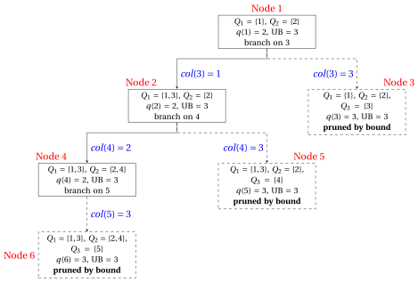

# Vertex coloring: the DSATUR branch-and-bound

**Part 6 · Ad hoc algorithms · Chapter 42** · [:material-file-pdf-box: Lecture notes, volume 6 (PDF)](../pdf/lecture-notes-6-specialized-algorithms.pdf) · [:material-pencil: Exercises: Vertex coloring (VCP)](../exercises/dsatur-branch-and-bound.md)

!!! nota "Prerequisites"

    - From the module <em>Integer linear programming</em>, [Chapter 7 «Branch-and-bound»](https://fabiofurini.github.io/integer-linear-programming/exact-methods/bb/): branching and bounding operations, the problem list, the pruning criteria, the bounds $\LB$ and $\UB$.

    - From this module, [Chapter 4 «Coloring problems»](https://fabiofurini.github.io/combinatorial-optimization/combinatorial-optimization-problems/coloring/): the vertex coloring problem, cliques, stable sets and the clique bound $\omega(G)\le\chi(G)$.

    - From this module, [Chapter 30 «Constructive heuristics»](https://fabiofurini.github.io/combinatorial-optimization/heuristic-algorithms/constructive-heuristics/vertex-coloring-greedy-and-dsatur/): the saturation degree and the $DSATUR$ heuristic.

!!! chiave "Objectives"

    At the end of this chapter you will be able to:

    - describe a node of the tree as a partial coloring, with its colors used and its saturation degrees;

    - branch on the vertex of maximum saturation degree, with one child per feasible color and one new color;

    - compute the upper bound with $DSATUR$, the lower bound with a greedy clique, and prune a node;

    - execute the DSATUR branch-and-bound algorithm by hand and prove that it is exact.

The problem of this chapter is the [vertex coloring problem (VCP)](https://fabiofurini.github.io/combinatorial-optimization/combinatorial-optimization-problems/coloring/the-vertex-coloring-problem/): its definition and its assumptions are on its page. On a graph $G=(V,E)$, its optimal value is the chromatic number $\chi(G)$.

## 42.1 The algorithm for the VCP { #sez-sec-DSATURBB }

!!! definizione "Definition 42.1: branching node and partial coloring"

    In the DSATUR branch-and-bound algorithm, the colors are the integers $1,2,3,\dots$, and a branching node $k$ of the tree is a <strong>partial coloring</strong>:

    1. a subset of <strong>colored vertices</strong> $\rightsquigarrow$ denoted $V^k \subseteq V$;

    2. a color $\mathit{col}^k(v)$ for every $v \in V^k$, with $\mathit{col}^k(u)\neq\mathit{col}^k(v)$ for all $\{u,v\}\in E$, $u,v\in V^k$;

    3. a subset of <strong>uncolored vertices</strong> $\rightsquigarrow$ denoted $U^k := V \setminus V^k$.

    The colors used at node $k$ are $1,2,\dots,q(k)$, where $q(k)$ is the <strong>number of colors used</strong>, and the color classes are $Q^k_c := \{\, v\in V^k : \mathit{col}^k(v)=c \,\}$, $c=1,\dots,q(k)$. For an uncolored vertex $v \in U^k$:

    \begin{align*}
    \mathit{sat}_k(v) &:= \big|\{\, \mathit{col}^k(u) : u \in N(v)\cap V^k \,\}\big| && \text{(\textbf{saturation degree})},\\[1ex]
    \mathit{du}_k(v) &:= |N(v)\cap U^k| && \text{(degree among the uncolored vertices)},\\[1ex]
    F_k(v) &:= \{\, c\in\{1,\dots,q(k)\} : Q^k_c\cap N(v)=\emptyset \,\} && \text{(\textbf{feasible colors})}.
    \end{align*}

- The saturation degree counts the <em>different</em> colors among the colored neighbours of $v$, and $|F_k(v)| = q(k)-\mathit{sat}_k(v)$.

- A node with $U^k=\emptyset$ is a <strong>complete coloring</strong>: a feasible solution of the VCP with $q(k)$ colors.

!!! chiave ""

    A node of the tree is a partial coloring; each child colors one more vertex. No LP problem is solved: the bounds of a node come from counting colors.

### 42.1.1 Branching { #sez-sec-DSATURBBbranch }

- <strong>Branching vertex.</strong> At node $k$ we branch on the uncolored vertex $v$ of <strong>maximum saturation degree</strong> $\mathit{sat}_k(v)$; ties are broken by the largest $\mathit{du}_k(v)$, and then by the smallest index. This is the rule of the $DSATUR$ heuristic (Brélaz, 1979).

- <strong>Children.</strong> The children of node $k$ give a color to $v$:

    1. one child for every feasible color $c\in F_k(v)$, in increasing order of $c$;

    2. one child with the <strong>new color</strong> $q(k)+1$.

- The colors $q(k)+2, q(k)+3,\dots$ are not used: a child with color $q(k)+2$ would differ from the child with color $q(k)+1$ only by the name of an empty color. The children are <strong>no symmetric copies</strong> of each other.

- The most saturated vertex has the fewest children: $|F_k(v)|+1$. If $F_k(v)=\emptyset$, the node has only the child with the new color.

!!! chiave ""

    The branching vertex is the most constrained one; its children are its feasible colors plus one new color, so two children never describe the same coloring with the colors renamed.

### 42.1.2 Bounds and pruning { #sez-sec-DSATURBBbounds }

- The VCP is a minimization problem: the incumbent solution gives the <strong>upper bound</strong> $\UB$, and a lower bound comes from a clique.

- <strong>Upper bound.</strong> Before branching, the $DSATUR$ heuristic of [Chapter 30 «Constructive heuristics»](https://fabiofurini.github.io/combinatorial-optimization/heuristic-algorithms/constructive-heuristics/vertex-coloring-greedy-and-dsatur/) gives the first incumbent solution, and $\UB$ is its number of colors.

- <strong>Greedy clique.</strong> The vertices are scanned by non-increasing degree (ties: smallest index), and a vertex enters $K$ if it is adjacent to all the vertices already in $K$. The set $K=\{k_1,\dots,k_r\}$ is a maximal clique, and $\LB := r \le \omega(G)\le\chi(G)$.

- <strong>Pre-coloring.</strong> The vertices of $K$ need $r$ different colors in every coloring, and the names of the colors are arbitrary: the root node colors $k_i$ with color $i$, $i=1,\dots,r$. This breaks the symmetry of the first $r$ colors.

- <strong>Lower bound of a node.</strong> The colors of a node are never removed in its subtree, so every complete coloring below node $k$ uses at least $q(k)$ colors:

    $$
    \LB(k) \;:=\; \max\{\, q(k),\; |K| \,\} \;=\; q(k),
    $$

    where the equality holds because the clique is pre-colored.

- <strong>Pruning.</strong> The number of colors is an integer, so a node can lead to a better solution only if it uses fewer than $\UB$ colors. Node $k$ is <strong>pruned by bound</strong> if

    $$
    q(k) \;\ge\; \UB .
    $$

- <strong>Complete coloring.</strong> A node with $U^k=\emptyset$ and $q(k)<\UB$ is a new incumbent solution: $\UB \leftarrow q(k)$, and the nodes of the list with $q \ge \UB$ are removed. If $\UB=|K|$, the incumbent solution is optimal and the algorithm stops.

!!! chiave ""

    $DSATUR$ gives $\UB$, a greedy clique gives $\LB$; a node is pruned as soon as it uses $\UB$ colors, because its subtree cannot contain a coloring with fewer colors.

### 42.1.3 Node selection and pseudocode { #sez-sec-DSATURBBalg }

- The tree is explored <strong>depth first</strong>: the list $L$ is a stack, the children of a node are evaluated in increasing order of color, and the child with the smallest color is extracted first.

- The nodes are numbered in the order of evaluation. A child is evaluated as soon as it is created: the evaluation only computes $q$ and checks whether the coloring is complete.

!!! algoritmo "Algorithm"

    - <strong>Input:</strong> a VCP instance, i.e., a graph $G=(V,E)$.

    - <strong>Output:</strong> an optimal coloring and the chromatic number $\chi(G)$.

    - **Step 0:** <strong>Initialization</strong>

        1. Run $DSATUR$: set the incumbent solution to its coloring and $\UB$ to its number of colors.

        2. Find the greedy clique $K=\{k_1,\dots,k_r\}$ and set $\LB \leftarrow r$. If $\LB=\UB$, the incumbent solution is optimal. <code>STOP</code>.

        3. Create node $1$ with $\mathit{col}^1(k_i)=i$, $i=1,\dots,r$, and $q(1)=r$. Insert node $1$ into the list $L$ and set the node counter $c\leftarrow 1$.

    - **Step 1:** <strong>Optimality check</strong>

        If $L$ is empty, $\UB$ is the optimal value and the incumbent solution is optimal. <code>STOP</code>.

    - **Step 2:** <strong>Branching-node selection</strong>

        Remove from $L$ the node $k$ inserted last.

    - **Step 3:** <strong>Branching</strong>

        Select $v\in U^k$ of maximum $\mathit{sat}_k(v)$, then maximum $\mathit{du}_k(v)$, then smallest index. For each color $a\in F_k(v)\cup\{q(k)+1\}$, in increasing order, create node $c+1$ as node $k$ with $\mathit{col}(v)=a$, evaluate it with the <strong>node sub-procedure</strong>, and set $c\leftarrow c+1$. Insert the surviving children into $L$ in decreasing order of color and go to Step 1.

- In Step 3, the counter $c$ of the nodes gives the next free index, and $a$ is the color given to $v$ in the child.

- This is the pseudocode of the <strong>node sub-procedure</strong>.

!!! algoritmo "Algorithm"

    - <strong>Input:</strong> a node $h$, i.e., a partial coloring with $q(h)$ colors.

    - **Step 1:** <strong>Bounding operations</strong>

        1. If $q(h)\ge\UB$, the node is pruned by bound. <code>STOP</code>.

        2. If $U^h=\emptyset$, update the upper bound and the incumbent solution: $\UB\leftarrow q(h)$. Remove from $L$ all the nodes with $q\ge\UB$. If $\UB=\LB$, the incumbent solution is optimal: <code>STOP</code> the algorithm. Otherwise <code>STOP</code>.

    - **Step 2:** <strong>Survival</strong>

        The node survives: it is inserted into $L$ in Step 3. <code>STOP</code>.

### 42.1.4 Correctness { #sez-sec-DSATURBBcorr }

!!! teorema "Proposition 42.2: no-symmetry branching"

    Consider the tree of the DSATUR branch-and-bound algorithm without pruning. Its leaves are complete colorings, and every partition of $V$ into stable sets, i.e., every feasible solution of the VCP, is the set of color classes of <strong>exactly one</strong> leaf.

??? dimostrazione "Proof"

    Let $\mathcal{Q}$ be a partition of $V$ into stable sets. The vertices of the clique $K$ are pairwise adjacent, so they lie in $r$ different classes; we give the name $i$ to the class of $k_i$.

    1. <strong>Existence.</strong> We follow a path from the root and keep this invariant: the classes of the node are the classes of $\mathcal{Q}$ restricted to $V^k$, each with its name. The root satisfies it. At node $k$, let $v$ be the branching vertex and $Q\in\mathcal{Q}$ its class.

        - If $Q$ already has a colored vertex, with name $c$, then no neighbour of $v$ has color $c$, because $Q$ is stable. Hence $c\in F_k(v)$, and the child with color $c$ keeps the invariant.

        - Otherwise $Q$ has no colored vertex yet: the child with the new color $q(k)+1$ keeps the invariant, and $Q$ gets the name $q(k)+1$.

        Every step colors one vertex, so after $|U^1|$ steps we reach a leaf whose classes are $\mathcal{Q}$.

    2. <strong>Uniqueness.</strong> Two different children of a node put $v$ in different classes: with the colored vertices of two different colors, or with one of them and alone. The partition restricted to $V^k\cup\{v\}$ differs, so the leaves below two different children give different partitions. □

- <strong>The algorithm is exact.</strong> A node is pruned only if $q(k)\ge\UB$, and every leaf below it uses at least $q(k)$ colors: no coloring with fewer than $\UB$ colors is lost. When the list is empty, $\UB=\chi(G)$.

- Without the new-color rule, every partition with $q$ classes would appear once for every way of naming its classes with the colors $1,\dots,\UB-1$: the tree would contain many symmetric copies of the same solution.

!!! chiave ""

    Without pruning, the tree enumerates every feasible solution of the VCP exactly once, up to a renaming of the colors. The pruning by bound removes only subtrees with at least $\UB$ colors: the algorithm is exact.

## 42.2 A worked example { #sez-sec-DSATURBBex }

!!! esempio "Example 42.1: DSATUR branch-and-bound on the Petersen graph"

    We consider the Petersen graph, the reference instance of [Chapter 4 «Coloring problems»](https://fabiofurini.github.io/combinatorial-optimization/combinatorial-optimization-problems/coloring/the-vertex-coloring-problem/#box-5-ex-vcp2), with $n=10$ vertices, $m=15$ edges and all degrees equal to $3$:

    $$
    \begin{aligned}
    E = \big\{~ & \{1,2\},~ \{1,5\},~ \{1,6\},~ \{2,3\},~ \{2,7\},~ \{3,4\},~ \{3,8\},~ \{4,5\},\\
    & \{4,9\},~ \{5,10\},~ \{6,8\},~ \{6,9\},~ \{7,9\},~ \{7,10\},~ \{8,10\} ~\big\}.
    \end{aligned}
    $$

    The DSATUR branch-and-bound algorithm uses the rules of Section [42.1](#sez-sec-DSATURBB): branching on the most saturated vertex, depth-first search, children in increasing order of color.

    - <strong>Initialization</strong>

        1. The $DSATUR$ heuristic (Example «$DSATUR$ on the Petersen graph» of [Chapter 30](https://fabiofurini.github.io/combinatorial-optimization/heuristic-algorithms/constructive-heuristics/vertex-coloring-greedy-and-dsatur/#box-17-ex-dsatur)) colors the vertices in the order $1,2,3,4,5,6,8,7,9,10$ and gives the incumbent solution

            $$
            \bar{\mathcal{Q}} = \big\{\, \{1,3,7\},~ \{2,4,6,10\},~ \{5,8,9\} \,\big\}, \qquad \UB = 3 .
            $$

        2. All the degrees are equal, so the greedy clique scans the vertices $1,2,\dots,10$. Vertex $1$ enters, vertex $2$ is adjacent to $1$ and enters, and no other vertex is adjacent to both. Hence $K=\{1,2\}$ and $\LB=2$. The Petersen graph has no triangle, so $\omega(G)=2$.

        3. Node $1$ colors $\mathit{col}^1(1)=1$ and $\mathit{col}^1(2)=2$, with $q(1)=2$. Since $\LB=2<3=\UB$, node $1$ is inserted into the list $L$:

            $$
            2 ~~\le~~ \chi(G) ~~\le~~ 3 .
            $$

    - <strong>Iteration 1</strong>

        Node $1$ is extracted from $L$. The vertices $3,5,6,7$ have one colored neighbour each, so $\mathit{sat}_1=1$; the others have $\mathit{sat}_1=0$. The four tied vertices have $\mathit{du}_1=2$, so the smallest index wins: the branching vertex is $3$. Its neighbour $2$ has color $2$, so $F_1(3)=\{1\}$.

        1. Node $2$: $\mathit{col}(3)=1$, with $q(2)=2<\UB$. The node survives.

        2. Node $3$: $\mathit{col}(3)=3$, the new color, with $q(3)=3\ge\UB$. The node is <u>pruned by bound</u>.

    - <strong>Iteration 2</strong>

        Node $2$ is extracted from $L$, with $Q_1=\{1,3\}$ and $Q_2=\{2\}$. The vertices $4,5,6,7,8$ have $\mathit{sat}_2=1$ and $\mathit{du}_2=2$, and $9,10$ have $\mathit{sat}_2=0$: the branching vertex is $4$. Its neighbour $3$ has color $1$, so $F_2(4)=\{2\}$.

        1. Node $4$: $\mathit{col}(4)=2$, with $q(4)=2<\UB$. The node survives.

        2. Node $5$: $\mathit{col}(4)=3$, with $q(5)=3\ge\UB$. The node is <u>pruned by bound</u>.

    - <strong>Iteration 3</strong>

        Node $4$ is extracted from $L$, with $Q_1=\{1,3\}$ and $Q_2=\{2,4\}$. Vertex $5$ has the neighbours $1$ (color $1$) and $4$ (color $2$): $\mathit{sat}_4(5)=2$, the only vertex with saturation degree $2$, so it is the branching vertex. Its feasible colors are $F_4(5)=\emptyset$.

        1. Node $6$: $\mathit{col}(5)=3$, the only child, with $q(6)=3\ge\UB$. The node is <u>pruned by bound</u>.

        The partial coloring of node $4$ is drawn below: the cycle $1,2,3,4,5$ has five vertices, and two colors are not enough to close it.

        { .fig loading=lazy  }

    - <strong>Termination</strong>

        The list $L$ is empty: the incumbent solution $\bar{\mathcal{Q}}$ is optimal and $\chi(G)=\UB=3$. The tree has $6$ nodes.

    This is the branch-and-bound tree, showing for each node its color classes, the number of colors $q$, the upper bound $\UB$ at the moment of the evaluation, and the branching vertex or the pruning criterion. The pruned nodes are dashed.

    { .fig loading=lazy  }

    The nodes in the order of evaluation:

    
<table>
    <tr>
    <th>Node</th>
    <th>Parent</th>
    <th>Child</th>
    <th>\(q\)</th>
    <th>\(\UB\)</th>
    <th>Branching vertex</th>
    <th>Outcome</th>
    </tr>
    <tr>
    <td>\(1\)</td>
    <td>–</td>
    <td>root, \(K=\{1,2\}\)</td>
    <td>\(2\)</td>
    <td>\(3\)</td>
    <td>\(3\) (\(\mathit{sat}=1\), \(\mathit{du}=2\))</td>
    <td>branched</td>
    </tr>
    <tr>
    <td>\(2\)</td>
    <td>\(1\)</td>
    <td>\(\mathit{col}(3)=1\)</td>
    <td>\(2\)</td>
    <td>\(3\)</td>
    <td>\(4\) (\(\mathit{sat}=1\), \(\mathit{du}=2\))</td>
    <td>branched</td>
    </tr>
    <tr>
    <td>\(3\)</td>
    <td>\(1\)</td>
    <td>\(\mathit{col}(3)=3\)</td>
    <td>\(3\)</td>
    <td>\(3\)</td>
    <td>–</td>
    <td>pruned by bound</td>
    </tr>
    <tr>
    <td>\(4\)</td>
    <td>\(2\)</td>
    <td>\(\mathit{col}(4)=2\)</td>
    <td>\(2\)</td>
    <td>\(3\)</td>
    <td>\(5\) (\(\mathit{sat}=2\), \(\mathit{du}=1\))</td>
    <td>branched</td>
    </tr>
    <tr>
    <td>\(5\)</td>
    <td>\(2\)</td>
    <td>\(\mathit{col}(4)=3\)</td>
    <td>\(3\)</td>
    <td>\(3\)</td>
    <td>–</td>
    <td>pruned by bound</td>
    </tr>
    <tr>
    <td>\(6\)</td>
    <td>\(4\)</td>
    <td>\(\mathit{col}(5)=3\)</td>
    <td>\(3\)</td>
    <td>\(3\)</td>
    <td>–</td>
    <td>pruned by bound</td>
    </tr>
    </table>

- The algorithm does not improve the incumbent solution: it proves that $\UB=3$ is optimal. The proof is the odd cycle $1,2,3,4,5$, found by the search in three levels.

- Without the pruning, the tree of the Petersen graph has $9\,776$ nodes and $7\,430$ leaves, one for each feasible partition counted in [Chapter 4](https://fabiofurini.github.io/combinatorial-optimization/combinatorial-optimization-problems/coloring/the-vertex-coloring-problem/), as [Proposition 42.2](#box-2-prop-nosym) predicts.

## 42.3 Remarks { #sez-sec-DSATURBBrem }

- <strong>Origin.</strong> The saturation degree and the exact algorithm that branches on it are due to Brélaz (1979). Pre-coloring a clique is the usual way to remove the symmetry of the first colors.

- <strong>Sewell's tie-breaking (1996).</strong> Among the vertices of maximum saturation degree, Sewell chooses the vertex $v$ that maximizes the number of feasible colors it shares with its uncolored neighbours, $\sum_{u\in N(v)\cap U^k} |F_k(v)\cap F_k(u)|$. Coloring that vertex removes the most options from the rest of the graph.

- <strong>PASS (San Segundo, 2012).</strong> PASS applies Sewell's rule only to selected vertices, computing the count over the vertices tied for the maximum saturation degree, which is cheaper. Both rules change only the tie-breaking: the children, the bounds and [Proposition 42.2](#box-2-prop-nosym) stay the same.

- References: D. Brélaz, «New methods to color the vertices of a graph», <em>Communications of the ACM</em> 22(4), 251–256, 1979; E. C. Sewell, «An improved algorithm for exact graph coloring», in D. S. Johnson, M. A. Trick (eds.), <em>Cliques, Coloring, and Satisfiability</em>, DIMACS Series in Discrete Mathematics and Theoretical Computer Science 26, 1996; P. San Segundo, «A new DSATUR-based algorithm for exact vertex coloring», <em>Computers &amp; Operations Research</em> 39(7), 1724–1733, 2012.

## 42.4 Typical mistakes

!!! attenzione "Warning"

    - <strong>Counting colored neighbours instead of colors.</strong> The saturation degree counts the <em>different</em> colors around $v$: two neighbours with the same color count once.

    - <strong>One child per color $1,\dots,\UB-1$.</strong> The unused colors are all equivalent: only the first new color $q(k)+1$ gives a child, otherwise the tree contains symmetric copies of the same coloring.

    - <strong>Forgetting the new color.</strong> The child with color $q(k)+1$ is always created, even when $F_k(v)\neq\emptyset$; without it some colorings are never reached.

    - <strong>Pruning with $q(k)>\UB$.</strong> A node with $q(k)=\UB$ cannot lead to a better coloring, because the number of colors is an integer: the rule is $q(k)\ge\UB$.

    - <strong>Pre-coloring a set that is not a clique.</strong> Only the vertices of a clique need pairwise different colors in every coloring; pre-coloring two non-adjacent vertices with different colors can cut off all the optimal colorings.

    - <strong>Continuing after $\UB=|K|$.</strong> When a complete coloring reaches the clique bound, it is optimal: the nodes still in the list are not explored.

## 42.5 In summary

!!! chiave "In summary"

    - A node of the DSATUR branch-and-bound is a partial coloring; the algorithm branches on the most saturated vertex, with one child per feasible color and one new color.

    - $DSATUR$ gives the first upper bound, a greedy clique gives the lower bound and is pre-colored; a node is pruned when $q(k)\ge\UB$.

    - Without pruning the tree enumerates every feasible coloring once, up to a renaming of the colors: the algorithm is exact.

    <strong>Dashboard of the Petersen graph</strong> ($n=10$, $m=15$). The bounds on $\chi(G)$ found so far:

    
<table>
    <tr>
    <th>Source</th>
    <th>Lower bound</th>
    <th>Upper bound</th>
    <th>From</th>
    </tr>
    <tr>
    <td>Clique bound (Chapter 4)</td>
    <td>\(2\)</td>
    <td>–</td>
    <td>\(\omega(G)=2\)</td>
    </tr>
    <tr>
    <td>\(DSATUR\) (Chapter 30)</td>
    <td>–</td>
    <td>\(3\)</td>
    <td>\(\{1,3,7\}\), \(\{2,4,6,10\}\), \(\{5,8,9\}\)</td>
    </tr>
    <tr>
    <td>This chapter, initialization</td>
    <td>\(2\)</td>
    <td>\(3\)</td>
    <td>greedy clique \(K=\{1,2\}\)</td>
    </tr>
    <tr>
    <td>This chapter, termination</td>
    <td>\(3\)</td>
    <td>\(3\)</td>
    <td>empty list, \(6\) nodes</td>
    </tr>
    </table>

---

**Exercises on this chapter:** [:material-pencil: Vertex coloring (VCP)](../exercises/dsatur-branch-and-bound.md)
