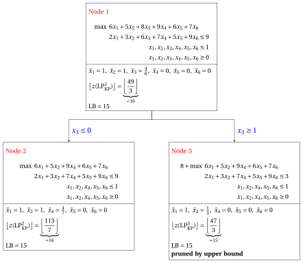
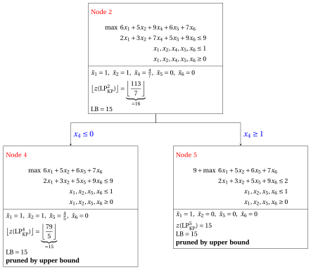
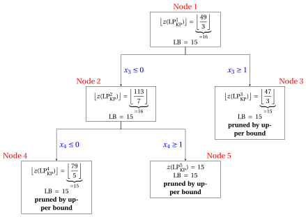

# Knapsack: branch-and-bound on the critical item

**Part 6 · Ad hoc algorithms · Chapter 38** · [:material-file-pdf-box: Lecture notes, volume 6 (PDF)](../pdf/lecture-notes-6-specialized-algorithms.pdf) · [:material-pencil: Exercises: Knapsack](../exercises/knapsack-branch-and-bound.md) · [:material-gesture-tap: App: Branch-and-bound for the knapsack](../lab/knapsack-branch-and-bound.md)

!!! nota "Prerequisites"

    - From the module <em>Integer linear programming</em>, [Chapter 7 «Branch-and-bound»](https://fabiofurini.github.io/integer-linear-programming/exact-methods/bb/): branching and bounding operations, the problem list, the pruning criteria, the lower bound $\LB$ and the upper bound $\UB$. The general algorithm is applied here to the knapsack problem.

    - From this module, the chapter «Knapsack formulations»: the models $\mathrm{ILP}_{\mathrm{KP}}$ and $\mathrm{LP}_{\mathrm{KP}}$, the efficiency of an item, the split item $s$, the residual capacity $\mathit{rc}$ and the bound of Dantzig.

!!! chiave "Objectives"

    At the end of this chapter you will be able to:

    - write the problem $\mathrm{LP}_{\mathrm{KP}}^k$ of a node, and solve it with the formulas of Dantzig, without the simplex algorithm;

    - branch on the variable of the split item, unselecting or selecting that item;

    - execute the branch-and-bound algorithm for the KP by hand, with the FIFO or the LIFO rule;

    - explain why the algorithm is simpler than the general one, and what stays the same.

## 38.1 The algorithm for the KP

!!! definizione "Definition 38.1: branching node and $\mathrm{LP}_{\mathrm{KP}}^k$ problem"

    In the branch-and-bound algorithm for the $\mathrm{ILP}_{\mathrm{KP}}$ model, the branching constraints on a variable $x_j$, $j \in \mathscr{I}$, are $x_j \le 0$ and $x_j \ge 1$. In a branching node $k$ of the branch-and-bound tree, we have:

    1. a subset of <strong>unselected  items</strong> $\rightsquigarrow$  denoted $\mathscr{I}_\text{out}^k$

    2. a  subset  of <strong>selected items</strong> $\rightsquigarrow$  denoted $\mathscr{I}_\text{in}^k$

    3. a subset of <strong>remaining items</strong> $\rightsquigarrow$  denoted  $\mathscr{I}^k := \mathscr{I} \setminus \left\{\mathscr{I}^k_\text{out} \cup \mathscr{I}^k_\text{in} \right\}$

    The $\mathrm{LP}_{\mathrm{KP}}$ problem associated to node $k$, called the $\mathrm{LP}_{\mathrm{KP}}^k$ problem, reads as follows:

    \begin{align*}
    &&    \max \;\;{\sum_{j \in \mathscr{I}} p_j \, x_j}                                \\[1.5ex]
    && \text{subject to} \quad  {\sum_{j \in \mathscr{I}} w_j \, x_j}  &\leq c,                        \\[1.5ex]
    && x_j                        &\ge  1, & \forall j \in \mathscr{I}^k_\text{in},\\[1.5ex]
    && x_j                        &\le  0, & \forall j \in \mathscr{I}^k_\text{out},\\[1.5ex]
    && x_j                        &\le  1, & \forall j \in \mathscr{I},\\[1.5ex]
    &&x_j                        &\ge  0, & \forall j \in \mathscr{I}.
    \end{align*}

- The branching constraints $x_j \le 0$ and $x_j \ge 1$ have the effect of <strong>unselecting</strong> or <strong>selecting</strong> an item.

!!! chiave ""

    A $\mathrm{LP}_{\mathrm{KP}}^k$ problem of a branching node $k$ can be equivalently re-written as:

    \begin{align*}
    &&   \underbrace{ \sum_{j \in \mathscr{I}^k_\text{in} } p_j}_{=p(k)}  +  \max \;\;{\sum_{j \in  \mathscr{I}^k } p_j \, x_j}                              \label{eq:KP-obj_LP}  \tag{38.1a}\\[2ex]
    && \text{subject to} \quad  {\sum_{j \in  \mathscr{I}^k} w_j \, x_j}  &\leq \underbrace{c - \sum_{j \in \mathscr{I}^k_\text{in} } w_j}_{=c(k)},                       \label{eq:KP-cap_LP}  \tag{38.1b}\\[2ex]
    &&  x_j                        &\le  1, & \forall j \in  \mathscr{I}^k, \tag{38.1c}\\[2ex]
    && x_j                        &\ge  0, & \forall j \in  \mathscr{I}^k. \label{eq:KP-bin_LP} \tag{38.1d}
    \end{align*}

- A $\mathrm{LP}^k_{\mathrm{KP}}$  problem of a branching node $k$ is <strong>structurally equivalent</strong> to  the  $\mathrm{LP}_{\mathrm{KP}}$ problem but:

    1. the set of items is $\mathscr{I}^k$ instead of $\mathscr{I}$

    2. the capacity is reduced to $c(k):=c - \sum_{j \in \mathscr{I}^k_\text{in} } w_j$

    3. there is an objective-function constant  $p(k):=\sum_{j \in \mathscr{I}^k_\text{in} } p_j$

### 38.1.1 Solving the $\mathrm{LP}_{\mathrm{KP}}^k$ problem of a node

- The problem $\mathrm{LP}_{\mathrm{KP}}^k$ is a knapsack LP problem on the items of $\mathscr{I}^k$, with capacity $c(k)$: it is solved by the formulas of Dantzig, without any simplex iteration. The items of $\mathscr{I}^k$ are kept in the order of non-increasing efficiency.

- If $c(k)<0$ the problem is <strong>infeasible</strong>. If $\sum_{j\in\mathscr{I}^k} w_j \le c(k)$ all the items of $\mathscr{I}^k$ fit, and the optimal solution is $\tilde{x}_j=1$ for all $j\in\mathscr{I}^k$: it is integer.

- Otherwise the <strong>split item</strong> $s$ of the node is the first item of $\mathscr{I}^k$ that does not fit entirely, and the <strong>residual capacity</strong> is the capacity left by the items that precede it:

    $$
    \sum_{j\in\mathscr{I}^k,\,j<s} w_j \le c(k) < \sum_{j\in\mathscr{I}^k,\,j\le s} w_j,
    \qquad
    \mathit{rc}=c(k)-\sum_{j\in\mathscr{I}^k,\,j<s} w_j .
    $$

- The optimal solution is $\tilde{x}_j=1$ for the items of $\mathscr{I}^k$ before $s$, $\tilde{x}_s=\frac{\mathit{rc}}{w_s}$ and $\tilde{x}_j=0$ for the items after $s$, and the optimal value is

    $$
    z(\mathrm{LP}_{\mathrm{KP}}^k) \;=\; p(k)+\sum_{j\in\mathscr{I}^k,\,j<s} p_j + p_s\,\frac{\mathit{rc}}{w_s}.
    $$

!!! chiave ""

    In every node at most one variable is fractional, the one of the split item, and the value of the node is the Dantzig bound of a smaller knapsack: the node is solved by a scan of the items.

### 38.1.2 Branching-variable selection strategy

- The optimal solution of an $\mathrm{LP}_{\mathrm{KP}}^k$ problem given by the formulas of the previous subsection has at most one fractional variable, the one associated to the split item. <strong>Branching can be performed on the variable associated to the split item</strong>: this branching-variable selection strategy is called split-item strategy.

- The optimal solution of an $\mathrm{LP}_{\mathrm{KP}}$ problem is not unique when some items have equal efficiency: the other optimal solutions can have more fractional variables, for instance $x=(\frac12,\frac12)$ for $p=(2,2)$, $w=(2,2)$, $c=2$. Here, as in the general algorithm, we always use the solution given by the formulas.

### 38.1.3 What changes with respect to the general algorithm

- The algorithm is the LP-based branch-and-bound algorithm of the module <em>Integer linear programming</em> ([Chapter 7 «Branch-and-bound»](https://fabiofurini.github.io/integer-linear-programming/exact-methods/bb/)), with its problem list, its pruning criteria and its optimality gap.

- <strong>Bounding.</strong> The problem of a node is solved by the formulas above. All the profits are integer, so the bound of a node is $\lfloor z(\mathrm{LP}_{\mathrm{KP}}^k)\rfloor$: the node is pruned by bound if $\lfloor z(\mathrm{LP}_{\mathrm{KP}}^k)\rfloor \le \LB$, by infeasibility if $c(k)<0$, by integrality if its solution is integer (then $\LB$ is updated when the value is larger).

- <strong>Branching.</strong> The branching variable is the one of the split item $s$: the children are $x_s\le 0$ (down, item unselected) and $x_s\ge 1$ (up, item selected), and the node is not solved with a simplex tableau but described by the sets $\mathscr{I}^k_\text{in}$, $\mathscr{I}^k_\text{out}$ and $\mathscr{I}^k$.

- <strong>Node selection.</strong> The node of the problem list is extracted with the FIFO or the LIFO rule, and the down-branching node is solved before the up-branching node; the nodes are numbered in the order of resolution. The lower bound written in a node is the value at the moment of its resolution.

## 38.2 A worked example

!!! esempio "Example 38.1: The $\mathrm{ILP}_{\mathrm{KP}}$ model"

    We consider a knapsack of capacity $c = 9$ and a set $\mathscr{I} = \{1,2,3,4,5,6\}$ of $6$ items ($n = 6$), with the following profits and weights:

    $$
    \begin{array}{l|rrrrrrr}
    \hline  & {j = 1} & {j = 2} & {j = 3} & {j = 4} & {j = 5} & {j = 6} \\
    \hline {p_j} & {6} & {5} & {8} & {9} & {6} & {7} \\
    {w_j} & {2} & {3} & {6} & {7} & {5} & {9} \\
    \hline
    \end{array}
    $$

    We refer to this KP instance as Example 1. The  $\mathrm{ILP}_{\mathrm{KP}}$ model for this KP instance is:

    $$
    \begin{array}{rrrrrrrrrrrrr}
    {\max} & 6 \, {x_1} & + 5 \, {x_2} & + 8 \, {x_3} & + 9 \, {x_4} & + 6 \, {x_5} & + 7 \, {x_6} \\[0.5ex]
    \text{subject to} & 2 \, {x_1} & + 3 \, {x_2} & + 6 \, {x_3} & + 7 \, {x_4} & + 5 \, {x_5} & + 9 \, {x_6} & {\le} & 9 \\[0.5ex]
    & {x_1}, & {x_2}, & {x_3}, & {x_4}, & {x_5}, & {x_6} & { \in} & { \{0,1\}}
    \end{array}
    $$

    An optimal solution $~{\tilde{\vet x}}(\,\mathrm{ILP}_{\mathrm{KP}}\,)$  is:

    $$
    \tilde x_1=1,~~\tilde x_2=0,~~\tilde  x_3=0,~~\tilde  x_4=1,~~\tilde  x_5=0,~~\tilde  x_6=0
    $$

    The optimal value $z(\mathrm{ILP}_{\mathrm{KP}})$  is $15$. The associated optimal solution of the KP is $\tilde{S} =\{1,4\}$. 

    The items are sorted by non-increasing efficiency, since:

    $$
    \frac{6}{2} ~~\ge~~ \frac{5}{3} ~~\ge~~ \frac{8}{6} ~~\ge~~ \frac{9}{7} ~~\ge~~ \frac{6}{5} ~~\ge~~ \frac{7}{9}
    $$

!!! esempio "Example 38.2: Branch-and-bound algorithm for the $\mathrm{ILP}_{\mathrm{KP}}$ model"

    A branch-and-bound algorithm for $\mathrm{ILP}_{\mathrm{KP}}$ model and the KP instance of Example 1 using:

    1. the split-item strategy as branching-variable selection strategy;

    2. the FIFO rule as branching-node selection strategy;

    3. solve first the down-branching node and then the up-branching node;

    4. set the incumbent solution $\bar{\vet x}(\mathrm{ILP}_{\mathrm{KP}})$ to the following  heuristic solution:

        $$
        \bar{x}_1=1, ~~~ \bar{x}_2=0,~~~ \bar{x}_3= 0,~~\bar{x}_4=1,~~\bar{x}_5=0,~~\bar{x}_6=0
        $$

        and set the lower bound $\LB$ accordingly.

    - <strong>Initialization</strong>

        For the $\mathrm{LP}^1_{\mathrm{KP}}$ problem, the split item is $s=3$ and the residual capacity is $\mathit{rc} = 4$. An  optimal solution $\tilde{\vet x}(\,\mathrm{LP}^1_{\mathrm{KP}}\,)$ is:

        $$
        \tilde{x}_1=1,~~\tilde{x}_2=1,~~\tilde{x}_3=\frac{2}{3},~~\tilde{x}_4=0,~~\tilde{x}_5=0,~~\tilde{x}_6=0
        $$

        the optimal value is:

        $$
        z(~\mathrm{LP}^1_{\mathrm{KP}}~) = 6 \cdot 1 + 5 \cdot 1 +  8 \cdot \frac{2}{3} =\frac{49}{3}
        $$

        The optimal solution $\tilde{\vet x}(\,\mathrm{LP}^1_{\mathrm{KP}}\,)$ is <strong>fractional</strong> and the $\mathrm{LP}^1_{\mathrm{KP}}$ problem is <strong>feasible</strong>, so the $\mathrm{LP}^1_{\mathrm{KP}}$ problem is inserted in the problem list $L$ and the lower bound $\LB$ is set to $15$ ($\LB(\bar{\vet x})= 15$).

        Due to the current lower bound $\LB$ and upper bound $\UB$, we have:

        $$
        15 ~~\le~~ z(\mathrm{ILP}_{\mathrm{KP}}) ~~\le~~  \underbrace{\left\lfloor \dfrac{49}{3} \right\rfloor}_{=16}
        $$

    - <strong>Iteration  1</strong>

        The $\mathrm{LP}^1_{\mathrm{KP}}$ problem is extracted and deleted from the problem list $L$.

        The branching variable is $x_3$. The $\mathrm{LP}^2_{\mathrm{KP}}$ and $\mathrm{LP}^3_{\mathrm{KP}}$ problems are created by unselecting ($x_3 \le 0$) and selecting ($x_3 \ge 1$) item $3$.

        1. Solution of the $\mathrm{LP}^2_{\mathrm{KP}}$ problem

            We have

            $$
            \mathscr{I}^2 = \{1,2,4,5,6\},~~~\mathscr{I}^2_\text{out} = \{3\}, ~~~\mathscr{I}^2_\text{in} = \emptyset
            $$

            The capacity is $c(2)=9$ and the objective-function constant is $p(2)=0$. The split item is $s=4$ and the residual capacity is $\mathit{rc} = 4$. An  optimal solution $\tilde{\vet x}(\,\mathrm{LP}^2_{\mathrm{KP}}\,)$ is:

            $$
            \tilde{x}_1=1,~~\tilde{x}_2=1,~~\tilde{x}_4=\frac{4}{7},~~\tilde{x}_5=0,~~\tilde{x}_6=0
            $$

            and

            $$
            z(~\mathrm{LP}^2_{\mathrm{KP}}~) =   6 \cdot 1 + 5 \cdot 1 + 9 \cdot \frac{4}{7} = \frac{113}{7}
            $$

            The $\mathrm{LP}^2_{\mathrm{KP}}$ problem is <strong>feasible</strong> and we have:

            $$
            \left\lfloor z(\mathrm{LP}^2_{\mathrm{KP}}) \right\rfloor > \LB
            \qquad \text{since} \qquad
            \underbrace{\left\lfloor\frac{113}{7} \right\rfloor}_{ = 16} >15
            $$

            The optimal solution $\tilde{\vet x}(\,\mathrm{LP}^2_{\mathrm{KP}}\,)$ is <strong>fractional</strong>, accordingly, the $\mathrm{LP}^2_{\mathrm{KP}}$ problem is <strong>inserted in the problem list</strong> $L$.

        2. Solution of the $\mathrm{LP}^3_{\mathrm{KP}}$ problem

            We have

            $$
            \mathscr{I}^3 = \{1,2,4,5,6\},~~~\mathscr{I}^3_\text{out} = \emptyset, ~~~\mathscr{I}^3_\text{in} = \{3\}
            $$

            The capacity is $c(3)=3$ and the objective-function constant is $p(3)=8$. The split item is $s=2$ and the residual capacity is $\mathit{rc} = 1$. An  optimal solution $\tilde{\vet x}(\,\mathrm{LP}^3_{\mathrm{KP}}\,)$ is:

            $$
            \tilde{x}_1=1,~~\tilde{x}_2=\frac{1}{3},~~\tilde{x}_4=0,~~\tilde{x}_5=0,~~\tilde{x}_6=0 \text{   and   }  z(~\mathrm{LP}^3_{\mathrm{KP}}~) =  8 + 6 \cdot 1 + 5 \cdot \frac{1}{3} = \frac{47}{3}
            $$

            The $\mathrm{LP}^3_{\mathrm{KP}}$ problem is <strong>feasible</strong> and we have:

            $$
            \left\lfloor z(\mathrm{LP}^3_{\mathrm{KP}}) \right\rfloor \le \LB
            \qquad \text{since} \qquad
            \underbrace{\left\lfloor\frac{47}{3} \right\rfloor}_{ = 15} \le 15
            $$

            accordingly, the branching node is <u>pruned by upper bound</u>.

        At the end of the first iteration, Node 2 is inserted in the problem list $L$, while Node 3 is pruned by upper bound. The corresponding branch-and-bound tree is:

        { .fig loading=lazy  }

        Due to the current lower bound $\LB$ and upper bound $\UB$, we have:

        $$
        15 ~~\le~~ z(\mathrm{ILP}_{\mathrm{KP}}) ~~\le~~  \underbrace{\left\lfloor \dfrac{113}{7} \right\rfloor}_{=16}
        $$

    - <strong>Iteration  2</strong>

        The $\mathrm{LP}^2_{\mathrm{KP}}$ problem is extracted and deleted from the problem list $L$.

        The branching variable is $x_4$. The $\mathrm{LP}^4_{\mathrm{KP}}$ and $\mathrm{LP}^5_{\mathrm{KP}}$ problems are created by unselecting ($x_4 \le 0$) and selecting ($x_4 \ge 1$) item $4$.

        1. Solution of the $\mathrm{LP}^4_{\mathrm{KP}}$ problem

            We have

            $$
            \mathscr{I}^4 =  \{1,2,5,6\},~~~\mathscr{I}^4_\text{out} = \{3,4\}, ~~~\mathscr{I}^4_\text{in} = \emptyset
            $$

            The capacity is $c(4)=9$ and the objective-function constant is $p(4)=0$. The split item is $s=5$ and the residual capacity is $\mathit{rc} = 4$. An  optimal solution $\tilde{\vet x}(\,\mathrm{LP}^4_{\mathrm{KP}}\,)$ is:

            $$
            \tilde{x}_1=1,~~\tilde{x}_2=1,~~\tilde{x}_5=\frac{4}{5},~~\tilde{x}_6=0 \text{   and   }  z(~\mathrm{LP}^4_{\mathrm{KP}}~) = 6 \cdot 1 + 5 \cdot 1 + 6 \cdot \frac{4}{5} = \frac{79}{5}
            $$

            The $\mathrm{LP}^4_{\mathrm{KP}}$ problem is <strong>feasible</strong> and we have:

            $$
            \left\lfloor z(\mathrm{LP}^4_{\mathrm{KP}}) \right\rfloor \le  \LB
            \qquad \text{since} \qquad
            \underbrace{\left\lfloor\frac{79}{5} \right\rfloor}_{ = 15} \le 15
            $$

            accordingly, the branching node is <u>pruned by upper bound</u>.

        2. Solution of the $\mathrm{LP}^5_{\mathrm{KP}}$ problem

            We have

            $$
            \mathscr{I}^5 = \{1,2,5,6\},~~~\mathscr{I}^5_\text{out} = \{3\}, ~~~\mathscr{I}^5_\text{in}= \{4\}
            $$

            The capacity is $c(5)=2$ and the objective-function constant is $p(5)=9$. The split item is $s=2$ and the residual capacity is $\mathit{rc} = 0$. An  optimal solution $\tilde{\vet x}(\,\mathrm{LP}^5_{\mathrm{KP}}\,)$ is:

            $$
            \tilde{x}_1=1,~~\tilde{x}_2=0,~~\tilde{x}_5=0,~~\tilde{x}_6=0 \text{   and   }  z(~\mathrm{LP}^5_{\mathrm{KP}}~) = 9 + 6 \cdot 1  =  15
            $$

            The $\mathrm{LP}^5_{\mathrm{KP}}$ problem is <strong>feasible</strong> and we have:

            $$
            \left\lfloor z(\mathrm{LP}^5_{\mathrm{KP}}) \right\rfloor \le \LB
            \qquad \text{since} \qquad
            15 \le 15
            $$

            accordingly, the branching node is <u>pruned by upper bound</u>. The optimal solution of the $\mathrm{LP}^5_{\mathrm{KP}}$ problem is also integer, but its value does not improve the incumbent solution: the node is pruned by bound, as the other nodes of this example.

        At the end of the second iteration, Node 4 and Node 5 are both pruned by upper bound. The corresponding branch-and-bound tree is:

        { .fig loading=lazy  }

    - <strong>Termination</strong>

        Since the problem list $L$ is empty, the $\mathrm{ILP}_{\mathrm{KP}}$ problem is solved to optimality.

        The optimal value is $z(\mathrm{ILP}_{\mathrm{KP}})=15$ (the value of the lower bound $\LB$) and an optimal solution $\tilde{\vet x}(\,\mathrm{ILP}_{\mathrm{KP}}\,)$  is $\tilde  x_1=1,\tilde  x_2=0,\tilde  x_3=0,\tilde  x_4=1,\tilde  x_5=0,\tilde  x_6=0$ (the incumbent solution ${\bar{\vet x}}(ILP_{\text{KP}})$).

    This is the branch-and-bound tree of the previous B&amp;B Algorithm, showing for each branching node the associated $\mathrm{LP}_{\mathrm{KP}}$ problem, its optimal solution and value, the lower bound $\LB$, and the pruning criteria.

    { .fig loading=lazy  }

## 38.3 Typical mistakes

!!! attenzione "Warning"

    - <strong>Forgetting the upper bounds $x_j\le 1$.</strong> Without them the LP problem of a node would put all the capacity on the item of best efficiency: the node boxes must contain $x_j\le 1$.

    - <strong>Computing the split item on the original instance.</strong> In a node, the split item and the residual capacity are computed on the items of $\mathscr{I}^k$ with the capacity $c(k)$, after fixing the items of $\mathscr{I}^k_\text{in}$ and $\mathscr{I}^k_\text{out}$.

    - <strong>Forgetting the constant $p(k)$.</strong> The value of the node is $p(k)$ plus the value of the items of $\mathscr{I}^k$: the profit of the selected items counts.

    - <strong>Using the old lower bound.</strong> The lower bound is updated as soon as a node has an integer solution of larger value; the nodes of the list that become dominated are discarded.

    - <strong>Numbering the skipped children.</strong> A child that is not solved does not receive a node index, exactly as in the general algorithm.

## 38.4 In summary

!!! chiave "In summary"

    - The branch-and-bound algorithm for the KP is the LP-based algorithm with two simplifications: the problem of every node is solved by the formulas of Dantzig, and the branching variable is the one of the split item.

    - A node is described by the sets $\mathscr{I}^k_\text{in}$, $\mathscr{I}^k_\text{out}$ and $\mathscr{I}^k$, by the capacity $c(k)$ and by the constant $p(k)$.

    - The bound of a node is $\lfloor z(\mathrm{LP}_{\mathrm{KP}}^k)\rfloor$; when the problem list is empty the lower and the upper bound coincide and the incumbent solution is optimal.

    <strong>Dashboard of the KP instance of Example 1</strong> ($c=9$, $p=(6,5,8,9,6,7)$, $w=(2,3,6,7,5,9)$). The bounds on $z(\mathrm{ILP}_{\mathrm{KP}})$ found so far:

    
<table>
    <tr>
    <th>Source</th>
    <th>Lower bound</th>
    <th>Upper bound</th>
    <th>From</th>
    </tr>
    <tr>
    <td>Dantzig bound</td>
    <td>–</td>
    <td>\(16\)</td>
    <td>\(\left\lfloor \frac{49}{3} \right\rfloor\)</td>
    </tr>
    <tr>
    <td>This chapter, initialization</td>
    <td>\(15\)</td>
    <td>\(16\)</td>
    <td>heuristic solution \(\{1,4\}\)</td>
    </tr>
    <tr>
    <td>This chapter, iteration \(1\)</td>
    <td>\(15\)</td>
    <td>\(16\)</td>
    <td>node \(2\) in the list, \(\left\lfloor \frac{113}{7} \right\rfloor\)</td>
    </tr>
    <tr>
    <td>This chapter, termination</td>
    <td>\(15\)</td>
    <td>\(15\)</td>
    <td>empty list, \(5\) nodes</td>
    </tr>
    </table>

---

**Exercises on this chapter:** [:material-pencil: Knapsack](../exercises/knapsack-branch-and-bound.md)

<!-- laboratorio-interattivo: sezione generata da interattivi.py -->

:material-flask-outline: **In the interactive lab:** [Branch-and-bound for the knapsack](../lab/knapsack-branch-and-bound.md).